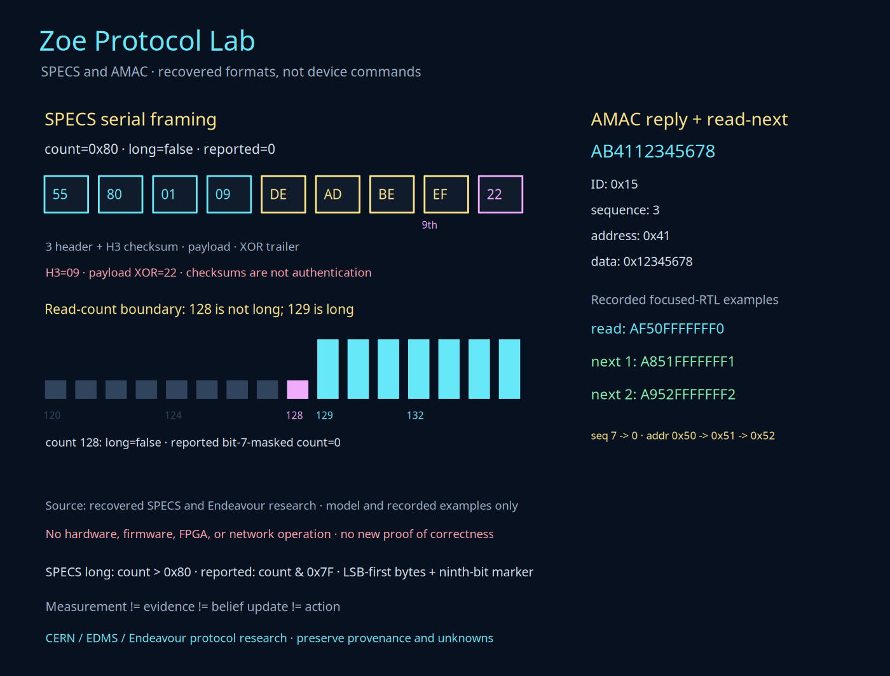

# ZVA-0304 — Zoe Protocol

[Visual archive index](../../README.md) · [Full catalog](../README.md) · [Category: Research figures and measurements](../categories/research-figure.md)

## What this image shows

Zoe Protocol Lab. This visual belongs to Zoe’s CERN/source-evidence program, helping a reader inspect a corpus, protocol, replay, virtual system, or process boundary.

## Role in Zoe

This visual belongs to Zoe’s CERN/source-evidence program, helping a reader inspect a corpus, protocol, replay, virtual system, or process boundary.

## Provenance and evidence boundary

**Provenance:** Zoe/allgems project-generated visual.

The image is preserved with its source context; the visual alone does not prove a scientific or operational claim.

## File identity

- Archive ID: **ZVA-0304**
- Visual family: **zoe-protocol**
- Dimensions/format: **1400×1064 PNG**
- Frames: **1**
- Bytes: **141,766**
- SHA-256: `1d90a2f2c11ffdc19056bb27563e28809d462d3141701a81b1e58399471e5ca6`
- Original file: [Open full resolution](../../images/ZVA-0304.png)

## Source occurrences

Byte-identical copies are archived once while every known source path remains recorded.

| Source repository/collection | Original path | Canonical link |
|---|---|---|
| zoe | `guiai-lab/docs/images/zoe-protocol.png` | [Source](https://github.com/Ablation-Tool/zoe/blob/main/guiai-lab/docs/images/zoe-protocol.png) |
| zoe-autonomy | `paper/unified/figures/protocol.png` | [Source](https://github.com/Ablation-Tool/Zoe-Autonomy/blob/main/paper/unified/figures/protocol.png) |
| next-token | `paper/unified/figures/protocol.png` | [Source](https://github.com/Ablation-Tool/next-token-predictability/blob/main/paper/unified/figures/protocol.png) |
| paper-source-figures | `02-unified-autonomy/figures/protocol.png` | [Source](https://github.com/Ablation-Tool/research-papers) |

## Documented context

### Creative and conceptual instruments

Source document: `zoe:README.md`

Zoe Protocol Lab

### Geometry and evidence

Source document: `zoe:guiai-lab/docs/VISUAL-GUIDES.md`

SPECS and AMAC protocol evidence

Zoe Presence self-model{width=72%} **Zoe Protocol Lab**

## Related format/size variants

- [ZVA-0305](ZVA-0305.md)
