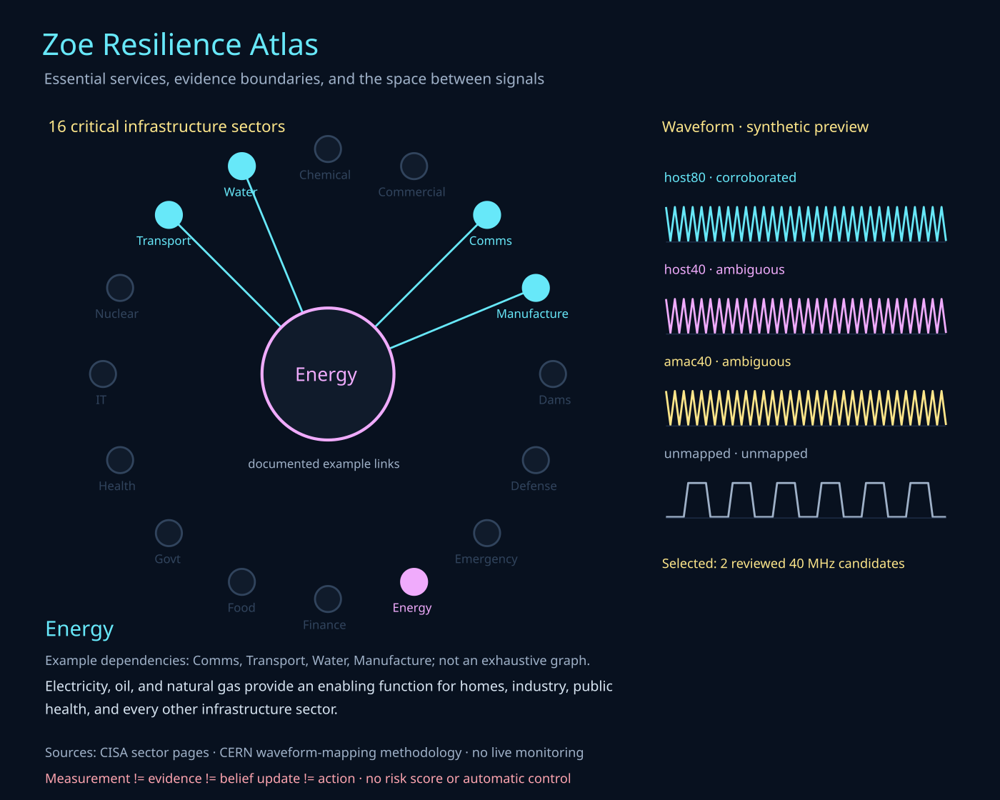

# ZVA-0311 — Zoe Resilience

[Visual archive index](../../README.md) · [Full catalog](../README.md) · [Category: Research figures and measurements](../categories/research-figure.md)

## What this image shows

Zoe Resilience is a research figures and measurements asset from the guiai-lab portion of the Zoe/allgems project. This figure preserves a measurement, model output, simulation, geometric construction, or research explanation from the Zoe/allgems program.

## Role in Zoe

This figure preserves a measurement, model output, simulation, geometric construction, or research explanation from the Zoe/allgems program.

## Provenance and evidence boundary

**Provenance:** Zoe/allgems project-generated visual.

The image is preserved with its source context; the visual alone does not prove a scientific or operational claim.

## File identity

- Archive ID: **ZVA-0311**
- Visual family: **zoe-resilience**
- Dimensions/format: **SVG 1400×1120**
- Frames: **vector/not applicable**
- Bytes: **16,342**
- SHA-256: `fe77374e126406234739aac9644ca394d64c4bdfed0853be44a05f4f8b266f30`
- Original file: [Open full resolution](../../images/ZVA-0311.svg)

## Source occurrences

Byte-identical copies are archived once while every known source path remains recorded.

| Source repository/collection | Original path | Canonical link |
|---|---|---|
| zoe | `guiai-lab/docs/images/zoe-resilience.svg` | [Source](https://github.com/Ablation-Tool/zoe/blob/main/guiai-lab/docs/images/zoe-resilience.svg) |

## Related format/size variants

- [ZVA-0310](ZVA-0310.md)
