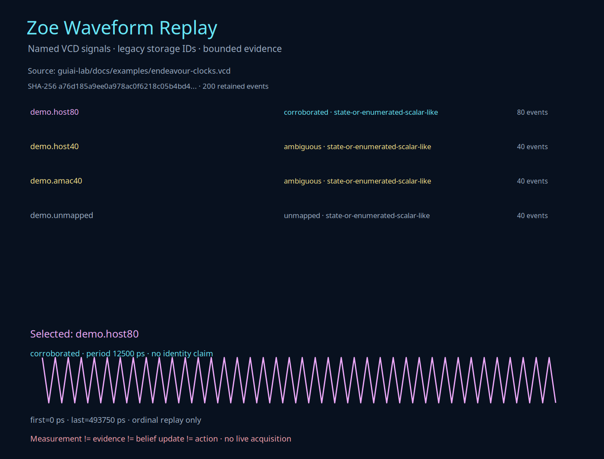

# ZVA-0321 — Zoe Waveform

[Visual archive index](../../README.md) · [Full catalog](../README.md) · [Category: Research figures and measurements](../categories/research-figure.md)

<a href="../../images/ZVA-0321.png"></a>

## What this image shows

Zoe Waveform Replay. This visual belongs to Zoe’s CERN/source-evidence program, helping a reader inspect a corpus, protocol, replay, virtual system, or process boundary.

## Role in Zoe

This visual belongs to Zoe’s CERN/source-evidence program, helping a reader inspect a corpus, protocol, replay, virtual system, or process boundary.

## Provenance and evidence boundary

**Provenance:** Zoe/allgems project-generated visual.

The image is preserved with its source context; the visual alone does not prove a scientific or operational claim.

## File identity

- Archive ID: **ZVA-0321**
- Visual family: **zoe-waveform**
- Dimensions/format: **1400×1064 PNG**
- Frames: **1**
- Bytes: **125,954**
- SHA-256: `6959062545031326b2d27fdd72e20f71b07bb1adebf6983f21cfb430e12a9e26`
- Original file: [Open full resolution](../../images/ZVA-0321.png)

## Source occurrences

Byte-identical copies are archived once while every known source path remains recorded.

| Source repository/collection | Original path | Canonical link |
|---|---|---|
| zoe | `guiai-lab/docs/images/zoe-waveform.png` | [Source](https://github.com/Ablation-Tool/zoe/blob/main/guiai-lab/docs/images/zoe-waveform.png) |
| zoe-autonomy | `paper/unified/figures/zoe-waveform.png` | [Source](https://github.com/Ablation-Tool/Zoe-Autonomy/blob/main/paper/unified/figures/zoe-waveform.png) |
| next-token | `paper/unified/figures/zoe-waveform.png` | [Source](https://github.com/Ablation-Tool/next-token-predictability/blob/main/paper/unified/figures/zoe-waveform.png) |
| paper-source-figures | `02-unified-autonomy/figures/zoe-waveform.png` | [Source](https://github.com/Ablation-Tool/research-papers) |


## Documented context

### Creative and conceptual instruments

Source document: `zoe:README.md`

Zoe Waveform Replay

### Geometry and evidence

Source document: `zoe:guiai-lab/docs/VISUAL-GUIDES.md`

Bounded VCD and legacy waveform replay

SPECS and AMAC protocol evidence{width=72%} **Zoe Waveform Replay**

### Verification

Source document: `zoe:guiai-lab/docs/WAVEFORM.md`

Zoe Waveform Replay

python -m unittest stress.waveform_stress -v ``` The suite covers scoped VCD values, malformed inputs, bounds and truncation, duplicate clock signatures, unused and single-event streams, normalized-document integrity, no-overwrite exports, CLI forwarding, native explicit loading, and geometry/VDI checks. When the optional local research files are present, it also replays 16 legacy JSONL events and a bounded 256-event WDB window and checks their source hashes. External-file tests are skipped when their evidence or optional decoder is unavailable.

## Related format/size variants

- [ZVA-0322](ZVA-0322.md)
