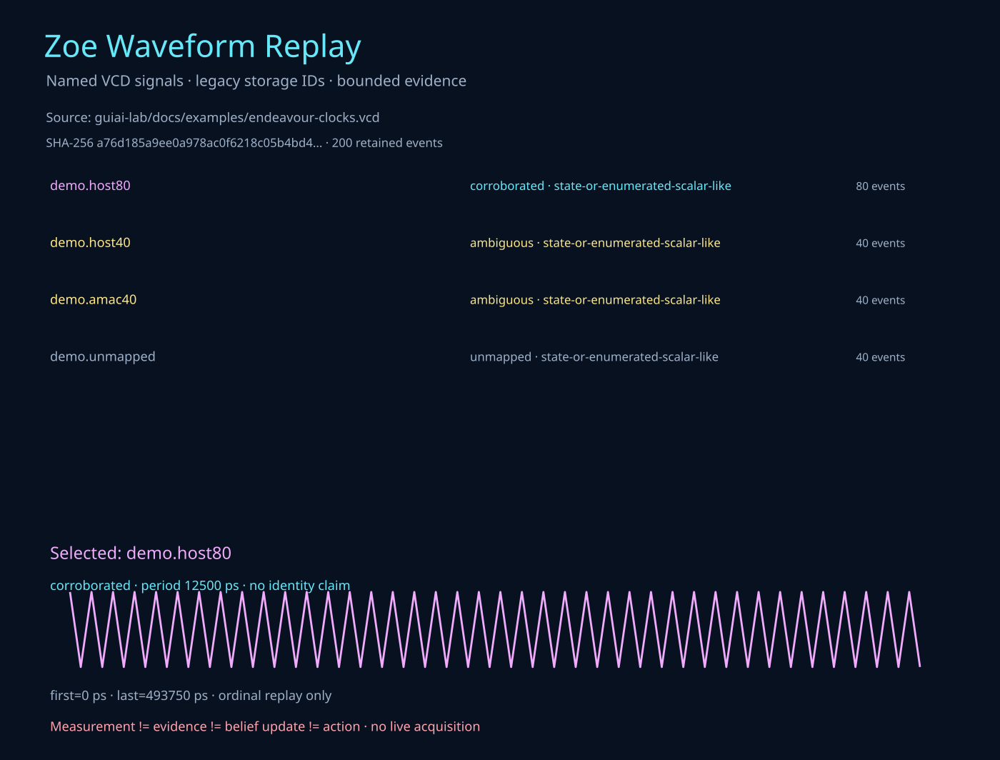

# ZVA-0322 — Zoe Waveform

[Visual archive index](../../README.md) · [Full catalog](../README.md) · [Category: Research figures and measurements](../categories/research-figure.md)

## What this image shows

Zoe Waveform is a research figures and measurements asset from the guiai-lab portion of the Zoe/allgems project. This visual belongs to Zoe’s CERN/source-evidence program, helping a reader inspect a corpus, protocol, replay, virtual system, or process boundary.

## Role in Zoe

This visual belongs to Zoe’s CERN/source-evidence program, helping a reader inspect a corpus, protocol, replay, virtual system, or process boundary.

## Provenance and evidence boundary

**Provenance:** Zoe/allgems project-generated visual.

The image is preserved with its source context; the visual alone does not prove a scientific or operational claim.

## File identity

- Archive ID: **ZVA-0322**
- Visual family: **zoe-waveform**
- Dimensions/format: **SVG 1400×1064**
- Frames: **vector/not applicable**
- Bytes: **5,691**
- SHA-256: `526515d5c40cc21a50e47d6dcdd6f8e6f972bb88c521dcba6104b1c48beccac0`
- Original file: [Open full resolution](../../images/ZVA-0322.svg)

## Source occurrences

Byte-identical copies are archived once while every known source path remains recorded.

| Source repository/collection | Original path | Canonical link |
|---|---|---|
| zoe | `guiai-lab/docs/images/zoe-waveform.svg` | [Source](https://github.com/Ablation-Tool/zoe/blob/main/guiai-lab/docs/images/zoe-waveform.svg) |

## Related format/size variants

- [ZVA-0321](ZVA-0321.md)
