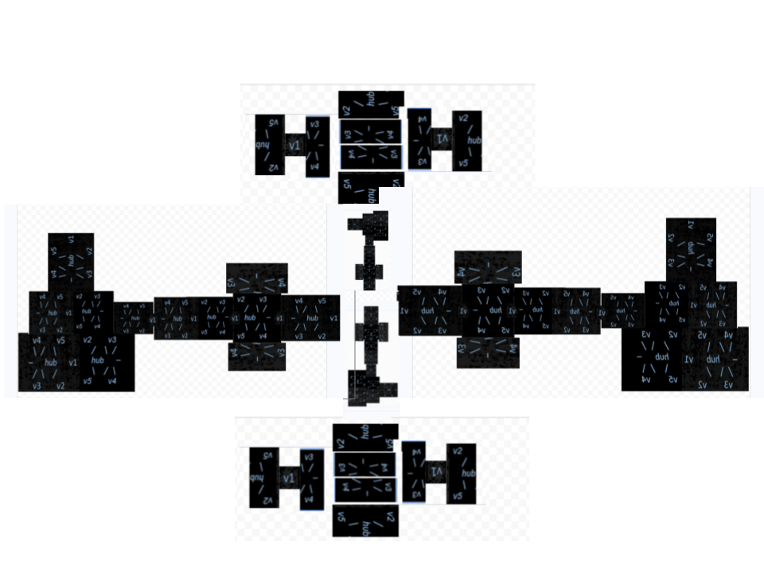

# ZVA-0323 — Reference Hub Lattice

[Visual archive index](../../README.md) · [Full catalog](../README.md) · [Category: Source references and derivative reading copies](../categories/reference.md)

## What this image shows

Reference Hub Lattice is a source references and derivative reading copies asset from the guiai-lab portion of the Zoe/allgems project. This asset preserves source context or a derivative reading view so that generated interpretations remain distinguishable from their references.

## Role in Zoe

This asset preserves source context or a derivative reading view so that generated interpretations remain distinguishable from their references.

## Provenance and evidence boundary

**Provenance:** Source-derived reference visual.

Reference material is retained for provenance and is not automatically original Zoe artwork.

## File identity

- Archive ID: **ZVA-0323**
- Visual family: **reference-hub-lattice**
- Dimensions/format: **960×720 PNG**
- Frames: **1**
- Bytes: **268,345**
- SHA-256: `3033a21a5e5cd7707567de01c6e6e062d37c3076dd5bc65d3191daaab5f4c82b`
- Original file: [Open full resolution](../../images/ZVA-0323.png)

## Source occurrences

Byte-identical copies are archived once while every known source path remains recorded.

| Source repository/collection | Original path | Canonical link |
|---|---|---|
| zoe | `guiai-lab/docs/references/cognitive-field/reference-hub-lattice.png` | [Source](https://github.com/Ablation-Tool/zoe/blob/main/guiai-lab/docs/references/cognitive-field/reference-hub-lattice.png) |
