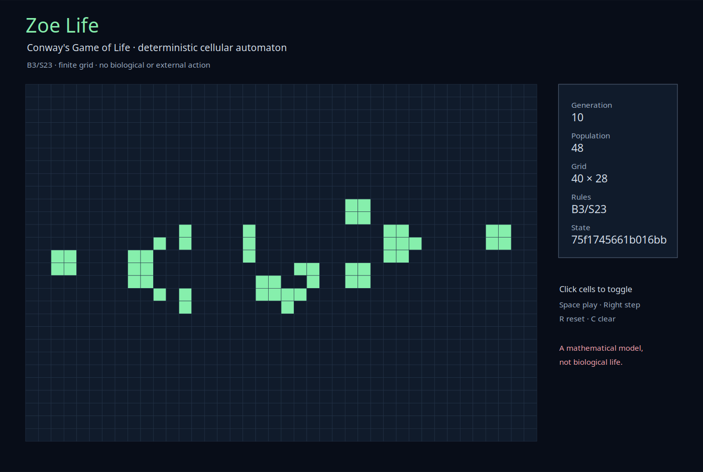

# ZVA-0327 — Life

[Visual archive index](../../README.md) · [Full catalog](../README.md) · [Category: Artwork and generative compositions](../categories/artwork.md)

## What this image shows

A deterministic Conway Game of Life state rendered as a colored cellular field. The PNG is a raster presentation and the SVG is an independently viewable vector scene of the same model family.

## Role in Zoe

This is part of Zoe’s creative geometry and generative-art practice, preserving the artistic side of the project alongside its scientific instruments.

## Provenance and evidence boundary

**Provenance:** Zoe/allgems project-generated visual.

The image is preserved with its source context; the visual alone does not prove a scientific or operational claim.

## File identity

- Archive ID: **ZVA-0327**
- Visual family: **life**
- Dimensions/format: **1400×942 PNG**
- Frames: **1**
- Bytes: **54,646**
- SHA-256: `350431275feac6b47c94f5ecdd6e02b60882640c34506ba0df1559f9e478dabf`
- Original file: [Open full resolution](../../images/ZVA-0327.png)

## Source occurrences

Byte-identical copies are archived once while every known source path remains recorded.

| Source repository/collection | Original path | Canonical link |
|---|---|---|
| zoe | `life.png` | [Source](https://github.com/Ablation-Tool/zoe/blob/main/life.png) |

## Documented context

### Zoe Life — Conway's Game of Life

Source document: `zoe:README.md`

Zoe Life running a Gosper glider gun

## Related format/size variants

- [ZVA-0328](ZVA-0328.md)
