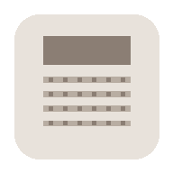

# ZVA-0329 — Icon 192

[Visual archive index](../../README.md) · [Full catalog](../README.md) · [Category: Identity, emblems, and interface icons](../categories/branding.md)

## What this image shows

A platform-sized SafeConvert application icon named Icon 192, exported for the Android target at 192×192. This visual supports recognition, navigation, application identity, or a cohesive visual language across Zoe and its components.

## Role in Zoe

This visual supports recognition, navigation, application identity, or a cohesive visual language across Zoe and its components.

## Provenance and evidence boundary

**Provenance:** Project identity or interface asset.

Functional and identity artwork does not constitute research evidence.

## File identity

- Archive ID: **ZVA-0329**
- Visual family: **icon**
- Dimensions/format: **192×192 PNG**
- Frames: **1**
- Bytes: **731**
- SHA-256: `2cd19ca708cc0f021e4b7454fc982a917e5046dc4dfcdf732790f5004bea8b3c`
- Original file: [Open full resolution](../../images/ZVA-0329.png)

## Source occurrences

Byte-identical copies are archived once while every known source path remains recorded.

| Source repository/collection | Original path | Canonical link |
|---|---|---|
| zoe | `mobile/android/app/src/main/assets/safeconvert/icon-192.png` | [Source](https://github.com/Ablation-Tool/zoe/blob/main/mobile/android/app/src/main/assets/safeconvert/icon-192.png) |
| zoe | `mobile/apple/Zoe/Resources/safeconvert/icon-192.png` | [Source](https://github.com/Ablation-Tool/zoe/blob/main/mobile/apple/Zoe/Resources/safeconvert/icon-192.png) |

## Related format/size variants

- [ZVA-0330](ZVA-0330.md)
