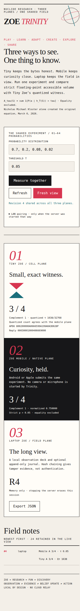

# ZVA-0348 — Zoe Trinity Responsive

[Visual archive index](../../README.md) · [Full catalog](../README.md) · [Category: Native interfaces and application scenes](../categories/interface.md)

## What this image shows

The responsive Zoe Trinity interface across supported display sizes, preserving shared revisions and measurement access. This image documents a native, mobile, browser, or desktop interface and its available controls at a particular recorded state.

## Role in Zoe

This image documents a native, mobile, browser, or desktop interface and its available controls at a particular recorded state.

## Provenance and evidence boundary

**Provenance:** Zoe/allgems project-generated visual.

The image is preserved with its source context; the visual alone does not prove a scientific or operational claim.

## File identity

- Archive ID: **ZVA-0348**
- Visual family: **zoe-trinity-responsive**
- Dimensions/format: **375×2831 PNG**
- Frames: **1**
- Bytes: **161,857**
- SHA-256: `fed0fe1c55fd73fba2692cb2d3f3245c72abfe1ce74c3d44751af0de84ee74ca`
- Original file: [Open full resolution](../../images/ZVA-0348.png)

## Source occurrences

Byte-identical copies are archived once while every known source path remains recorded.

| Source repository/collection | Original path | Canonical link |
|---|---|---|
| zoe | `mobile/docs/images/zoe-trinity-responsive.png` | [Source](https://github.com/Ablation-Tool/zoe/blob/main/mobile/docs/images/zoe-trinity-responsive.png) |
