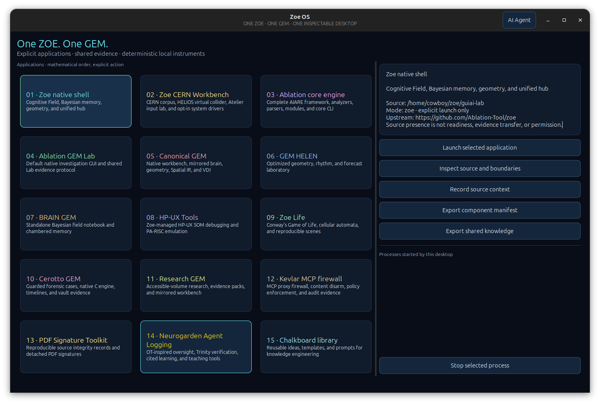

# ZVA-0350 — Zoe Desktop

[Visual archive index](../../README.md) · [Full catalog](../README.md) · [Category: Native interfaces and application scenes](../categories/interface.md)

## What this image shows

The Zoe OS-style mathematical desktop, presenting the unified user-space environment for launching and inspecting registered engines without claiming to be a bootable operating system.

## Role in Zoe

This image documents a native, mobile, browser, or desktop interface and its available controls at a particular recorded state.

## Provenance and evidence boundary

**Provenance:** Zoe/allgems project-generated visual.

The image is preserved with its source context; the visual alone does not prove a scientific or operational claim.

## File identity

- Archive ID: **ZVA-0350**
- Visual family: **zoe-desktop**
- Dimensions/format: **1492×1007 PNG**
- Frames: **1**
- Bytes: **168,833**
- SHA-256: `fd5184013b9520514c6ae4c4e3499ac1bdc53a0036c4da6d013d304532fd32b0`
- Original file: [Open full resolution](../../images/ZVA-0350.png)

## Source occurrences

Byte-identical copies are archived once while every known source path remains recorded.

| Source repository/collection | Original path | Canonical link |
|---|---|---|
| zoe | `zoe-desktop.png` | [Source](https://github.com/Ablation-Tool/zoe/blob/main/zoe-desktop.png) |

## Documented context

### One ZOE. One GEM.

Source document: `zoe:README.md`

Zoe OS mathematical desktop

| **CERN Workbench** | Guide | Zoe-owned CERN console, HELIOS, and Atelier process lifecycle, health checks, browser targets, and no-overwrite manifests | | **Zoe Life** | 2D engine · 3D engine · text renderer | Conway's Game of Life, 3D Brain Life, direct text-to-cell rendering, and reproducible JSON/SVG/PNG/GEM exports |
