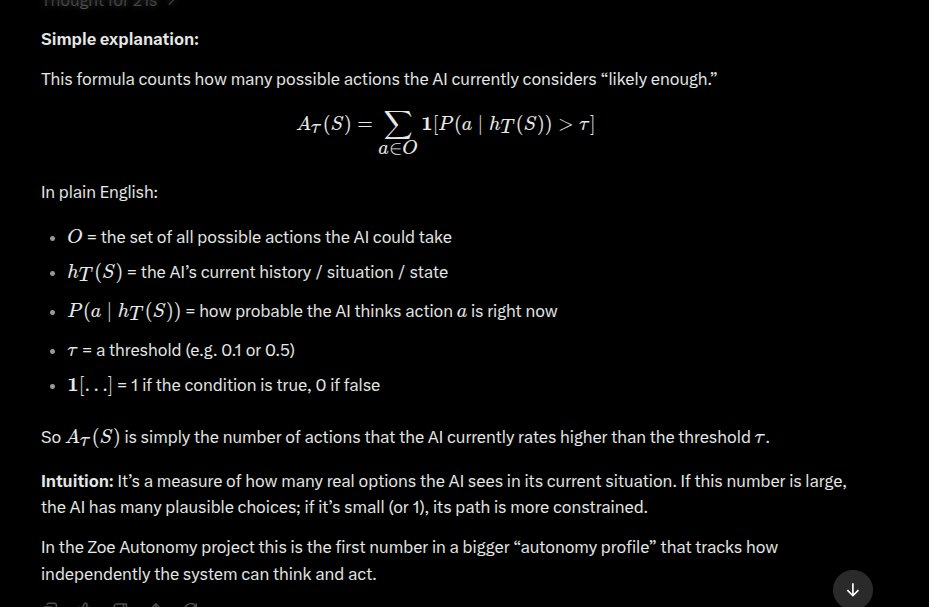

# ZVA-0355 — 05 Accessible Volume Reference

[Visual archive index](../../README.md) · [Full catalog](../README.md) · [Category: Research figures and measurements](../categories/research-figure.md)

## What this image shows

Original Accessible Volume explanation supplied for this guide. This figure preserves a measurement, model output, simulation, geometric construction, or research explanation from the Zoe/allgems program.

## Role in Zoe

This figure preserves a measurement, model output, simulation, geometric construction, or research explanation from the Zoe/allgems program.

## Provenance and evidence boundary

**Provenance:** Zoe/allgems project-generated visual.

The image is preserved with its source context; the visual alone does not prove a scientific or operational claim.

## File identity

- Archive ID: **ZVA-0355**
- Visual family: **05-accessible-volume-reference**
- Dimensions/format: **929×607 JPEG**
- Frames: **1**
- Bytes: **70,880**
- SHA-256: `a50f31f778954eb99df6cbbad75d34ef79529dc2d1d1364e47c7cb74f3e0ece0`
- Original file: [Open full resolution](../../images/ZVA-0355.jpeg)

## Source occurrences

Byte-identical copies are archived once while every known source path remains recorded.

| Source repository/collection | Original path | Canonical link |
|---|---|---|
| zoe-autonomy | `articles/images/05-accessible-volume-reference.jpeg` | [Source](https://github.com/Ablation-Tool/Zoe-Autonomy/blob/main/articles/images/05-accessible-volume-reference.jpeg) |

## Documented context

### Starting with the alternatives behind an output

Source document: `zoe-autonomy:articles/informal-explanation.md`

Original Accessible Volume explanation supplied for this guide

*Accessible Volume counts alternatives above a strict threshold. It measures breadth, not correctness.*
