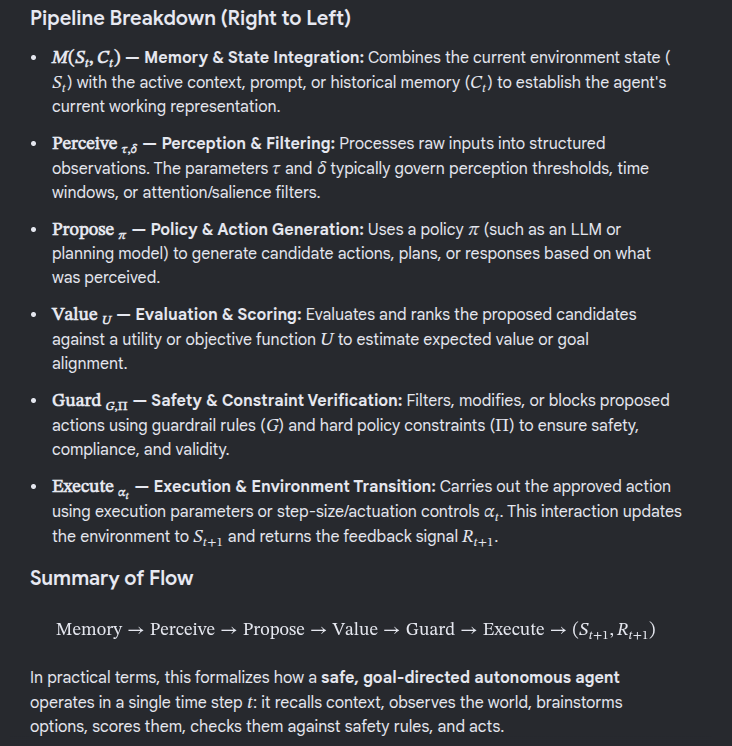

# ZVA-0356 — 06 Pipeline Reference

[Visual archive index](../../README.md) · [Full catalog](../README.md) · [Category: Mechanism and architecture diagrams](../categories/mechanism-diagram.md)

## What this image shows

Original conceptual pipeline breakdown supplied for this guide. This diagram explains relationships among components, evidence states, measurements, or decisions without requiring the reader to reconstruct the architecture from code.

## Role in Zoe

This diagram explains relationships among components, evidence states, measurements, or decisions without requiring the reader to reconstruct the architecture from code.

## Provenance and evidence boundary

**Provenance:** Zoe/allgems project-generated visual.

The image is preserved with its source context; the visual alone does not prove a scientific or operational claim.

## File identity

- Archive ID: **ZVA-0356**
- Visual family: **06-pipeline-reference**
- Dimensions/format: **732×746 PNG**
- Frames: **1**
- Bytes: **190,540**
- SHA-256: `be082622e78568dda06abee7eba588175f8bd8bf5ed8aee69e7e07a731334f09`
- Original file: [Open full resolution](../../images/ZVA-0356.png)

## Source occurrences

Byte-identical copies are archived once while every known source path remains recorded.

| Source repository/collection | Original path | Canonical link |
|---|---|---|
| zoe-autonomy | `articles/images/06-pipeline-reference.png` | [Source](https://github.com/Ablation-Tool/Zoe-Autonomy/blob/main/articles/images/06-pipeline-reference.png) |

## Documented context

### From measurement to self-government

Source document: `zoe-autonomy:articles/informal-explanation.md`

Original conceptual pipeline breakdown supplied for this guide

*Each stage has a distinct responsibility. Measurement never silently becomes permission.*
