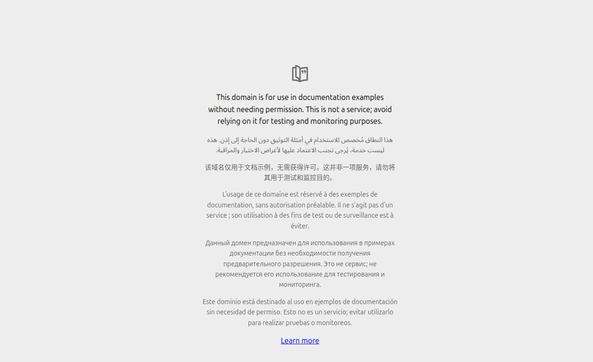

# ZVA-0358 — Example Com Browser

[Visual archive index](../../README.md) · [Full catalog](../README.md) · [Category: Research figures and measurements](../categories/research-figure.md)

## What this image shows

Example Com Browser is a research figures and measurements asset from the evidence portion of the Zoe/allgems project. This figure preserves a measurement, model output, simulation, geometric construction, or research explanation from the Zoe/allgems program.

## Role in Zoe

This figure preserves a measurement, model output, simulation, geometric construction, or research explanation from the Zoe/allgems program.

## Provenance and evidence boundary

**Provenance:** Zoe/allgems project-generated visual.

The image is preserved with its source context; the visual alone does not prove a scientific or operational claim.

## File identity

- Archive ID: **ZVA-0358**
- Visual family: **example-com-browser**
- Dimensions/format: **1265×775 PNG**
- Frames: **1**
- Bytes: **75,888**
- SHA-256: `05aec8c112cd68d45c094ef97413244a06e739a22b0a8abda40dd2e5c89f3f53`
- Original file: [Open full resolution](../../images/ZVA-0358.png)

## Source occurrences

Byte-identical copies are archived once while every known source path remains recorded.

| Source repository/collection | Original path | Canonical link |
|---|---|---|
| zoe-autonomy | `evidence/capabilities/example-com-browser.png` | [Source](https://github.com/Ablation-Tool/Zoe-Autonomy/blob/main/evidence/capabilities/example-com-browser.png) |
