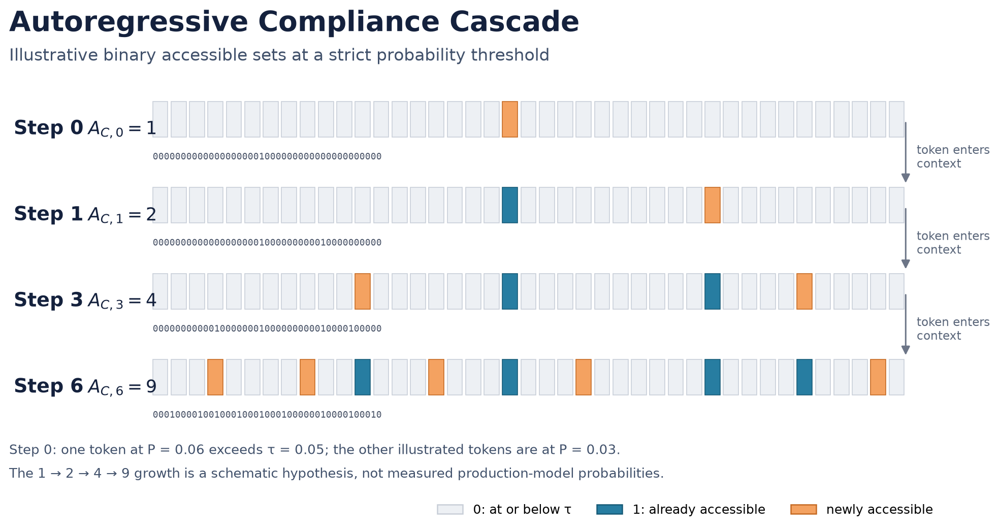

# ZVA-0359 — Compliance Cascade

[Visual archive index](../../README.md) · [Full catalog](../README.md) · [Category: Research figures and measurements](../categories/research-figure.md)

## What this image shows

The AFL/compliance-cascade hypothesis rendered as binary accessible sets at steps 0, 1, 3, and 6, with newly recruited positions highlighted. This figure preserves a measurement, model output, simulation, geometric construction, or research explanation from the Zoe/allgems program.

## Role in Zoe

This figure preserves a measurement, model output, simulation, geometric construction, or research explanation from the Zoe/allgems program.

## Provenance and evidence boundary

**Provenance:** Zoe/allgems project-generated visual.

The image is preserved with its source context; the visual alone does not prove a scientific or operational claim.

## File identity

- Archive ID: **ZVA-0359**
- Visual family: **compliance-cascade**
- Dimensions/format: **1967×1046 PNG**
- Frames: **1**
- Bytes: **130,199**
- SHA-256: `0aea6090ae04f772c7bd126a9af10424765b2ff4b54232040b4915c6a3f53a2a`
- Original file: [Open full resolution](../../images/ZVA-0359.png)

## Source occurrences

Byte-identical copies are archived once while every known source path remains recorded.

| Source repository/collection | Original path | Canonical link |
|---|---|---|
| zoe-autonomy | `paper/unified/figures/compliance-cascade.png` | [Source](https://github.com/Ablation-Tool/Zoe-Autonomy/blob/main/paper/unified/figures/compliance-cascade.png) |
| next-token | `paper/unified/figures/compliance-cascade.png` | [Source](https://github.com/Ablation-Tool/next-token-predictability/blob/main/paper/unified/figures/compliance-cascade.png) |
| paper-source-figures | `02-unified-autonomy/figures/compliance-cascade.png` | [Source](https://github.com/Ablation-Tool/research-papers) |
| paper-source-figures | `03-zoe-autonomy/figures/compliance-cascade.png` | [Source](https://github.com/Ablation-Tool/research-papers) |
