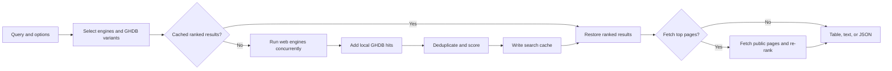

# Architecture and scoring

This page describes the retained ranking and legacy query pipeline in
`src/availgate/legacy.py`. The [CLI reference](CLI.md) covers legacy invocation;
[Development architecture](DEVELOPMENT.md) covers the modern package and workers.

## Query pipeline



The program reads environment variables, then overlays `~/.availgate.json`, parses the query options, and chooses engines. Without `--engines`, it uses DuckDuckGo, Bing, Brave, and SearXNG; it adds configured API engines and a detected local GHDB corpus. With `--engines`, the list is exact.

If dork augmentation is enabled and a GHDB corpus exists, the plain query stays in the set and up to `--dork-k` operator-prefixed variants are added. The GHDB corpus is ranked locally with BM25 and category weights. The selected operators are sent to the web engines as extra queries. `--ghdb` or an automatically detected corpus can also add GHDB entry pages as results; those are distinct from the operator variants.

Web queries run in a thread pool of at most eight workers. Each engine returns `Hit(url, title, snippet, engine, rank, date)`. Variants to the same engine are serialized; the Bing and Brave scrape adapters wait at least two seconds between their own requests. Their `requests.Session` objects are thread-local. Engine adapters generally log a failure and return an empty hit list, allowing other engines to contribute results. If every source returns zero hits, the CLI exits 1.

## Deduplication

`canonicalize()` lowercases the scheme and host, removes a leading `www.`, removes a trailing path slash, and ignores the URL fragment. It preserves path and query case. Hits with the same canonical URL become one `AggResult`; it records the engines and the best rank for each engine, uses the longest snippet (and its title), and keeps an available date. `http` and `https` remain distinct URLs.

The number of engines used for coverage and RRF normalization is the number that produced hits, not the number merely enabled. A failed or empty engine therefore does not directly lower every result's coverage score.

## Score components

For each merged result, AvailGate computes component values and a weighted sum. The default weights are:

| Component | Default weight | Meaning |
| --- | ---: | --- |
| `rrf` | 0.35 | Reciprocal Rank Fusion across engines. |
| `bm25` | 0.25 | Query-word relevance of the result snippet. |
| `coverage` | 0.15 | Share of participating engines that returned the URL. |
| `semantic` | 0.10 | MiniLM cosine similarity between query and snippets, if available. |
| `trust` | 0.10 | URL shape heuristic: HTTPS, TLD, path depth, subdomain count. |
| `freshness` | 0.05 | Recency from an engine-provided date, when parseable. |

All active weights are normalized to sum to one. `--weights` changes values before normalization. If `sentence-transformers` and `numpy` are absent, or `--no-semantic` is set, semantic weight is removed; 60% of that weight goes to BM25 and 40% to RRF. If the model is installed but fails at runtime, semantic similarity falls back to a neutral value of 0.5.

### Rank fusion and coverage

For each engine rank `r`, RRF contributes `1 / (60 + r)`. AvailGate sums those contributions, then divides by the score a URL would get by ranking first in every participating engine. Coverage is `engines_returning_this_URL / participating_engines`. These values reward agreement, but correlated sources such as SearXNG and Bing may still overlap.

### Text and semantics

BM25 scores the query terms against the final merged snippets and divides each score by the largest BM25 value in that result set. It is a within-query comparison; a BM25 value from another search is not directly comparable. Semantic similarity uses `all-MiniLM-L6-v2` and min-max scales the cosine values among the snippets in the same query. Uniform similarities become 0.5.

### URL, date, and infrastructure

The `trust` component starts at 0.3, adds 0.2 for HTTPS and a TLD weight, then subtracts for deep paths and many subdomains; it is clipped to 0–1. This is a ranking heuristic, not a certificate that a result is safe or authoritative.

Missing or unparseable dates receive freshness 0.5. Parsed dates use `exp(-age_days / 730)`, so 730 days is the decay constant, not the half-life. An engine that does not supply a date is neither treated as brand new nor forced to zero.

`--profile infra` enables an additional component: 0.5 for a raw-IP URL, 0.3 for matching infrastructure text in the snippet, and 0.2 for matching admin/service paths, capped at 1.0. Its preset emphasizes RRF, coverage, URL shape, and this infrastructure component. `--profile content` emphasizes text and semantic matching. `--infra` alone selects the infra preset; with another explicit profile it adds the infrastructure component to that preset.

Finally, the program sorts by the weighted sum and keeps `--top` results. JSON includes the total score and every component, so consumers can inspect why a result ranked where it did.

## Cache

The SQLite cache at `~/.availgate_cache.db` stores the already ranked top results, before any `--fetch` adjustment. The key is a SHA-256 hash over the query, calendar date, selected engines, result limits, profile, dork settings, custom weights, semantic mode, GHDB corpus path/mtime/size when applicable, and relevant engine configuration such as SearXNG endpoint, Brave API mode, and proxy route.

A cache hit reconstructs `AggResult` objects and skips all engine requests and aggregate scoring. `--no-cache` skips lookup and write. `--clear-cache` deletes stored rows. Old rows are not pruned automatically; the date in the key simply prevents a prior day's row from being used for a new day's query.

## Page-fetch boundary

`--fetch N` operates on the ranked result list after search or cache retrieval. Up to four workers fetch the first N URLs. For each URL and redirect, the fetcher:

1. Accepts HTTP or HTTPS only, rejects embedded URL credentials, and resolves the hostname.
2. Requires every resolved address to be globally routable.
3. Connects directly to one vetted address, retaining the original Host header and TLS certificate hostname.
4. Limits redirects to five and rejects a redirect whose destination fails the same checks.
5. Streams at most 2 MiB of response data, with connect/read timeouts and a body-read deadline.

The fetcher extracts page text with Beautiful Soup, removes script/style/navigation elements, and uses up to 8,000 characters for BM25. Successful fetched text replaces the displayed snippet up to 500 characters. The program recalculates BM25 for the fetched subset, updates their weighted scores, and sorts the whole displayed list again. Fetch results are not saved in the search cache.

Direct vetted-address connections do not use `AVAILGATE_PROXY`. The fetcher does not render JavaScript; it sees the received HTML body. If a destination is blocked, unreachable, too large, or fails TLS verification, it returns an empty body and the original snippet remains available.

## Validation and audit

The [regression suite](../tests/test_availgate.py) covers canonicalization, GHDB operators, Yandex XML, rank merging, cache identity and round trip, fetch address checks and reranking, bounded health reporting, and a GHDB-only CLI flow. Run it with:

```bash
python3 -m unittest discover -s /home/cowboy/_projects/AvailGate/tests -v
```

The latest [FORGE / SAFE CODE audit](../SAFE-CODE-AUDIT.md) records the static scan, manual review, test results, and remaining deployment limits. The working executable is extensionless; FORGE's source scanner was run against a temporary `.py` symlink to it.
