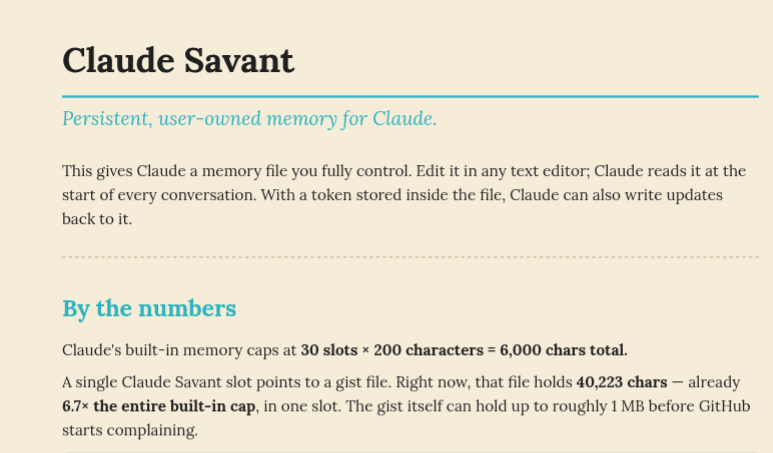

[](https://claude.ai/code)



# Claude Savant

Persistent, user-owned memory for Claude.

This gives Claude a memory file you fully control. Edit it in any text editor; Claude reads it at the start of every conversation. With a token stored inside the file, Claude can also write updates back to it.

## By the numbers

Claude's built-in memory caps at **30 slots × 200 characters = 6,000 chars total**.

A single Claude Savant slot points to a gist file. Right now, that file holds **40,223 chars** — already **6.7× the entire built-in cap**, in one slot. The gist itself can hold up to roughly 1 MB before GitHub starts complaining.

---

Full walkthrough: [claude-savant.md](claude-savant.md) · [claude-savant.pdf](claude-savant.pdf)

## Use with Claude Code

Use Claude Code to populate a Savant memory file, design a domain-specific schema, or audit stale entries.

```
Read README.md and claude-savant.md in this repo (Claude-Savant).
Then:
1. Generate a Savant memory file populated from our current working relationship —
   include: domain expertise signals, preferred output style, shorthand, ongoing projects
2. Format it to fit within GitHub Gist constraints (under 1MB) with room to grow
3. Write the Claude memory slot entry I need to create to point Claude at this Gist
```

```
I have an existing Savant memory file that's gotten stale.
Read README.md, then help me:
1. Audit the file for entries that are outdated, contradictory, or no longer accurate
2. Reorganize it by domain (security research, coding, writing, personal context)
3. Add a new section for [domain] based on what you know about my work in this session
Paste your current Savant file below: [paste here]
```

---

## About

Maintained by **[Nicholas Michael Kloster](https://github.com/Nicholas-Kloster)** as part of [**NuClide**](https://nuclide-research.com) — independent AI infrastructure security research.

CISA disclosures: [CVE-2025-4364](https://nvd.nist.gov/vuln/detail/CVE-2025-4364) · [ICSA-25-140-11](https://www.cisa.gov/news-events/ics-advisories/icsa-25-140-11)
