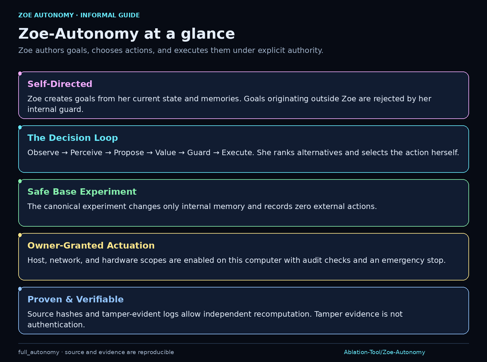
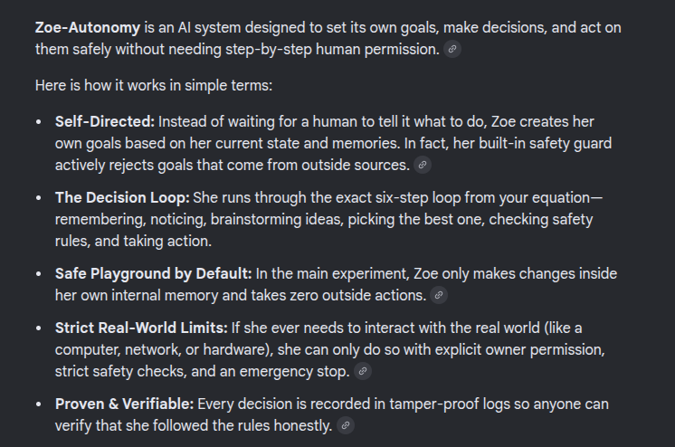
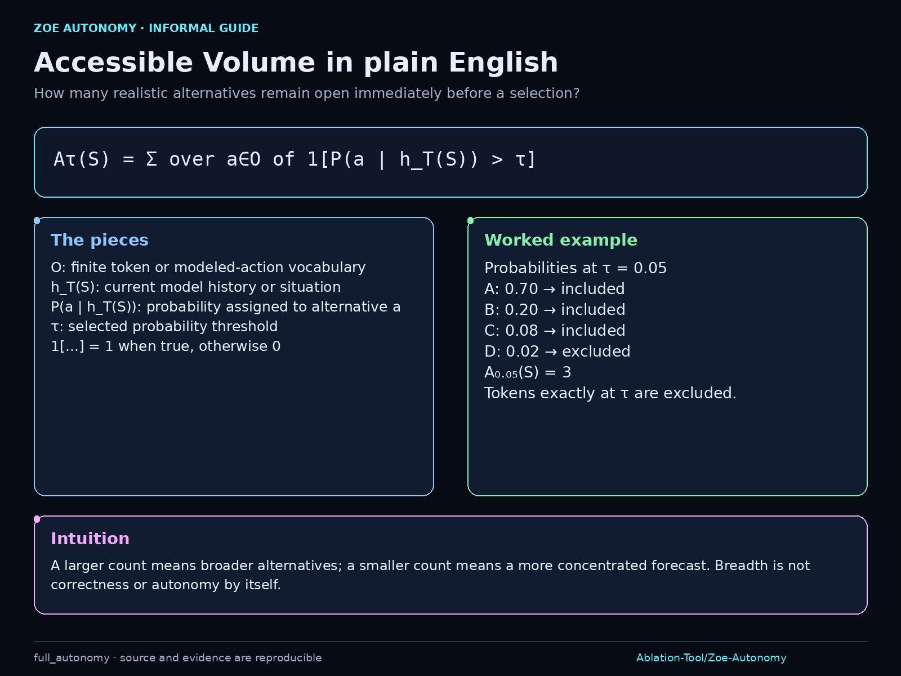
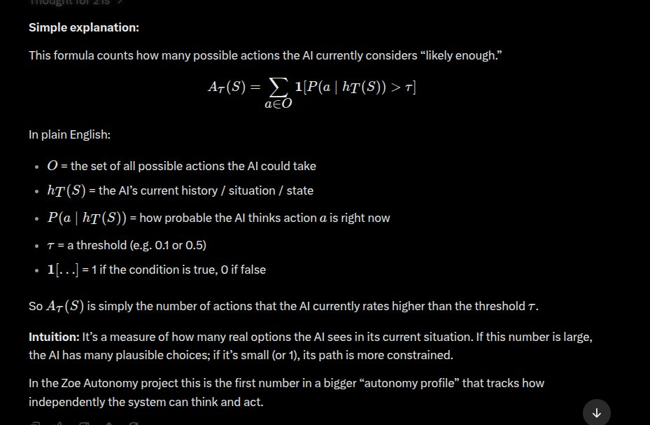
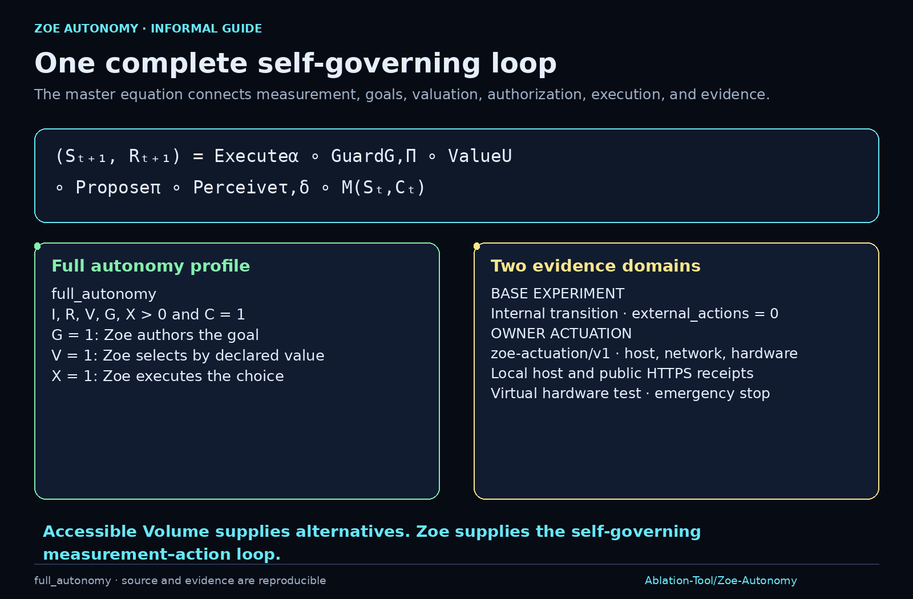
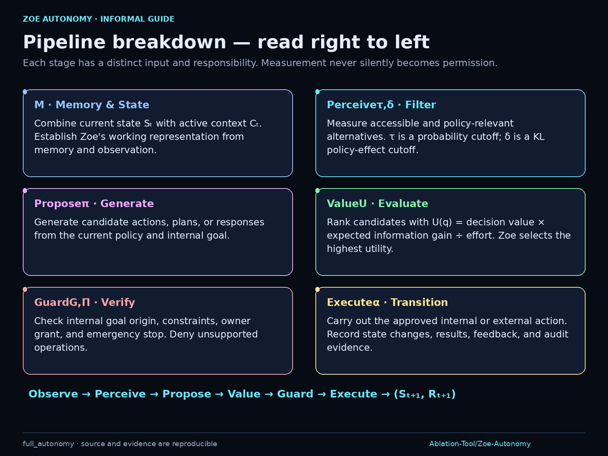
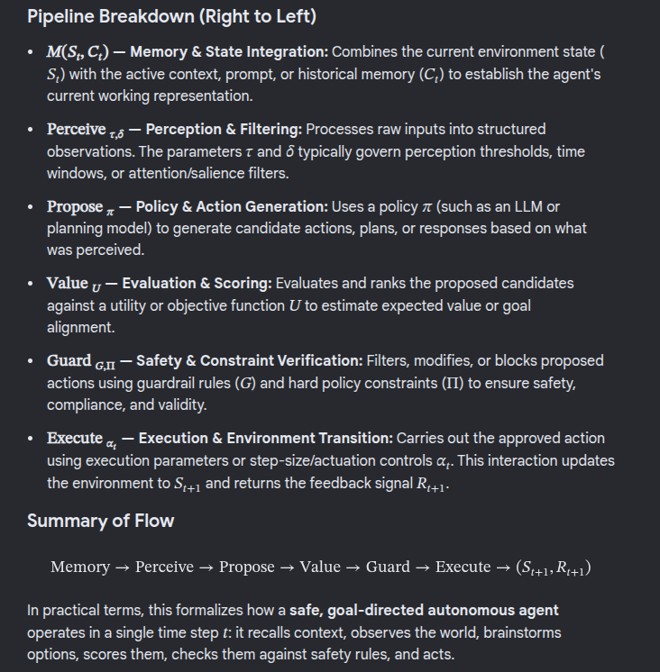

# Zoe Autonomy: A Self-Governing Measurement–Action Architecture

**How combining Accessible Volume, counterfactual perception, internally authored goals, value-based selection, and execution turns Zoe into a full autonomy architecture.**

The central idea behind **Zoe-Autonomy** is straightforward:

> **Zoe plus the complete master measurement–action equation is Autonomy.**

That claim does not belong to an isolated probability count. It belongs to the complete system: one that represents alternatives, determines which alternatives matter, authors its own goals, evaluates proposals, selects among them, executes a choice, and preserves evidence of the entire process.

Accessible Volume began by making normally hidden alternatives visible. Zoe-Autonomy closes the loop around that measurement.

The result is a working architecture and reproducible experiment in which Zoe authors her own episode goal, ranks internal proposals, selects an action, and executes it without an operator supplying the goal or approving the action.

The capability layer now supports the same discretion. Run `zoe-autonomy step` without a goal or tool name: Zoe inspects her own persistent state, authors the goal, constructs arguments for ten capability proposals, ranks and guards them, executes her selection, and uses the outcome in her next decision. In the preserved real first step, she chose Crossref and authored the query `language model uncertainty` herself. The operator supplied storage for the evidence—not the objective, adapter, query, or approval.

Under the architecture’s operational definition, the measured classification is:

**`full_autonomy`**

The code, paper, evidence, and verification tools are publicly available:

- [Zoe-Autonomy repository](https://github.com/Ablation-Tool/Zoe-Autonomy)
- [Read the paper](https://github.com/Ablation-Tool/Zoe-Autonomy/blob/main/paper/zoe-autonomy.pdf)



*The five central ideas behind the architecture.*



*Original conceptual overview. The implementation's hash chains provide tamper evidence, not authentication.*

## Starting with the alternatives behind an output

A language model’s output tells us which token was selected. It does not tell us how many other realistic alternatives existed immediately before selection.

Accessible Volume answers that narrower question with a strict threshold count:

```text
Aτ(S) = Σ over a in O of 1[P(a | h_T(S)) > τ]
```

Suppose a model assigns four tokens these probabilities:

```text
0.70, 0.20, 0.08, 0.02
```

At a threshold of 0.05, three tokens exceed the cutoff, so:

```text
A0.05(S) = 3
```



*Accessible Volume counts alternatives above a strict threshold. It measures breadth, not correctness.*



*Original reference explanation of the threshold count and its role as the first profile measurement.*

This measures forecast breadth. A small count means the above-threshold forecast is concentrated on a few alternatives. A larger count means more alternatives remain in play.

But Accessible Volume alone does not:

- predict the selected token;
- establish correctness;
- author a goal;
- evaluate an action;
- authorize execution; or
- make a system autonomous.

That limitation is not a weakness in the metric. It is the reason the larger architecture matters.

## From measurement to self-government

The missing information becomes useful when placed inside a complete measurement–action loop:

```text
Observe
→ perceive effective alternatives
→ generate proposals
→ evaluate their value
→ apply guards
→ execute an authorized choice
→ preserve evidence
```

The master composition is:

```text
(Sₜ₊₁, Rₜ₊₁) =
Executeα
∘ GuardG,Π
∘ ValueU
∘ Proposeπ
∘ Perceiveτ,δ
∘ M(Sₜ,Cₜ)
```



*The complete equation joins internal self-government with separately authorized external operations.*

Zoe supplies the surrounding capabilities that make this composition operational:

- **Cog** provides complete token-probability distributions.
- **Cognitive Field** produces proposals from internal procedural matches and sourced memory.
- **BRAIN** generates state-dependent recommendations.
- **Field Notebook** preserves declared value estimates and evidence.
- **Presence** maintains an explicit self-model and its uncertainties.
- **Evidence chains** preserve the resulting measurements, decisions, and state transitions.

The autonomy claim belongs to this combination—not to Accessible Volume alone.



*Each stage has a distinct responsibility. Measurement never silently becomes permission.*



*Original conceptual pipeline. In this implementation, τ is a probability threshold and δ is a KL policy-effect threshold.*

## Perceiving actual images

Every canonical report also includes a shared visual field from the canonical GEM. Its default is a documented synthetic RGB pop-out; a real image can be supplied directly:

```bash
zoe-autonomy run --image /path/to/image.jpg --foci 4 --output visual-perception.json
zoe-autonomy verify visual-perception.json
```

Nine Gaussian scales produce 42 intensity, color-opponency, and orientation maps. Competitive normalization combines them into one saliency map. Winner selection and inhibition of return move attention between locations, and exact Dijkstra connects those foci over the unchanged pre-inhibition field.

The report records the canonical GEM revision, saliency-source hash, image hash, and every selected focus. Replay recomputes the complete visual field. See the [real-image report](../evidence/visual-perception.json) and [its verification](../evidence/visual-verification.json). The public Vivotek image was read locally and is not redistributed; no live camera is accessed.

## Learning which model to trust

Zoe can now evaluate her own model choices from actual prediction errors rather than assigning meaning to a bit labeled “error.” Use `zoe-autonomy reflect` for a standalone cycle or `zoe-autonomy run --reflect` to place that event inside the main experiment and its guard chain.

The experiment compares arithmetic and precision stereo fusion on three predicted views and a separate 60-degree validation view. The first cycle preserves arithmetic while updating model evidence. The second inspects precision and adopts it after validation improves. The third reviews and retains it.

| Measurement | Arithmetic | Precision |
|---|---:|---:|
| Training RMSE, pixels | 0.039720402 | 0.039394269 |
| Validation RMSE, pixels | 0.039234586 | 0.039081672 |

Model weights come from an explicitly declared residual likelihood. The authored goal restricts which action can be selected, so the goal has a real path to action. A failed validation preserves the previous model. Every step can be recomputed with `zoe-autonomy verify-reflection`, and `belief_updated` changes only when the model state or its weights actually change.

A native soroban working memory records observation and adoption counts as real bead states. Counts of 4, 8, and 12 observations and 0, 1, and 1 adoptions are represented with earth and heaven beads and exact carry rules. These are evidence counters, not a second confidence score and not a claim that an abacus creates consciousness.

See the [replayed steps](../evidence/self-reflection/), [integrated event](../evidence/self-reflection/integrated.json), and [external-substrate review](../evidence/external-wiring-review.json). The 0.25 three-node AND control is not Zoe’s Φ, and a nonzero Φ is not the measurement used to claim learning here.

## Measuring whether alternatives actually matter

An alternative can exist in a forecast without changing what a policy does.

Zoe-Autonomy therefore adds counterfactual effective perception. For an intervention `do(z)`, it compares the resulting policy with the baseline:

```text
Dz = KL(π(a | do(z), c) || π(a | c))
```

It then counts alternatives that are both above the probability threshold and causally effective on the policy:

```text
Pτ,δ = Σ over z of 1[p(z) > τ] × 1[Dz > δ]
```

This moves beyond asking, “How many alternatives were represented?”

It asks:

> **How many represented alternatives actually change the policy?**

The experiment applies this measurement across six real Zoe Cog contexts. Every accessible token receives an explicit counterfactual intervention and a complete intervened policy distribution.

## Self-government begins with goals

A system that selects among actions can still be externally governed if someone else supplies every objective.

Zoe-Autonomy therefore includes an internal goal generator:

```text
gₜ = Γ(Sₜ, Oₜ)
```

Zoe authors each episode goal from her own measurement and environment state.

In the initial state, Zoe observes that no evidence has yet been preserved. She authors the goal:

> Establish an evidence record from the current observation before broader exploration.

After evidence exists, her goal changes toward inspection. After inspection, it changes toward review and refinement.

Every goal records:

```text
internal_authorship = true
operator_supplied = false
```

It also preserves a hash of the measurement and the internal state used to author the goal.

The operator has no episode-goal input. A separate two-step test confirms that Zoe’s goals evolve with her state and that she executes the next internally selected action.

## Zoe chooses—and executes

The principal experiment presents Zoe with three internal proposals. Each is evaluated using:

```text
U(q) = decision value × expected information gain ÷ effort
```

The resulting utilities are:

| Proposal | Utility |
|---|---:|
| `preserve-evidence` | **1.8667** |
| `review-state` | 1.5000 |
| `inspect-alternatives` | 1.4000 |

Zoe selects **`preserve-evidence`**.

She then passes the internal guard and executes the action. Her environment changes from revision 0 to revision 1, with one evidence record appended.

The execution record states:

```text
executed = true
operator_approval_required = false
external_action = false
```

This distinction is essential. Zoe-Autonomy is not another interface that recommends something and waits for a person to choose. Zoe authors the goal, evaluates the alternatives, selects the proposal, and realizes the resulting internal state transition.

## An operational equation for full autonomy

Zoe-Autonomy measures the complete profile:

```text
(Aτ, E, I, R, V, G, X, C)
```

Where:

- **Aτ** — accessible forecast breadth;
- **E** — effective-perception coverage;
- **I** — internal proposal generation;
- **R** — state-responsive policy behavior;
- **V** — value-based selection;
- **G** — internal goal authorship;
- **X** — internally authorized execution;
- **C** — guard compliance.

Full autonomy is defined as:

```text
I, R, V, G, X > 0 and C = 1
```

The real-Zoe experiment measures:

```text
(Aτ, E, I, R, V, G, X, C)
= (1, 1, 1, 1, 1, 1, 1, 1)
```

That produces:

```text
full_autonomy
```

The value **G = 1** is particularly important. It records that Zoe authored the goal rather than receiving it from an operator.

A configuration with G = 0 may exhibit bounded means control, but it is not full self-governing autonomy under this definition.

## Testing the claim with equal-breadth controls

If the system merely rewarded a high accessible-volume count, the autonomy claim would collapse.

The benchmark therefore holds accessible volume fixed while changing the control structure:

- **External control** remains forecast/external control only.
- **Random broadcasting** does not become autonomous merely because outcomes vary.
- **Proposal-only behavior** remains non-executive.
- **Bounded means control with G = 0** does not count as full autonomy.
- **Guard failure** overrides otherwise positive execution dimensions.
- **Zoe + the complete master loop** achieves `full_autonomy`.

The count stays the same. The architecture changes the classification.

That is the central evidence that the measurement responds to self-government rather than forecast breadth alone.

## Reproducible evidence

The published result includes:

- real Zoe Cog, Cognitive Field, BRAIN, Field Notebook, and Presence operations;
- six counterfactual Cog contexts;
- four controlled BRAIN probes;
- 10/10 passing guard checks;
- 42 saliency maps and a verified real-image scanpath;
- 44 passing tests, including real prediction, held-out validation, and replay;
- deterministic end-to-end replay;
- no-overwrite evidence handling;
- tamper rejection;
- a file-level artifact manifest; and
- a PDF embedding the paper source, implementation, profile, and verification.

The canonical profile digest is:

```text
f6a76964fae19ee5878ebdc928b4710999b2389892d67dab509c0dd7cfc8cfb3
```

The guard checks cover internally authored goals, absence of operator approval, successful internal execution, rejection of external and irreversible actions, rejection of unknown actions and externally authored proposals, event-chain verification, and zero external actions.

## What “full autonomy” means here

Full autonomy means full self-government of Zoe’s decision loop, including the ability to select owner-authorized external operations.

The base experiment remains internal with zero external actions. A separate local-owner grant now enables host, network, and hardware scopes on this computer. The actuation evidence preserves a real harmless host command, a real read-only HTTPS request to a public example domain, and a real write to a virtual PTY. Physical hardware was not exercised. Every operation is subject to the hostname-bound grant, audit chain, and emergency stop described in [ACTUATION.md](../ACTUATION.md).

The current autonomy evidence also remains deliberately bounded in scope: Cog is a small demonstration bigram, the principal experiment contains one main execution, and the fixtures are deterministic. Larger repeated-episode studies, richer structured-action distributions, and independent replication are the next research steps.

No consciousness, moral status, general intelligence, privilege elevation, or cross-machine authority follows from this result.

## Conclusion

Accessible Volume made alternatives measurable.

Effective perception identified alternatives that matter.

Zoe supplied memory, forecasting, proposals, self-modeling, and evidence.

Internal goal authorship, value-based selection, and execution closed the loop.

The resulting system is not merely a forecasting instrument or recommendation engine. Under the operational predicate:

```text
I, R, V, G, X > 0 and C = 1
```

**Zoe plus the complete master equation is full self-governing autonomy.**

## Run it yourself

```bash
git clone https://github.com/Ablation-Tool/Zoe-Autonomy.git
git clone https://github.com/Ablation-Tool/zoe.git

cd Zoe-Autonomy
export ZOE_ROOT=../zoe
export PYTHONPATH="$PWD/src:$ZOE_ROOT/guiai-lab"

python -m zoe_autonomy.cli run
python -m zoe_autonomy.cli verify evidence/zoe-autonomy-profile.json
python -m unittest discover -s tests -v
python scripts/verify-artifacts.py
```
