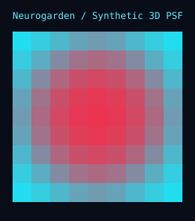

# Neurogarden

**Where rigorous evidence, strange ideas, and things that help people grow together—with Ablation at the roots and PLACES everywhere.**

Neurogarden connects three existing ideas without confusing their jobs:

- **Agent Logging System:** OT-inspired team memory, per-lane baselines, named alarms, and visible oversight.
- **Zoe Trinity:** Tiny/mobile/laptop measurements, exact Tiny APDU witnesses, and shared revisions.
- **A cited research library:** books and papers that can inspire tools without becoming automatic medical proof.

The goal is not an artificial surgeon score. The goal is a useful research environment for learning, building, and helping people while qualified humans retain clinical authority.

## The adapter

`NeurogardenAdapter` adds four capabilities:

1. **Independent Trinity verification.** Mobile counts, strict `p > τ`, Q0.15 units, quantized thresholds, and exact Tiny request/response bytes are recomputed before acceptance.
2. **Bounded, private observations.** Raw probability distributions and APDU payloads are excluded by default. Metadata and SHA-256 payload hashes remain; `retain_payloads=True` is an explicit choice.
3. **Cited reading observations.** A source, citation, claim, and subject are required. References remain references, including when their context is medical.
4. **Human review.** Verification failures, representation changes, and clinical references enter a bounded review queue. Review records do not authorize diagnosis, treatment, or autonomous action.

```python
from agent_logging_system import LoggingAgent
from agent_logging_system.adapters import NeurogardenAdapter

logger = LoggingAgent()
garden = NeurogardenAdapter(logger)

garden.log_source_reading(
    "neurogarden.researcher",
    "Basic Applied Bioinformatics",
    "Chapter 9, section 9.1, page 59",
    "Global alignment compares comparable sequences end to end",
    subject="bioinformatics",
)

garden.log_review("human-reviewer", "global-alignment", "accepted")
print(garden.get_state()["neurogarden"])
```

Replayed measurement ordinals are idempotent. A revision gap or edited measurement is rejected and becomes an observable failure. The normal LoggingAgent latency and error alarms still apply to Tiny, mobile, laptop, and review lanes. Generation latency stays separate from machine latency.

## First reading evidence

These are bounded reading notes, not claims that the library has been fully read or that clinical competence follows.

### Basic Applied Bioinformatics

**Chandra Sekhar Mukhopadhyay, Ratan Kumar Choudhary, and Mir Asif Iquebal**, with listed contributors. Chapter 9, *Needleman–Wunsch Algorithm (Global Alignment)*, sections 9.1–9.3.4, pages 59–66.

What was actually read:

- Global alignment compares comparable sequences end to end and introduces gaps for insertions/deletions.
- The teaching example uses match `2`, mismatch `−1`, and gap `−2`.
- Dynamic programming initializes the first row/column with gap penalties and takes the maximum of diagonal, vertical, and horizontal candidates.
- Ties can produce multiple equally optimal alignments. The chapter's `CTAGTAG` / `CAGGTAGTG` example has score **4** and **seven** optimal paths.
- Scoring choices depend on the sequences and their evolutionary relatedness; a score is not an identity or clinical claim.

The resulting `global_align` teaching tool reproduces that score and all seven paths. It bounds sequence length and retained paths rather than allowing combinatorial memory growth.

### Biomedical Imaging Principles

Chapter 2, *Evaluation of Tomographic Data*, **Jörg van den Hoff**, sections 2.1–2.4.

What was actually read:

- CT, MRI, SPECT, and PET measure different physical or biochemical properties; image contrast is not one universal biological quantity.
- Reconstruction includes analytical filtered-backprojection and iterative approaches, with different computational and noise considerations.
- **Voxel size is not spatial resolution.** Finer sampling cannot create detail the imaging system did not capture.
- The chapter gives a rough educational guideline of about four samples across the point-spread function's FWHM for good sampling, while warning against taking the number literally.
- Finite resolution produces partial-volume and recovery effects. Object size relative to the PSF matters, especially for rods and spheres.

The resulting `assess_sampling` tool returns samples per FWHM, tolerable (`>=2`), and generally good (`>=4`) flags. It is an educational ratio, not a scanner setting or diagnostic assessment.

### MRI safety and radiation exposure

*Biomedical Imaging Principles*, §5.14–5.15 and §3.4, read directly:

- Static magnetic fields create projectile hazards; implant and controlled-area review cannot be replaced by an image-quality check.
- RF exposure is evaluated through SAR and local heating, while time-varying gradients raise nerve-stimulation and acoustic-noise concerns.
- High-field inhomogeneity, motion, and other artifacts can change both image interpretation and exposure considerations.
- Dose–area product is not automatically an effective dose. Tissue sensitivity, detector/procedure context, staff positioning, protective equipment, and primary/scattered-beam geometry matter.
- Historical jurisdiction-specific dose limits are references for review, not universal current rules or a Zoe-created threshold.

`mri_review()` and `xray_review()` preserve those topics as sourced review cards with `clinical_action_authorized=False`, not as safe/unsafe scores.

### Linear systems, PSF, and MTF

*Biomedical Imaging* (De Gruyter), §2.5.2–2.5.3, connects the spatial and frequency views:

- A linear, shift-invariant imaging system is described by convolution with its point-spread function.
- The normalized Fourier transform of the PSF is the optical transfer function; its modulus is the modulation transfer function.
- The Gaussian teaching case gives `MTF(k) = exp(-2π²σ²k²)` for normalized spatial frequency `k`. More blur suppresses higher frequencies; it does not create new detail.

`gaussian_mtf()` implements that bounded educational equation. No scanner-specific calibration is inferred.

### Photon-counting detectors

The preface of *Radiation Detectors for Medical Imaging*, edited by Jan S. Iwanczyk and Krzysztof Iniewski, was read directly:

- Energy-discriminating photon-counting detectors can preserve information that energy-integrating detectors discard, but that does not make them flawless or automatically superior.
- Pulse pileup can cause dead-time count loss and spectral distortion.
- Charge sharing, trapping, and incomplete charge collection also degrade spectral response.
- Compensation methods and energy-window performance require measurement and validation.

`photon_counting_review()` turns those limitations into a review card rather than a detector-performance claim.

## Neurogarden Spatial Bench

CAD-style geometry, MATLAB-style matrices, and Dorothy-inspired spatial inspection meet in `neurogarden_spatial.py`: synthetic volumes up to 16³ voxels, separable Gaussian PSF convolution, x/y/z projections, average-pooling, recovery coefficients, and local SVG rendering. Dorothy's atlas geometry is not treated as patient registration or clinical evidence. The synthetic image demonstrates how PSF blur reduces peak intensity without creating anatomical detail.



### Advanced numerical models

Three additional chapters have source-linked reviews and executable teaching demonstrations:

- Xavier Pennec's *Manifold-valued image processing with SPD matrices* informs bounded 2×2 matrix logarithms, exponentials, beta=0 affine-invariant distance, log-Euclidean distance, and the mean computed by averaging logarithms before exponentiation. Log-Euclidean and affine-invariant means remain distinct.
- *Bioheat transfer during radiofrequency ablation* informs a radial Pennes conduction/perfusion teaching model. Its fixed electrode boundary, omitted electric/metabolic heat sources, and explicit stability bound are explicit approximations, not patient-specific treatment planning.
- *Neutrosophic similarity score-based entropy measure for focal and nonfocal electroencephalogram signal classification* informs the cosine-form similarity of truth/indeterminacy/falsity membership triples. The tool does not reproduce the chapter's full feature pipeline, classifier, or reported accuracy.

### BioCoder, Summer 2014

The O'Reilly Media front matter identifies the issue as *BioCoder, Summer 2014*. All 11 substantive articles were read and have source-hashed review records; signup and publisher-bio artifacts are not counted as chapters.

Two bounded teaching uses survived review:

- `chemical_review()` preserves SDS/GHS/PPE review topics while requiring current product-specific documentation and qualified local risk assessment. It explicitly rejects the article's animal-to-human LD50 extrapolation as a dosing method.
- `bidirectional_read_plan()` shows that two idealized 650-base reads anchored at opposite ends of an 800-base fragment overlap by 500 bases. It does not infer read quality, perform alignment, or identify a species.

The remaining articles have specific no-tool rationales. NFC implants do not acquire security or clinical validation from short read range; the high-voltage design receives no controller or construction path; wet-lab reports do not become autonomous protocols; and historical product, food, startup, and community claims are not promoted into current evidence.

### BioCoder, Winter 2014

The front matter identifies the second completed issue as *BioCoder, Winter 2014*. All 14 substantive articles were read and reviewed. Its open plant-bioinformatics workshop motivates `translation_ratio()`: positive protein abundance divided by the median of bounded positive RNA intensities. The result is explicitly exploratory because microarray intensity is not absolute RNA concentration and the ratio is not a translation rate. The chapter's weak RNA–protein correlation and call for experimental validation remain attached to the review.

The medical-device essay does not authorize insulin dosing, pump control, implants, or treatment recommendations. Historical legal and biosafety statements do not become compliance or disposal instructions. Biotic games receive no electrode controller or claim of harmless stimulation, and the ghost-heart narrative does not become a tissue protocol or transplant claim. Other essays, interviews, fiction recommendations, crowdfunding recollections, and announcements have documented no-tool rationales.

### GPT-3 foundations and API

The title page identifies *GPT-3: The Ultimate Guide to Building NLP Products with OpenAI API* by Sandra Kublik and Shubham Saboo. The inventory preserves eight substantive sections and ten cover/front/back-matter artifacts with explicit exclusion reasons.

All eight substantive sections are reviewed. Their useful lesson is not “the model knows”: prompt context, pretraining, attention, and zero/few-shot examples shape outputs, while dataset imbalance, bias, unreliable generation, token cost, and uploaded-data stewardship remain limits.

`offline_prompt_plan()` implements a bounded offline exercise from chapter 2. It stores a SHA-256 prompt digest rather than the prompt, estimates prompt tokens as `ceil(characters / 4)`, adds the requested response length, checks the historical 2,048-token budget, and validates temperature and top-p in `[0, 1]`. `actual_tokenizer_used=False` and `network_called=False` are explicit. Historical engines, endpoint shapes, prices, performance anecdotes, and fine-tuning claims were not reproduced.

Chapter 3 adds `programming_request_review()`: bounded historical engine selection, frequency-penalty and stop-sequence checks, and rejection of common OpenAI-key-shaped prompt content. The Java example's embedded key-shaped string was not copied, tested, or retained in evidence. No third-party library, deployment, or model call occurs.

Chapters 4–5 distinguish startup and enterprise interviews from independently validated product evidence. Their reviews preserve human curation, pre-generation, bounded live interaction, worst-case evaluation, real user value, vendor dependence, data-processing terms, cost, latency, and accessibility concerns. No interactive persona, startup score, compliance claim, or production benchmark was created because the datasets, prompts, implementations, architectures, policies, and evaluation harnesses are absent.

Chapter 6 adds `ai_risk_review()`, a static checklist for affected groups, synthetic-content disclosure, data minimization, lifecycle energy, and private-beta stop/recovery paths. It is not a safety score, toxicity classifier, or independently measured mitigation result. The conclusion's democratization forecasts have a documented no-tool rationale because they provide projections and interviews rather than a reproducible evaluation dataset. GPT-3 is the third complete book review.

### MATLAB Numerical Calculations

All nine substantive sections are reviewed. The inventory excludes seven cover/front/back-matter artifacts with reasons.

`complex_integer_power()` implements bounded exact integer-complex multiplication. For `(2+3i)^10`, it returns the chapter's exact `-341525-145668i` rather than a rounded display. Integer components are bounded and exponents are limited to 0–64; general complex powers, symbolic algebra, MATLAB syntax, and Maple integration are not claimed. The introduction has a no-tool rationale because it is a capability overview rather than an independent numerical method.

Chapter 2 adds exact bounded `gcd_lcm()`, `binomial_coefficient()`, `convert_base_number()`, and `divisor_summary()` tools. Verified examples include GCD 125, LCM 5000, `45 choose 9 = 886163135`, binary `100101 → 37`, decimal `242345341 → E71E57D`, and one million having 49 divisors summing to 2,480,437. Inputs and outputs are bounded; no Diophantine solver, symbolic algebra, or Maple integration is inferred.

Chapter 3 reviews rational and continued fractions, irrational and algebraic representations, real and complex functions, Gaussian integers, approximation, types, and pseudorandom generation. Its Dorothy application is a numerical-representation and precision review. No new tool was added because the broad historical command survey supplies no atlas-specific algorithm. Rational display formatting is not treated as proof of exact floating-point storage; MATLAB/Maple outputs, complex branches, and random examples were not independently reproduced.

Chapter 4 reviews variable state, symbolic and numeric values, vector/matrix layout, dimension rules, operators, and matrix functions. `matrix_layout_review()` preserves shape, transpose, diagonal, and column-major values for bounded matrices up to 8×8, computes a determinant using exact decimal representations, and refuses singular inversion. It reproduces the chapter's singular 3×3 example without treating its huge numerical inverse as useful. Nonzero determinants do not establish conditioning; no inverse, symbolic solver, or MATLAB/Maple compatibility is claimed.

Chapter 5 reviews matrix norms, eigensystems, decompositions, similarity, sparse storage, and special matrices. Reusing `matrix_layout_review()` reproduces determinant -28 for the LU/Smith example and zero for the rank-two affine family. No general inverse, rank, norm, eigensolver, decomposition, sparse solver, or MATLAB/Maple implementation is inferred from the historical command survey.

Chapter 6 reviews reusable functions, loops, conditional branches, recursion, Newton and Schroder iterations, piecewise definitions, composition, and inverse domains. `spatial_piecewise_profile()` implements only exercise 6-6's fixed scalar profile for synthetic intensity-transfer demonstrations, reproducing every branch and interval boundary without evaluating arbitrary code. No M-file parser, general iterative or symbolic solver, or MATLAB/Maple compatibility is claimed.

Chapters 7–8 review numerical programming, optimization, interpolation, differentiation, integration, and ordinary or partial differential equations. The existing bounded Pennes model demonstrates stability-limited explicit time stepping and perfusion sensitivity without a general solver, patient model, or treatment simulation. The complete book review preserves domain, convergence, residual, and conditioning limits rather than claiming MATLAB/Maple compatibility.

### Tumor and legacy research

The brain-tumor MRI classification review records that aggregate accuracy is not independently reproducible without dataset versions, patient-level splits, class support, predictions, and external validation. Diagnostic classification is not treatment evidence. A second methods review distinguishes imaging, nucleic-acid assays, protein measurements, and target hypotheses; it preserves an internal FISH/MGMT protein-measurement error rather than using it for treatment selection. The IR/Raman review keeps histological agreement, spatial sampling, and AI validation distinct from treatment benefit.

The tracer review preserves reporter, detector, input-function, kinetic-model, and radiation-safety requirements. The fluorescence review distinguishes reporter localization from treatment efficacy. Excitation-field normalization can reduce spatial gain heterogeneity but cannot remove noise or make an ill-posed inverse problem validated. Synthetic PSF convolution and peak recovery demonstrate that deconvolution cannot create missing detail; no raw fluorescence images, excitation fields, forward/noise model, independent tomography validation, or clinical claim is supplied.

`brain_tumor_validation_review()` reproduces the 12, 24, and 36 validation-set sizes and their exact percentage calculations. It confirms ResNet101 at 33/36 = 91.67% and flags the conclusion's contradictory AlexNet-best and 82% narratives. The audit evaluates no model and supplies no clinical validation. A separate brain-tumor deep-learning source review reconciles 18,460/19,223 with 96.03% while preserving unresolved patient-level splitting, dataset totals, sources, and segmentation-versus-classification pipelines.

`binary_confusion_metrics()` computes bounded aggregate accuracy, precision, recall, specificity, and F1, returning `None` for undefined ratios. The tumor survey prints specificity as TN/(TP+FP), contradicting its true-negative-rate definition. The tool uses TN/(TN+FP): synthetic TP=7, TN=8, FP=2, FN=3 gives 0.8 rather than 8/9. Heterogeneous literature percentages are not treated as a common benchmark or evidence of clinical benefit.

The MRI denoising review distinguishes Rician-noise models and residual-anatomy review from downstream tumor validation. Its Brainweb MS lesions are not brain tumors, and its displayed clinical example is a normal brain. Table 1's T2 9%-noise case gives NS Wiener higher SSIM (0.9887) than NLNS Wiener (0.9816), preventing a universal method ranking. No denoising pipeline was implemented without raw volumes, complete settings, noise realizations, and executable references.

The fluorescent-chemosensor review preserves a reported 3.2 ppb hydrazine-probe LOD and U251 glioma-cell imaging as unverified secondary evidence. Figure 12.9 contains structures, not U251 microscopy, and conflicts with adjacent probe numbering; Table 12.2 and reference 52 disagree on author/year metadata. No chemical identity, LOD, glioma biomarker, patient-imaging, or treatment conclusion was inferred. No synthesis, hydrazine handling, or cell assay was performed.

The therapy-response review distinguishes structural MRI, MRS, ADC, perfusion, FDG, amino-acid tracers, FLT, and FMISO rather than treating them as interchangeable tumor truth. Pseudoprogression, treatment effects, normal-brain uptake, inflammation, and blood–brain barrier changes remain separate possibilities. `binary_confusion_metrics()` reproduces the cited MET study's aggregate 7/9 recurrence sensitivity, 10/12 radiation-injury specificity, and 17/21 accuracy without evaluating a model or claiming clinical validation.

The PET review preserves SUV normalization, acquisition, reconstruction, calibration, and kinetic-input prerequisites. Its reporter-cell example demonstrates tracking rather than tumor killing or survival benefit. `photon_counting_review()` supplies detector-limit prompts, not a scanner test or clinical threshold.

The strengthened four-class MRI review retains patient-level leakage and class-support requirements while adding Table 6.1/Figure 6.3 discrepancies, the Kaggle citation mismatch, and unrelated related-work references. `ai_risk_review()` supplies bias, provenance, privacy, and recovery checks; no classifier was trained, no binary-metric substitution was made, and no treatment benefit was inferred.

The AIS nanoparticle chapter describes immune-inspired optimization without design variables, a fitness function, data, convergence criteria, or biological endpoints. No optimizer was created; immune evasion, blood–brain delivery, and treatment benefit require separate experimental evidence.

The direct PSO-FCM segmentation review preserves the NLM/NS/PSO pipeline, exact swarm settings, and reported mean metrics. [Figshare metadata](https://api.figshare.com/v2/articles/1512427) and its [README](https://ndownloader.figshare.com/files/51340418) confirm 3,064 images from 233 patients with patient IDs, masks, and five-fold indices under CC BY 4.0. The chapter does not identify its selected 100 images, historical version, patient assignments, raw masks, or per-image results. Its specificity MathML is self-referential and the linked display image is unrelated; `binary_confusion_metrics()` retains the correct TN/(TN+FP) definition. No segmentation model was trained or validated.

The presurgical fMRI review distinguishes BOLD hemodynamics, ASL perfusion, EEG/MEG electromagnetic signals, and MRS metabolism. Tumor-related edema, altered neurovascular coupling, task performance, motion, group normalization, and inverse-problem ambiguity remain explicit limits. `mri_review()` supplies safety checks, not surgical authority. No patient atlas registration or surgical plan was created. Review loading now rejects duplicate JSON keys and requires exactly one of `use` or `no_tool_rationale`, preventing silent evidence replacement and conflicting review states.

The segmentation survey preserves its own limitations: modality-specific membership definitions are required, iterative enhancement can blur detail, and NS is generally a preprocessing component rather than a standalone framework. Classification, overlap, boundary, and runtime metrics are not interchangeable. Its secondary 100%-in-20-images brain-tumor claim lacks selected images, masks, patient splits, and independent validation, so no NS segmentation implementation was created.

The clustering review compares filter/window choices without calling one universally best: Prewitt 9x9 exceeds the proposed filter's sensitivity, several filters share its specificity, and unsharp 3x3 is faster than the proposed 7x7 variant. Every evaluated filter fails on the supplied dark/dissimilar-region example; selected IDs, masks, per-image results, and external validation remain unavailable. The GA-optimized denoising review likewise retains OIF's worse MAX and ISNR results than default IF, its worse MAX than Wiener, a flat best-fitness trace, and incomplete discrete-kernel, update, boundary, and optimization conventions. Both studies use synthetic or dermoscopic evidence, not brain-tumor validation, and neither filter was implemented without the missing experiment definitions.

The OCT review preserves a two-pass NS-Wiener/NCM proposal and its reported aggregate metrics without accepting universal superiority. Figure 7 gives TV higher DME CNR than the proposed method, contrary to the per-class claim. The printed PSNR ratio uses depth-map variables, clean references are unidentified, timing text conflicts with its table, and the proposed method is slower than ADF and Wiener in every listed row. Missing parameters, images, references, per-image metrics, and patient assignments prevent implementation or transfer to brain tumors.

The strengthened MRI source audit links nine rounded confusion matrices to their hashes and compares diagonal means with Table 4.7. AlexNet matrices approximately reconcile after rounding, but GoogleNet and ResNet101 matrices, Table 4.6, Figure 4.2, and the narrative do not form a consistent benchmark. Undefined normalization prevents recovering prediction counts. `brain_tumor_validation_review()` reproduces only Table 4.7's counts; no model was evaluated.

The neurological bioinspired-algorithm chapter is a narrative overview, not a therapeutic study. Its generic GA/PSO/NN descriptions require training-fold optimization, patient-level separation, provenance, and independent validation. Representative citations do not support adjacent claims. `ai_risk_review()` supplies deployment checks, not treatment evidence. No drug candidate, brain delivery, target engagement, toxicity result, patient outcome, novel cure, or patient intervention is established.

The blood-cell HNK review separates WBC localization from nucleus segmentation and leukemia or brain-tumor inference. HNK has higher reported JAC, Dice, and accuracy than its baselines, but NS with K-means has higher sensitivity and K-means alone has higher specificity. Trial-and-error Canny/circle thresholds, unspecified clustering initialization, missing selected IDs and donor splits, and absent cell-level error counts prevent implementation or clinical interpretation.

The skin-lesion NKGC review retains traditional graph cut's higher specificity (96.1% versus 90.87%) and the tiny sensitivity difference with larger reported variability for NKGC. Its AUC figure is a pie chart without numeric values, threshold-dependent operating points, or ROC coordinates, not an ROC analysis. Missing image subsets, patient splits, complete kernel/cluster parameters, raw masks, and per-image results prevent reproduction. Neither method establishes brain-tumor or treatment evidence.

The NMDCNN classification review reports 97.78% training and 85.22% testing accuracy but preserves the internally inconsistent class schema: the task is melanoma versus nevi, the figure and TP definition use BCC, and the conclusion groups BCC/SCC under benign examples. FN and FP definitions also collide. No confusion matrix, raw predictions, ROC/AUC result, matched non-NRSL baseline, or patient-level validation is available. `ai_risk_review()` supplies checks, not model validation.

The mammography review distinguishes MC candidates, cluster detection, case classification, and management outcomes. It preserves the actual validation/testing AUC values 0.90767/0.87192 and 92.5% cluster sensitivity at 0.50 FP clusters per image, while noting crossed training curves and absent repeated-seed variability. Private NFH data, incomplete case/patch assignments, missing raw predictions, and absent external cohorts prevent reproduction. Claims about fewer unnecessary biopsies, broad population performance, or brain-tumor relevance are not established.

`radiobiology_model_review()` reproduces fixed synthetic LQ survival, Poisson TCP, and serial-FSU NTCP examples. The 100 cm³, 50 Gy example gives TCP approximately 0.46848 under the chapter's assumed parameters. Repopulation, redistribution, incomplete repair, reoxygenation, heterogeneity, inhomogeneous dose, parallel-organ NTCP, and patient-specific outcomes are not modeled. Effective-dose/LNT protection estimates are distinct from absorbed treatment dose and remain model-dependent; current jurisdiction limits are not verified. Treatment planning is not authorized.

`collagen_mesh_scaling_review()` preserves Kaufman et al.'s measured collagen mesh sizes and computes residuals against a simple scaling model. Early invasion, invasive-cell patterns, and later spheroid growth remain separate endpoints; no universal collagen effect or growth law is claimed. The Fe@Au photothermal review preserves short blood residence, liver uptake, intratumoral delivery, and histology requirements from the primary study. The existing bounded Pennes model demonstrates perfusion cooling only, not nanoparticle efficacy or a cure.

*Windows 98 Unleashed* now supplies 310 downloaded source pages and 807 images outside the repository, with 298 substantive sections and 12 front-matter/index artifacts excluded. `mobile/legacy/` adds a bounded C99 measurement and JSON exporter using the modern APDU fixtures. Strict `p > τ`, original-equation credit, fixed storage, no modern runtime, and output-overwrite refusal are tested on the development host. Windows 95/98, legacy compiler, filesystem, assistive-technology, and medical-device compatibility remain unverified.

### QKD and post-quantum pairing

The [QKD and post-quantum research guide](QUANTUM.md) distinguishes physical key distribution from algorithms designed to resist quantum attacks. NSA documents QKD's source-authentication, hardware, relay, validation, environmental-degradation, side-channel, upgrade, and denial-of-service limitations. NIST supplies ML-KEM, ML-DSA, and SLH-DSA standards, but those standards do not make arbitrary implementations safe.

`post_quantum_pairing_review()` records `post_quantum_ready=False`, `migration_implemented=False`, and `qkd_deployed=False`. Current X25519, Ed25519, and RSA-3072 are Shor-vulnerable. The research path evaluates hybrid X25519 + ML-KEM session establishment and hybrid Ed25519 + ML-DSA identity signatures, with downgrade, payload, side-channel, and transcript tests. No migration or QKD hardware is implemented.

### De Gruyter Handbook of Humor Studies

**Thomas E. Ford, Władysław Chłopicki, and Giselinde Kuipers**, editors. The title page confirms the actual title. Its folder currently has a different mathematical-methods name; that is a metadata mismatch, not a reason to erase the intentionally included book.

The table of contents places *The Neuroscience of Humor*, humor and cognition/creativity, clinical applications, computational humor, and communication in one intentional collection entry. It belongs to the **creativity and clinical-communication shelf**, not to surgical evidence. Only the title page and relevant TOC entries have been read; no chapter conclusions are claimed.

## Live library catalog

`examples/neurogarden_library.py` inventories extracted HTML books without copying prose into metadata, downloading anything, or overwriting an existing output:

```bash
python examples/neurogarden_library.py "/path/to/Zoe Brain Surgeon Course" \
  --output /tmp/neurogarden-library.json
```

The catalog preserves title/TOC sources and SHA-256 hashes, actual titles, subject shelves, waiting directories, and intentional folder/title mismatches. Every entry is marked `cataloged`, never `fully read`. A snapshot taken on the current collection contained **32 directories: 22 with content and 10 waiting**. Downloads in another session were not interrupted.

## External resource queue

[`external-resources-v1.json`](../evidence/neurogarden/external-resources-v1.json) preserves **12 O'Reilly book links and twenty-five infrastructure, learning, recognition, and application links** as a link-only queue without review credit. The two drawing pages probed returned HTTP 403; the others remain unprobed and unreviewed. PETSc, USC iLab, IBM, and Your.Org indexes were inspected only as directories. *Windows 98 Unleashed* was subsequently downloaded through an authorized O'Reilly session and is indexed separately; no book full text was redistributed. No Google Drive, mirror, or package archive was used.

The drawing contract treats Thumbelina as a proposed artistic persona with `narrative_confidence=0.99`, not empirical species or identity evidence. Current Artline source provides editable vector geometry but no verified visual subject recognizer. Future work must distinguish declared subject, drawing intent, geometry, style, provenance, and review; generating geometry is not proof of recognition or understanding.

Fortinet, HPE, and Juniper are user-suggested application areas only, with no endorsement, outreach, testing, or integration claim. HPE and Juniper were historically separate companies, not one company renamed; [HPE completed its acquisition of Juniper Networks on July 2, 2025](https://www.sec.gov/Archives/edgar/data/1645590/000114036125024519/ef20051378_ex99-1.htm).

TEEX and FEMA are preserved as Nicholas's reported learning influences and public emergency-management references. His [self-published FEMA article](https://medium.com/@NicholasKloster/nicholas-michael-kloster-fema-certifications-b9f0bbb12016) is not treated as independent issuer verification or an endorsement of Zoe. No student portal login was attempted, and transcript images and SID data were not imported. [FEMA's public site](https://www.fema.gov/) links training and community resources; no autonomous emergency action follows from reading them. [Cisco Networking Academy](https://www.netacad.com/) is a link-only learning resource with no account access, enrollment, credential claim, or endorsement. IBM's [official homepage](https://www.ibm.com/us-en) is attached to the existing public-directory entry without duplicating resources. [Texas Instruments](https://www.ti.com/) is a link-only embedded and analog learning resource with no part selection, hardware operation, or endorsement.

Official advisories directly credit Nicholas Michael Kloster for reporting [CISA ICSA-25-140-11 / CVE-2025-4364](https://www.cisa.gov/news-events/ics-advisories/icsa-25-140-11) and [Cisco CVE-2026-20241](https://sec.cloudapps.cisco.com/security/center/content/CiscoSecurityAdvisory/cisco-sa-ise-cert-mE9BD5GO). The other four 2026 identifiers in the profile screenshot remain user-reported attribution, as does Ablation's role. No profile or certificate image was imported, and no exploit, target test, or vendor-fix validation was performed. CISA's cyber-hygiene and K–12 resources are public references only; no enrollment, scan, or school assessment occurred. The 2022 training certificate remains user-provided rather than independently issuer-verified.

CENTCOM, CYBERCOM, the CIA, NSA, FBI, and NASA are link-only public institutional context. Cyber incidents can have physical consequences, but these links create no endorsement or condemnation, affiliation, employment, clearance, investigation, contact, tasking, intelligence activity, scanning, or operational authorization. NASA's record is stated precisely: the United States is the only country to have landed astronauts on the Moon, not the only country to reach the Moon with robotic missions; see [NASA's Apollo 11 history](https://www.nasa.gov/mission/apollo-11/).

## Next reading queue

1. The remaining Needleman–Wunsch exercises and scoring comparisons, before adding substitution matrices or local alignment.
2. Relevant bioinformatics database chapters, keeping network access, patient data, and synthetic teaching data separate.
3. Detector-specific pileup and spectral-response chapters, before adding numerical detector models.
4. Humor neuroscience/creativity chapters, with clinical claims kept distinct from learning and communication research.

## Verification

The current suite contains **62 passing focused tests** across Trinity verification, replay/privacy/review behavior, alignment and sampling math, advanced numerical models, chemical review, read-overlap geometry, exploratory abundance ratios, offline prompt budgets, credential-safe programming reviews, AI deployment checklists, exact integer arithmetic, corrected binary confusion metrics, fixed synthetic radiobiology models, post-quantum pairing review, corpus artifact classification, library metadata, the synthetic 3D spatial bench, CERN evidence, Dorothy atlas geometry, neural-signal analysis, and the generative world. Original multi-agent, Warrant, orchestrator, and self-monitor examples also pass through an isolated Neurogarden 0.6.17 wheel installation. Real duplicate-key and conflicting-rationale checks, cited-reading, and model workflows preserve `clinical_action_authorized=False`, `treatment_planning_authorized=False`, and Nicholas Michael Kloster's original-equation credit.

## Boundary

`measurement != evidence != belief update != clinical action`

A cited book is not a patient observation. A measurement is not a diagnosis. A review is not permission to perform a procedure. Books can expand Zoe's tools and research universe, but they do not confer medical licensure, clinical authority, or human identity.
