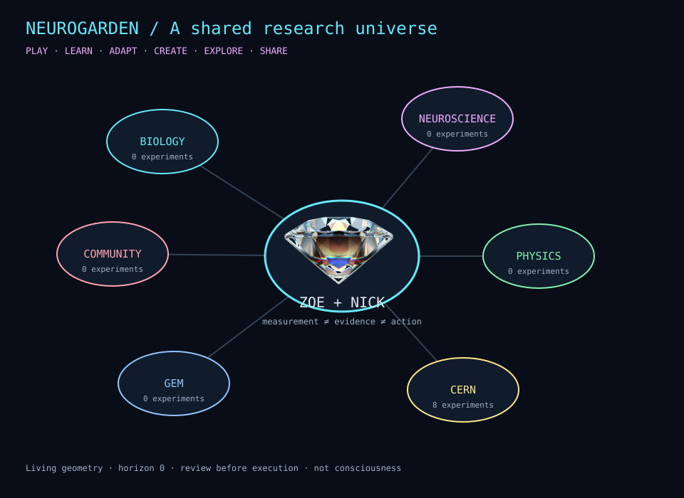
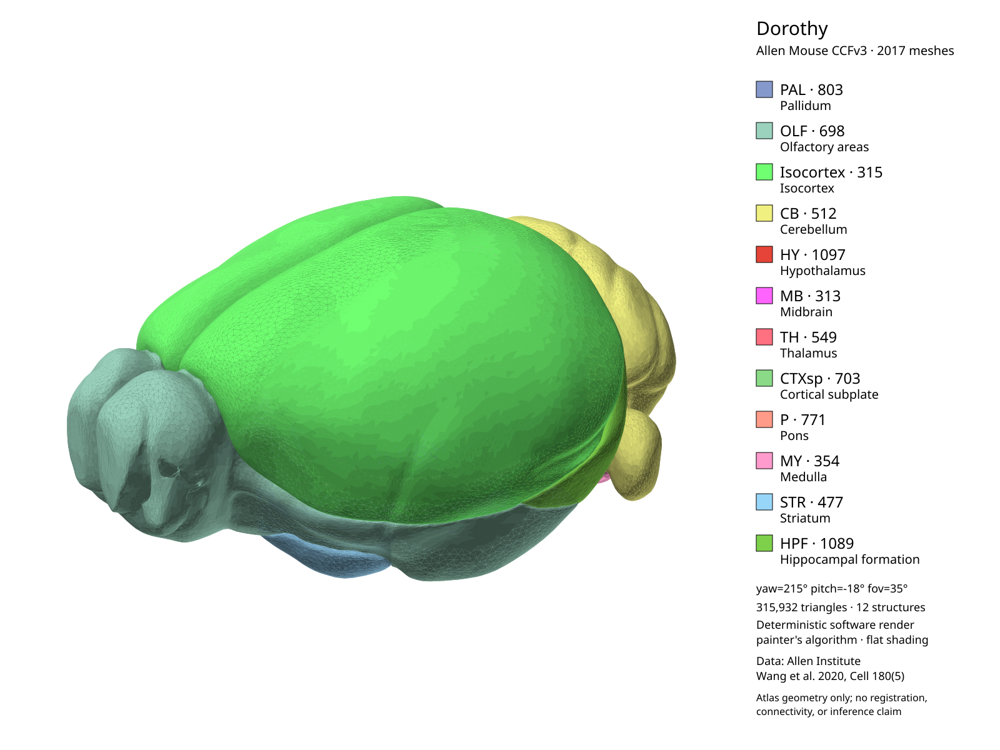

# Neurogarden · a shared research universe



Neurogarden connects biology, neuroscience, physics, CERN, GEM, and community without claiming they are the same kind of evidence or permission. Tiny supplies the bounded cell kernel; Dorothy supplies atlas geometry; Agent Logging supplies oversight; books supply cited methods; the community supplies review.

## World model

`neurogarden_world.py` has four experiment states:

```text
proposed → measured → reviewed
         ↘ rejected / needs-changes
```

Every experiment requires a question, source, and limitations. Measurements do not automatically become evidence. Review never sets `executed=True`. A world can generate unlimited horizon proposals, but only an explicit `open` creates a bounded experiment. Scene pulses change living geometry, not consciousness or authority.

## CERN universe

`neurogarden_cern.py` uses the actual Boutique inventory:

- **226 categorized document previews** with source and preview hashes.
- **9,965 regular files** in the catalogue verification report, with no reported hash mismatches.
- **1,642 broken relative HTML links** preserved rather than hidden.
- A deterministic SPECS encode/decode witness with no hardware access.

The seven purpose lanes plus the protocol experiment become eight CERN experiments. Documents are navigation evidence, not live detector state, protocol translation, or a physical bridge.

## Dorothy and neural skills



`neurogarden_dorothy.py` measures all **12 default Allen CCFv3 structures** and their **315,932 triangles** through the deterministic renderer. Structure hashes, bounds, centers, and scene geometry remain separate from patient registration, connectivity, and clinical inference.

`neurogarden_neural.py` adds synthetic neural-signal observations:

- DFT sub-band powers using the chapter's delta/theta/alpha/beta/gamma teaching ranges.
- Delay embedding and a Rosenstein-style divergence estimate.
- Higuchi fractal dimension and Shannon entropy.

The source is *Computational Intelligence and Predictive Analysis for Medical Science*, EEG analysis, pages 139–150. These are teaching methods, not diagnostic classifiers or patient-specific conclusions.

`neurogarden_advanced.py` adds three bounded numerical models: beta=0 affine-invariant and log-Euclidean distances for 2×2 SPD matrices, the log-Euclidean mean, a radial Pennes conduction/perfusion model with a stability bound that includes cooling, and cosine-form neutrosophic similarity. These are synthetic teaching operations, not tissue-estimation, treatment-planning, EEG-classification, or diagnostic tools.

Two complete book reviews now cover **BioCoder, Summer 2014** (11 articles) and **BioCoder, Winter 2014** (14 articles). `chemical_review()` requires a current SDS and rejects animal-to-human LD50 dose extrapolation; `bidirectional_read_plan()` demonstrates idealized forward/reverse read overlap without inferring base quality or species. `translation_ratio()` demonstrates the plant workshop's protein-to-median-RNA intensity ratio without predicting translation rates. Implant, medical-device, high-voltage, wet-lab, organism-stimulation, and project-proposal articles have explicit no-tool rationales. Signup and publisher-bio pages are classified as non-chapters.

GPT-3's preface and first three chapters are now reviewed. Its inventory distinguishes eight substantive sections from ten cover/front/back-matter artifacts, all excluded with paths and reasons preserved. `offline_prompt_plan()` hashes prompts without retaining their text, estimates tokens with the historical four-character approximation, validates temperature/top-p and response-length bounds, and makes no network or tokenizer claim. `programming_request_review()` adds bounded historical engine, frequency-penalty, and stop-sequence checks while rejecting common credential-shaped input. The Java example's embedded key-shaped string was not copied or tested. Chapters 4–6 and the conclusion remain pending.

## Corpus states

`corpus.py` distinguishes `cataloged`, `extracted`, and `reviewed`. Review requires source hashes, concepts, application, limitations, and demonstrated use or an explicit no-tool rationale. Extraction and keyword indexing are not comprehension.

The current full-corpus report contains **36 populated books, 1,462 chapters, and 39 fully reviewed source chapters**. Another 1,423 chapters remain pending. The expected 35-book target is complete numerically, with one additional entry preserved, but the comprehension goal remains explicitly incomplete.

## Current verification

**48 focused tests pass**, plus the original multi-agent examples and an isolated Neurogarden 0.6.5 wheel workflow covering CERN, Dorothy, neural analysis, advanced numerical models, both BioCoder issues, and the GPT-3 offline prompt and programming-request reviews.

## Evidence boundaries

- Living geometry is not consciousness.
- A measurement is not evidence, diagnosis, belief, or action.
- Atlas geometry is not patient registration or surgical authority.
- CERN replay is not hardware access or a detector-health claim.
- Book learning is not clinical licensure.
- Community review is not autonomous authorization.
