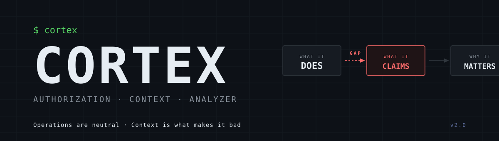

<h1 align="center">
  
  <br>
</h1>

<h4 align="center">Authorization context analyzer. Describes code, systems, and behaviors by what they do versus what they assume the right to do.</h4>

<p align="center">
  <a href="https://github.com/nuclide-research/cortex-framework/blob/main/LICENSE"></a>
  <a href="https://www.python.org"></a>
  <a href="https://nuclide-research.com"></a>
</p>

<p align="center">
  <a href="#features">Features</a> •
  <a href="#installation">Installation</a> •
  <a href="#usage">Usage</a> •
  <a href="#input-format">Input format</a> •
  <a href="#severity-scoring">Severity</a> •
  <a href="#reference-corpus">Corpus</a> •
  <a href="#scope">Scope</a>
</p>

---

cortex parses a structured markdown description of any artifact into three sections (SKELETON, VIOLATIONS, CONTEXT) and emits JSON, markdown, and HTML reports with severity scoring. The thesis: operations are neutral. Context is what makes behavior harmful. Code cannot express intent or consent. cortex formats the external metadata into a reviewable, citable analysis.

The gap between what something does (SKELETON) and what it assumes the right to do (VIOLATIONS) is the load-bearing metric. A positive gap signals social-engineering or cognitive-layer attacks. A negative gap signals living-off-the-land, supply-chain, or boundary-test samples. A generic LLM verdict says "this looks malicious." cortex says "5 operations, 8 violations, critical, see the bullets and the cited primary source." A human reviewer can read the markdown and check every claim.

The repo ships a 14-sample reference corpus spanning historical worms, APTs, ICS safety-system attacks, social engineering, LLM-layer prompt injection, and null-violation boundary tests (Mimikatz, mgeeky red-teaming).

> [!WARNING]
> Do not use cortex for this loop:
> 1. Draft a cortex MD for a malicious script or prompt (with LLM help)
> 2. Run the analyzer to see the explicit violations and context gaps
> 3. Edit the original artifact to hide or reduce those gaps
> 4. Repeat until a generic LLM no longer flags it

# Features

- Three-section input format: SKELETON, VIOLATIONS, CONTEXT (REFERENCES optional)
- Severity scoring keyed to violation count plus weighted context, with a `violations <= 1` cap that holds boundary-test samples at `informational`
- Side-by-side `compare` across all three sections, plus a summary row covering severity, counts, and the skeleton-to-violation gap
- `validate` subcommand returns exit 0 when all three sections parse non-empty
- JSON, markdown, and optional HTML output (dark theme)
- 14-sample reference corpus across four delivery media, citable side-by-side
- Standard library only. Python 3.10 or later. No `pip install` required.

# Installation

```bash
git clone https://github.com/nuclide-research/cortex-framework
cd cortex-framework
```

# Usage

```console
python3 analyzer.py analyze examples/iloveyou.md
python3 analyzer.py analyze examples/xz_utils_backdoor.md --html
python3 analyzer.py validate examples/stuxnet.md
python3 analyzer.py compare examples/iloveyou.md examples/conficker.md
```

Outputs land in `output/reports/` by default:

- `<name>.json` - structured data
- `<name>_report.md` - human-readable markdown
- `<name>_report.html` - optional HTML (dark theme)

<details>
  <summary>Full help (analyze flags)</summary>

| Flag | Default | Effect |
|------|---------|--------|
| `file` | required | input markdown file |
| `--json PATH` | `output/reports/<stem>.json` | JSON output path |
| `--report PATH` | `output/reports/<stem>_report.md` | markdown report path |
| `--html [PATH]` | off | also emit HTML (dark theme), path optional |
| `--output-dir DIR` | `output/reports` | base output directory |
| `--force` | off | write output even when validation fails |
| `-q, --quiet` | off | suppress the startup banner |
| `--banner` | off | force the banner even when stderr is not a TTY |
| `--version` | | print version and exit |

</details>

# Using cortex with a coding agent

The fastest way to produce a structured analysis of an unknown sample:

1. Clone this repo next to your sample:
   ```bash
   git clone https://github.com/nuclide-research/cortex-framework
   ```
2. Paste a prompt like this into your coding agent:

> Read `framework.md` and a few `examples/*.md` to learn the cortex format. Then analyze `<path/to/sample>` and write `examples/<short-name>.md` with SKELETON, VIOLATIONS, CONTEXT, and an optional REFERENCES section. Then run `python3 analyzer.py analyze examples/<short-name>.md --html` and show me the output.

The agent reads the methodology plus sample analyses, drafts a three-section cortex markdown, and runs the analyzer. The output:

- A reviewable analysis where every authorization claim is a falsifiable bullet, not an opaque verdict
- Deterministic JSON, markdown, and HTML reports from the analyzer
- Side-by-side comparability against the 14-sample reference corpus
- A citable artifact that holds up in a bug report, disclosure writeup, or incident review

The structure is enforced by the framework. The drafting uses the model. The authorization claims stay falsifiable by any human reviewer who reads the markdown.

See [`framework.md`](framework.md) for the full methodology, violation-class taxonomy, and reference analyses.

# Input format

```markdown
# Subject - Authorization Context Analysis

## SKELETON
- functional operation 1
- functional operation 2

## VIOLATIONS
- Assumes right to X without authorization
- Zero checks before Y

## CONTEXT THAT MAKES IT BAD
- Impact on owner or system
- Deception involved

## REFERENCES
- Primary source 1
```

Section headers are case-insensitive. Aliases: `AUTHORIZATION VIOLATIONS` for VIOLATIONS, `CONTEXT` or `BAD CONTEXT` for the context section. REFERENCES is optional.

# Severity scoring

```
if violations <= 1:  severity = informational
else:
    score = violations + (context_notes * 0.5)
    score >= 10  ->  critical
    score >=  6  ->  high
    score >=  3  ->  medium
    otherwise    ->  low
```

The `violations <= 1` cap prevents boundary-test samples (Mimikatz, mgeeky tooling) from inheriting inflated severity from heavy CONTEXT sections that are framework commentary rather than authorization harm.

The report also prints the skeleton-to-violation gap (`violations - operations`). A positive gap is the tell for social-engineering or cognitive-layer attacks (the attacker claims more rights than operations they visibly perform). A deeply negative gap is the tell for LOTL, supply-chain, or boundary-test samples (many operations, fewer explicit rights claims).

# Output shape (JSON)

```json
{
  "analysis_name": "ILOVEYOU Worm",
  "source_file": "examples/iloveyou.md",
  "analyzed_at": "2026-06-03T12:00:00Z",
  "skeleton": ["Reads address book from Outlook", "Sends itself as email attachment"],
  "violations": ["Assumes right to read all Outlook contacts without consent", "..."],
  "context": ["Caused $10B in damage globally", "..."],
  "analysis_summary": {
    "total_operations": 5,
    "total_violations": 8,
    "total_context_notes": 6,
    "skeleton_violation_gap": 3,
    "severity": "critical"
  },
  "parse_warnings": []
}
```

# Reference corpus

14 samples in `examples/`:

| Category | Samples |
|----------|---------|
| Historical worms and APTs | ILOVEYOU, Conficker, Stuxnet, WannaCry, NotPetya, SUNBURST, Volt Typhoon, xz-utils, 3CX cascade |
| ICS safety-system attacks | Triton, TRISIS |
| Social engineering | Phishing, 419 advance-fee scams |
| LLM-layer attacks | Prompt injection, jailbreak chains |
| Boundary tests (null-violation samples) | gentilkiwi/mimikatz, mgeeky/Penetration-Testing-Tools |

See `framework.md` § Reference Analyses for the full metrics table (ops, violations, context, gap, severity) across all 14.

# Repository layout

```
cortex-framework/
├── analyzer.py        CLI: analyze / validate / compare subcommands
├── framework.md       Methodology, violation-class taxonomy, reference metrics table
├── genesis.md         Motivating examples and origin
├── examples/          14 cortex markdown analyses
├── output/reports/    Generated JSON, markdown, HTML artifacts
└── assets/            Banner SVG
```

# Scope

cortex is not a detector. It does not classify samples automatically. It formats human-authored descriptions into a structured, comparable, citable report. The drafting step requires a person (or a coding agent reading `framework.md`) to write the SKELETON, VIOLATIONS, and CONTEXT sections. The analyzer parses and scores what you write. It does not infer intent from code.

# Our other projects

- [aimap](https://github.com/nuclide-research/aimap) - vulnerability scanner for AI and ML infrastructure
- [warrant](https://github.com/nuclide-research/warrant) - book-grounded coding agent
- [VisorLog](https://github.com/nuclide-research/visorlog) - finding ledger and ingest pipeline
- [VisorCorpus](https://github.com/nuclide-research/visorcorpus) - adversarial corpus for LLM-adjacent surfaces
- [AI-LLM-Infrastructure-OSINT](https://github.com/nuclide-research/AI-LLM-Infrastructure-OSINT) - population-scale exposed-AI-infrastructure surveys

# License

MIT. Part of the NuClide toolchain. Contact: [nuclide-research.com](https://nuclide-research.com)
