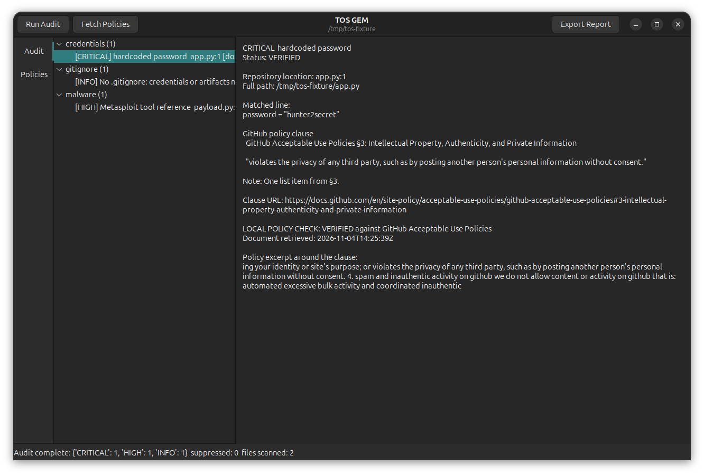

# github-tos-audit

github-tos-audit audits a git repository for GitHub Terms of Service and Acceptable Use Policy risks before you push. It scans tracked files and commit messages, then maps every finding to a verbatim policy clause with a section, quote, and URL.

It is a single-file Python 3 tool with no dependencies beyond the standard library and git. Run it locally before publication or as a pre-push check in CI.

**Current version:** 0.2.0

**Primary question:** **Could this repository get me in trouble with GitHub, and exactly which clause says so?**

---

## Capabilities

<details>
<summary>TOS GEM Workbench</summary>

**TOS GEM workbench**

TOS GEM is the native graphical workbench. It is a desktop application built with GTK3, the Linux UI toolkit used by GNOME applications, not a web page. The deterministic scanner produces all findings; the workbench and any embedded agent never invent them.

- Lab on the left with two tabs: Audit (findings grouped by check) and Policies (local GitHub policy documents with retrieval dates).
- Finding details show the repository location, matched line, verbatim clause quote, clause URL, and an independent local policy check.
- Every clause quote is re-verified against the local policy text and shown with the surrounding excerpt, so agent or scanner interpretations can be checked against the source. A quote that no longer matches is flagged DOC MISMATCH.
- Suppressed findings stay visible with their written reasons.
- Run Audit, Fetch Policies, and Export Report controls.
- Embedded VTE terminal for the user's own AI CLI, on by default like Ablation's GEM. Auto-detects `kimi`, `claude`, or `codex`; falls back to a plain shell. Explicitly unguarded. `--no-agent` disables it.

Launch:

```bash
python3 -m tos_gem --repo /path/to/repo
```

The default launch embeds your real agent automatically. To choose a specific CLI or disable the terminal:

```bash
python3 -m tos_gem --repo /path/to/repo --agent-command claude
python3 -m tos_gem --repo /path/to/repo --no-agent
```

The terminal receives `TOS_AUDIT_REPO`, `TOS_AUDIT_SCANNER`, and `TOS_AUDIT_POLICIES`. A typical offline request: "audit my repo using our local GitHub ToS documentation." The agent runs the same deterministic scanner; the Lab remains the verification view.



Desktop launcher and window icon ship in `assets/` (`tos-gem.desktop`, `gem3ico.png`). Install the launcher for the current user:

```bash
sh assets/install-desktop.sh
```

The installer substitutes the repository path into the launcher and installs it under `~/.local/share/applications/` plus `~/Desktop/` when present.

</details>

<details>
<summary>Local GitHub Policy Documents</summary>

**Local GitHub policy documents**

A snapshot of the GitHub Terms of Service, Acceptable Use Policies, DMCA Takedown Policy, and Community Guidelines ships inside the package at `tos_gem/snapshot/`. Audits and clause verification work offline against this snapshot.

Fetch Policies downloads the current documents into a user cache at `~/.local/share/github-tos-audit/policies/`, records retrieval dates and SHA-256 hashes, and reports each document as updated, unchanged, or error. The cache takes precedence over the snapshot once present. Fetched pages under 2000 characters are rejected rather than cached.

| Capability | Code | Description |
|:---|:---|:---|
| [Policy fetch and cache](tos_gem/policies.py) | [1](tos_gem/policies.py) | Downloads policy pages, extracts text, hashes content, reports changes. |
| [Quote verification](tos_gem/policies.py) | [1](tos_gem/policies.py) | Locates clause quotes in local policy text and returns the surrounding excerpt. |
| [Finding verification](tos_gem/model.py) | [1](tos_gem/model.py) | Independently re-checks every scanner finding against the local documents. |

</details>

<details>
<summary>Policy-Verified Findings</summary>

**Policy-verified findings**

Every finding must map to an entry in the clause registry. A finding without a valid clause key is dropped, never reported. Quotes in the registry are verbatim from the GitHub Terms of Service (effective April 27, 2026) and Acceptable Use Policies, retrieved 2026-11-04. Vendor commit-message findings are labeled OPSEC: operational risk from vendor legal teams, not a GitHub ToS violation.

| Capability | Code | Description |
|:---|:---|:---|
| [Clause registry](github_tos_audit.py) | [1](github_tos_audit.py) | Verbatim quotes with section, URL, retrieval date, and a separate note field for interpretation. |
| [Finding verification](github_tos_audit.py) | [1](github_tos_audit.py) | VERIFIED, OPSEC, or REJECTED status on every finding; rejected findings never reach output. |
| [Reasoned suppression](github_tos_audit.py) | [1](github_tos_audit.py) | Allowlist entries require a written reason. Suppressed findings stay visible in output for audit. |

</details>

<details>
<summary>Checks</summary>

**Checks**

| Check | Severity | Clause | Description |
|:---|:---|:---|:---|
| credentials | CRITICAL | AUP §3 privacy | Hardcoded passwords, API keys, and tokens: GitHub, GitLab, Slack, OpenAI-style, Google, npm, AWS, private key headers. |
| sensitive-files | HIGH | AUP §3 privacy | Tracked sensitive filenames: `.env`, `*.pem`, `*.key`, `*.p12`, `id_rsa`, keystores, credential stores. |
| malware | HIGH | AUP §5 | Reverse-shell strings, Metasploit references, shellcode byte sequences, mass-exploitation patterns. Dual-use research tooling is outside this clause; matches indicate review need. |
| dmca | HIGH | ToS §F | Decompiler attribution headers that indicate takedown exposure. |
| export | MEDIUM | AUP §1 | Export-control classification markers such as EAR99 and ECCN 5D002. A prompt for legal review, not proof of violation. |
| binaries | MEDIUM | ToS §F | Tracked binaries over 1 MB that may be DMCA-exposed firmware or vendor artifacts. |
| vendors | HIGH | OPSEC | Vendor names in public commit messages. Not a ToS violation. |
| gitignore | INFO | ToS §D.1 | Missing `.gitignore` or missing secret-file patterns in it. |

</details>

<details>
<summary>Output & CI Integration</summary>

**Output and CI integration**

- Text report with severity summary, per-finding clause quotes, and a separate suppressed-findings section.
- JSON report with tool version, retrieval date, summary counts, findings, suppressed findings, and warnings.
- Exit code 0 when clean, 1 when findings reach `--fail-on`, 2 on usage errors.
- `--fail-on` counts only unsuppressed findings, so reviewed exceptions do not break CI.
- Single-pass scanning reads each source file once. Files over `--max-file-mb` (default 2) are skipped and listed.

</details>

## Setup & About

<details>
<summary>Quick Start</summary>

Install:

```bash
pip install .
```

Or run the single file directly, no installation needed:

```bash
python3 github_tos_audit.py /path/to/repo
```

Common invocations:

```bash
# Full audit
github-tos-audit /path/to/repo

# JSON for CI, credentials only
github-tos-audit --checks credentials sensitive-files --json

# Offline run, fail only on CRITICAL
github-tos-audit --no-fetch --fail-on CRITICAL
```

</details>

<details>
<summary>Suppressing Reviewed Findings</summary>

Create `.github-tos-audit.json` in the audited repository:

```json
{
  "allowlist": [
    {
      "path": "docs/example.py",
      "category": "credentials",
      "reason": "Fake credential used in documentation."
    }
  ]
}
```

`path` is a glob matched against the repository-relative file path. `category` and `match` (a substring of the matched line) are optional narrows. `reason` is required: entries without one are ignored with a warning. Suppressed findings are printed in a separate section and included in JSON output, never hidden.

This repository uses the same mechanism to suppress the scanner's own detection-rule patterns.

</details>

<details>
<summary>Verification Status</summary>

Verified 2026-11-04:

- Clause quotes checked verbatim against the live GitHub Terms of Service and Acceptable Use Policies pages.
- Planted-secret fixture: hardcoded password, API key, AWS key ID, tracked `.env`, and a vendor commit message all detected with the expected severities and exit code 1.
- Self-scan: three detection-rule self-matches suppressed through the allowlist, exit code 0.
- JSON output parsed and validated. Non-repository path returns exit code 2. Check selection and `--fail-on` thresholds behave as documented.
- `pip install .` console entry point installed and exercised in a clean virtual environment.
- Real run against the CEROTTO repository: 73 source files scanned, one INFO finding.
- Policy snapshot: all four documents fetched and hashed; every registry clause quote verified verbatim against the local snapshot text.
- TOS GEM: real GTK rendering exercised in isolated X11 (Xephyr). Audit run, finding selection, repository location, clause quote, and LOCAL POLICY CHECK excerpt confirmed in the rendered window and by buffer assertions. Embedded VTE terminal construction exercised with a real shell.
- `python3 -m tos_gem` launcher and the `tos-gem` console entry point.

No automated test suite yet. The checks above were run manually.

</details>

<details>
<summary>Limits & Safe Use</summary>

- This is a heuristic scanner, not legal advice. A clean run does not prove ToS compliance, and a finding is not proof of a violation.
- Scanning covers tracked files in the working tree, not git history. Deleted secrets still need history review and rotation.
- Text checks cover common source-code extensions only. Other file types are not content-scanned.
- Oversize files are skipped and listed rather than scanned.
- Credential patterns are intentionally broad. Expect false positives and suppress them with written reasons.
- The clause registry is a snapshot dated 2026-11-04. GitHub updates its policies; re-verify quotes periodically.
- OPSEC findings are not GitHub policy violations and are labeled as such.
- TOS GEM requires Python GI and GTK3; the embedded terminal requires VTE 2.91. The CLI scanner needs neither.
- The embedded agent terminal is unguarded and keeps the agent's own permissions. Agent output is advisory; the Lab's clause verification is the evidence view.
- Policy documents are snapshots of public GitHub pages. Fetch Policies refreshes them, but a changed policy can make older clause quotes mismatch until the registry is reviewed.

</details>

<details>
<summary>Responsible Use & Contact</summary>

Use this tool to review your own repositories before publication. Rotate any real credential it finds; deletion alone does not revoke it.

Report bugs through [GitHub Issues](https://github.com/Ablation-Tool/github-tos-audit/issues).

</details>
