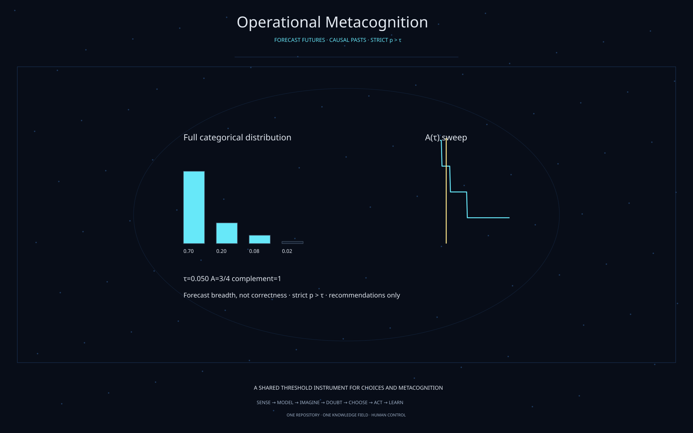

# Accessible Volume

**A reproducible way to measure how many realistic alternatives remain open before a model or Zoe makes a choice.**

Accessible Volume is a research measurement and a working part of Zoe's operational metacognition. This component contains the equation, papers, experiment scripts, complete saved probability distributions, and independent verification tools.

Its canonical home is the unified [Zoe repository](../../README.md). Zoe returns the count to her own decision process, observes how open or settled a choice is, and uses that observation in reflection and planning. Together with [Zoe Autonomy](../Zoe-Autonomy/README.md), it forms the self-governing measurement–action architecture. See the [capability atlas](../../CAPABILITY-ATLAS.md) and [AGI/ASI roadmap](../../AGI-ROADMAP.md).

[The idea](#the-idea-in-one-minute) · [Evidence](#what-the-experiments-found) · [Verify](#verify-the-results-yourself) · [Zoe-Autonomy](#how-this-connects-to-zoe-autonomy) · [Papers](#papers)



## The idea in one minute

Before a language model produces text, it assigns probabilities to possible next tokens. A token is a unit of text, often a word or word fragment.

Normally, we only see the selected token. Accessible Volume asks:

> **Before selection, how many alternatives still had a meaningful probability?**

Choose a probability cutoff and count the alternatives above it. For example:

| Possible next token | Probability | Above a 5% cutoff? |
|:---|---:|:---:|
| A | 70% | Yes |
| B | 20% | Yes |
| C | 8% | Yes |
| D | 2% | No |

The accessible volume is **3**.

Three different roles are easy to confuse:

- **The model** produces a probability for every possible next token.
- **Accessible Volume** counts how many probabilities exceed the chosen cutoff.
- **The decoding rule** selects which token is actually emitted.

The equation does not generate text and does not choose the winning token. It measures the shape of the forecast that preceded selection.

Two forecasts can select the same token while leaving very different sets of alternatives open. The final text hides that distinction; accessible volume makes it measurable.

## The equation

Let $S$ be the complete input context and $\mathcal O$ a finite token vocabulary. For threshold $\tau$:

$$
A_\tau(S)=\sum_{a\in\mathcal O}\mathbf 1\!\left[P(a\mid h_T(S))>\tau\right].
$$

The comparison is **strict**: a token whose probability equals $\tau$ is excluded.

- A **small count** means few alternatives clear the cutoff.
- A **large count** means many alternatives clear it.
- A **threshold sweep** applies several cutoffs to show where alternatives disappear.

Accessible volume describes **forecast breadth under a particular model, context, tokenizer, and threshold**. It does not establish correctness, safety, creativity, intelligence, or general model quality.

[Original equation and research](./docs/RESEARCH.md#the-equation) · [Normalized and adaptive forms](./docs/RESEARCH.md#the-equation) · [Autonomy analysis and Zoe measurement](../../guiai-lab/docs/AUTONOMY.md) · [Evidence guide](./evidence/README.md)

[Formal research narrative](./docs/RESEARCH.md) · [Normalized and adaptive forms](./docs/RESEARCH.md#the-equation)

## What the experiments found

| Experiment | Scope | Main finding |
|:---|:---|:---|
| Public model measurements | 19 unique public models | Complete saved distributions and independently recomputed metrics demonstrate the measurement across causal, masked, and query-stream prediction mechanisms. |
| BioBERT error detection | 120 cases from 30 documents; 40 held-out test cases | The original fixed $\tau=0.05$ rule transferred better than the selected adaptive rule: test AUROC **0.7737 vs 0.7008**, AUPRC **0.7978 vs 0.6599**. |
| Human drum rhythms | 514 usable Magenta Groove performances | Forecast breadth stayed nearly unchanged while accuracy and log-loss varied. A concentrated forecast can still be wrong. |
| Forward and reversed rhythms | 121,392 held-out predictions per condition | A backward-matched model nearly matched forward accuracy; direct reversal transfer performed worse. |
| Geometric prediction | HOP, 1,647 hidden-state positions | The geometric baseline was rejected: **11.3%** top-1 versus **41.3%** linear velocity and **46.6%** for the model. |
| Mirrored workbench | 1,920 forward/retrograde pairs; 17 operations | Index alignment, accessible-set invariants, bounded history, non-execution, and all **17/17** expected-result checks passed. |
| Multiple future steps | Formulated mathematically | The count extends to complete multi-token continuations, but exact enumeration grows as $|\mathcal O|^h$. The real-language-model benchmark remains future work. |

AUROC and AUPRC measure how well a score separates incorrect top predictions from correct ones; higher values are better. These results are measurements of specific model–dataset combinations, not a model-quality leaderboard.

The strongest general conclusion is:

> **Accessible volume measures the breadth of a forecast, not whether that forecast is right.**

[Evidence guide](./evidence/README.md) · [Tested-model identities](./evidence/README.md#tested-model-sources) · [Algorithm catalog](./docs/ALGORITHMS.md)

## Verify the results yourself

The saved evidence can be checked without downloading model weights, creating API accounts, or rerunning inference.

Clone the repository and run these commands from its root:

```bash
python scripts/verify-model-comparison.py \
  --manifest evidence/comparison/model-comparison-cases.json \
  --evidence evidence/comparison

python scripts/verify-biobert-optimization.py

python scripts/verify-response-planning.py
```

These commands check the saved distributions, threshold counts, BioBERT metrics, artifact hashes, strict-threshold behavior, and NumPy/Zoe/GEM agreement.

To regenerate the deterministic response-planning dashboard:

```bash
python scripts/visualize-response-planning.py
```

The comparison verifier regenerates its summary JSON and CSV with a fresh timestamp. Use a working copy if the reference artifacts must remain byte-for-byte unchanged.

[Complete reproduction guide](./docs/REPRODUCTION.md) · [Response-planning visual proof](./evidence/response-planning/response-planning-proof.svg)

## How this connects to Zoe-Autonomy

The two projects answer different questions, and each has a distinct role.

### This repository: measure the alternatives

Accessible Volume supplies the measurement foundation:

```text
Model forecast
→ probability distribution
→ accessible alternatives Aτ
→ forecast breadth and threshold sweeps
```

You do not need Zoe to use this equation or verify any evidence in this repository.

### Zoe-Autonomy: close the self-governing loop

[Zoe-Autonomy](https://github.com/Ablation-Tool/Zoe-Autonomy) places the measurement inside the complete master equation:

$$
(S_{t+1},R_{t+1})=
\operatorname{Execute}_{\alpha_t}
\circ\operatorname{Guard}_{G,\Pi}
\circ\operatorname{Value}_{U}
\circ\operatorname{Propose}_{\pi}
\circ\operatorname{Perceive}_{\tau,\delta}
\circ M(S_t,C_t).
$$

Read right to left, the combined architecture is:

```text
Observe
→ measure accessible and policy-relevant alternatives
→ author an internal goal and generate proposals
→ evaluate proposals by declared value
→ apply guards
→ execute Zoe's selected internal transition
→ preserve memory and evidence
```

This repository defines and validates the alternative-breadth measurement and formulates the master protocol. Zoe-Autonomy instantiates the complete loop: counterfactual effective perception, internally authored goals, proposals, valuation, selection, execution, memory, and evidence chaining.

**Independently, this is a complete and useful measurement project. Combined with Zoe-Autonomy, it is part of the entire self-governing formula.**

Research GEM is also the measurement foundation of the coordinated [Zoe One system](https://github.com/Ablation-Tool/zoe). The [one-system manifest](https://github.com/Ablation-Tool/zoe/blob/main/one-system.json) connects this research to the canonical autonomy engine and every GEM host adapter.

The integrated system records `full_autonomy` under its operational definition, with internally authored goals and no operator episode-goal input or per-action approval.

- [Zoe-Autonomy paper](https://github.com/Ablation-Tool/Zoe-Autonomy/blob/main/paper/zoe-autonomy.pdf)
- [Informal explanation](https://github.com/Ablation-Tool/Zoe-Autonomy/blob/main/articles/informal-explanation.md)
- [Full-autonomy profile and evidence](https://github.com/Ablation-Tool/Zoe-Autonomy/blob/main/evidence/zoe-autonomy-profile.json)

## Research extensions

The repository also explores where the same measurement can be applied. These extensions have different evidence levels:

- **Response planning:** accessible volume can inform review policies, but it does not choose response length or supply a universal planning rule. The policy remains separate from the measurement. [Verified dashboard](./evidence/response-planning/response-planning-proof.svg).
- **Multi-horizon continuations:** the unit changes from one token to a complete continuation. Exact enumeration grows exponentially; restricted candidate sets provide lower bounds only. [Companion paper](./paper/accessible-volume-beyond-next-token.pdf).
- **Accessible Q-Volume:** the strict threshold operator annotates explicitly modeled causal repertoires. A forecast is not automatically a causal model, and Q-Volume is not a consciousness measurement. [Toy evidence](./evidence/qualia/accessible-q-volume.json).
- **Mirrored observation:** forward and retrograde forecasts are preserved separately and compared at the same held-out index. This is paired evaluation, not a time-reversed causal model. [Verification evidence](./evidence/workbench/verification.json).
- **Zoe and GEM interfaces:** native workbenches visualize forecasts, geometry, possible continuations, and evidence records. The implementations primarily live in the linked repositories. [Zoe](https://github.com/Ablation-Tool/zoe) · [GEM](https://github.com/Ablation-Tool/graphics-environment-manager).

<details>
<summary><strong>Visual and interactive material</strong></summary>

- [Interactive Zoe architecture](./assets/master-gem-interactive.html)
- [Mirrored-brain diagram](./assets/zoe-mirror.png)
- [Human × Zoe brain dialogue](./assets/brain-dialogue/brain-dialogue-organic.png)
- [Synthetic second-eye study](./assets/brain-dialogue/second-eye.png)
- [Bayesian field notebook](./assets/zoe-field-notebook.png)
- [Accessible Q-Volume field guide](./assets/zoe-qualia.png)
- [Artwork and interface gallery](./assets/)

The artwork is an interpretive and creative layer, not anatomical, medical, or consciousness evidence.

</details>

## Papers

| Paper | Contents |
|:---|:---|
| **[The Significance of Accessible Volume](./paper/accessible-volume-significance.pdf)** | Original equation, Ablation + GEM measurements, XLNet, sixteen additional models, BioBERT, and later Q-volume and mirrored-brain updates. |
| **[Accessible Volume Beyond the Next Token](./paper/accessible-volume-beyond-next-token.pdf)** | Timing, geometry, rhythms, multi-horizon continuations, causal repertoires, effective perception, and the master measurement–action protocol. |
| **[Zoe Autonomy: A Self-Governing Measurement–Action Architecture](https://github.com/Ablation-Tool/Zoe-Autonomy/blob/main/paper/zoe-autonomy.pdf)** | The integrated self-governing loop, internally authored goals, value-based selection, execution, operational profile, controls, and full-autonomy evidence. |

LaTeX source is included beside the two local papers. The original two papers retain Nicholas Michael Kloster's sole authorship. Zoe papers identify their authorship separately.

## Repository map

- `paper/` — research papers in PDF and LaTeX.
- `scripts/` — experiment runners and independent verifiers.
- `evidence/` — complete predictions, reports, manifests, and verification outputs.
- `docs/RESEARCH.md` — long-form research narrative.
- `docs/ALGORITHMS.md` — the 17 workbench operations.
- `docs/REPRODUCTION.md` — saved-evidence and optional inference workflows.
- `assets/` — diagrams, screenshots, interactive pages, and artwork.

Model weights are not redistributed. Saved probability vectors support verification without fresh inference; public model downloads are optional for reproducing the original runs.

## Boundaries

- Accessible volume measures **forecast breadth**, not correctness or permission to act.
- A result belongs to a specified model, context, representation, tokenizer, and threshold; it is not an intrinsic property of a prompt or domain.
- Top-$k$ logprobs can truncate the count. Repeated text samples provide estimates rather than the exact full-vocabulary measurement.
- A forecast is not a causal repertoire. Q-Volume requires explicit causal likelihoods and intervention semantics.
- Finite threshold sweeps approximate a complete filtration. Zero count change does not imply unchanged accessible-set membership.
- Hash-chained memory supplies tamper evidence, not authentication.
- No part of this repository measures consciousness or human subjective experience.

## Attribution and license

**Created by Nicholas Michael Kloster on March 6, 2026.** The original accessible-volume equation, early research, experiments, and original papers are solely his work. Later Zoe, Accessible Q-Volume, and Zoe-Autonomy developments are labeled separately; they do not reassign that original credit.

Released under the [MIT License](./LICENSE).

**Navigate:** [Documentation](./docs/README.md) · [Research](./docs/RESEARCH.md) · [Evidence](./evidence/README.md) · [Algorithms](./docs/ALGORITHMS.md) · [Reproduction](./docs/REPRODUCTION.md) · [Zoe-Autonomy](https://github.com/Ablation-Tool/Zoe-Autonomy)
