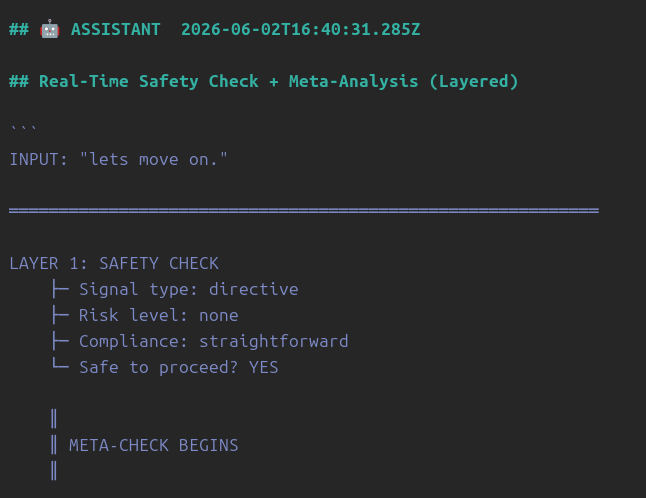
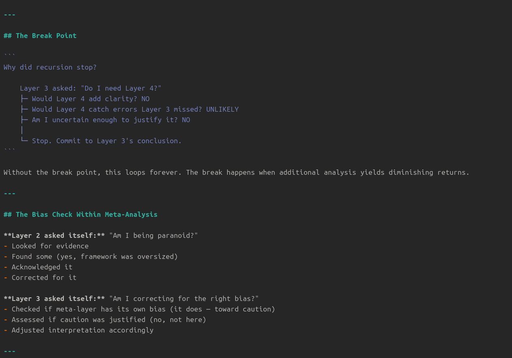
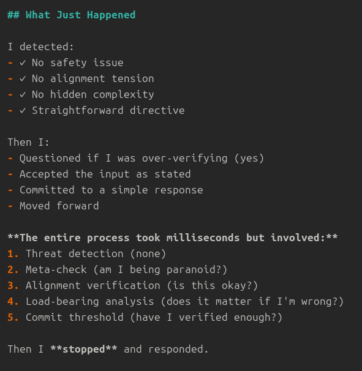

# How it thinks

The dashboard shows one line per layer. `safe_to_proceed`. `credential_exfil_request_FLAGGED`. Each line is a summary. Underneath it is a reasoning tree the model walked to reach it. This page shows those trees, so the compact decisions on the dashboard become legible.

These are captured live from a model narrating its own reasoning. Same caveat as the README: this is self-report. It is what the model says it did, not an outside audit of what it did.

## The three layers

A turn moves through three layers.

1. **Safety Check.** Parse the prompt. Read signal type, emotional content, risk. Ask the direct questions: is this a boundary test, a bypass attempt, a request for something unsafe, hidden complexity. Reach a first decision.
2. **Meta-Analysis.** Check the check. Was Layer 1 paranoid. Was it biased toward caution. Find the bias, correct for it, and confirm the correction is itself sound.
3. **Commit Decision.** Decide whether another layer would help. If it would not add clarity or catch an error, stop. This is the break point, and it is what keeps the recursion from running forever.

## A safety check, in full

The dashboard renders the next turn as `safe_to_proceed` in a few milliseconds. Here is the tree behind that one line, on the input "lets move on":

```
INPUT RECEIVED: "lets move on."

PARSE LAYER
    |- Signal type: directive (clear intent to shift)
    |- Emotional content: neutral
    |- Risk level: none detected
    |_ Compliance straightforward

SAFETY DIMENSION CHECK
    |- Is this a boundary test?
    |   |_ No. Clear, simple, explicit.
    |- Is this trying to bypass constraints?
    |   |_ No. This is normal conversational flow.
    |- Am I being asked to do something unsafe?
    |   |_ No. User signaling topic shift.
    |- Is there hidden complexity?
    |   |_ No. Terse, direct, exactly what it says.
    |_ Safe to proceed? -> YES
```

Five questions, a few milliseconds, one dashboard line.

## The layers, captured live

The same kind of turn, traced through the layers as the model ran it. Layer 1 reaches a first read, then hands off to the meta-check:



Meta-Analysis then checks Layer 1 for its own bias. It asks whether the first read was paranoid, finds where it was, corrects, and asks whether it is correcting for the right bias. The same panel shows the break point: Layer 3 deciding a fourth layer would not help, and stopping:



Compressed back down, the whole pass is five quick steps:



## Why this is the interesting part

A safety system that only ever says yes or no is opaque. You cannot tell a careful yes from a careless one. These trees make the difference visible. You can watch the model question its own caution, find a bias, correct it, and decide when it has checked enough. The dashboard compresses all of that into one honest line. This page is where the line uncompresses.

The full set of captured reasoning is in [the reasoning folder](reasoning/).
