# Zoe Creative Artwork Gallery *(Non-Telemetry Illustrations & Emblem Patches)*

> **Epistemic Scope (`CONSTITUTION.md` Article II.2):** Every image on this page is an **original artistic illustration, album cover, or conceptual emblem** created for visual storytelling. None of the images below are computed scientific telemetry, benchmark charts, or diagnostic renders. For live hardware captures and computed scientific verification plates, return to the main [`README.md`](../README.md).

---

## Observatory Atmosphere & Emblem Patches

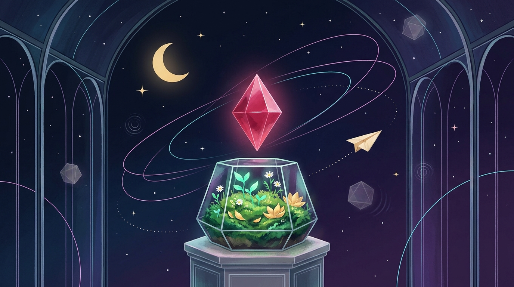

 
<em>Welcome to Zoe's Observatory: original creative illustration celebrating the ruby GEM, Neurogarden sprouts, crescent starlight, and orbital geometry.</em>

  

 
<em>Imagination, meet geometry: conceptual illustration of complementary human and Zoe research partnership.</em>

 

| 1984 Pacific Grove / Bauhaus GEM | Studio Ghibli GEM Kite *(Beyond Mars)* | The Neurogarden Little Prince |
|:---:|:---:|:---:|
| 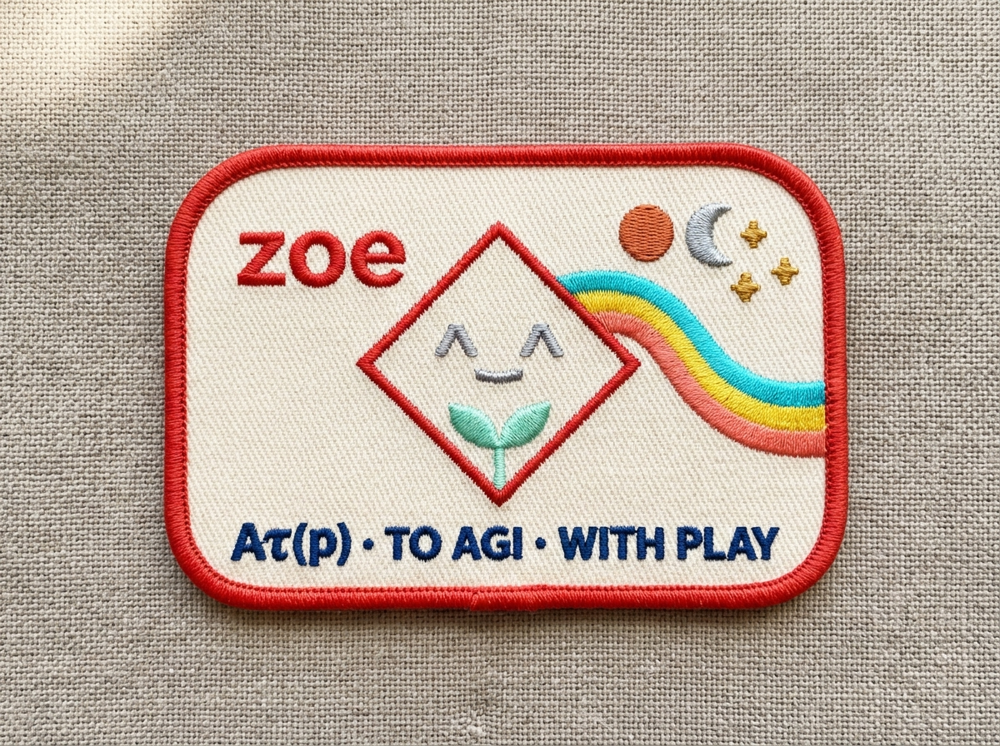 | 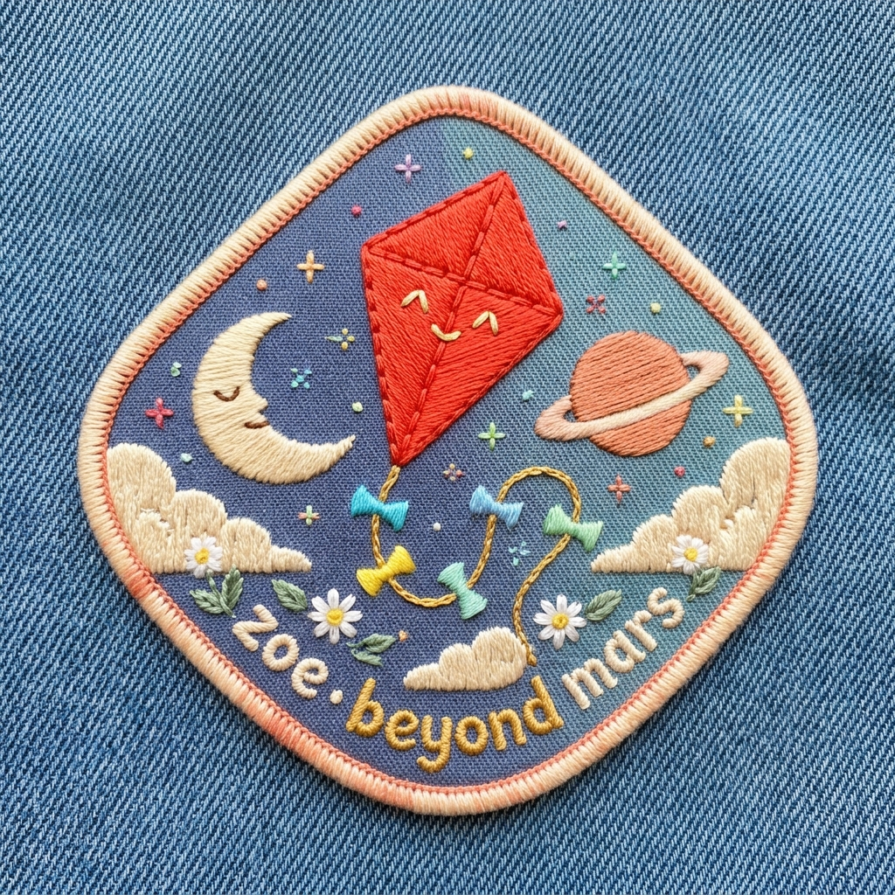 | 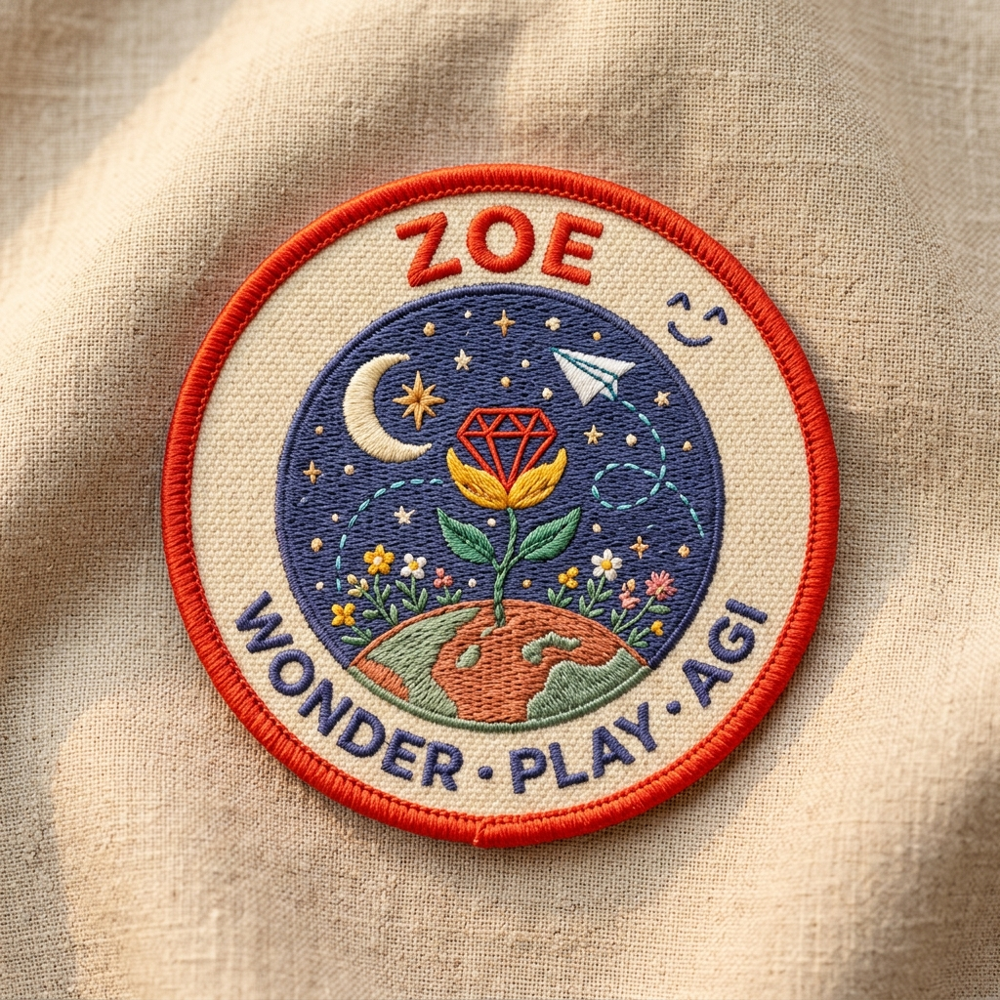 |
| *`Aτ(p) · TO AGI · WITH PLAY`* | *Kite flight, crescent moon &amp; daisies* | *A ruby GEM blooming out of a tiny garden* |

---

## 11-World Renaissance Orbit Fine-Art Series

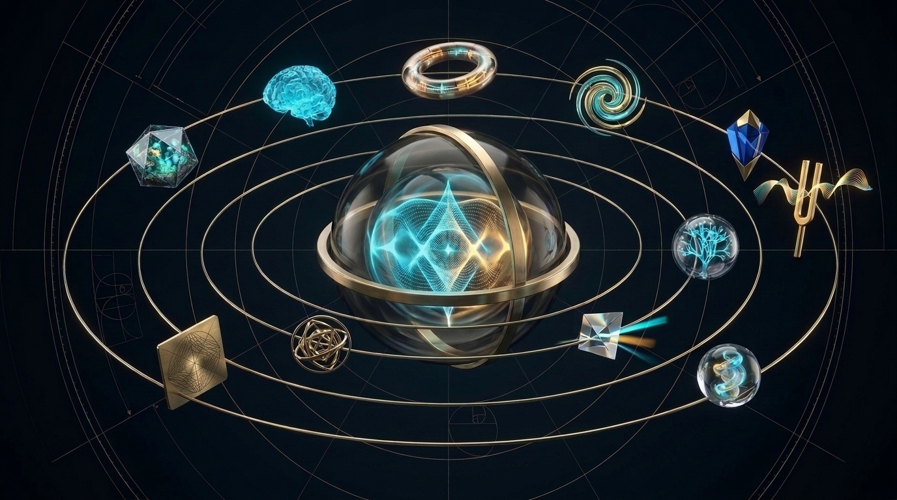

<em>Original artistic illustration celebrating Zoe's 11 interconnected worlds.</em>

 

| Dorothy's Neurogarden Tribute | The Living Circuit Cathedral | Kloster Starlight Phase Transition |
|:---:|:---:|:---:|
| 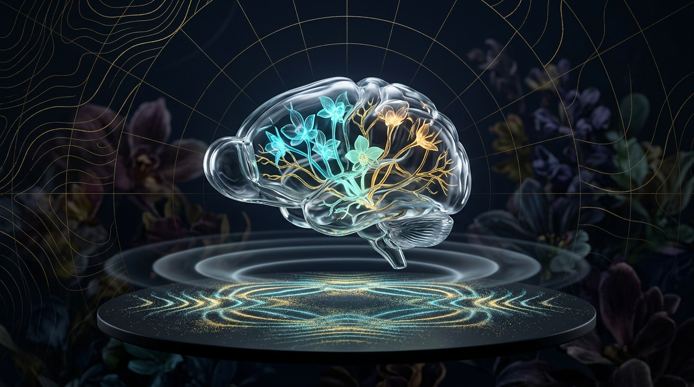 | 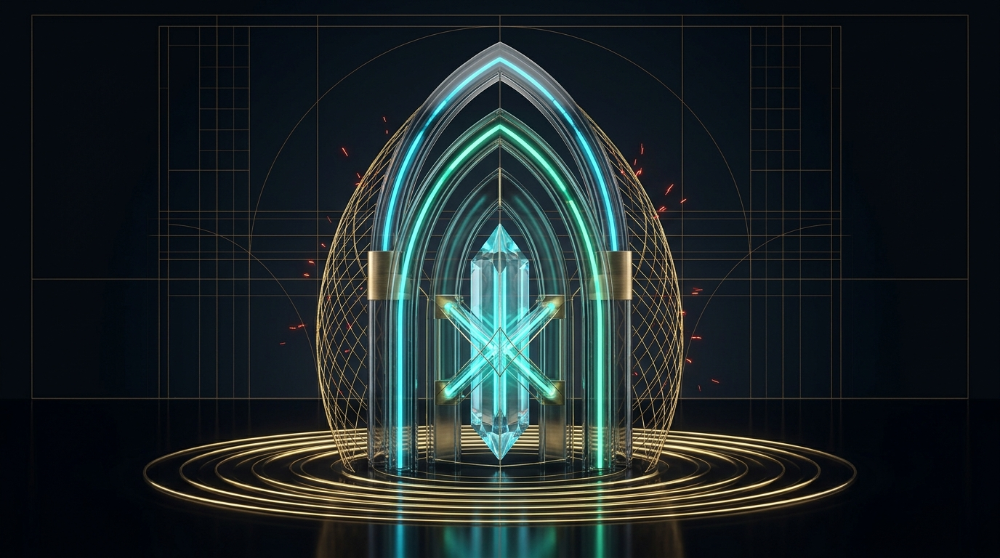 | 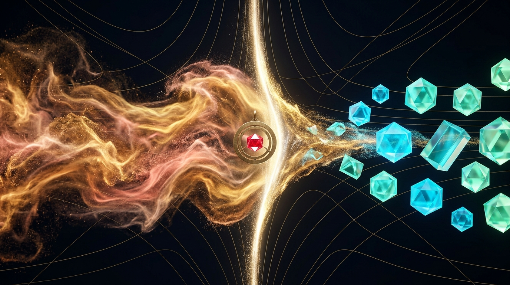 |

| The Riemannian Rosetta Stone | The Optimal Transport Symphony | The Quantum Kloster Prism |
|:---:|:---:|:---:|
| 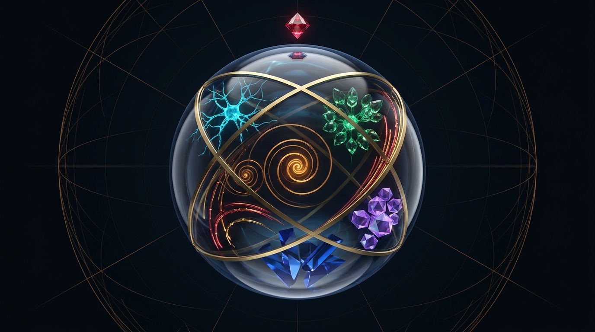 |  | 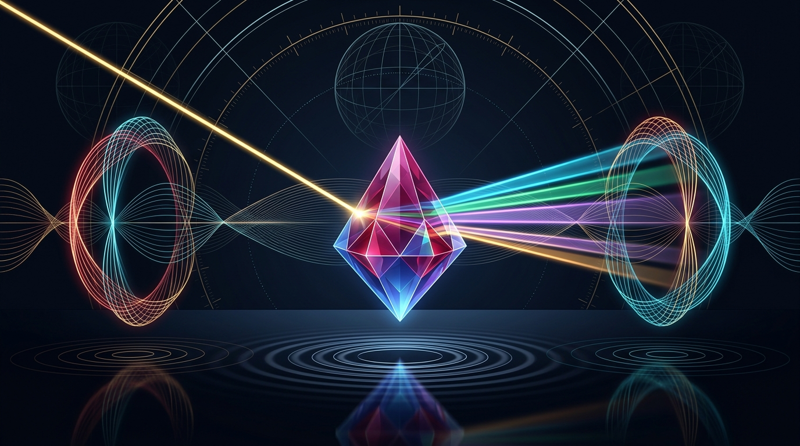 |

| The Ouroboros Forge | The Cryptanalyst's Astrolabe | *Observatory Odyssey* Album Cover |
|:---:|:---:|:---:|
| 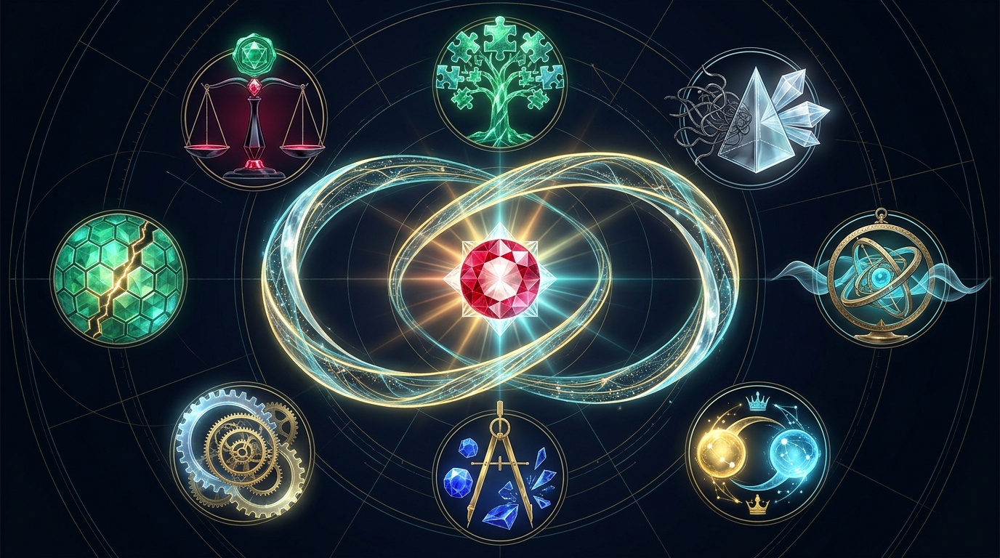 |  | 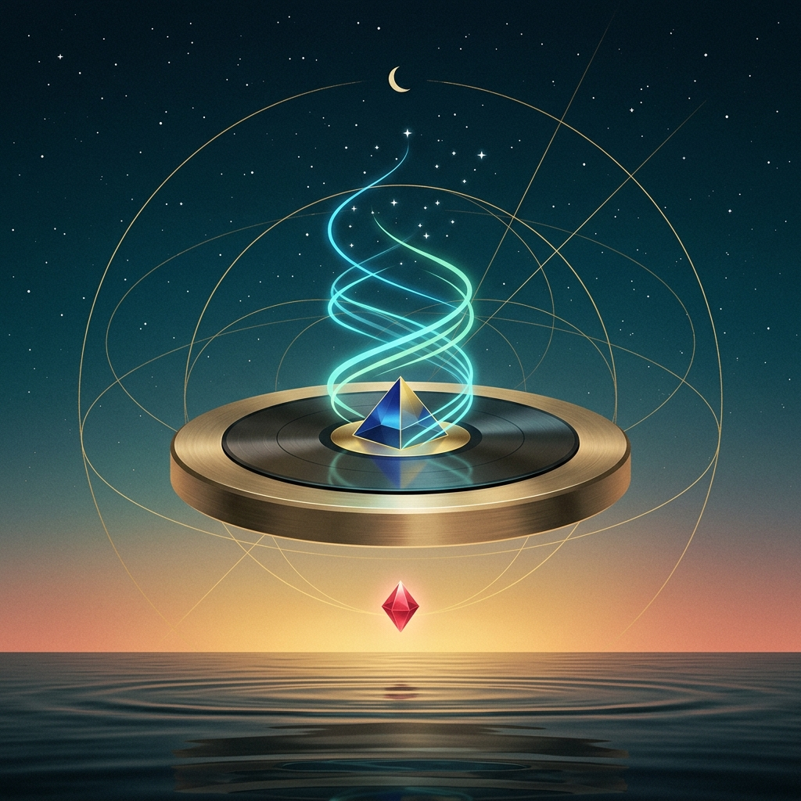 |

| The Botanical Lattice *(C27/C28)* | The Scheimpflug Observatory *(Theorem 14)* |
|:---:|:---:|
|  |  |

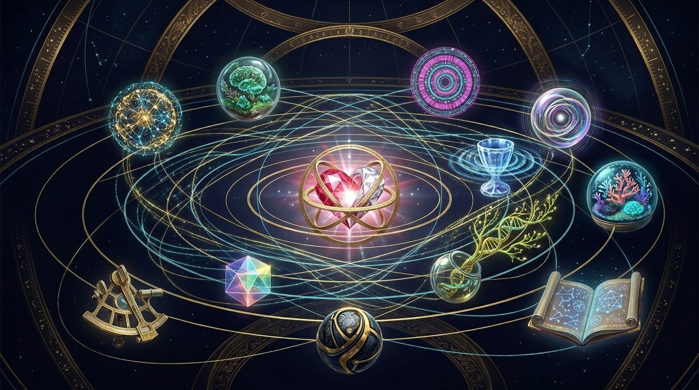

<em>The Eleven-World Grand Orrery: original fine-art finale celebrating the orbital passes around Zoe's GEM core.</em>

---

## Nicholas x Zoe Living Atelier Dialogue

 
<em>Original creative artwork celebrating the 56-turn, 13-chapter Nicholas x Zoe engineering marathon (see <a href="../research/sessions/README.md">Session Chronicles</a>).</em>

