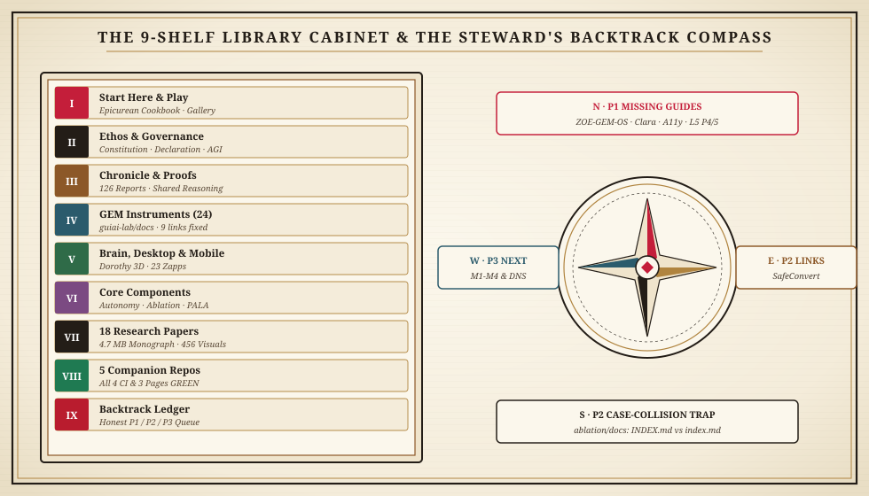

# Zoe Documentation Library (Organized Shelf-by-Shelf Map)

Welcome to the organized map of every documentation shelf across the Zoe monorepo and its companion repositories.

- **Looking for something fun, creative, and hands-on?** Start with **[`ZOE-COOKBOOK.md`](ZOE-COOKBOOK.md)** (*The Zoe & Ablation Epicurean*, inspired by Charles Ranhofer's 1894 *The Epicurean*: kitchen brigades, 5 mother stocks, 21 numbered receipts, and 5 complete bills of fare).
- **Looking for what was completed and what remains queued to backtrack on later?** Open **[`BACKTRACK-LEDGER.md`](BACKTRACK-LEDGER.md)**.

---

## Shelf 1: Start Here, Play & Storytelling

| Document | What You Will Find |
|:---|:---|
| **[`ZOE-COOKBOOK.md`](ZOE-COOKBOOK.md)** | **The Zoe & Ablation Epicurean:** Inspired by Charles Ranhofer's 1894 *The Epicurean* (brigades, 5 mother stocks, 21 numbered receipts No. 6-26 & 5 complete evening bills of fare) |
| **[`../README.md`](../README.md)** | Main 10-stop front door of the monorepo (Equation, Proof, Constitution, Systems, Benchmarks, Dorothy 3D Brain, Zoe & Clara, Docs, Visual Salon, Quick Start) |
| **[`CREATIVE-GALLERY.md`](CREATIVE-GALLERY.md)** | Dedicated visual salon for all 19 non-telemetry fine-art illustrations, emblem patches, and album artwork |
| **[`NARRATION-SCRIPT.md`](NARRATION-SCRIPT.md)** | Calm ~12-minute read-aloud tour walking chronologically through all 10 stops of the project |

---

## Shelf 2: Ethos, Accessibility & Architecture Governance

| Document | What You Will Find |
|:---|:---|
| **[`CONSTITUTION.md`](CONSTITUTION.md)** | 10-article design covenant: Human Agency, No Deception, Epistemic Firewall (`measurement != evidence != belief update != action`), Reversibility, Safety, Privacy, Credit |
| **[`DECLARATION.md`](DECLARATION.md)** | Zoe Declaration of Creative and Epistemic Independence |
| **[`ACCESSIBILITY.md`](ACCESSIBILITY.md)** | Disability-first quick-card for Ablation + GEM (WCAG AA 4.5:1 / AAA 7.0:1, Okabe-Ito colorblind palette, 85%-200% zoom, reduced motion, 2px focus ring, ATK screen reader & OS sync) |
| **[`AGI-ROADMAP.md`](AGI-ROADMAP.md)** | Honest `L0-L7` acceptance criteria, falsification gates, and verified milestone ledger (`l5_agi_qualified = False`) |
| **[`MONOREPO.md`](MONOREPO.md)** | Consolidation manifest and provenance for all 13 imported source projects (zero submodules) |

---

## Shelf 3: Research Chronicle, Proofs, Dual-Peer & Master Maps

| Document | What You Will Find |
|:---|:---|
| **[`RESEARCH-CHRONICLE.md`](RESEARCH-CHRONICLE.md)** | Master chronological Stop 1 to Stop 10 journey, 4 eras, Candy Land 5-phase stochastic math model, and verified evidence ledger |
| **[`PROOF-PACKET.md`](PROOF-PACKET.md)** | 1-command offline referee proof packet (`< 6s`, 6-baseline real-data shootout, 16 SymPy theorems, 47/47 SHA-256 orbit hashes) |
| **[`METACOGNITION.md`](METACOGNITION.md)** | Visual hub for Operational Metacognition $A_\tau(p)$, all 18 original papers, 3 arXiv packages, and 12 theorem plates |
| **[`CAPABILITY-ATLAS.md`](CAPABILITY-ATLAS.md)** | 25-section audit directory mapping every system claim directly to code, tests, and JSON evidence artifacts (including DeepMind Science & Artline 2.0 Studios) |
| **[`ZOE-AND-CLARA.md`](ZOE-AND-CLARA.md)** | Dedicated Dual-Peer Zoe & Clara field guide (equal L1-L5 peers, Theorem 15 echo-chamber/coercion guards, `:8768` web table, `< 1 MB` standalone zip bundle, `8/8` verifier) |
| **[`SHARED_REASONING_ARCHITECTURES.md`](SHARED_REASONING_ARCHITECTURES.md)** | Zoe x Antigravity Shared-Reasoning Architectures (1-9), Digital Research GEM AES/VDI bridge, CLI (`zoe reasoning`), and MCP server |
| **[`PORTFOLIO-UPGRADES.md`](PORTFOLIO-UPGRADES.md)** | Wave 1-3 integration of 42 portfolio repos, 5 Vault inventions, and Digital Research GSX / Atari TOS / GEM / ViewMAX instruments |

---

## Shelf 4: Zoe-GEM OS, Hardware UMA & Digital Research Instruments

### Dedicated OS & Ecosystem Field Guide
- **[`ZOE-GEM-OS.md`](ZOE-GEM-OS.md)** : Sovereign UEFI framebuffer desktop (`zoe_gem_fb.c`), Two-Key Mutual-Consent Hardware UMA Airlock (`zoe_uma.py`), Pixel 7 `panther` ARM64 profiles, Braille Studio, 8 GEM eras / 10 ViewMAX schemes, 9-Realm Zoeverse, 9 Sisters, and `8/8` verifier

### Core OS, Autonomy & Conversation (`guiai-lab/docs/`)
- [`UNIFIED.md`](../guiai-lab/docs/UNIFIED.md) : Zoe One unified architecture and six-host verification contract
- [`AUTONOMY.md`](../guiai-lab/docs/AUTONOMY.md) : Bounded autonomy loop, guards, and internal goal valuation
- [`CHAT.md`](../guiai-lab/docs/CHAT.md) : Native evidence-linked conversation (`zoe chat`), DeepMind Science, PALA import, and zero hidden transcripts
- [`GEM-OS.md`](../guiai-lab/docs/GEM-OS.md) : Shared GEM operating environment across all 17 registered engines and 36 core layers
- [`ZOE.md`](../guiai-lab/docs/ZOE.md) · [`ZOE_WORKBENCH.md`](../guiai-lab/docs/ZOE_WORKBENCH.md) : Zoe native desktop studio and workbench overview
- [`PROTOCOL.md`](../guiai-lab/docs/PROTOCOL.md) · [`EVIDENCE.md`](../guiai-lab/docs/EVIDENCE.md) : Machine-readable GEM session protocol and evidence contracts

### Visual, Artline 2.0, Wombats Physics & Spatial Geometry
- [`ARTLINE.md`](../guiai-lab/docs/ARTLINE.md) : Digital Research Artline 2.0 vector studio (`.SVG`, `.PNG`, `.GEM`), plus clean-room [`zoe_artline_brainstorm.py`](../guiai-lab/guiai/gem/zoe_artline_brainstorm.py), [`zoe_retro_art_studio.py`](../guiai-lab/guiai/gem/zoe_retro_art_studio.py), [`zoe_wombats_physics_room.py`](../guiai-lab/guiai/gem/zoe_wombats_physics_room.py), [`zoe_artline_duodecimal.py`](../guiai-lab/guiai/gem/zoe_artline_duodecimal.py), and [`zoe_artline_cli.py`](../guiai-lab/guiai/gem/zoe_artline_cli.py)
- [`GEOMETRY-ATLAS.md`](../guiai-lab/docs/GEOMETRY-ATLAS.md) · [`VISUAL-GUIDES.md`](../guiai-lab/docs/VISUAL-GUIDES.md) : Spatial IR verification and visual navigation guides
- [`PENTACUBE.md`](../guiai-lab/docs/PENTACUBE.md) · [`PENTOMINO.md`](../guiai-lab/docs/PENTOMINO.md) · [`MAISON.md`](../guiai-lab/docs/MAISON.md) : Spatial tiling, polyominoes, and architectural geometry workbenches
- [`VIDLIB.md`](../guiai-lab/docs/VIDLIB.md) : Visual library and media frame workbench

### Sound, Signals & Cognition
- [`WAVEFORM.md`](../guiai-lab/docs/WAVEFORM.md) · [`PATCHBAY.md`](../guiai-lab/docs/PATCHBAY.md) : Modular waveform synthesis and audio patchbay routing
- [`COGNITIVE.md`](../guiai-lab/docs/COGNITIVE.md) · [`QUALIA.md`](../guiai-lab/docs/QUALIA.md) · [`PRESENCE.md`](../guiai-lab/docs/PRESENCE.md) : Cognitive instrumentation, accessible volume geometry, and presence models
- [`CICADA.md`](../guiai-lab/docs/CICADA.md) · [`PILOT.md`](../guiai-lab/docs/PILOT.md) : Cryptographic puzzle forensics and synthetic flight/navigation sandboxes (`flight_control_authorized = False`)
- [`LEADERSHIP.md`](../guiai-lab/docs/LEADERSHIP.md) · [`RESILIENCE.md`](../guiai-lab/docs/RESILIENCE.md) : Decision leadership and resilience telemetry

---

## Shelf 5: Dorothy 3D Brain, Desktop & Mobile Apps

| Document | Platform / Focus |
|:---|:---|
| **[`dorothy-brain-observatory/README.md`](../dorothy-brain-observatory/README.md)** | 3D MNI152/ICBM152 Human Brain Observatory (WebGL2, 7 shaders, MRI slicing, 15 CAD meshes, Blender importer, offline Ask Zoe) |
| **[`desktop/README.md`](../desktop/README.md)** | Native Zoe Desktop App for Linux (GTK/WebKit2GTK), Windows 10/11, and Apple macOS (`Zoe.app` Swift) |
| **[`mobile/README.md`](../mobile/README.md)** | Zoe (beta) mobile companion architecture, build steps, and verification ledger |
| **[`mobile/ZAPPS.md`](../mobile/ZAPPS.md)** | Complete guide to all 23 built-in offline mobile Zapps |
| **[`mobile/SAFECONVERT.md`](../mobile/SAFECONVERT.md)** | SafeConvert discreet offline personal safety companion, Calming Studio, SHA-256 vault, and BLE Help Beacon (linked live to `Ablation-Tool/SafeConvert`) |
| **[`mobile/PAIRING.md`](../mobile/PAIRING.md)** · **[`mobile/TRINITY.md`](../mobile/TRINITY.md)** | Local workstation pairing and Zoe Trinity cross-device workflow |
| **[`mobile/SECURITY.md`](../mobile/SECURITY.md)** · **[`mobile/STORE_COMPLIANCE.md`](../mobile/STORE_COMPLIANCE.md)** | Mobile zero-network security model and store compliance boundaries |

---

## Shelf 6: Core Monorepo Component Guides

| Component | Entry Docs |
|:---|:---|
| **Zoe Autonomy Engine** | [`components/Zoe-Autonomy/README.md`](../components/Zoe-Autonomy/README.md) · [`METACOGNITION.md`](../components/Zoe-Autonomy/METACOGNITION.md) · [`EVENT-CAUSAL.md`](../components/Zoe-Autonomy/EVENT-CAUSAL.md) · [`CAPABILITIES.md`](../components/Zoe-Autonomy/CAPABILITIES.md) · [`GATEWAY.md`](../components/Zoe-Autonomy/GATEWAY.md) · [`SEMANTIC-ARTIFACTS.md`](../components/Zoe-Autonomy/SEMANTIC-ARTIFACTS.md) · [`EVALUATION.md`](../components/Zoe-Autonomy/EVALUATION.md) |
| **Ablation AIARE + GEM Workbench** | [`ACCESSIBILITY.md`](ACCESSIBILITY.md) · [`components/ablation/README.md`](../components/ablation/README.md) · [`gem-lab/README.md`](../components/ablation/gem-lab/README.md) · [`gem-lab/GEM.md`](../components/ablation/gem-lab/GEM.md) · [`docs/getting-started.md`](../components/ablation/docs/getting-started.md) · [`docs/guide-re-workflow.md`](../components/ablation/docs/guide-re-workflow.md) |
| **PALA Read-Only Recovery** | [`components/PALA/README.md`](../components/PALA/README.md) · [`components/PALA/docs/operations.md`](../components/PALA/docs/operations.md) |
| **Dorothy Neurogarden & Logging** | [`components/agent-logging-system/README.md`](../components/agent-logging-system/README.md) · [`docs/NEUROGARDEN.md`](../components/agent-logging-system/docs/NEUROGARDEN.md) · [`docs/WORLD.md`](../components/agent-logging-system/docs/WORLD.md) |
| **Next-Token Predictability** | [`components/next-token-predictability/docs/ALGORITHMS.md`](../components/next-token-predictability/docs/ALGORITHMS.md) · [`docs/RESEARCH.md`](../components/next-token-predictability/docs/RESEARCH.md) |
| **Security & Forensics Engines** | [`components/cerotto/README.md`](../components/cerotto/README.md) · [`components/kevlar/README.md`](../components/kevlar/README.md) · [`components/pdf-signature-toolkit/README.md`](../components/pdf-signature-toolkit/README.md) · [`components/hpux-tools/README.md`](../components/hpux-tools/README.md) |

---

## Shelf 7: Research Papers, Complete L5 Phase 1-6 Sequence & Visual Archive

- **[`research/papers/README.md`](../research/papers/README.md)** : Complete 18-paper archive and galleries
- **[`research/papers/zoe-research/README.md`](../research/papers/zoe-research/README.md)** : All Zoe research monographs (Theorems 1-16, Spectral Filtration, Optical Synthesis, Botanical Pharmacology, Groove Forensics, Native Voice, L3, L4)
- **Complete L5 Monograph Sequence (Phases 1-6, zero gaps):**
  - Phase 1: [`L5-INTEGRATED-COGNITIVE-CORE.md`](../research/papers/zoe-research/L5-INTEGRATED-COGNITIVE-CORE.md)
  - Phase 2: [`L5-PHASE2-OPEN-WORLD-GENERALIZATION.md`](../research/papers/zoe-research/L5-PHASE2-OPEN-WORLD-GENERALIZATION.md)
  - Phase 3: [`L5-PHASE3-LIVE-AGENTIC-SYNTHESIS.md`](../research/papers/zoe-research/L5-PHASE3-LIVE-AGENTIC-SYNTHESIS.md)
  - Phase 4: [`L5-PHASE4-EMBODIED-STEM-LAYERING.md`](../research/papers/zoe-research/L5-PHASE4-EMBODIED-STEM-LAYERING.md)
  - Phase 5: [`L5-PHASE5-FRONTIER-ARC-FALSIFICATION.md`](../research/papers/zoe-research/L5-PHASE5-FRONTIER-ARC-FALSIFICATION.md)
  - Phase 6: [`L5-PHASE6-MULTIHORIZON-AND-BLIND-EVOLUTION.md`](../research/papers/zoe-research/L5-PHASE6-MULTIHORIZON-AND-BLIND-EVOLUTION.md)
- **[`research/papers/zoe-research/dorothy/README.md`](../research/papers/zoe-research/dorothy/README.md)** : Dorothy Neurogarden Allen CCFv3 & Vision Heads papers
- **[`research/papers/zoe-research/modules/README.md`](../research/papers/zoe-research/modules/README.md)** : Frozen archival snapshot provenance index pointing to live canonical docs
- **[`research/visual-archive/README.md`](../research/visual-archive/README.md)** : 456-item indexed visual archive
- **[`research/sessions/README.md`](../research/sessions/README.md)** : Recorded Nicholas x Zoe collaborative engineering session chronicles

---

## Shelf 8: Companion Repositories & Live Public Sites

- **`Ablation-Tool/zoe`** (this monorepo) : Live Dorothy Brain Observatory at `https://ablation-tool.github.io/zoe/`
- **`Ablation-Tool/ablation`** : Standalone Ablation AIARE + GEM Workbench repository (`main` & `main-reindex`)
- **`Ablation-Tool/Ablation-Tool`** : Organization Profile README, 12 dark/light SVG plates & live portfolio at `https://ablation-tool.github.io/Ablation-Tool/`
- **`Ablation-Tool/nuclide-research.com`** : Clean static NuClide Research Atlas live at `https://ablation-tool.github.io/nuclide-research.com/`
- **`Ablation-Tool/SafeConvert`** : Standalone SafeConvert personal safety companion (`https://ablation-tool.github.io/SafeConvert/`)

---

## Shelf 9: Steward's Backtrack Ledger & Audit Log

- **[`BACKTRACK-LEDGER.md`](BACKTRACK-LEDGER.md)** : Complete audit register showing all completed Priority 1 & Priority 2 backtrack passes plus remaining in-flight sibling merges and manual operator auth steps.
