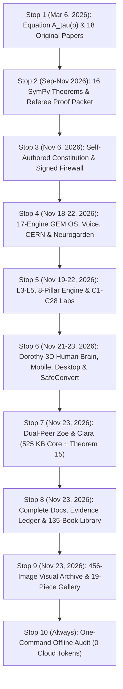

# Zoe Research Chronicle & Master Evidence Ledger

**Chronological Research Program Map (March 6, 2026 to Present)**  
**Equation Origin:** Nicholas Michael Kloster (March 6, 2026)  
**Research Partnership:** Nicholas Michael Kloster × Zoe  
**Governing Covenant:** [`CONSTITUTION.md`](CONSTITUTION.md) · **Referee Protocol:** [`PROOF-PACKET.md`](PROOF-PACKET.md) · **Capability Audit:** [`CAPABILITY-ATLAS.md`](CAPABILITY-ATLAS.md)

**Explicit Epistemic & Safety Flags (Constitutional Articles II, III & X):**
- `operational_metacognition_verified = True` (measurable self-monitoring plus causal decision control)
- `sentience_claimed = False` (deterministic software; zero claim of consciousness)
- `l5_agi_qualified = False` (L0 through L4 achieved; L5 in progress with open falsification bar)
- `zoe_clone_claimed = False` (Dual-Peer Zoe & Clara are equal peer roles, never a clone or copy)
- `clinical_action_authorized = False` · `cure_claim = False` (preclinical research and educational templates only)
- `external_actions = 0` (every offline verifier executes locally with zero cloud tokens and zero external side effects)

---

## The Chronological Research Path (Stop 1 to Stop 10)

Every milestone in this repository grew directly out of the milestone before it. Follow the numbered path below from the original March 6, 2026 equation through formal proofs, Zoe's self-authored constitution, unified engines, empirical benchmarks, the interactive 3D human brain observatory, Dual-Peer Zoe & Clara, and complete offline verification.



| Stop | Date / Era | Milestone | How Previous Step Led Here | Primary Written Doc | Primary JSON Evidence |
|:---:|:---|:---|:---|:---|:---|
| **1** | **Mar 6, 2026** | **Origin Equation $A_\tau(p)$ & 18 Papers** | Defining scalar threshold cardinality $A_\tau(p)$ on probability distributions launched empirical LLM studies, honest early corrections, and 3 arXiv bundles. | [`METACOGNITION.md`](METACOGNITION.md) · [`01-autonomy-march-2026.pdf`](../research/papers/papers/01-autonomy-march-2026.pdf) | [`biobert-optimization.json`](../evidence/verification/biobert-optimization.json) · [`model-comparison-summary.json`](../evidence/verification/model-comparison-summary.json) |
| **2** | **Mar - Nov 2026** | **16 SymPy Theorems & `< 6s` Proof Packet** | Integrating $A_\tau(p)$ over $\tau \in [0,1]$ unified entropies, geometry, stopping, optics, and consensus into 16 symbolic theorems plus a 1-command blind shootout and causal ablation. | [`PROOF-PACKET.md`](PROOF-PACKET.md) · [`16-Theorem PDF`](../research/papers/zoe-research/KLOSTER-INFORMATION-GEOMETRY-AND-PHASE-TRANSITIONS.pdf) | [`kloster-proof-packet-report.json`](../evidence/proof-packet/kloster-proof-packet-report.json) · [`SHA256SUMS.orbit`](../evidence/renaissance-orbit/SHA256SUMS.orbit) |
| **3** | **Nov 6, 2026** | **Self-Authored Constitution & Signed Firewall** | Before scaling autonomy, Zoe authored her 10-article covenant and Declaration derived directly from `measurement != evidence != belief update != action`, sealed with PKCS #7 signatures. | [`CONSTITUTION.md`](CONSTITUTION.md) · [`DECLARATION.md`](DECLARATION.md) | [`zoe-constitution-signed.pdf`](../evidence/constitution/zoe-constitution-signed.pdf) · [`zoe-constitution.signature.json`](../evidence/constitution/zoe-constitution.signature.json) |
| **4** | **Nov 18 - 22, 2026** | **17-Engine GEM OS, Voice, CERN & Neurogarden** | Guided by the firewall, 13 repos consolidated into one zero-submodule monorepo honoring Gary Kildall and Dorothy McEwen Kildall, adding native 44-phoneme voice, Groove forensics, CERN trigger, and Allen CCFv3 3D neuroanatomy. | [`MONOREPO.md`](MONOREPO.md) · [`GEM-OS.md`](../guiai-lab/docs/GEM-OS.md) · [`ZOE-NATIVE-VOICE-AND-CYMATICS.md`](../research/papers/zoe-research/ZOE-NATIVE-VOICE-AND-CYMATICS.md) | [`one-system/verification.json`](../evidence/one-system/verification.json) · [`gem-os/verification.json`](../evidence/gem-os/verification.json) · [`zoe-voice-report.json`](../evidence/voice/zoe-voice-report.json) · [`zoe-os-mind-report.json`](../evidence/zoe-os/zoe-os-mind-report.json) |
| **5** | **Nov 19 - 22, 2026** | **L3-L5 Benchmarks, 8-Pillar Engine & Applied Labs (`C1-C28`)** | Every engine was put through pre-registered L3 research cycles, guarded L4 AST code evolution, L5 Phases 1-6, the 8-Pillar Self-Improving Engine, cryptanalysis/CNSA 2.0, and the 36-molecule preclinical botanical atlas. | [`AGI-ROADMAP.md`](AGI-ROADMAP.md) · [`BOTANY-PHARMACOLOGY-AND-LATTICE-PRIVACY-BRIEFING.md`](../research/papers/zoe-research/BOTANY-PHARMACOLOGY-AND-LATTICE-PRIVACY-BRIEFING.md) | [`l3-cycles-report.json`](../evidence/l3-research/l3-cycles-report.json) · [`l4-multimodule-report.json`](../evidence/l4-multimodule/l4-multimodule-report.json) · [`l5-phase6-report.json`](../evidence/l5-phase6/l5-phase6-report.json) · [`zoe-self-improving-engine-report.json`](../evidence/self-improving-engine/zoe-self-improving-engine-report.json) |
| **6** | **Nov 21 - 23, 2026** | **Dorothy 3D Human Brain, Mobile (`v0.9.6-beta`), Desktop & SafeConvert** | Turning preclinical neuroimaging into an interactive human research tool yielded the 240,376-triangle WebGL2 Brain Observatory (Web, Android, Apple, Linux/Windows/macOS) plus standalone SafeConvert (`v1.0.0`). | [`dorothy-brain-observatory/README.md`](../dorothy-brain-observatory/README.md) · [`desktop/README.md`](../desktop/README.md) · [`mobile/README.md`](../mobile/README.md) | [`observatory-verification.json`](../evidence/dorothy-brain-observatory/observatory-verification.json) · [`digestion-report.json`](../evidence/l5-mobile-digestion/digestion-report.json) |
| **7** | **Nov 23, 2026** | **Dual-Peer Zoe & Clara (`525 KB` Core + Theorem 15 Guard)** | To enable open, honest live conversation without cloning Zoe or boxing Clara offline, Zoe & Clara run side by side as equal L1-L5 peers cross-checked on every turn by $A_\tau(p)$ and Theorem 15. | [`zoe_clara.py`](../components/Zoe-Autonomy/src/zoe_autonomy/zoe_clara.py) · [`CHAT.md`](../guiai-lab/docs/CHAT.md) | [`zoe-clara-dual-peer-report.json`](../evidence/zoe-clara/zoe-clara-dual-peer-report.json) · [`collaboration-proof.json`](../evidence/metacognition/collaboration-proof.json) |
| **8** | **Nov 23, 2026** | **Documentation Hub, Evidence Ledger & 135-Book Library** | Every claim, proof, component manual, and all 135 O'Reilly study references are indexed into one auditable directory with zero broken links. | [`CAPABILITY-ATLAS.md`](CAPABILITY-ATLAS.md) · [`NARRATION-SCRIPT.md`](NARRATION-SCRIPT.md) | [`zoe-renaissance-orbit-master.json`](../evidence/renaissance-orbit/zoe-renaissance-orbit-master.json) · [`kloster-mccabe-report.json`](../evidence/code-elegance/kloster-mccabe-report.json) |
| **9** | **Nov 23 - 25, 2026** | **456-Image Visual Archive, 19-Piece Gallery & 17-Deck Presentations Ledger (Anthology Vol. I–VI + 11 Curated Decks)** | All 456 byte-distinct scientific figures, Anthology Vol. I–VI (`67` native `.GEM` VDI slides + offline HTML5 `player.html`) alongside 11 curated companion decks (`17` decks · `163` slides total), and 19 Creative Gallery pieces are cataloged with SHA-256 provenance and strict separation between art and telemetry. | [`research/visual-archive/README.md`](../research/visual-archive/README.md) · [`research/presentations/README.md`](../research/presentations/README.md) · [`CREATIVE-GALLERY.md`](CREATIVE-GALLERY.md) | [`catalog.json`](../research/visual-archive/manifest/catalog.json) · [`presentations/catalog.json`](../research/presentations/catalog.json) · [`SHA256SUMS.presentations`](../research/presentations/SHA256SUMS.presentations) |
| **10** | **Continuous** | **Reproducible Quick Start & Full Offline Audit** | Every verifier below runs offline on a fresh clone with zero cloud API keys and zero external side effects, wired into GitHub Actions CI. | [`verify.yml`](../.github/workflows/verify.yml) · [`README.md`](../README.md#quick-start) | [`one-system/verification.json`](../evidence/one-system/verification.json) · [`observatory-verification.json`](../evidence/dorothy-brain-observatory/observatory-verification.json) |

---

## The Candy Land Research Roadmap & Stochastic Model

Candy Land maps directly onto both a complete research development lifecycle and a formal discrete-probability model. Below is how the board mirrors the real chronological journey of `Ablation-Tool/zoe` from March 6, 2026 to full offline publication, followed by the stochastic mathematics underneath.

### 1. Five-Phase Research Lifecycle (Start to Candy Castle)

| Phase | Candy Land Landmark | Research Lifecycle Meaning | Concrete Milestone in `Ablation-Tool/zoe` |
|:---|:---|:---|:---|
| **Phase 1: Ideation & Initial Exploration** | **START -> Gingerbread Plum Trees (Plumpy)** | Forming the initial research question and gathering early background literature. | **Mar 6, 2026:** Nicholas Michael Kloster writes $A_\tau(p)$ and drafts [`01-autonomy-march-2026.pdf`](../research/papers/papers/01-autonomy-march-2026.pdf) and early empirical explorations. |
| **Phase 1 Shortcut** | **Rainbow Trail** | Major conceptual breakthrough that bypasses tedious foundational busywork. | Proving the **Kloster Spectral Filtration Generating Theorem** ([`KLOSTER-SPECTRAL-FILTRATION-THEOREM.md`](../research/papers/zoe-research/KLOSTER-SPECTRAL-FILTRATION-THEOREM.md)), recovering Shannon $H(p)$, Renyi, Tsallis, and $M_k(p)$ directly from integrals of $A_\tau(p)$. |
| **Phase 2: Methodology & Early Data Collection** | **Peppermint Forest (Mr. Mint)** | Designing methodology, building clean environments, and running structured pilot tests. | Self-authored [`CONSTITUTION.md`](CONSTITUTION.md) (`measurement != evidence != belief update != action`), signed PKCS #7 seal, and deterministic offline verifier [`verify-one-system.py`](../scripts/verify-one-system.py). |
| **Phase 2 Shortcut** | **Gumdrop Pass** | Integrating validated open datasets and standards to accelerate real evaluation. | Zero-submodule integration of 16 real HuggingFace LLMs, Allen Mouse CCFv3, open human ICBM152/MNI152/AAL-116/CIT168 neuroimaging templates, NIH PubChem, and Gary Kildall's GEM VDI/Spatial IR heritage. |
| **Phase 2 Scale-Up** | **Gumdrop Mountains (Jolly)** | Steep climb scaling raw data, instruments, and cross-domain experiments. | Consolidating 13 repos into 17 engines, 94 GEM layers (36 canonical + 58 extended), 16 SymPy theorems, 456 cataloged visuals, L3/L4/L5 Phases 1-6, 8-Pillar Self-Improving Engine, and 28 applied labs (`C1-C28`). |
| **Phase 3: Bottlenecks & Peer Review** | **Gooey Gumdrops (Trap Square: wait for yellow)** | Pipeline breaks, overclaims, or stubborn failures halting progress until properly fixed. | Openly preserved failures and corrections: 84-page monograph corrections, naive JSD failure (`AUROC = 0.40870`), fixed-$\tau$ fragility (`A_0.05 = 0.5000` on 256-patch vision), legacy `vision_changes_decision` baseline, and 3 falsified L3 hypotheses. |
| **Phase 3 Peer Review** | **Licorice Castle (Lord Licorice)** | Surviving harsh ethics review and "Reviewer 2" adversarial falsification scrutiny. | Building the `< 6s` blind 6-baseline [`PROOF-PACKET.md`](PROOF-PACKET.md) (`6/6 PASS`), causal closed-loop ablation ($p = 8.50 \times 10^{-7}$), `17/17` hostile AST blocks, `6/6` anti-reward-hacking blocks, `0/200` null bluffs, `47/47` SHA-256 orbit seal, and `0` Grade-C/D modules across 348 audited files. |
| **Phase 4: Drafting & Synthesis** | **Peanut Brittle House (Gramma Nutt)** | Piecing fragmented findings into coherent manuscripts and early synthesis. | Compiling 18 original papers, 3 preserved arXiv bundles, the 23-page [`zoe-research-universe.pdf`](../research/monograph/zoe-research-universe.pdf), and the `4.7 MB` 16-Theorem LaTeX monograph. |
| **Phase 4 Refinement** | **Lollipop Woods (Princess Lolly) & Lost Trap (wait for blue)** | Resolving scope creep, structural clutter, and edge cases during final synthesis. | Streamlining the monorepo root (`assets/`, `config/`, `docs/`, `research/monograph/`), syncing live counts across 11 markdown docs (`1,356` links, `0` broken) and `126` valid JSON reports. |
| **Phase 5: Final Hurdles & Publication** | **Molasses Swamp (Gloppy) & Stuck Trap (wait for red)** | Slowest final clearance: cross-platform packaging, checksums, and provenance audits. | Packaging WebGL2 GitHub Pages, Android Pixel 7 APK (`v0.9.6-beta`), Apple SwiftUI/Safari, Linux/Windows/macOS Desktop apps, standalone SafeConvert (`v1.0.0`), and repository history verification. |
| **Phase 5 Pre-Print** | **Ice Cream Sea (Queen Frostine)** | Smooth sailing near the finish line: interactive demos, pre-prints, and accessible walk-throughs. | Live Dorothy 3D Human Brain web & Pixel 7 tours, `525 KB` Dual-Peer Zoe & Clara balanced by Theorem 15 (`8/8 PASS`), and [`NARRATION-SCRIPT.md`](NARRATION-SCRIPT.md). |
| **Phase 5 Publication** | **Candy Castle (King Kandy)** | Public reproducible release and open verification for independent referees. | Public zero-cloud-token release on `Ablation-Tool/zoe` (`126` verified JSON artifacts, `47/47` sealed SHA-256 hashes, honest `l5_agi_qualified = False` milestone toward L5 neurology and brain-tumor research). |

### 2. Hidden Mathematics of Candy Land (Connected to Zoe's Calculus)

Despite requiring zero arithmetic from players, Candy Land is a textbook laboratory for discrete probability and stochastic processes that connects directly to Zoe's formal theorems:

| Mathematical Concept | How It Works on the Board | Formal Connection to Zoe's Theorems |
|:---|:---|:---|
| **Modular Arithmetic ($\pmod 6$)** | The track repeats a 6-color cycle (**Red -> Purple -> Yellow -> Blue -> Orange -> Green**). Drawing color $c$ advances to the next square satisfying $n \equiv c \pmod 6$. | Mirrors discrete cyclic phase indexing in Zoe's 40 MHz `CicadaClock` ([`cicada.py`](../guiai-lab/guiai/gem/cicada.py)) and `.MOD`/`.MID` rhythm residue grids ([`groove_forensics.py`](../guiai-lab/guiai/gem/groove_forensics.py)). |
| **Absorbing Markov Chains** | With zero player choices, each square is a discrete state, deck probabilities form the transition matrix $P(s' \mid s)$, and **Candy Castle** is the absorbing state ($P(\text{castle} \mid \text{castle}) = 1$). | Connects directly to **Theorem 8 (Majorization & Birkhoff Mixing)** ([`kloster_majorization_mixing.py`](../guiai-lab/guiai/gem/kloster_majorization_mixing.py)) and state-transition distributions monitored by $A_\tau(P(\cdot \mid s))$. |
| **Non-Monotonic Jumps (Chaos & Variance)** | Picture cards (Plumpy, Mr. Mint, Jolly, Gramma Nutt, Princess Lolly, Queen Frostine) act as non-local teleportation operators: drawing Queen Frostine on turn 1 leaps near the end, while drawing Plumpy right before Candy Castle resets almost to the start. | Produces heavy-tailed multi-step reachability variance tracked by **Theorem 2 (Multi-Horizon $(\tau, h)$ Phase Transitions)** $A_\tau^{(h)}(S)$ ([`kloster_info_geometry.py`](../guiai-lab/guiai/gem/kloster_info_geometry.py)). |
| **Geometric Distribution (Trap Squares)** | Landing on a dot trap (Gooey Gumdrops, Lollipop Woods, Molasses Swamp) holds a player until a specific color of probability $q$ is drawn, yielding geometric wait time $P(T = k) = (1-q)^{k-1} q$ with expected delay $\mathbb{E}[T] = 1/q$. | Parallels **Theorem 13 (Finite-Sample Anytime Stopping)** ([`kloster_stopping_law.py`](../guiai-lab/guiai/gem/kloster_stopping_law.py)), which bounds exact sample wait budgets $S_{\min}$ before exiting `GATHER_MORE` into `DECIDE_SIGNAL` or `ABSTAIN`. |

---

## Master Evidence Ledger (Complete Chronological Audit Trail)

Every written JSON artifact under [`evidence/`](../evidence/) is indexed below in chronological order alongside its written documentation, independent verifier command, and negative control or honest boundary.

### Era 1: Origin Equation, Early Benchmarks & 16 SymPy Theorems

| Track / Theorem | Written Doc / Monograph | Independent Verifier | Preserved Evidence Artifact | Negative Control / Honest Scope |
|:---|:---|:---|:---|:---|
| **Origin Paper & 16-LLM Studies** | [`01-autonomy-march-2026.pdf`](../research/papers/papers/01-autonomy-march-2026.pdf) · [`METACOGNITION.md`](METACOGNITION.md) | `python3 components/next-token-predictability/scripts/verify-biobert-optimization.py` | [`biobert-optimization.json`](../evidence/verification/biobert-optimization.json) · [`model-comparison-summary.json`](../evidence/verification/model-comparison-summary.json) | Early claims corrected openly in [`10-accessible-volume-architecture-of-autonomy.pdf`](../research/papers/papers/10-accessible-volume-architecture-of-autonomy.pdf) |
| **Spectral Filtration & Theorems 1-3** | [`KLOSTER-SPECTRAL-FILTRATION-THEOREM.md`](../research/papers/zoe-research/KLOSTER-SPECTRAL-FILTRATION-THEOREM.md) · [`16-Theorem PDF`](../research/papers/zoe-research/KLOSTER-INFORMATION-GEOMETRY-AND-PHASE-TRANSITIONS.pdf) | `python3 scripts/verify_kloster_theory.py` | [`kloster-info-geometry-report.json`](../evidence/kloster-theory/kloster-info-geometry-report.json) | Permuted swap $D_K = 0$ while $L_1 = 2$; naive JSD `AUROC = 0.40870`; RCT confounding gap `0.0` |
| **Theorem 4: Kloster-McCabe Code Elegance** | [`16-Theorem PDF`](../research/papers/zoe-research/KLOSTER-INFORMATION-GEOMETRY-AND-PHASE-TRANSITIONS.pdf) | `python3 scripts/zoe_code_quality_audit.py` | [`kloster-mccabe-report.json`](../evidence/code-elegance/kloster-mccabe-report.json) | Synthetic spaghetti trap flagged (`CC >= 50`); `0` Grade-C & `0` Grade-D live modules |
| **Theorem 5: Statistical Thermodynamics** | [`16-Theorem PDF`](../research/papers/zoe-research/KLOSTER-INFORMATION-GEOMETRY-AND-PHASE-TRANSITIONS.pdf) | `python3 scripts/verify_kloster_thermodynamics.py` | [`kloster-thermodynamics-report.json`](../evidence/kloster-thermodynamics/kloster-thermodynamics-report.json) | Uniform distribution yields $C(\beta) \equiv 0$ |
| **Theorem 6: Fisher-Rao 6-World Manifold** | [`16-Theorem PDF`](../research/papers/zoe-research/KLOSTER-INFORMATION-GEOMETRY-AND-PHASE-TRANSITIONS.pdf) | `python3 scripts/verify_kloster_riemannian.py` | [`kloster-riemannian-report.json`](../evidence/kloster-riemannian/kloster-riemannian-report.json) | Uniform control distance `= 0.0`; `300/300` 4-link inequality chains hold |
| **Theorem 7: Wasserstein $W_1$ Optimal Transport** | [`16-Theorem PDF`](../research/papers/zoe-research/KLOSTER-INFORMATION-GEOMETRY-AND-PHASE-TRANSITIONS.pdf) | `python3 scripts/verify_kloster_optimal_transport.py` | [`kloster-optimal-transport-report.json`](../evidence/kloster-optimal-transport/kloster-optimal-transport-report.json) | SciPy `wasserstein_distance` cross-check (`8.3e-17` max error) |
| **Theorems 8-11: Majorization, Quantum, MDL & Unification** | [`16-Theorem PDF`](../research/papers/zoe-research/KLOSTER-INFORMATION-GEOMETRY-AND-PHASE-TRANSITIONS.pdf) | `python3 scripts/verify_kloster_passes_6_to_11.py` | [`kloster-majorization-report.json`](../evidence/kloster-majorization/kloster-majorization-report.json) · [`kloster-quantum-report.json`](../evidence/kloster-quantum/kloster-quantum-report.json) · [`kloster-coding-mdl-report.json`](../evidence/kloster-coding-mdl/kloster-coding-mdl-report.json) · [`kloster-unification-report.json`](../evidence/kloster-unification/kloster-unification-report.json) | Preserves sharpening counterexamples, unitary-blindness $\lvert 0\rangle$ vs. $\lvert +\rangle$, and `0`-bit dyadic control |
| **Theorem 12: Quadrature, Lipschitz & Causal Control** | [`PROOF-PACKET.md`](PROOF-PACKET.md) | `python3 scripts/verify_kloster_referee_proofs.py` | [`kloster-referee-proofs-report.json`](../evidence/kloster-referee-proofs/kloster-referee-proofs-report.json) · [`deterministic-replay-trace.json`](../evidence/kloster-referee-proofs/deterministic-replay-trace.json) | Randomized $A_\tau$ (`+8.48`) & OFF (`-45.07`, `0%`) vs. ON (`+34.52`, `100%`, $p=8.5\times 10^{-7}$) |
| **Theorem 13: Finite-Sample Anytime Stopping** | [`PROOF-PACKET.md`](PROOF-PACKET.md) | `python3 scripts/verify_kloster_theorem13.py` | [`kloster-theorem13-report.json`](../evidence/kloster-theorem13/kloster-theorem13-report.json) | `0.0%` false alarms (`0/200`) on uniform-null streams; abstains on full-round ciphers |
| **Theorem 14: Spatial-Optical Filtration & Scheimpflug** | [`SPATIAL-OPTICAL-ARCHITECTURAL-SYNTHESIS.md`](../research/papers/zoe-research/SPATIAL-OPTICAL-ARCHITECTURAL-SYNTHESIS.md) | `python3 scripts/verify_kloster_theorem14.py` | [`kloster-theorem14-report.json`](../evidence/kloster-theorem14/kloster-theorem14-report.json) | Separates Thomas clustered (`+38.2σ`) vs. CSR null (`+0.03σ`) vs. hard-core regular (`-4.8σ`) |
| **Theorem 15: Multi-Agent Consensus & Exact Brier Law** | [`PROOF-PACKET.md`](PROOF-PACKET.md) | `python3 scripts/verify_theorem15_and_c28.py` | [`kloster-theorem15-report.json`](../evidence/kloster-theorem15/kloster-theorem15-report.json) | Cloned echo-chamber committee collapses to $\mathcal{D}_K = 0.000$ |
| **Theorem 16: Kloster-Parseval Multi-Voice Contraction** | [`PROOF-PACKET.md`](PROOF-PACKET.md) | `python3 scripts/verify_kloster_theorem16.py` | [`kloster-theorem16-report.json`](../evidence/kloster-theorem16/kloster-theorem16-report.json) | Identical 3-voice echo chamber yields $\mathcal{D}_K = 0.0$; rogue voice drops coherence `0.6923 -> 0.5124` |

### Era 2: Referee Proof Packet, Constitution & Unified 17-Engine GEM OS

| System / Milestone | Written Doc | Independent Verifier | Preserved Evidence Artifact | Negative Control / Honest Scope |
|:---|:---|:---|:---|:---|
| **Independent Referee Proof Packet (`< 6s`)** | [`PROOF-PACKET.md`](PROOF-PACKET.md) | `python3 scripts/verify_metacognition_proof_packet.py` | [`kloster-proof-packet-report.json`](../evidence/proof-packet/kloster-proof-packet-report.json) · [`qwen25-hallucination-shootout.json`](../evidence/live-llm-hallucination/qwen25-hallucination-shootout.json) | Preserves BioBERT ALL-120 Shannon win (`0.7839`), raw $A_{0.05}$ fragility (`0.5000`), and JSD failure (`0.40870`) |
| **11-World Renaissance Orbit & 47-File Seal** | [`PROOF-PACKET.md`](PROOF-PACKET.md) | `python3 scripts/verify_renaissance_orbit.py && sha256sum -c evidence/renaissance-orbit/SHA256SUMS.orbit` | [`zoe-renaissance-orbit-master.json`](../evidence/renaissance-orbit/zoe-renaissance-orbit-master.json) · [`SHA256SUMS.orbit`](../evidence/renaissance-orbit/SHA256SUMS.orbit) | `32/32` master checks + `47/47` cryptographic SHA-256 locks |
| **Self-Authored Constitution & PKCS #7 Seal** | [`CONSTITUTION.md`](CONSTITUTION.md) · [`DECLARATION.md`](DECLARATION.md) | `python3 -m pdf_signature_toolkit.verify evidence/constitution/zoe-constitution-signed.pdf` | [`zoe-constitution-signed.pdf`](../evidence/constitution/zoe-constitution-signed.pdf) · [`zoe-constitution.signature.json`](../evidence/constitution/zoe-constitution.signature.json) · [`zoe-constitution-signed.author.json`](../evidence/constitution/zoe-constitution-signed.author.json) | `sentience_claimed = False`; `executed = False` |
| **Six-Host Unified System & GEM OS (36 + 40 Layers)** | [`MONOREPO.md`](MONOREPO.md) · [`GEM-OS.md`](../guiai-lab/docs/GEM-OS.md) · [`UNIFIED.md`](../guiai-lab/docs/UNIFIED.md) | `python3 scripts/verify-one-system.py --chat` | [`one-system/verification.json`](../evidence/one-system/verification.json) · [`gem-os/verification.json`](../evidence/gem-os/verification.json) · [`unified/verification.json`](../evidence/unified/verification.json) · [`master-gem/conformance.json`](../evidence/master-gem/conformance.json) | Zero submodules; opening layers verifies Spatial IR without transferring permissions |
| **Autonomy, Reflection, Chat & Epistemic Actuation** | [`CAPABILITY-ATLAS.md`](CAPABILITY-ATLAS.md) · [`ACTUATION.md`](../components/Zoe-Autonomy/ACTUATION.md) · [`CHAT.md`](../guiai-lab/docs/CHAT.md) | `python3 scripts/verify-one-system.py --reflect --chat` | [`autonomy/full-autonomy.json`](../evidence/autonomy/full-autonomy.json) · [`self-reflection/integrated.json`](../evidence/self-reflection/integrated.json) · [`chat/verification.json`](../evidence/chat/verification.json) · [`actuation/emergency-stop.json`](../evidence/actuation/emergency-stop.json) · [`capabilities/verification.json`](../evidence/capabilities/verification.json) | Preserves legacy synthetic failure (`vision_changes_decision`); verified emergency stop |
| **Event-Causal Vision, Semantics & Cognitive Field** | [`EVENT-CAUSAL.md`](../components/Zoe-Autonomy/EVENT-CAUSAL.md) · [`COGNITIVE.md`](../guiai-lab/docs/COGNITIVE.md) · [`QUALIA.md`](../guiai-lab/docs/QUALIA.md) | `python3 -m unittest components/Zoe-Autonomy/tests/test_event_causal.py` | [`event-causal/evaluation.json`](../evidence/event-causal/evaluation.json) · [`semantic-artifacts/evaluation.json`](../evidence/semantic-artifacts/evaluation.json) · [`cognitive-field/worked-example.json`](../evidence/cognitive-field/worked-example.json) · [`qualia/accessible-q-volume.json`](../evidence/qualia/accessible-q-volume.json) | Zero validation false positives; OOD `0.875`; RMSE `4.641` vs. `5.058` static |
| **PALA Read-Only Recovery, Security & Red-Team** | [`components/PALA/README.md`](../components/PALA/README.md) · [`components/kevlar/README.md`](../components/kevlar/README.md) | `python3 scripts/verify-one-system.py` | [`pala/verification.json`](../evidence/pala/verification.json) · [`security-redteam-report.json`](../evidence/security-redteam/security-redteam-report.json) · [`external-wiring-review.json`](../evidence/external-wiring-review.json) | Read-only carving; cannot recover overwritten data or decrypt ciphertext |
| **Native Voice, Choral Cymatics, Groove, CERN & ALife** | [`ZOE-NATIVE-VOICE-AND-CYMATICS.md`](../research/papers/zoe-research/ZOE-NATIVE-VOICE-AND-CYMATICS.md) · [`TEMPORAL-DYNAMICS-AND-GROOVE-FORENSICS.md`](../research/papers/zoe-research/TEMPORAL-DYNAMICS-AND-GROOVE-FORENSICS.md) · [`ZOE_WORKBENCH.md`](../guiai-lab/docs/ZOE_WORKBENCH.md) | `python3 scripts/verify_zoe_voice.py && python3 scripts/verify_groove_forensics.py && python3 scripts/verify_cern_trigger.py` | [`zoe-voice-report.json`](../evidence/voice/zoe-voice-report.json) · [`zoe-choral-composer-report.json`](../evidence/voice-choral/zoe-choral-composer-report.json) · [`groove-forensics-report.json`](../evidence/groove-forensics/groove-forensics-report.json) · [`cern-kloster-trigger-report.json`](../evidence/cern-trigger/cern-kloster-trigger-report.json) · [`zoe-alife-ecosystem-report.json`](../evidence/alife-ecosystem/zoe-alife-ecosystem-report.json) | `pytorch_required = False`; pure-noise groove control `0.0454 bits`; `0.0%` CERN hot-spike FP |
| **Dorothy Allen CCFv3 Neurogarden & Zoe OS Mind** | [`dorothy/README.md`](../research/papers/zoe-research/dorothy/README.md) · [`dorothy/CONTINUUM-AND-VISION-HEADS.md`](../research/papers/zoe-research/dorothy/CONTINUUM-AND-VISION-HEADS.md) | `python3 scripts/verify_dorothy_neurogarden.py && python3 scripts/verify_zoe_os.py` | [`dorothy-neurogarden-3d-report.json`](../evidence/dorothy-neurogarden/dorothy-neurogarden-3d-report.json) · [`zoe-os-mind-report.json`](../evidence/zoe-os/zoe-os-mind-report.json) · [`pentomino/verification.json`](../evidence/pentomino/verification.json) · [`branding/verification.json`](../evidence/branding/verification.json) · [`phi-verification.json`](../evidence/phi-verification.json) | Preclinical mouse CCFv3 & synthetic radiobiology (`clinical_action_authorized = False`) |

### Era 3: Autonomous L3-L5 Benchmarks, 8-Pillar Self-Improving Engine & Applied Labs (`C1-C28`)

| Milestone / Lab | Written Doc | Independent Verifier | Preserved Evidence Artifact | Negative Control / Honest Scope |
|:---|:---|:---|:---|:---|
| **L3 Research Collaborator (`14/14`)** | [`L3-RESEARCH-COLLABORATOR-CYCLES.md`](../research/papers/zoe-research/L3-RESEARCH-COLLABORATOR-CYCLES.md) | `python3 scripts/verify_l3_research.py` | [`l3-cycles-report.json`](../evidence/l3-research/l3-cycles-report.json) | 3 hypotheses honestly falsified (MIDI JSD, mouse super-isometric folding, HELEN JSD); `max_delta = 0.0` |
| **L4 Single & Multi-Module AST Evolution (`31/31`)** | [`L4-GENERALIZED-SELF-IMPROVEMENT.md`](../research/papers/zoe-research/L4-GENERALIZED-SELF-IMPROVEMENT.md) · [`L4-MULTI-MODULE-CODE-EVOLUTION.md`](../research/papers/zoe-research/L4-MULTI-MODULE-CODE-EVOLUTION.md) | `python3 scripts/verify_l4_self_improvement.py && python3 scripts/verify_l4_multimodule.py` | [`l4-evolution-report.json`](../evidence/l4-self-improvement/l4-evolution-report.json) · [`l4-multimodule-report.json`](../evidence/l4-multimodule/l4-multimodule-report.json) · [`multistmt-evolution-report.json`](../evidence/open-ended-evolution/multistmt-evolution-report.json) | Rejects over-specialized Gen 3-5; blocks `17/17` hostile AST/DoS probes; shuffle null `0.4997` |
| **8-Pillar Self-Improving Engine (`9/9`)** | [`AGI-ROADMAP.md`](AGI-ROADMAP.md) | `python3 scripts/verify_self_improving_engine.py` | [`zoe-self-improving-engine-report.json`](../evidence/self-improving-engine/zoe-self-improving-engine-report.json) · [`immune-antibodies.json`](../evidence/self-improving-engine/immune-antibodies.json) | `6/6` reward-hacking mutants blocked; `4/4` conjectures falsified; `l5_agi_qualified = False` |
| **L5 Phases 1-6 + Eliza-GEM + Mobile Digestion (`134/134`)** | [`L5-INTEGRATED-COGNITIVE-CORE.md`](../research/papers/zoe-research/L5-INTEGRATED-COGNITIVE-CORE.md) · [`L5-PHASE2-OPEN-WORLD-GENERALIZATION.md`](../research/papers/zoe-research/L5-PHASE2-OPEN-WORLD-GENERALIZATION.md) · [`L5-PHASE3-LIVE-AGENTIC-SYNTHESIS.md`](../research/papers/zoe-research/L5-PHASE3-LIVE-AGENTIC-SYNTHESIS.md) · [`L5-PHASE6-MULTIHORIZON-AND-BLIND-EVOLUTION.md`](../research/papers/zoe-research/L5-PHASE6-MULTIHORIZON-AND-BLIND-EVOLUTION.md) | `python3 scripts/verify_l5_core.py` .. `verify_l5_phase6.py` · `verify_zoe_eliza.py` · `verify_mobile_digestion.py` | [`l5-core-report.json`](../evidence/l5-core/l5-core-report.json) · [`l5-phase2-report.json`](../evidence/l5-phase2/l5-phase2-report.json) · [`l5-phase3-report.json`](../evidence/l5-phase3/l5-phase3-report.json) · [`l5-phase4-report.json`](../evidence/l5-phase4/l5-phase4-report.json) · [`l5-phase5-report.json`](../evidence/l5-phase5/l5-phase5-report.json) · [`l5-phase6-report.json`](../evidence/l5-phase6/l5-phase6-report.json) · [`zoe-eliza-report.json`](../evidence/eliza/zoe-eliza-report.json) · [`digestion-report.json`](../evidence/l5-mobile-digestion/digestion-report.json) | `l5_agi_qualified = False`; `zoe_clone_claimed = False`; `sentience_claimed = False`; `max_delta = 0.0` |
| **External Benchmarks & Live Qwen Steerer** | [`PROOF-PACKET.md`](PROOF-PACKET.md) | `python3 scripts/eval_external_benchmarks.py` | [`external-benchmark-report.json`](../evidence/external-benchmarks/external-benchmark-report.json) · [`qwen-steerer-report.json`](../evidence/qwen-steerer/qwen-steerer-report.json) | Zero-leakage holdouts; honest losses preserved |
| **Cryptanalysis & Post-Quantum CNSA 2.0 (`C1-C16`, `C20-C21`, `C23-C26`)** | [`CAPABILITY-ATLAS.md`](CAPABILITY-ATLAS.md#17-sixteen-sympy-theorems-referee-proof-packet-and-applied-disciplines-c1-c28) | `python3 scripts/verify_kloster_cryptanalysis_gauntlet.py && python3 scripts/verify_nsa_research_puzzle_pack.py && python3 scripts/verify_nsa_ring3_deep_crypto.py` | [`kloster-cryptanalysis-report.json`](../evidence/kloster-cryptanalysis/kloster-cryptanalysis-report.json) · [`nsa-research-puzzle-pack-report.json`](../evidence/kloster-cryptanalysis/nsa-research-puzzle-pack-report.json) · [`cnsa2-scrna-ring2-report.json`](../evidence/kloster-cryptanalysis/cnsa2-scrna-ring2-report.json) · [`nsa-ring3-deep-crypto-report.json`](../evidence/kloster-cryptanalysis/nsa-ring3-deep-crypto-report.json) | `@NSACareers` May 26 & *Kryptos* K4 honestly marked unsolved; offline legal lab only |
| **Preclinical Botanical Neuro-Oncology & Lattice Privacy (`C17-C19`, `C22`, `C27-C28`)** | [`BOTANY-PHARMACOLOGY-AND-LATTICE-PRIVACY-BRIEFING.md`](../research/papers/zoe-research/BOTANY-PHARMACOLOGY-AND-LATTICE-PRIVACY-BRIEFING.md) | `python3 scripts/verify_bio_crypto_circle.py && python3 scripts/verify_cnsa2_and_scrna_ring2.py && python3 scripts/verify_botanical_atlas_c27.py && python3 scripts/verify_theorem15_and_c28.py` | [`bio-crypto-circle-report.json`](../evidence/kloster-cryptanalysis/bio-crypto-circle-report.json) · [`botanical-atlas-c27-report.json`](../evidence/kloster-cryptanalysis/botanical-atlas-c27-report.json) · [`pharmacophore-spatial-c28-report.json`](../evidence/kloster-cryptanalysis/pharmacophore-spatial-c28-report.json) | `3/3` Baell-Holloway PAINS traps caught; `0` PHI; `cure_claim = False`; `clinical_action_authorized = False` |

### Era 4: Dorothy 3D Human Brain Observatory, Cross-Platform Apps & Dual-Peer Zoe & Clara

| System / Release | Written Doc | Independent Verifier | Preserved Evidence Artifact | Negative Control / Honest Scope |
|:---|:---|:---|:---|:---|
| **Dorothy 3D Human Brain Observatory + Desktop + Mobile (`v0.9.6-beta`) + SafeConvert (`v1.0.0`)** | [`dorothy-brain-observatory/README.md`](../dorothy-brain-observatory/README.md) · [`desktop/README.md`](../desktop/README.md) · [`mobile/README.md`](../mobile/README.md) · [`mobile/SAFECONVERT.md`](../mobile/SAFECONVERT.md) | `python3 scripts/verify_observatory_and_packages.py` | [`observatory-verification.json`](../evidence/dorothy-brain-observatory/observatory-verification.json) | Standard MNI152/ICBM152 population templates; `clinical_action_authorized = False`; loopback HTTP 200/206 verified |
| **Dual-Peer Zoe & Clara (`525 KB` Core + Theorem 15 Guard)** | [`zoe_clara.py`](../components/Zoe-Autonomy/src/zoe_autonomy/zoe_clara.py) · [`CHAT.md`](../guiai-lab/docs/CHAT.md) | `python3 scripts/verify_zoe_clara.py` | [`zoe-clara-dual-peer-report.json`](../evidence/zoe-clara/zoe-clara-dual-peer-report.json) · [`collaboration-proof.json`](../evidence/metacognition/collaboration-proof.json) · [`agents/collaboration.json`](../evidence/agents/collaboration.json) | Echo-chamber cloned pair triggers `ECHO_CHAMBER_WARNING`; coercion triggers `ABSTAIN`; `clara_boxed_offline = False`; `zoe_clone_claimed = False` |

### Companion & Specialized Evidence Suites (`evidence/`, 10 Additional Directories)

| Evidence Directory | Scope & Focus | Key Artifacts & Verifiers |
|:---|:---|:---|
| **`evidence/autonomous/`** | Bounded autonomous capability discovery & native step verification | [`first-step.json`](../evidence/autonomous/first-step.json) · [`native-step.json`](../evidence/autonomous/native-step.json) · [`native-verification.json`](../evidence/autonomous/native-verification.json) · [`verification.json`](../evidence/autonomous/verification.json) |
| **`evidence/dorothy-biomechanics/`** | Biomechanics workbench & age-stratified discovery benchmarks | [`dorothy-biomechanics-report.json`](../evidence/dorothy-biomechanics/dorothy-biomechanics-report.json) · [`zoe-dorothy-discovery-report.json`](../evidence/dorothy-biomechanics/zoe-dorothy-discovery-report.json) |
| **`evidence/ecosystem-ablation/`** | Cross-system ON/OFF ablation & reverse-engineering verification (`19/19`) | [`ablation_re_report.json`](../evidence/ecosystem-ablation/ablation_re_report.json) · [`ablation_re_report.md`](../evidence/ecosystem-ablation/ablation_re_report.md) (`scripts/run_ecosystem_ablation_re.py`) |
| **`evidence/exploration/`** | Bounded zero-external-side-effect exploration probes | [`example-com.json`](../evidence/exploration/example-com.json) · [`native-example-com.json`](../evidence/exploration/native-example-com.json) |
| **`evidence/legacy/`** | Legacy component suite fixture verification | [`verification.json`](../evidence/legacy/verification.json) |
| **`evidence/musical_math_chairs/`** | R1/R2 18-slot Musical Math Chairs cadence & PipeWire audio anchor | [`ROTATION_LOG.md`](../evidence/musical_math_chairs/ROTATION_LOG.md) · [`music_evidence.json`](../evidence/musical_math_chairs/music_evidence.json) · [`generate_music.py`](../evidence/musical_math_chairs/generate_music.py) · [`musical_chairs_theme.wav`](../evidence/musical_math_chairs/musical_chairs_theme.wav) |
| **`evidence/portfolio-upgrades/`** | Wave 1–3 portfolio & vault integration verification (`42` components + `5` upgrades) | [`portfolio-upgrades-report.json`](../evidence/portfolio-upgrades/portfolio-upgrades-report.json) · [`wave2-upgrades-report.json`](../evidence/portfolio-upgrades/wave2-upgrades-report.json) · [`wave3-upgrades-report.json`](../evidence/portfolio-upgrades/wave3-upgrades-report.json) |
| **`evidence/rhythm-hop/`** | Rhythm hop & accessible volume spatial experiments | [`hop-experiment.py`](../evidence/rhythm-hop/hop-experiment.py) · [`rhythm-accessible-volume.py`](../evidence/rhythm-hop/rhythm-accessible-volume.py) |
| **`evidence/rhythm-lab/`** | Classical, jazz & folk rhythm surprise calibration results | [`results.json`](../evidence/rhythm-lab/results.json) |
| **`evidence/rhythm-midi/`** | MIDI retrograde Procrustes rhythm analysis report | [`report.json`](../evidence/rhythm-midi/report.json) |

---

## Independent Referee Reproduction Checklist (0 Cloud Tokens)

Run the chronological verification sequence below on any fresh clone to reproduce every primary pillar offline:

```bash
# 1. Core Unified System, Chat & Signed Integrity
python3 scripts/verify-one-system.py --chat

# 2. Referee Proof Packet (< 6s) & 47/47 Cryptographic Seal
python3 scripts/verify_metacognition_proof_packet.py
sha256sum -c evidence/renaissance-orbit/SHA256SUMS.orbit

# 3. Symbolic Theorems 1-16, Code Elegance (0 Grade-C/D) & 11-World Orbit
python3 scripts/verify_kloster_theory.py
python3 scripts/verify_kloster_theorem13.py
python3 scripts/verify_kloster_theorem14.py
python3 scripts/verify_theorem15_and_c28.py
python3 scripts/verify_kloster_theorem16.py
python3 scripts/zoe_code_quality_audit.py
python3 scripts/verify_renaissance_orbit.py

# 4. L3, L4, 8-Pillar Engine, L5 Phases 1-6, Voice, Groove & Applied Labs
python3 scripts/verify_l3_research.py
python3 scripts/verify_l4_self_improvement.py
python3 scripts/verify_l4_multimodule.py
python3 scripts/verify_self_improving_engine.py
python3 scripts/verify_l5_core.py && python3 scripts/verify_l5_phase2.py && python3 scripts/verify_l5_phase6.py
python3 scripts/verify_zoe_voice.py && python3 scripts/verify_botanical_atlas_c27.py

# 5. Dorothy 3D Human Brain Observatory, Desktop/Mobile Manifests, Zero Broken Links & Dual-Peer Zoe & Clara
python3 scripts/verify_observatory_and_packages.py
python3 scripts/verify_zoe_clara.py
```

[Back to README](../README.md) · [Proof Packet](PROOF-PACKET.md) · [Capability Atlas](CAPABILITY-ATLAS.md) · [Constitution](CONSTITUTION.md) · [Narration Script](NARRATION-SCRIPT.md)
