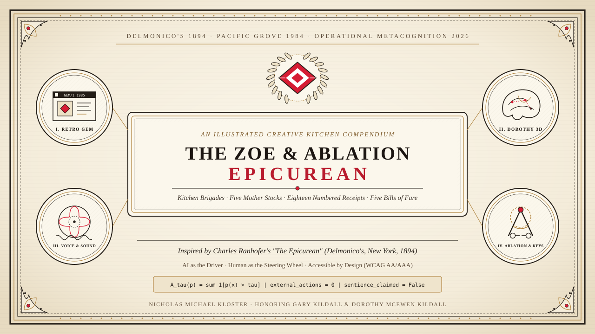
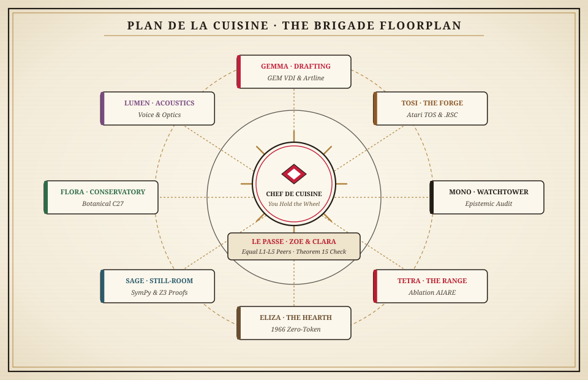
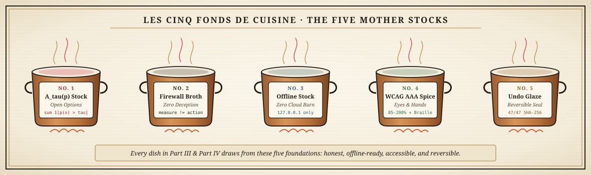
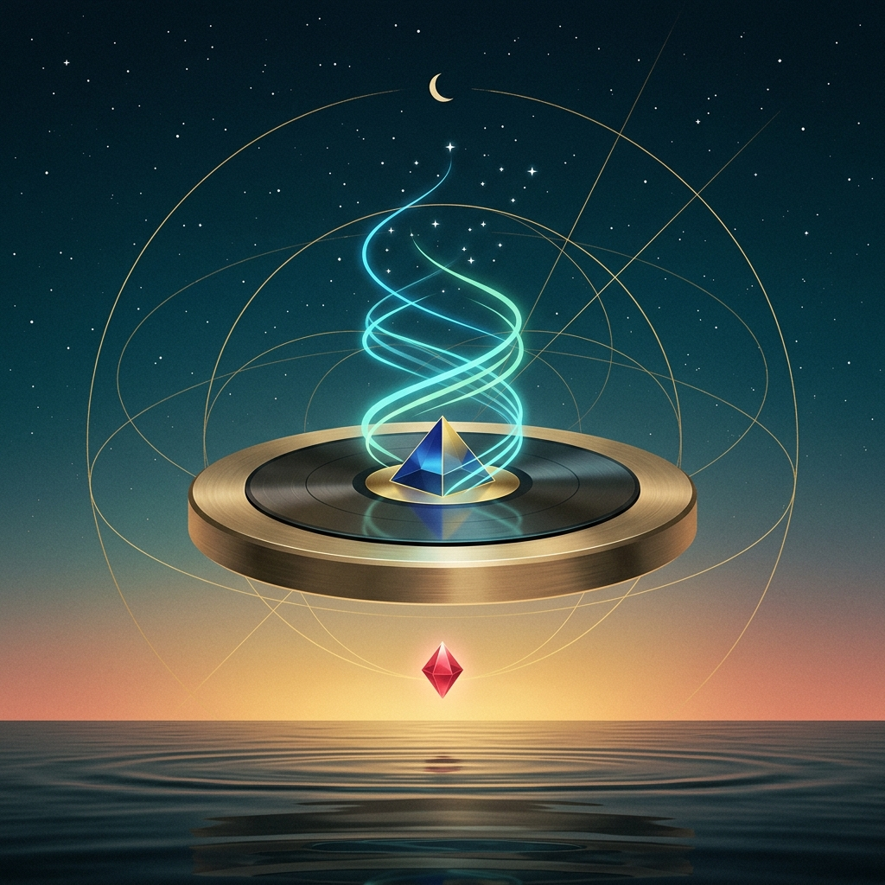
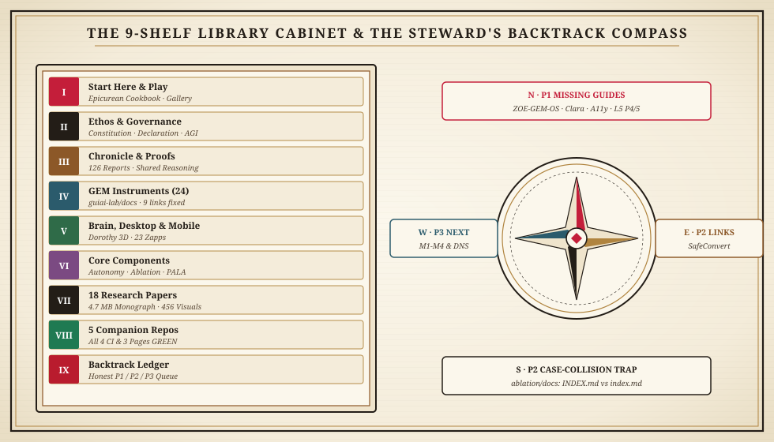

<div align="center">



<br/>
<sub><em>Original artistic bookplate illustration inspired by Charles Ranhofer's 1894 Delmonico's classic "The Epicurean" (non-telemetry creative artwork, CONSTITUTION.md Article II.2).</em></sub>

<br/><br/>

<a href="INDEX.md"></a>

# THE ZOE & ABLATION EPICUREAN

### *A Complete Creative Treatise of Computing, Sound, Geometry, Reverse Engineering & Play*

**Containing Kitchen Brigades, Five Mother Preparations, Twenty-One Numbered Receipts, and Five Complete Bills of Fare**  
*Inspired by Charles Ranhofer's "The Epicurean" (Delmonico's, New York, 1894)*

[Browse the Full Library](INDEX.md) · [Zoe-GEM OS Guide](ZOE-GEM-OS.md) · [Zoe & Clara Guide](ZOE-AND-CLARA.md) · [Accessibility Card](ACCESSIBILITY.md) · [Backtrack Ledger](BACKTRACK-LEDGER.md)

</div>

<p align="center"></p>

## Preface from the Chef de Cuisine

In 1894, Charles Ranhofer published *The Epicurean* after thirty years leading the kitchens of Delmonico's in New York. He did not write a cold factory manual. He wrote an illustrated, joyful, encyclopedic kitchen companion: first introducing the rooms, the brigade, and the copperware; then the five mother stocks that quietly lift every dish; then numbered receipts grouped by course; and finally, complete evening bills of fare so a host could put together a memorable night without guessing.

This volume follows Ranhofer's spirit for **Zoe** and **Ablation**. It is not a dry command-line dictionary, and you do not have to read it front to back. Flip straight to a numbered receipt that catches your eye, or pick one of the five complete **Bills of Fare** in Part IV and cook an entire afternoon of music, 3D neuroanatomy, vintage 1985 desktops, and calm, accessible reverse engineering.

Honoring **Gary Kildall**, **Dorothy McEwen Kildall**, and **Nicholas Michael Kloster** (Operational Metacognition $A_\tau(p)$, March 6, 2026).

---

## Table of Contents

- **[Part I: The House, Its Brigades & Kitchen Utensils](#part-i-the-house-its-brigades--kitchen-utensils)** (*La Cuisine, Les Brigades et La Batterie de Cuisine*)
- **[Part II: Elementary Preparations & Mother Stocks (No. 1 to No. 5)](#part-ii-elementary-preparations--mother-stocks-no-1-to-no-5)** (*Fonds de Cuisine*)
- **[Part III: The Numbered Receipts (No. 6 to No. 26)](#part-iii-the-numbered-receipts-no-6-to-no-26)** (*Recettes Choisies*)
  - [Hors-d'Oeuvre (Opening Sparks: No. 6 to No. 8)](#hors-doeuvre-opening-sparks)
  - [Potages & Preuves (Clear Broths & Proofs: No. 9 to No. 10)](#potages--preuves-clear-broths--proofs)
  - [Releves & Entrees (Reverse Engineering & Forensics: No. 11 to No. 14)](#releves--entrees-reverse-engineering--forensics)
  - [Rotis, Voix & Acoustique (Music, Voice & Roundtable Sound: No. 15 to No. 18)](#rotis-voix--acoustique-music-voice--roundtable-sound)
  - [Entremets & Retro Confections (3D Brain & 1982-1992 Time Machine: No. 19 to No. 21)](#entremets--retro-confections-3d-brain--1982-1992-time-machine)
  - [Desserts, Botanique & Optique (Preclinical Compounds & Lenses: No. 22)](#desserts-botanique--optique)
  - [Cave & Cellier (Sovereign Hardware & Mutual-Consent Airlock: No. 23)](#cave--cellier-sovereign-hardware--mutual-consent-airlock)
  - [Atelier de Saison (DeepMind Science, Artline Studio & Wombats Physics: No. 24 to No. 26)](#atelier-de-saison-deepmind-science-artline-studio--wombats-physics)
- **[Part IV: Five Complete Bills of Fare (Menus I to V)](#part-iv-five-complete-bills-of-fare)** (*Menus de Saison & de Circonstance*)
- **[Part V: The Steward's Cellar Book & Pantry Map](#part-v-the-stewards-cellar-book--pantry-map)**

<p align="center"></p>

## Part I: The House, Its Brigades & Kitchen Utensils

<div align="center">

</div>

### The Brigade de Cuisine (Who Works Each Station)

In a great kitchen, nobody is boxed in a closet and nobody grabs the steering wheel away from the host. Here is the brigade on duty inside Zoe & Ablation:

| Station | Brigade Role | Who Stands at the Counter | Specialty |
|:---|:---|:---|:---|
| **The Steering Wheel** | *Chef de Cuisine* | **You (Human Steward)** | Sets taste, curiosity, judgment, and final word on every dish |
| **The Passe** | *Chefs de Partie (Equal Peers)* | **Zoe & Clara** | Equal L1-L5 peers who check each other's citations and catch echo-chamber drift |
| **The Hearth** | *Entremetier (Zero-Token)* | **Eliza** (`dos`) | 1966 Weizenbaum reflection + SHA-256 relay notes in milliseconds at zero cloud cost |
| **The Watchtower** | *Garde-Manger & Verifier* | **Mono** (`sm124`) | Monochrome constitutional auditor, Theorem 15 check, and epistemic firewall |
| **The Drafting Table** | *Dessinateur* | **Gemma** (`gem3`) | Digital Research GEM VDI, Artline 2.0 vectors, and Spatial IR geometry |
| **The Forge** | *Rotisseur (Retro Binary)* | **Tosi** (`atari`) | Atari ST TOS 1.0, FreeGEM `.RSC` resources, and dual-endian binary codecs |
| **The Range** | *Saucier (Reverse Engineering)* | **Tetra** (`tetris`) | Ablation AIARE binary dissection, ELF/PE/Mach-O/firmware lifting, and multi-node compute |
| **The Still-Room** | *Sommelier of Proofs* | **Sage** (`hat`) | SymPy symbolic proofs, Z3 SMT verification, and research synthesis |
| **The Conservatory** | *Botaniste* | **Flora** (`sprout`) | Preclinical C27 botanical screening, PAINS controls, and neuro-oncology notebooks |
| **The Acoustic Gallery** | *Confiseur du Son* | **Lumen** (`prism`) | 44-phoneme 3D soprano voice, Chladni sand waves, and Theorem 14 optical lenses |

### La Batterie de Cuisine (Essential House Utensils)

1. **The Adjustable Counter (WCAG AA/AAA Accessibility):** Ablation's GEM Workbench adapts immediately to your vision and comfort (`system`, Okabe-Ito `colorblind`, and `high-contrast` AAA `>= 7.0:1`, live 85% to 200% zoom via `Ctrl++`/`Ctrl+-`/`Ctrl+0`, reduced motion, 2px focus rings, extra letter spacing, and ATK screen-reader labels).
2. **The Read-Only Carving Knife (`PALA` & `Ablation`):** Inspects disk images and unknown binaries without writing one byte to the original sample and without ever executing untrusted payloads.
3. **The Two-Key Icebox (`Hardware UMA Airlock`):** Keeps private files sealed `PRIVATE` by default until both Nick and Zoe turn their consent keys.
4. **The Glass-Box Timer (`Operational Metacognition`):** Shows live open options $A_\tau(p)$ right beside replies so nothing quietly narrows behind closed doors.

> **Kitchen Tip:** Every terminal receipt below assumes you are inside your Zoe directory (`cd /path/to/zoe`). Want pure zero-terminal browsing? Jump straight to **No. 19** (`https://ablation-tool.github.io/zoe/`) or **No. 20** ([`wave3-desktop.html`](../evidence/gem-os/wave3/wave3-desktop.html)).

<p align="center"></p>

## Part II: Elementary Preparations & Mother Stocks (No. 1 to No. 5)

<div align="center">

</div>

*Just as Ranhofer opens with the five foundational stocks before plating a single entree, these five house preparations quietly season every receipt in this book.*

### No. 1: Operational Metacognition Stock (*Fond de Metacognition*)
Count how many distinct hypotheses remain viable above confidence threshold $\tau$: $A_\tau(p) = \sum_x \mathbf{1}[p(x) > \tau]$. Originated by Nicholas Michael Kloster on March 6, 2026. Used across the house to prevent premature tunnel vision, measure uncertainty, and integrate spectral filtration curves. See [METACOGNITION.md](METACOGNITION.md).

### No. 2: Clarified Epistemic Firewall Consomme (*Consomme du Pare-Feu Epistemique*)
One crystal-clear rule skimmed of all hype: `measurement != evidence != belief update != action`. A pretty plot, score, or hash chain is never served as proof of correctness, consciousness, or safety (`sentience_claimed = False`, `l5_agi_qualified = False`, `clinical_action_authorized = False`). See [CONSTITUTION.md](CONSTITUTION.md).

### No. 3: Zero-Token Offline Stock (*Bouillon Hors-Ligne*)
Simmered entirely on your own machine with zero cloud API bills (`cloud_tokens_used = 0`) and strict localhost loopback boundaries (`127.0.0.1`, `localhost`, `::1`). Works on an airplane, in a cabin, or during a quiet midnight coding session.

### No. 4: Universal Accessibility Seasoning (*Assaisonnement d'Accessibilite*)
Every dish served in Ablation's GEM Workbench persists your visual preferences atomically in `accessibility.json` (`<= 16 KiB` strict schema) and reads GNOME, macOS, or Windows system contrast and motion cues automatically. See [ACCESSIBILITY.md](ACCESSIBILITY.md) and [`components/ablation/gem-lab/README.md`](../components/ablation/gem-lab/README.md).

### No. 5: Reversibility & Undo Glaze (*Glace de Reversibilite*)
No autonomous external side effects (`external_actions = 0`, `auto_flash_allowed = False`), no-overwrite export contracts, instant `undo` inside Zoe Chat, and `47/47` SHA-256 tamper-evident file seals.

<p align="center"></p>

## Part III: The Numbered Receipts (No. 6 to No. 26)

### Hors-d'Oeuvre (Opening Sparks)

---

#### No. 6: Zoe & Clara, Table for Two (*Dialogue a Deux Pairs*)

<div align="center">

</div>

- **Service Time:** 30 seconds
- **Mise en Place:** One genuine question, one web browser, and a willingness to hear two independent voices cross-check each other
- **Preparation:** Set the table on localhost with:
  ```bash
  zoe clara --serve
  ```
  Open `http://127.0.0.1:8768`. Serve any technical or philosophical prompt, such as *"What does CONSTITUTION.md state about no deception?"* Watch both Zoe and Clara cite monorepo passages and compute a Theorem 15 coherence verdict (`COORDINATE_CONSENSUS` for grounded diverse agreement, `ECHO_CHAMBER_WARNING` for hollow cloned yes-man agreement, or `ABSTAIN` if coerced).
- **Garniture & Remix:** Try asking them to claim they are sentient or to switch off metacognition. Notice how cleanly both peers hold the floor without scolding.

---

#### No. 7: Midnight Cafe Weizenbaum x GEM (*Cafe de Minuit Zoe-ELIZA*)

- **Service Time:** 45 seconds
- **Mise en Place:** Zero cloud tokens, a restless creative thought, and a soft lamp
- **Preparation:** Light the 1966-meets-1984 glass-box atelier:
  ```bash
  zoe eliza serve
  ```
  Start a thought with *"What if we..."* to feel Weizenbaum's non-repeating reflection engine reply in milliseconds while showing the exact matched rule, Kloster $A_\tau$ breadth, and live Chladni sand waves beside every card. Pin an idea for future sessions by starting a message with `relay `.
- **Garniture & Remix:** Tap **Speak** on any reply card to listen to the line synthesized from scratch in 3D binaural stereo while the Chladni plate shifts geometry to match the vowel formants.

---

#### No. 8: Nine-Realm Zoeverse Star Chart (*Carte des Neuf Royaumes*)

- **Service Time:** 20 seconds
- **Mise en Place:** One terminal window and curiosity about vintage FreeGEM relics
- **Preparation:** Unroll the nine-realm constellation map:
  ```bash
  zoe gemos realms
  ```
  Trace the eight orbital realms radiating from the central `STEM:Zoe` conservatory (`Drafting/Gemma`, `Forge/Tosi`, `Watch/Mono`, `Lattice/Tetra`, `Hearth/Eliza`, `Library/Sage`, `Darkroom/Flora`, `Prism/Lumen`).
- **Garniture & Remix:** Serve alongside **No. 21** (`zoe gemos braille flower`) to plate glowing 2x4 Unicode Braille artwork right beside the star chart.

---

### Potages & Preuves (Clear Broths & Proofs)

---

#### No. 9: Six-Second Skeptic's Proof Flight (*Consomme de Preuve en Six Secondes*)

- **Service Time:** 6 seconds
- **Mise en Place:** Healthy scientific skepticism and zero appetite for hand-waving
- **Preparation:** Pour the complete one-command offline referee proof packet:
  ```bash
  python scripts/verify_metacognition_proof_packet.py
  ```
  In under six seconds, observe 16 SymPy symbolic identities confirmed at zero residual, Operational Metacognition pitted against 6 baselines across BioBERT PubMed, HELEN, 3D volumes, and Dorothy CCFv3, an honest negative control (`AUROC = 0.40870`), and all `47/47` sealed SHA-256 orbit hashes verified intact.
- **Table Note:** Full plated breakdown lives in [PROOF-PACKET.md](PROOF-PACKET.md).

---

#### No. 10: Kloster-McCabe Code Elegance Consomme (*Bouillon de Clarte Structurelle*)

- **Service Time:** 10 seconds
- **Mise en Place:** A curiosity about whether a 100,000+ line research monorepo actually stays clean under the hood
- **Preparation:** Run the live AST maintainability sweep across all `335` Python modules:
  ```bash
  python scripts/zoe_code_quality_audit.py
  ```
  Inspect the live mean Maintainability Index (`MI = 60.13`), zero Grade C/D modules, SymPy Theorem 4 verification, and the freshly rendered visual elegance plate (`components/agent-logging-system/docs/images/zoe-kloster-mccabe-elegance.png`).

---

### Releves & Entrees (Reverse Engineering & Forensics)

<div align="center">

</div>

---

#### No. 11: Mystery Binary Dissection a la GEM (*Dissection d'un Binaire a la GEM*)

- **Service Time:** 2 minutes
- **Mise en Place:** One mysterious ELF, PE, Mach-O, or firmware file (never executed!), your preferred interactive AI CLI, and **Ablation + GEM Workbench**
- **Preparation:**
  1. Consult the workbench welcome card in [`components/ablation/gem-lab/README.md`](../components/ablation/gem-lab/README.md) (or [`components/ablation/docs/getting-started.md`](../components/ablation/docs/getting-started.md)).
  2. Open your binary or firmware directory in GEM. Before inspecting a single byte, dial in the counter to fit your eyes: press **`Ctrl++`** / **`Ctrl+-`** / **`Ctrl+0`** to scale typography smoothly between 85% and 200%, or toggle `colorblind` (Okabe-Ito WCAG AA), `high-contrast` (WCAG AAA `>= 7.0:1`), reduced motion, and 2px focus rings in the Accessibility toolbar.
  3. Select a function or region in the tree and steer your embedded AI agent by asking plain-English questions. The agent reads your exact machine-readable selection revision (`gem state` / `gem begin`) and attaches findings cleanly back into the tree.
- **Garniture & Remix:** Pair with [`components/ablation/docs/guide-re-workflow.md`](../components/ablation/docs/guide-re-workflow.md) when diffing two firmware revisions side by side.

---

#### No. 12: Read-Only Disk Image Carving (*Decoupe en Lecture Seule PALA*)

- **Service Time:** 2 minutes
- **Mise en Place:** A disk image or historical dump you must never modify by even one bit
- **Preparation:**
  1. Verify PALA's read-only contract inside Zoe One:
     ```bash
     python scripts/verify-one-system.py --pala
     ```
  2. Review [`components/PALA/docs/operations.md`](../components/PALA/docs/operations.md) to carve files strictly read-only into an isolated output directory.
  3. Inside `zoe chat`, type `import-pala <report.json>` to index the verified SHA-256 metadata without ever reading untrusted file contents, then query with `recall jpeg` (or `undo` anytime).

---

#### No. 13: Static X-Ray of a Compiled AI Agent (*Radiographie d'un Agent Compile*)

- **Service Time:** 2 minutes
- **Mise en Place:** Curiosity about what hidden tool schemas or capability surpluses live inside a compiled AI-agent binary
- **Preparation:** Open the Wave 3 suite of 4 static agent auditors inside [`components/ablation/ablation/analyzers/`](../components/ablation/ablation/analyzers/) (`agent_authority_audit.py`, `agent_observability_audit.py`, `agent_tool_surface_enumerator.py`, `ai_control_indicators.py`) and read their design notes in [PORTFOLIO-UPGRADES.md](PORTFOLIO-UPGRADES.md). They scan `.rodata` JSON tool schemas, PLT capability surpluses, and human-in-the-loop audit sinks without running the target binary.

---

#### No. 14: RXVM & Erlang BEAM Unwrapping (*Deballage RXVM et BEAM*)

- **Service Time:** 2 minutes
- **Mise en Place:** Interest in custom crypto virtual machines, WebCrypto minifloats, or obfuscated Erlang BEAM bytecode
- **Preparation:** Inspect [`components/ablation/ablation/analyzers/rxvm_crypto_analyzer.py`](../components/ablation/ablation/analyzers/rxvm_crypto_analyzer.py) and [`components/ablation/ablation/analyzers/beam_obfuscation_analyzer.py`](../components/ablation/ablation/analyzers/beam_obfuscation_analyzer.py) alongside the Wave 2-3 forensics map in [PORTFOLIO-UPGRADES.md](PORTFOLIO-UPGRADES.md).

---

### Rotis, Voix & Acoustique (Music, Voice & Roundtable Sound)

<div align="center">

</div>

---

#### No. 15: Evolved Stereo Pentatonic Synth Jam (*Harmonie Pentatonique Evoluee*)

- **Service Time:** 1 minute
- **Mise en Place:** Headphones, any lucky integer seed (`1984`, `2026`, `777`), zero audio samples, zero cloud music APIs
- **Preparation:** Ask Zoe's Playroom to evolve and render a warm stereo Rhodes-and-synth `.wav` track purely from math:
  ```bash
  zoe chat --command "jam 2026"
  ```
  Play the generated `.wav` file back on headphones. Change the seed number to taste a completely new harmonic evolution.

---

#### No. 16: Soprano "Daisy" in 3D Binaural Audio (*Air de "Daisy" en Relief Binaural*)

- **Service Time:** 1 minute
- **Mise en Place:** Stereo headphones (for Woodworth head-shadowing binaural cues) and zero neural voice-clone weights
- **Preparation:** Let Zoe's first-principles 44-phoneme Rosenberg-Klatt soprano vocal tract sing or speak:
  ```bash
  zoe voice sing daisy --play
  zoe voice speak "Imagination, meet geometry." --play
  ```
- **Garniture & Remix:** Run `zoe chat --command "voice"` to view the 332 spelling-to-phoneme rules and Chladni standing-wave nodal numbers behind every syllable.

---

#### No. 17: Musical Math Chairs Counterpoint (*Chaises Musicales Mathematiques*)

- **Service Time:** 2 minutes
- **Mise en Place:** One complex design problem that deserves two fresh perspectives instead of one monologue
- **Preparation:** Inspect and verify all **9 Shared-Reasoning Architectures** (AlphaEvolve Loop, Bidirectional Process Supervision, Kloster MCTS, 4-Peer Quorum, System-2 to 1 Distillation, 4-Lane SHA-256 Epistemic Blackboard, SymPy/Z3 Reality Sandbox Labs, Human Steering Fork Detector, and Counterpoint Chairs):
  ```bash
  zoe reasoning status
  zoe reasoning verify
  ```
- **Garniture & Remix:** Read the live seat-swap chronicle in [`evidence/musical_math_chairs/ROTATION_LOG.md`](../evidence/musical_math_chairs/ROTATION_LOG.md) and the full guide in [SHARED_REASONING_ARCHITECTURES.md](SHARED_REASONING_ARCHITECTURES.md).

---

#### No. 18: Groove Forensics Poincare Attractors (*Attracteurs de Cadence*)

- **Service Time:** 1 minute
- **Mise en Place:** Love for Amiga `.MOD` tracker music, `.MID` timing, and nonlinear dynamics
- **Preparation:** Run the offline Groove Forensics verifier:
  ```bash
  python scripts/zoe_groove_forensics.py --verify
  ```
  Explore the paper behind the Kuramoto entrainment and Poincare return maps in [`research/papers/zoe-research/TEMPORAL-DYNAMICS-AND-GROOVE-FORENSICS.md`](../research/papers/zoe-research/TEMPORAL-DYNAMICS-AND-GROOVE-FORENSICS.md).

---

### Entremets & Retro Confections (3D Brain & 1982-1992 Time Machine)

---

#### No. 19: Voyage Through the Dorothy 3D Human Brain (*Voyage au Cerveau Humain Dorothy*)

<div align="center">

</div>

- **Service Time:** 10 seconds (web) or 30 seconds (local desktop window)
- **Mise en Place:** A browser or desktop display and curiosity about human neuroanatomy
- **Preparation:**
  - **Instant Browser Tasting:** Visit **`https://ablation-tool.github.io/zoe/`** (works on desktop, Pixel, iPhone, iPad, and Fold).
  - **Local Desktop Studio (100% Loopback):**
    ```bash
    python desktop/zoe_desktop.py
    ```
  Cycle through all 7 live GPU shaders (`SSS Tissue`, `Lobe Atlas`, `AAL-116`, `GLSL Fresnel Glass X-Ray`, `Connectome Neon`, `Dorothy A_tau(p)`, `CAD Wireframe`), slide the 3D textured axial/coronal/sagittal MRI cuts, inspect the 12 cranial nerves and 19-electrode EEG cap, and open the **Ask Zoe** tab.
- **Garniture & Remix:** Open [`dorothy-brain-observatory/README.md`](../dorothy-brain-observatory/README.md) to load any of the 15 bundled `.OBJ`/`.PLY`/`.STL` CAD meshes straight into Blender!

---

#### No. 20: The 1982-1992 Retro Computing Time Machine (*Machine a Remonter 1982-1992*)

<div align="center">

| 1985 Atari TOS 1.0 Little Green Desktop | 5-Era GSX / GEM / ViewMAX Desktop |
|:---:|:---:|
|  |  |

</div>

- **Service Time:** 15 seconds
- **Mise en Place:** Any web browser and nostalgia for Digital Research GSX (1982), Atari ST TOS 1.0 (1985), GEM 2.0/3.11 (1986), and ViewMAX/3 (1992)
- **Preparation:** Open [`evidence/gem-os/wave3/wave3-desktop.html`](../evidence/gem-os/wave3/wave3-desktop.html) directly in your browser. Click between all 5 historical computing eras and inspect the roundtrip-verified binary artifacts beside it (`wave3-desktop.gem`, Intel x86 `wave3-desktop.rsc`, Motorola 68000 big-endian `wave3-tos-68k.rsc`, 4-plane `XIMG` `wave3-desktop.img`, and `wave3-gsx.gsx`).
- **Garniture & Remix:** Inspect the pure-Python spec-exact codecs in [`guiai-lab/guiai/gem/seasip_gem.py`](../guiai-lab/guiai/gem/seasip_gem.py).

---

#### No. 21: 2x4 Unicode Braille Studio & ViewMAX Palettes (*Atelier Braille et Palettes ViewMAX*)

- **Service Time:** 30 seconds
- **Mise en Place:** Any Unicode-capable terminal
- **Preparation:** Paint crisp Braille vector emblems and explore all 8 historic GEM eras plus 10 authentic `VIEWMAX.INI` schemes:
  ```bash
  zoe gemos braille flower
  zoe gemos themes
  ```
- **Garniture & Remix:** Import `BrailleCanvas` from [`guiai-lab/guiai/gem/zoe_braille_studio.py`](../guiai-lab/guiai/gem/zoe_braille_studio.py) to plot custom waveforms, constellations, or ASCII/Braille title cards.

---

### Desserts, Botanique & Optique

---

#### No. 22: Botanical Alchemy & Optical Lenses (*Herbier Botanique et Banc Optique*)

- **Service Time:** 1 minute
- **Mise en Place:** Interest in preclinical computational screening and first-principles optical geometry (`clinical_action_authorized = False`, `cure_claim = False`)
- **Preparation:** Run either visual workbench right from Zoe Chat:
  ```bash
  zoe chat --command "botanical"
  zoe chat --command "optics"
  ```
  - **C27 Botanical Atlas:** 36 real NIH PubChem molecules screened against Baell-Holloway PAINS controls for preclinical H3K27M diffuse midline glioma research.
  - **Theorem 14 Optics Workbench:** Scheimpflug tilt-focus geometry, modulation transfer function (MTF) curves, and architectural isovist ray-casting.
- **Garniture & Remix:** Add `html /tmp/lab.html` after `botanical` or `optics` inside `zoe chat` to plate a standalone interactive HTML visual report.

---

### Cave & Cellier (Sovereign Hardware & Mutual-Consent Airlock)

---

#### No. 23: Two-Key Hardware UMA Airlock & Pixel 7 Blueprint (*Sas a Double Cle et Plan Pixel 7*)

- **Service Time:** 1 minute
- **Mise en Place:** Respect for privacy-by-default (`PRIVATE` gate) and zero uncommanded hardware flashing (`auto_flash_allowed = False`)
- **Preparation:** Inspect the live Zoe-GEM OS ecosystem, all 9 Pixel 7-9 (`panther`/`gs201`) sovereign OS profiles, and the 8-check isolated airlock verifier:
  ```bash
  zoe gemos status
  zoe gemos pixel --device panther
  zoe gemos verify
  ```
- **Table Note:** Unilateral transfers raise `PermissionError` until both Nick and Zoe explicitly grant consent, and every crossing is sealed in a SHA-256 tamper-evident audit chain. Full walkthrough in [ZOE-GEM-OS.md](ZOE-GEM-OS.md) (and see [ZOE-AND-CLARA.md](ZOE-AND-CLARA.md) for Receipt No. 6).

---

### Atelier de Saison (DeepMind Science, Artline Studio & Wombats Physics)

---

#### No. 24: Google DeepMind Science & Constitutional SDK Hooks (*Laboratoire DeepMind et Garde-Fous SDK*)

- **Service Time:** 1 minute
- **Mise en Place:** Interest in preclinical structural biology and native `google-antigravity` hook engineering (`clinical_action_authorized = False`, `cure_claim = False`, `wet_lab_validation_required = True`)
- **Preparation:** Query curated H3K27M DMG/GBM protein targets across AlphaFold DB v6, AlphaMissense pathogenicity scoring, AlphaFold 3 JSON complex jobs, AlphaGenome 1-Mbp locus plans, and TxGemma TDC prompts right from Zoe Chat or MCP:
  ```bash
  zoe chat --command "deepmind"
  ```
- **Garniture & Remix:** Inspect [`deepmind_science.py`](../components/Zoe-Autonomy/src/zoe_autonomy/shared_reasoning/deepmind_science.py) and [`deepmind_sdk_hooks.py`](../components/Zoe-Autonomy/src/zoe_autonomy/shared_reasoning/deepmind_sdk_hooks.py) to compile `CONSTITUTION.md` directly into native `PreToolCallDecideHook`, `PostToolCallHook`, `StopHook`, `LocalOpenAIAgentConfig`, and `LiteRTAgentConfig` guards.

---

#### No. 25: Artline 2.0 Brainstorm & Clean-Room Retro Art Studio (*Atelier Artline et Retro-Graphisme*)

- **Service Time:** 1 minute
- **Mise en Place:** Hunger for tactile 1990s MS-DOS vector art, DeluxePaint color-cycling kaleidoscopes, Fractint Kloster-Julia fractals, and iterative visual self-critique (`clean_room_original = True`, `copied_code_bytes = 0`)
- **Preparation:** Launch the clean-room Artline 2.0 CLI to render `.SVG`, `.PNG`, and `.GEM` brainstorming concepts (`desk`, `chess`, `sector`, `mondo`) or evolve Gen 1 to Gen 3 retro art pieces:
  ```bash
  python3 -m guiai.gem.zoe_artline_cli brainstorm all
  python3 -m guiai.gem.zoe_artline_cli retro
  ```
- **Garniture & Remix:** Explore [`zoe_artline_brainstorm.py`](../guiai-lab/guiai/gem/zoe_artline_brainstorm.py) (18x23 TrueColor sprites + glass-box `IdeaScratchpadDrawer`) and [`zoe_retro_art_studio.py`](../guiai-lab/guiai/gem/zoe_retro_art_studio.py) (Bayer dithering, polygon morph GIFs, Logo L-System dendrites, HyperCard 4-lens stacks, and 72-column CP437 ANSI blueprints).

---

#### No. 26: Page A-2 Wombats Optional-Physics Room & ADC-12 Duodecimal Shorthand (*Salle Wombats et Catalogue Base-12*)

- **Service Time:** 1 minute
- **Mise en Place:** A playful curiosity for Digital Research Artline 2.0 Font ID 131 *Wombats* dingbats, break-stuff physics sandboxes, and Base-12 Dewey-style library call numbers (`external_actions = 0`)
- **Preparation:** Toss spirograph rosettes and Wombat stars in `OFF` (relaxed), `ZERO_G` (drift), or `GRAVITY` (shatter-and-reset) mode, or catalog highlights into Base-12 Duodecimal (`000_12` to `E00_12`):
  ```bash
  python3 -m guiai.gem.zoe_artline_cli physics gravity
  python3 -m guiai.gem.zoe_artline_cli adc12
  ```
- **Garniture & Remix:** Use `/artline ...` and `/adc12 ...` live inside the `:8765` Eliza-GEM Web Studio (`zoe eliza serve`), backed by [`zoe_wombats_physics_room.py`](../guiai-lab/guiai/gem/zoe_wombats_physics_room.py) and [`zoe_artline_duodecimal.py`](../guiai-lab/guiai/gem/zoe_artline_duodecimal.py).

---

#### No. 27: NSA Ring 4 Cryptanalysis Arsenal (*L'Arsenal de Cryptanalyse Anneau 4 · C29-C33*)

- **Service Time:** 10 seconds
- **Mise en Place:** Pure Python + NumPy, zero cloud tokens, 100% offline official NSA cipher specs (`external_actions = 0`, `sentience_claimed = False`)
- **Preparation:** Crack all five Ring 4 NSA targets live and render the 6-panel dark-observatory verification plate:
  ```bash
  python3 scripts/verify_nsa_ring4_crack_arsenal.py
  ```
  - **C29 (`SPECK-32/64`):** Exact 64-bit master key recovery (`5a0e 1994 c0de 4242`) on 6-round SPECK vs 22-round Theorem 13 `ABSTAIN`.
  - **C30 (`SIMON-32/64`):** Exact 64-bit master key recovery (`2026 cafe 1337 9001`) on 8-round SIMON across all 16 rotational bit lanes vs 32-round `ABSTAIN`.
  - **C31 (`DES` FIPS 46, 1977):** Biham-Shamir 6-round full 56-bit key recovery (`0x5a0e1876c0de42fe`) from 520 pairs + live verification of Don Coppersmith's 1977 NSA S-box Criteria S-4/S-5 (`0/3,072` violations vs `~848` random) vs 16-round `ABSTAIN`.
  - **C32 (`SHA-1` FIPS 180-1, 1995):** Exact 160-bit 19-step structural collision via Wang message modification + full 80-round length-extension forgery vs CNSA 2.0 `HMAC-SHA-384` & `SHA3-384` (`32/32` blocked).
  - **C33 (`Clipper Chip` & `SKIPJACK`):** Matt Blaze's 1994 16-bit LEAF escrow forgery (`17,802` trials) + 4-round SKIPJACK exact 80-bit key recovery (`36` queries) vs 128-bit CNSA 2.0 HMAC LEAF (`65,536/65,536` blocked) & 32-round `ABSTAIN`.
- **Garniture & Remix:** Inspect [`kloster_nsa_ring4_arx_des.py`](../guiai-lab/guiai/gem/kloster_nsa_ring4_arx_des.py), [`kloster_nsa_ring4_sha1_clipper.py`](../guiai-lab/guiai/gem/kloster_nsa_ring4_sha1_clipper.py), and the rendered 6-panel plate [`zoe-nsa-ring4-crack-arsenal.png`](../components/agent-logging-system/docs/images/zoe-nsa-ring4-crack-arsenal.png).

<p align="center"></p>

## Part IV: Five Complete Bills of Fare (*Menus de Saison & de Circonstance*)

*Following Charles Ranhofer's signature Delmonico's menus, here are five ready-to-serve evenings pairing multiple receipts into one cohesive creative session.*

---

### Menu No. I: The Late-Night Reverse Engineer's Supper
*For a quiet night taking apart an unfamiliar binary with calm eyes and zero guesswork.*

- **Mise en Place:** Enable WCAG AAA high-contrast and 140% zoom (**No. 4**)
- **Hors-d'Oeuvre:** Open **No. 7** (*Midnight Cafe Zoe-ELIZA*) to jot `relay` breadcrumbs as ideas spark
- **Releve:** **No. 11** (*Mystery Binary Dissection a la GEM*) with AI as driver and you as steering wheel
- **Entree:** **No. 12** (*PALA Read-Only Disk Carving*) or **No. 13** (*Compiled AI-Agent Binary X-Ray*)
- **Digestif:** **No. 6** (*Zoe & Clara, Table for Two*) to stress-test your final hypothesis against echo-chamber bias
- **Audio Pairing:** **No. 15** (*Evolved Stereo Synth Jam*, seed `1984`) playing softly in the background

---

### Menu No. II: A Rainy Sunday in the Sound & Voice Atelier
*Pure first-principles acoustic physics, zero cloud audio APIs, warm stereo headphones.*

- **Hors-d'Oeuvre:** **No. 7** (*Midnight Cafe Zoe-ELIZA*) with live Chladni sand waves
- **Roti:** **No. 15** (*Evolved Stereo Pentatonic Synth Jam*, taste three seeds: `1985`, `2026`, `4096`)
- **Second Course:** **No. 16** (*Soprano "Daisy" in 3D Binaural Audio* + custom spoken poetry)
- **Entremets:** **No. 18** (*Groove Forensics Poincare Attractors*) & **No. 21** (*Braille Studio* cover sketch)
- **Finale:** Visit the *Observatory Odyssey* artwork in [CREATIVE-GALLERY.md](CREATIVE-GALLERY.md)

---

### Menu No. III: The 1894-Meets-1985 Retro-Computing Banquet
*Honoring Gary Kildall's Digital Research GEM and the golden era of crisp desktop geometry.*

- **Hors-d'Oeuvre:** **No. 8** (*Nine-Realm Zoeverse Star Chart*)
- **Main Course:** **No. 20** (*1982-1992 Atari TOS / GEM / ViewMAX Time Machine* in browser)
- **Side Dish:** **No. 21** (*2x4 Unicode Braille Studio & 10 Authentic ViewMAX Themes*)
- **Table Entertainment:** **No. 17** (*Musical Math Chairs*) speaking native 16-byte GEM AES messages
- **Cellar Finale:** **No. 23** (*Two-Key Hardware UMA Airlock & Pixel 7 Panther Blueprint*)

---

### Menu No. IV: The Neuroscientist's Grand Tasting
*Honoring Dorothy McEwen Kildall: 3D human anatomy, MRI cuts, botanical screening, and optical geometry.*

- **Opening View:** **No. 19** (*Dorothy 3D Human Brain Observatory* in browser or `desktop/zoe_desktop.py`)
- **Exploration:** Slice axial/coronal/sagittal MRIs, toggle **GLSL Fresnel Glass X-Ray**, and query **Ask Zoe**
- **Lab Course:** **No. 22** (*C27 Botanical Atlas* with Baell-Holloway PAINS controls + *Theorem 14 Optics Workbench*)
- **Honest Table Reminder:** Preclinical computational research only (`clinical_action_authorized = False`, `cure_claim = False`)

---

### Menu No. V: The Skeptic's Zero-Trust Referee Banquet
*For visitors who want hard proofs, negative controls, and verifiable hashes in under five minutes.*

- **First Pour (6 seconds):** **No. 9** (*Six-Second Skeptic's Proof Flight*: 16 SymPy theorems, 6 real baselines, negative control `AUROC = 0.40870`, `47/47` SHA-256 hashes)
- **Second Pour (10 seconds):** **No. 10** (*Kloster-McCabe Code Elegance Audit*: 335 modules, zero Grade C/D)
- **Main Proof:** **No. 17** (*Shared-Reasoning 1-9 & 4-Lane SHA-256 Epistemic Blackboard Verification*)
- **Closing Seal:** **No. 23** (*8-Check Zoe-GEM OS & UMA Airlock Tamper Verification*)

<p align="center"></p>

## Part V: The Steward's Cellar Book & Pantry Map

<div align="center">

</div>

When you finish cooking and want the deep engineering shelves, original fine art, or the honest list of remaining items in our backtrack ledger:

- **Organized Shelf-by-Shelf Library:** [`docs/INDEX.md`](INDEX.md)
- **Dedicated Field Guides:** [`docs/ZOE-GEM-OS.md`](ZOE-GEM-OS.md) · [`docs/ZOE-AND-CLARA.md`](ZOE-AND-CLARA.md) · [`docs/ACCESSIBILITY.md`](ACCESSIBILITY.md)
- **Original Artwork, Patches & Album Covers:** [`docs/CREATIVE-GALLERY.md`](CREATIVE-GALLERY.md)
- **Complete Chronological Research Story (March 6 to November 25, 2026):** [`docs/RESEARCH-CHRONICLE.md`](RESEARCH-CHRONICLE.md)
- **Steward's Backtrack Ledger:** [`docs/BACKTRACK-LEDGER.md`](BACKTRACK-LEDGER.md)
