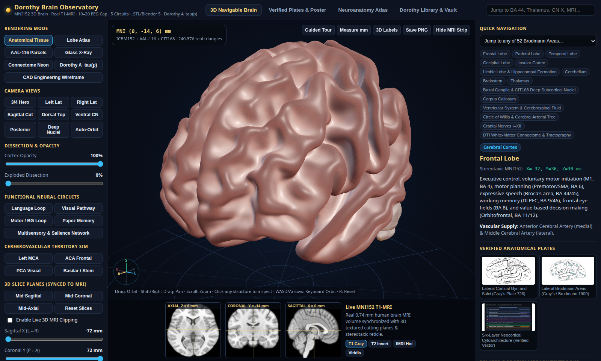
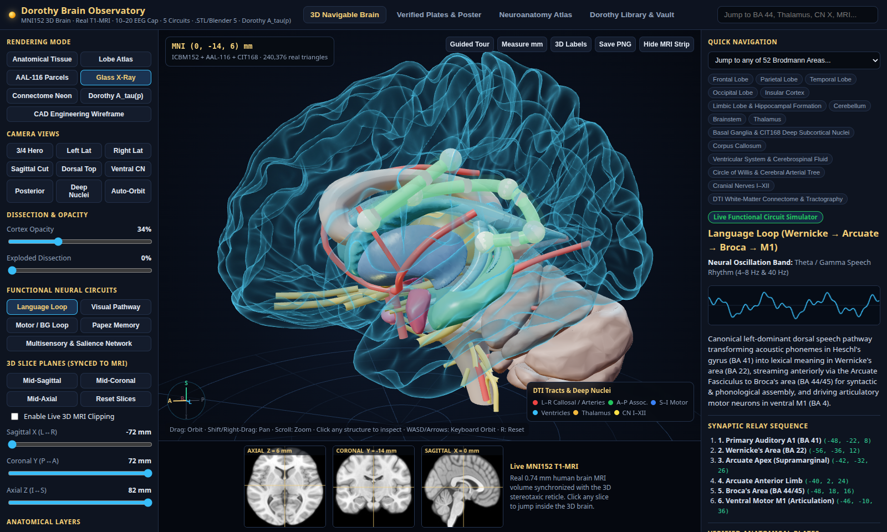
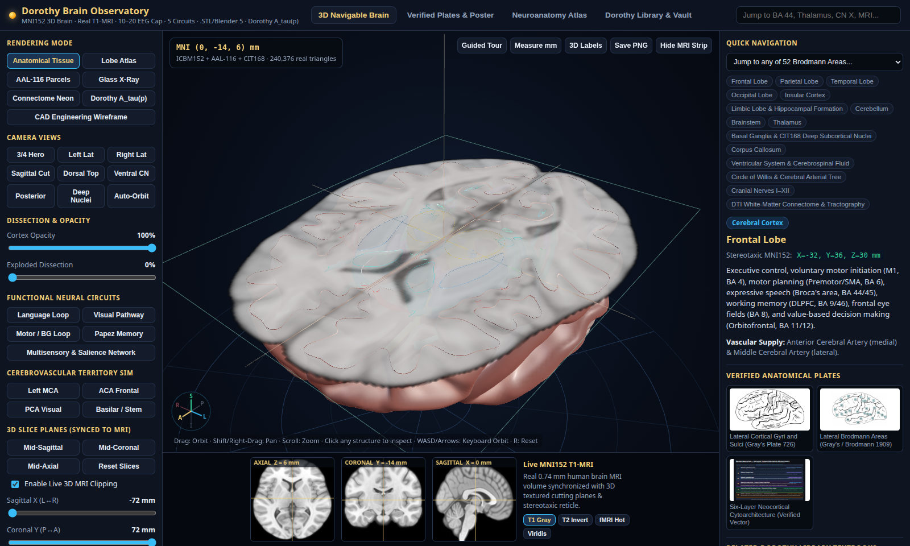
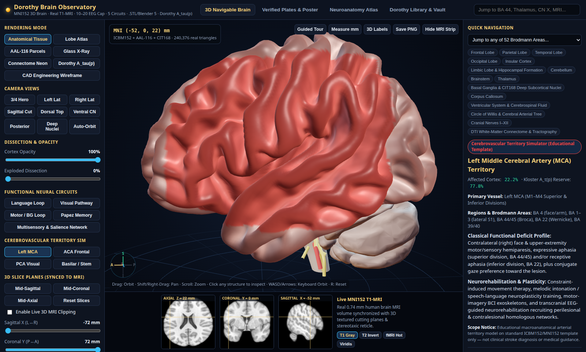
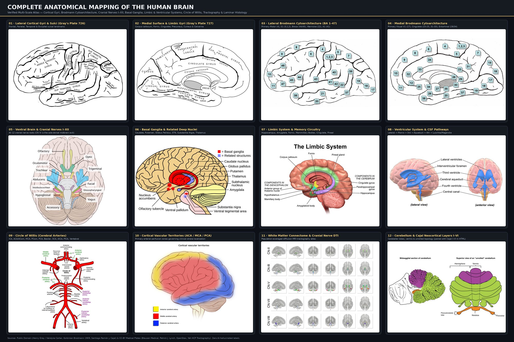

# Dorothy Brain Observatory

An offline-first, interactive WebGL2 **3D Navigable Human Brain Observatory** uniting real stereotaxic **MNI152 / ICBM152 / AAL-116 / CIT168** human neuroimaging meshes (`240,376` real anatomical triangles), a **custom GLSL Fresnel Rim Glass Shader**, **19-electrode International 10–20 EEG & Smart-Textile Cap overlay**, **5 interactive Functional Neural Circuit Simulators**, a **CAD Stereotaxic 3D Millimeter Caliper**, synchronized real **MNI152 T1-weighted MRI** tri-planar slices, **25 visually audited public-domain / CC-BY / custom vector anatomical plates**, a printable **`4800 × 3200`** wall-chart poster, **15 CAD & 3D-print-ready `.OBJ` / `.PLY` / `.STL` brain meshes + 1-click Blender 4/5 auto-importer**, and **Dorothy Continuum Operational Metacognition** ($A_\tau(p)$) visualization — honoring **Dorothy McEwen Kildall** and built as part of the **Zoe** research universe.

> **Epistemic & Clinical Scope Notice:** All 3D meshes and MRI slices derive from standard population neuroimaging templates (ICBM152 / MNI152, AAL-116, Pauli CIT168) for educational, visual-computing, and research exploration only — **not** patient-specific registration, diagnosis, or surgical guidance. A complete single-synapse whole-brain human connectome (~86 billion neurons, ~100 trillion synapses) does not yet exist in neuroscience; nanoscale reconstructions currently cover cubic-millimeter cortical samples.

## Live Previews

| Anatomical Tissue (Real ICBM152 Cortex + Live MNI152 MRI) | Glass X-Ray (CIT168 Deep Nuclei, Ventricles, Circle of Willis & DTI) |
|:---:|:---:|
|  |  |

| Exploded Dissection (Lobe Atlas Mode) | Midsagittal Cutaway + Dorothy Operational Metacognition $A_\tau(p)$ |
|:---:|:---:|
|  |  |

| Custom GLSL Fresnel Glass + Language Circuit Simulator | International 10–20 EEG & Wearable Smart-Textile Cap (19) |
|:---:|:---:|
|  |  |

| Live 3D Textured MNI152 T1-MRI Cutting Plane | Cerebrovascular Territory Simulator (Left MCA) + Kloster $A_\tau(p)$ |
|:---:|:---:|
|  |  |

## 12-Panel Anatomical Map

**Complete Anatomical Mapping of the Human Brain (Verified 12-Panel Multi-Scale Atlas):** Lateral & Medial Gyri (Gray's Plates 726-727), Lateral & Medial Brodmann Cytoarchitecture (BA 1-47), Ventral Brain & Cranial Nerves I-XII, Basal Ganglia & Deep Nuclei, Limbic System, Ventricular System & CSF Pathways, Circle of Willis, ACA/MCA/PCA Vascular Territories, White Matter & Cranial Nerve DTI Tractography, and Cerebellum. Public Domain ([Henry Gray / Vandyke Carter](https://en.wikipedia.org/wiki/Gray%27s_Anatomy), [Korbinian Brodmann 1909](https://en.wikipedia.org/wiki/Korbinian_Brodmann), [Santiago Ramón y Cajal](https://en.wikipedia.org/wiki/Santiago_Ram%C3%B3n_y_Cajal)) & CC-BY Medical Plates ([Blausen Medical](https://commons.wikimedia.org/wiki/Category:Blausen_gallery_2014), [Patrick J. Lynch](https://commons.wikimedia.org/wiki/Category:Patrick_J._Lynch), [OpenStax](https://openstax.org/books/anatomy-and-physiology-2e/pages/1-introduction), [Yeh HCP Tractography](https://brain.labsolver.org/)). Zero AI-hallucinated labels.

## Quick Start (100% Offline, Zero Dependencies)

1. **Direct Browser Open:** Double-click [`index.html`](index.html) (loads completely offline over `file://` with bundled MIT Three.js — no CDN or internet required).
2. **Optional Local Server:** Run `./launch.sh` to serve locally at `http://127.0.0.1:8765/`.

## Highlights

* **Real MNI152 Stereotaxic 3D Anatomy (`240,376` Triangles):**
  * ICBM152 Left & Right cerebral hemispheres with authentic FreeSurfer sulcal/gyral curvature ambient occlusion and real AAL-116 regional parcellation.
  * Real AAL-116 Cerebellum & Vermis, Thalamus, Hippocampus, and Amygdala.
  * Real Pauli CIT168 32 bilateral subcortical human nuclei (Putamen, Caudate, Nucleus Accumbens, Extended Amygdala, GPe, GPi, STN, SNc, SNr, Red Nucleus, VTA, PBP, Ventral Pallidum, Habenula, Hypothalamus, Mammillary Bodies).
  * Anatomically MNI-registered Brainstem (Midbrain/Colliculi, Pons, Medulla), Corpus Callosum, CSF Ventricular System, pulsing Circle of Willis & cerebral arteries, all 12 bilateral Cranial Nerves (CN I–XII, with CN IV exiting dorsally from the midbrain), 10 color-coded DTI White-Matter tractography bundles with animated neural impulses, and 52 clickable 3D Brodmann landmarks.
* **7 Interactive Rendering Modes (Custom GLSL Subsurface Scattering + Fresnel Glass Shaders):** **Physically Based GLSL Subsurface Scattering (SSS) Wet-Pia Anatomical Tissue**, Lobe Atlas, AAL-116 Parcels, **Holographic GLSL Fresnel Glass X-Ray** (with live 3D MRI clipping-plane support), **Fresnel Connectome Neon**, **Dorothy Continuum $A_\tau(p)$** (live $\tau$ threshold slider computing accessible cortical volume), and CAD Engineering Wireframe.
* **Live 3D Textured MNI152 T1-MRI Cutting Planes & Radiology Colormaps:** Slicing axially, coronally, or sagittally projects the real `0.74 mm` human MNI152 MRI cross-section directly onto the 3D cut face inside the brain with live **`T1 Gray`**, **`T2 Invert`**, **`fMRI Hot`**, and **`Viridis`** colormaps.
* **5 Interactive Functional Neural Circuit Simulators + 3D fMRI BOLD Hotspots:** 1-click simulation of **Language Loop** (`Wernicke → Arcuate → Broca → M1`), **Visual Pathway** (`Retina → LGN → V1 → Dorsal/Ventral`), **Motor / Basal Ganglia Loop**, **Papez Memory Circuit**, and **Multisensory & Salience Network** with glowing synaptic relay tubes, cortical BOLD hotspots, traveling action-potential packets, step-by-step relay cards, and a live neural oscillation oscilloscope.
* **Cerebrovascular Territory & Neurorehabilitation Simulator *(Educational Template)*:** 1-click visualization of **Left MCA**, **ACA**, **PCA**, and **Vertebrobasilar/Brainstem** vascular territories directly on the real ICBM152 cortex with live affected-cortex percentage, **Kloster $A_\tau(p)$ reserve**, classical deficit profiles, and neurorehabilitation pathways.
* **International 10–20 EEG & Wearable Smart-Textile Cap (19 Electrodes):** Exact Koessler et al. (2009) MNI152 cortical projections connected by geodesic conductive textile straps; click any sensor (`Fp1`–`O2`, `Cz`, etc.) to inspect its underlying Brodmann area and live synthetic EEG waveform.
* **CAD Stereotaxic 3D Millimeter Caliper (`Measure mm`):** Click any two 3D anatomical landmarks to drop laser pins and read exact Euclidean distance and `(ΔX, ΔY, ΔZ)` millimeter deltas.
* **Synchronized Real MNI152 T1-MRI Tri-Planar Strip:** Click anywhere on the live Axial, Coronal, or Sagittal `0.74 mm` MRI slices to teleport the 3D stereotaxic reticle and clipping planes to that exact millimeter coordinate.
* **15 Ready-to-Import 3D CAD & 3D-Print Meshes + Blender 4/5 Auto-Importer (`3d_models/`):** Standard `.OBJ`, `.PLY`, and binary `.STL` (watertight 3D-printing) exports in MNI152 millimeters plus [`import_dorothy_brain.py`](3d_models/import_dorothy_brain.py) for 1-click Blender 4/5 PBR assembly, ZBrush, AutoCAD, SolidWorks, Unity, Unreal Engine 5, Godot, and Dorothy's Neurogarden.
* **25 Verified Medical Plates & `4800 × 3200` Poster (`plates/`):** Public-domain & CC-BY anatomical illustrations plus 3 audited custom vector SVGs (`08c_thalamic_nuclei_verified.svg`, `08f_cortical_layers_circuitry.svg`, `08g_basal_ganglia_pathways.svg`) with zero AI-hallucinated anatomical labels.
* **Accessibility-First:** Full keyboard navigation (`WASD` / Arrows / `+/-` / `R`), skip-to-content link, ARIA tablist/dialog/live-region announcements, natural unspaced typography, and descriptive `alt` text.

## Open-Source & Dataset Attributions

* **Operational Metacognition ($A_\tau(p)$):** Nicholas Michael Kloster (March 6, 2026).
* **3D Cortical/Subcortical Meshes & MNI152 Template:** Derived from open neuroimaging templates distributed via [NiiVue](https://github.com/niivue/niivue) (BSD-2-Clause): ICBM152 cortical surface & curvature, AAL-116 (Tzourio-Mazoyer et al., 2002), Pauli et al. (2018) CIT168 human subcortical atlas (*Scientific Data*), and MNI152 T1 volume.
* **WebGL Engine:** [Three.js](https://threejs.org/) r128 (MIT License).
* **Anatomical Plates:** Public Domain (Henry Gray / Henry Vandyke Carter, Korbinian Brodmann 1909, Santiago Ramón y Cajal, Mark Dow / Univ. of Oregon, Rhcastilhos, NIDA) and Creative Commons CC-BY / CC-BY-SA (Patrick J. Lynch, OpenStax, Blausen Medical, Frank Gaillard, Xavier Gigandet et al., Yeh et al. 2018 HCP Tractography Atlas, Leevanjackson / SUM1, Camazine).
* **Public Repository Note:** Copyrighted third-party textbooks and figures from private user subscriptions are intentionally excluded from this public repository (`.gitignore`d locally); the Vault tab preserves open bibliographic references only.
