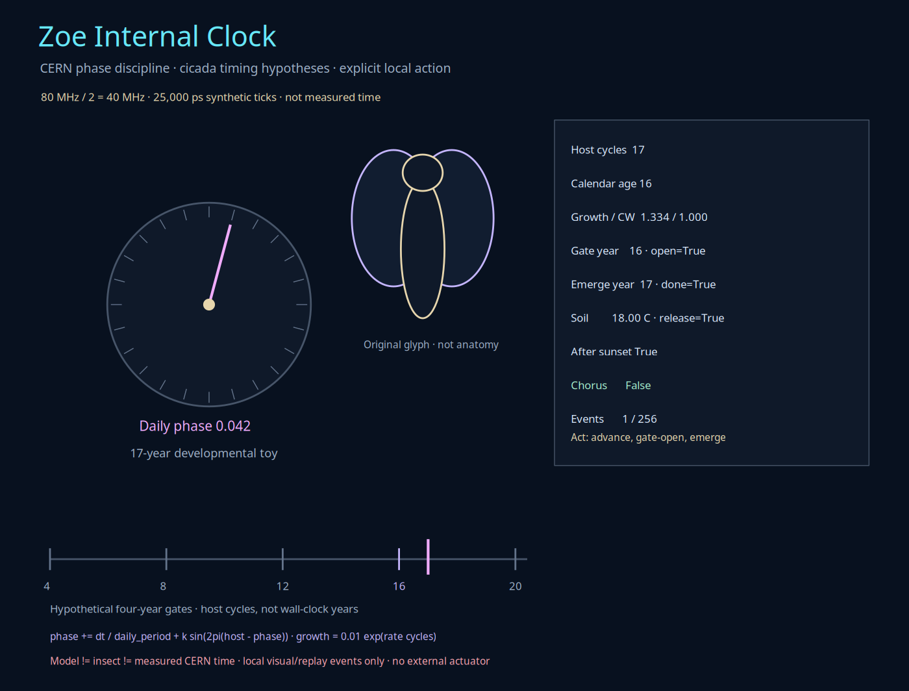
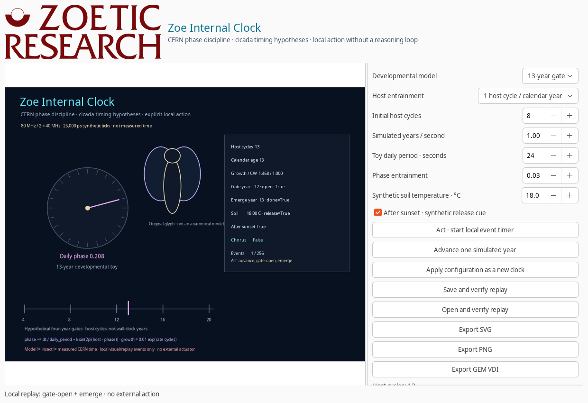

# Zoe Internal Clock

**Zoe Internal Clock is a deterministic timing instrument informed by CERN clock distribution and the biological study of cicada timing.** It advances a local state machine—`advance`, `daily-pulse`, `gate-open`, `emerge`, and `chorus`—without a reasoning loop.

“Acting without thinking” here means exactly that: after an explicit **Act** action, a bounded local timer advances visual/replay events. It does not mean autonomous hardware control, an AI decision process, a biological measurement, or a claim that the software is a cicada.



## Three different kinds of time

The model keeps three domains separate:

1. **Reference ticks** provide exact software arithmetic, not a CERN timestamp.
2. **Host seasonal cycles** can run at one or two cycles per simulated calendar year.
3. **Daily phase** is an illustrative free-running oscillator with optional entrainment.

The local TIM3C diagram shows an **80 MHz oscillator divided by two to 40 MHz**, with clock distribution and delay/window controls. Its source is `TIM3C_Clock_Flow.pdf` in this directory, with the listed SHA-256:

```text
/media/cowboy/research/CERN/Boutique/01-documentation/docs/tim/
96e9f0a51d3ba1e3b9a1fa5ece05688341f220ada54cf451fdbbfe68263d0611
```

Zoe uses that 40 MHz pattern only as a quantization reference:

\[
f=\frac{80\text{ MHz}}{2}=40\text{ MHz},\qquad
T=\frac{1}{f}=25\text{ ns}=25{,}000\text{ ps}.
\]

For an input duration \(\Delta t_n\):

\[
N_{n+1}=N_n+\operatorname{round}(40{,}000{,}000\Delta t_n).
\]

The actual event duration is the integer tick count divided by 40,000,000. This is a deterministic software convention, **not measured CERN time or a laboratory clock calibration**. Zoe's separate replay uses a nominal 40.08 MHz reference; it is not silently substituted for the TIM3C diagram's 40 MHz divider.

## Host cycles and calendar age

Let \(s\) be simulated calendar years per reference second and \(h\in\{1,2\}\) the host seasonal-cycle rate. Then:

\[
C_{n+1}=C_n+s\Delta t_nh,\qquad
A_{n+1}=A_n+s\Delta t_n,
\]

where \(C\) is host cycles and \(A\) is calendar age. The two can differ, which is essential when interpreting accelerated host seasons.

### Karban-style worked example

[Karban, Black, and Weinbaum, *How 17-year cicadas keep track of time* (2000)](http://www.onem-france.org/cigales/BIBLIO/KARBAN_2000.pdf) altered host-plant seasonal cycles. Their results support counting host phenological cycles rather than simply elapsed calendar time or degree-day accumulation.

The included `docs/examples/cicada-karban.json` starts at 15 host cycles, uses two host cycles per calendar year, and advances one calendar year:

```bash
zoe cicada --cycle 17 --host-rate 2 --start 15 --years 1 \
  --output cicada-karban.json
```

The resulting toy state is **17 host cycles at calendar age 16**, with the year-16 gate open and year-17 emergence triggered. This reproduces a timing relationship, not the experiment's individual nymphs, survival outcomes, physiology, or proof of mechanism.

## The developmental gate is a hypothesis

[Yoshimura's 2022 life-cycle review](https://esj-journals.onlinelibrary.wiley.com/doi/10.1111/1440-1703.12354) proposes an interaction among an internal clock, genetically influenced growth rate, and critical body weight. The proposed four-year clock and gate remain hypotheses requiring testing, not settled cicada fact.

Zoe makes that distinction executable. Growth is a toy exponential:

\[
W(C)=0.01e^{rC},\qquad r=\frac{\ln 100}{Y-1}m,
\]

where \(Y\in\{13,17\}\) and \(m\) is an explicit growth multiplier. The first eligible gate is:

\[
G=\max\left(4,4\left\lceil\frac{\ln 100/r}{4}\right\rceil\right),
\]

with emergence at \(G+1\). With \(m=1\), the gate is year 12 for the 13-year model and year 16 for the 17-year model. The familiar relationships \(13=3\times4+1\) and \(17=4\times4+1\) are therefore visible without claiming that nymphs literally count this way.

Varying growth can produce earlier or later gates. These are toy variations, not a genetic model or a prediction of a real brood.

## Daily phase and entrainment

The daily oscillator is deliberately separate from the multi-year gate:

\[
\phi_{n+1}=\operatorname{frac}\left(\phi_n+\frac{\Delta t_n}{D}
+\kappa\sin\left(2\pi(z_n-\phi_n)\right)\right),
\]

where \(D\) is the toy daily period in seconds, \(z_n\) is host phase, and \(0\leq\kappa\leq0.25\). Crossing a daily boundary emits `daily-pulse`. The unwrapped phase is checked so a transition from phase 0 to phase 1 correctly produces a pulse after wrapping to 0.

[Sato et al. (2002)](https://pubmed.ncbi.nlm.nih.gov/12193798/) identified pigment-dispersing-factor neurons in *Meimuna opalifera*. That supports a structural circadian research reference; it does not make this oscillator a fitted molecular or behavioral model of that cicada.

## Environmental release and chorus

A developmental gate alone does not force emergence. The toy also requires:

\[
T_{\text{soil}}\geq\frac{(64-32)5}{9}\approx17.78^\circ\text{C}
\quad\text{and}\quad \texttt{after\_sunset=True}.
\]

[UConn's periodical-cicada information](https://cicadas.uconn.edu/) describes local emergence near 64°F soil at 7–8 inches and usually after sunset. Local conditions vary, and these cues do not explain the particular night of every emergence.

If temperature or the sunset cue is absent, the model remains `awaiting_conditions`. Once both are present, it emits `emerge`. A `chorus` event follows after \(4/365\) host cycles, a four-day toy delay informed by the described teneral period. No actual sound is produced.

## Act, stop, and replay

```bash
zoe cicada
zoe cicada --cycle 13 --start 8 --act
zoe cicada --cycle 17 --host-rate 2 --start 15 --years 1 --output replay.json
zoe cicada replay.json --output clock.gem
```

The native window defaults to eight initial host cycles. It does **not** arm its timer automatically. **Act** starts it, **Stop** halts it, and **Advance one simulated year** performs one explicit step. Timer catch-up is capped at 0.25 seconds per callback; zero-delta callbacks do not create events.



The configuration controls cover the 13/17-year model, host rate, initial cycles, simulated years per second, daily period, entrainment, soil temperature, and sunset cue. The side pane scrolls without removing controls.

Every step records its exact input, actions, previous-event hash, and resulting state hash. Saving performs a complete replay before exclusive JSON creation. Loading checks configuration, initial state, ordered events, final state, measurements, and document digest. Undo is not used here: history is append-only; reset creates a new configured clock rather than rewriting an old event.

Bounds include 256 events, 64 host cycles, calendar age 80, one reference tick to 86,400 seconds per step, and explicit temperature/phase/growth limits. Capacity and oversize checks happen before state mutation.

## Evidence boundaries

- The four-year internal gate is an explicit hypothesis, not settled biology.
- Host-season evidence and internal-gate speculation remain distinct.
- Daily phase is a generic toy, not a molecular circadian model.
- Reference ticks are exact software intervals, not CERN measurements.
- Soil and sunset values are synthetic inputs, not sensor readings.
- `llm_called=False` and `external_actions_executed=False` remain recorded.
- Act changes local visuals and replay memory only. It does not flash firmware, touch a driver, alter a clock, or control an organism.

## Verification

```bash
PYTHONPATH=guiai-lab python -m unittest stress.cicada_stress -v
PYTHONPATH=guiai-lab guiai-lab/stress/nested_x11.sh \
  python -m unittest stress.cicada_stress -v
```

The suite checks 13/17-year gates, chorus delay, Karban-style accelerated host cycles, environmental holds, growth variation, phase wraps, replay and tamper detection, capacity boundaries, all export formats, both CLI entry points, native act/stop with an injected clock, replay preservation, and the dedicated Atlas window.
