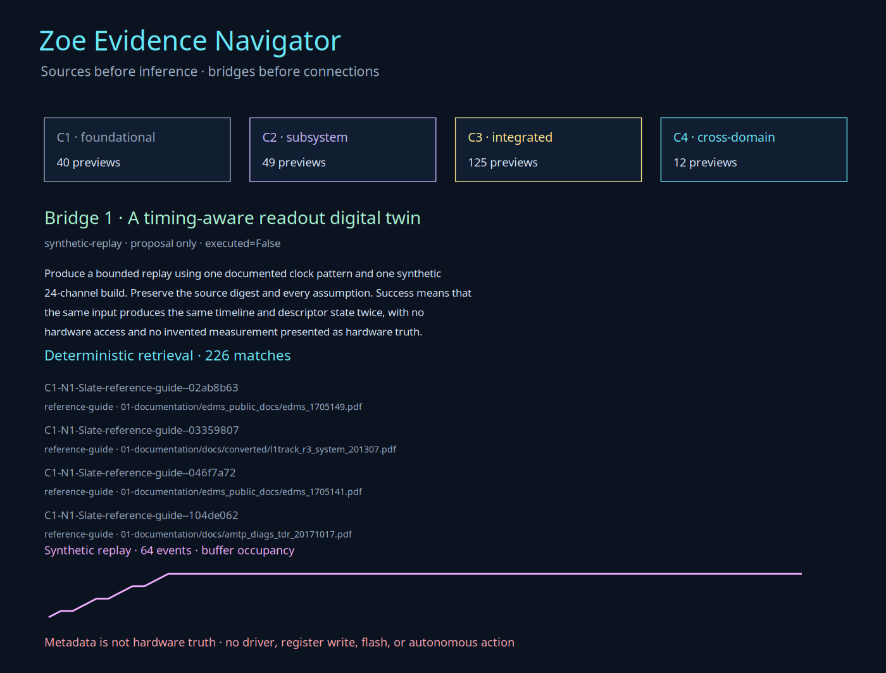
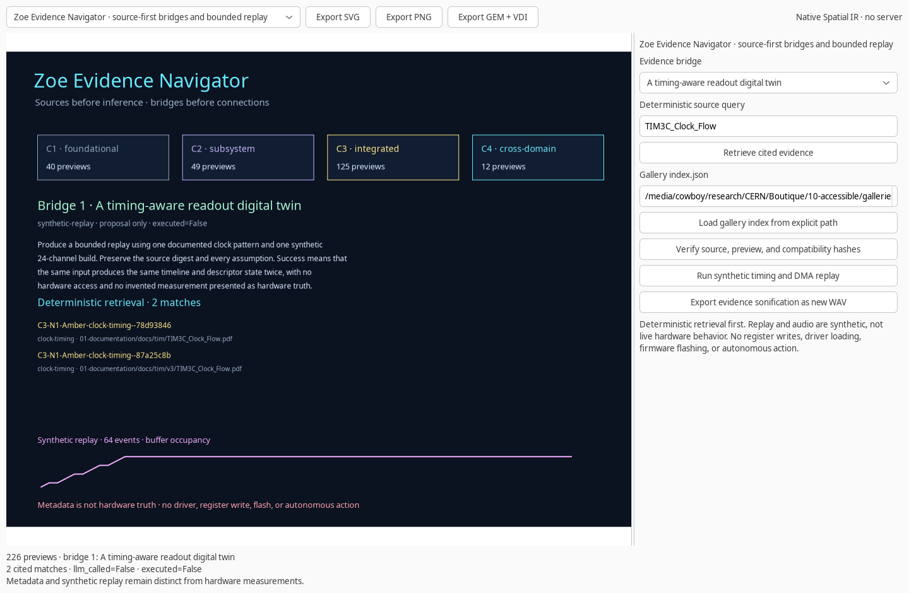

# Zoe Evidence Navigator

Zoe Evidence Navigator connects the categorized CERN gallery to **deterministic retrieval, bounded replay, source verification, protocol observation, and a C1–C4 practice curriculum**.

The organizing principle is **sources before inference, bridges before connections**. The gallery provides 226 first-page previews, not 226 complete explanations or 226 measurements.

## The evidence inventory

The supplied `document-images/index.json` uses **schema version 2**. The navigator accepts versions 1 and 2 and validates:

- The `C{complexity}-N{novelty}-{Color}-{Purpose}--{source_identity[:8]}` naming structure.
- Complexity, novelty, color, and purpose agreement.
- Unique labels, categorized image paths, and compatibility paths.
- Source and preview SHA-256 hashes when full verification is requested.
- Compatibility symlinks and their targets.

The root is four parents above `index.json`. Document records resolve relative to the corpus. Bridge-document links instead resolve relative to the gallery directory, with both paths constrained to the corpus. Compatibility links retain their lexical symlink path so `is_symlink()` checks the link, not its target.

```text
C1 foundational   40
C2 subsystem      49
C3 integrated     125
C4 cross-domain   12
```

Complexity describes interacting concerns, not correctness, security, quality, or readiness. Novelty describes the integration within the collection, not simply the document date. Colors identify purpose, not health or quality.

The full local check verifies **226 source hashes, 226 preview hashes, and 226 compatibility links**, plus **17 bridge-document links**. Metadata-only loading is also available and explicitly sets `source_hashes_verified=false`.

## Retrieve before generating

```bash
zoe evidence query --index /media/cowboy/research/CERN/Boutique/10-accessible/galleries/document-images/index.json \
  --query TIM3C_Clock_Flow --output tim-evidence.json
```

Retrieval filters labels, paths, and source descriptions by text, complexity, color, purpose, and novelty. It returns at most 64 cited records per request, preserving the total match count and the limit actually returned.

A result contains source paths, source digests, preview paths, compatibility paths, and the original `what` and `why` metadata. It does not manufacture register values, measurements, or hardware health.

If no record matches, `decline_to_act=true`. No fact is inferred from missing evidence. `llm_called` and `executed` remain false.

## Seven concrete bridge workflows

### 1. Timing-aware readout replay

`bridge 1` combines TIM timing references, FELIX architecture, Wupper DMA behavior, and register context. The replay produces a shared observation timeline with clock phases, trigger identifiers, synthetic frame state, synthetic descriptors, buffer occupancy, host consumption, and backpressure.

```bash
zoe evidence twin --index /media/cowboy/research/CERN/Boutique/10-accessible/galleries/document-images/index.json \
  --channels 24 --events 64 --output timeline.json --wav timeline.wav
```

Defaults are 24 channels, 64 events, a 40.08 MHz documented reference, an eight-slot buffer, and host consumption every third event. The clock period is retained as an exact rational value. Descriptor payloads are 256 bytes, and descriptor CRC32 values are integrity checks, not signatures.

These are **synthetic observations**, not a hardware trace. The replay has `hardware_accessed=false`, `measured=false`, and `physical_connection_claimed=false`. Identical inputs produce identical timeline and descriptor state.

### 2. Protocol observation ladder

`ladder` compares LCB and STAR/Flink observation records for idle, reset, command, identifier, back-to-back requests, and invalid symbols. Each record identifies its source model, clock domain, alignment assumption, and unresolved field meaning.

This is a shared observation schema, not an LCB↔STAR translator, synthesis claim, or hardware bridge. It is useful for seeing differences without hiding them behind a universal converter.

### 3. Guarded observability

`manifest` distinguishes allowed inspection from blocked changes. Inspection covers register-map YAML, source files, saved waveforms, and cited evidence. Blocked operations include `fcheck -w`, `fpepo` with a data word, driver loading, register writes, firmware flashing, and shell execution.

The default is **observe-only**. The manifest does not imply that an unpopulated driver submodule is an installed driver or that a tool which writes a file is read-only.

### 4. One stream, several senses

The same replay can drive a scene and deterministic 16-bit mono PCM audio. Channel count shapes the base frequency, the 40.08 Hz reference becomes a scaled drone, and backpressure adds an accent.

Audio is **evidence sonification**, not live detector sound, an alarm, or a health signal. It never autoplays. The default 64-event example uses 400 samples per event at 8,000 samples per second: 25,600 frames and 3.2 seconds.

### 5. Deterministic shadow retrieval

`shadow` reads a saved finding and returns its exact reported fields, source context, hash, and evidence limits. It does not call a language model.

```bash
zoe evidence shadow \
  --finding /media/cowboy/research/CERN/analysis/felix-flx155/findings.json \
  --output shadow-finding.json
```

The checked finding reports `timing_met=false` and `wns_ns=-0.096`. The navigator suggests reviewing that result against independent simulation and hardware evidence; it does not turn static slack into a runtime failure claim. No anomaly model is trained and no telemetry is generated.

### 6. Cross-experiment design review

`design_review` supplies a shared checklist for command reachability, authorization evidence, timing/reset behavior, and deployment limits. Conclusions must remain scoped to their own RTL, artifact, and evidence level. No ALICE↔ATLAS hardware connection is proposed.

### 7. Complexity-directed practice

```bash
zoe evidence curriculum --index /media/cowboy/research/CERN/Boutique/10-accessible/galleries/document-images/index.json \
  --level 1 --output curriculum-c1.json
```

- **C1:** name the artifact, source, and intended explanation.
- **C2:** explain one bounded mechanism and its supporting evidence.
- **C3:** explain interacting mechanisms, timing, framing, and host behavior.
- **C4:** trace evidence end to end and identify what remains unknown.

This is a practice path, not a rating of the reader. It points to cited examples and an inspectable next step, not a badge.

## Native controls and gallery

```bash
zoe evidence scene
zoe evidence scene --index /media/cowboy/research/CERN/Boutique/10-accessible/galleries/document-images/index.json \
  --bridge 1 --replay --output evidence.svg
```

The native view lets you select a bridge, retrieve cited records, load an index from an explicit path, verify all source and compatibility hashes, run the synthetic replay, and export a new WAV. Failed index loads preserve the previous index and scene.

```bash
zoe evidence gallery --index /media/cowboy/research/CERN/Boutique/10-accessible/galleries/document-images/index.json \
  --color Amber --complexity 3 --purpose clock-timing \
  --output timing-gallery.html
```

The local HTML gallery keeps the original preview images and source-document links. It does not copy those files into Zoe or claim that a preview is a complete understanding of its document.

## Integrity and examples

`docs/examples/evidence-twin.json` contains four synthetic observations. `docs/examples/evidence-sonification.wav` is the matching deterministic audio. They are worked examples, not detector measurements.

Timeline JSON has a canonical digest and ordered event checks. JSON reports and model files are created exclusively. Scene exports have the same local destination checks as the other creative instruments. WAV files are created with exclusive `xb` mode, which also closes the pre-write race between concurrent exporters.

## Verification

```bash
PYTHONPATH=guiai-lab python -m unittest stress.evidence_stress -v
PYTHONPATH=guiai-lab guiai-lab/stress/nested_x11.sh \
  python -m unittest stress.evidence_stress -v
```

The suite covers schema and distribution checks, source and preview hashes, compatibility links, all seven bridges, missing-evidence behavior, curriculum prompts, protocol schemas, observation controls, shadow retrieval, replay and audio determinism, CLI workflows, and native load/verify/replay/export paths.




