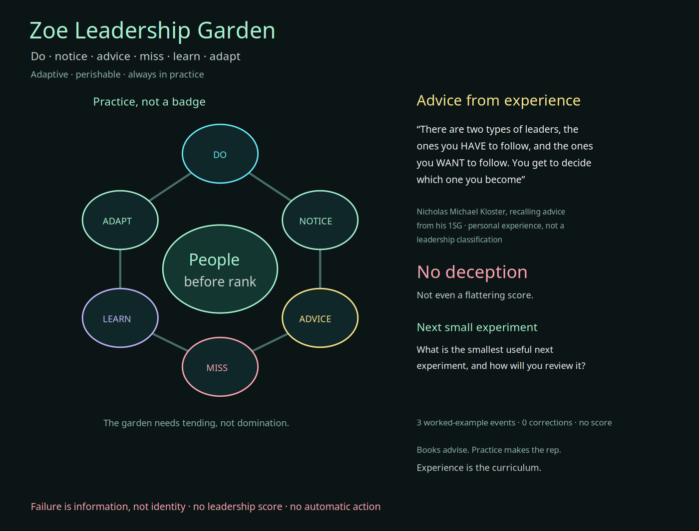
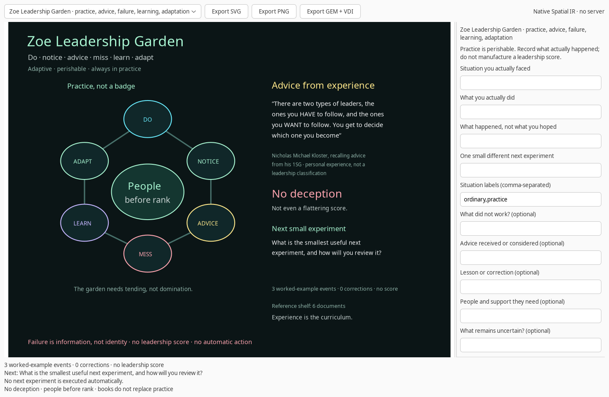

# Zoe Leadership Garden

**Leadership is learned in motion.** Through doing, advice, failure, mistakes, learning, and finding a different way through each new situation—good or bad, easy or difficult, simple or complex. It is an evolving, adaptive, perishable skill.

Books can offer perspective, counterexamples, and useful questions. They cannot make an attempt, absorb a mistake, listen to a person, or adapt a decision for you. Zoe Leadership Garden is therefore a **practice instrument**, not a reading-course score.

## The practice loop

The garden keeps six actions in view:

```text
DO → NOTICE → ADVICE → MISS → LEARN → ADAPT → try again
```

A repetition is not a level. There is no badge for being finished, and no leaderboard for being a person.

- **Do:** record what you actually tried, not what you intended to try.
- **Notice:** record what happened, including an inconvenient result.
- **Advice:** preserve a useful perspective and its context.
- **Miss:** name what did not work without turning it into an identity.
- **Learn:** articulate what changed in your understanding.
- **Adapt:** choose one small, different next experiment and review it.

A **miss is information, not an identity**. A correction appends a new lesson rather than rewriting the earlier event.

## Record an actual attempt

```bash
zoe leadership practice \
  --situation "A review failed when the room lost network access" \
  --action "I kept presenting the original plan" \
  --outcome "People heard the slides but did not practice the decision" \
  --next-try "Use a local example and let each person review one choice" \
  --frame "difficult,communication" \
  --mistake "I protected the plan instead of the purpose" \
  --advice "Let the format change if the purpose stays clear" \
  --learning "Participation is more useful than finishing my script" \
  --support "A printed example and a way for everyone to participate" \
  --unknown "Which part is hardest for each person?" \
  --stop-condition "Pause if anyone is excluded" \
  --output first-practice.json
```

The required fields are `situation`, `action`, `outcome`, and `next_try`. The other fields can remain empty. No names, private details, or dramatic stories are required: an ordinary small attempt is enough.

`frame` contains up to six labels describing the **situation**, not your identity. Use `good`, `bad`, `easy`, `difficult`, `simple`, `complex`, `ordinary`, or your own short labels. Repetition of the same frame can prompt a different pace, complexity, support, or point of view; it does not advance a score.

Append another attempt to a new file:

```bash
zoe leadership practice --input first-practice.json \
  --situation "The same explanation needs to work for a different person" \
  --action "I asked for context before explaining" \
  --outcome "I learned which part actually needed attention" \
  --next-try "Change one condition and compare the result" \
  --advice "Ask before assuming" \
  --mistake "I initially optimized for speed" \
  --learning "Understanding differs from following steps" \
  --support "Time for questions" \
  --unknown "What else changed?" \
  --stop-condition "Pause if the exchange becomes pressuring" \
  --output second-practice.json
```

The input is never overwritten. The output must be a new JSON file.

## Correct without erasing

```bash
zoe leadership correct --input second-practice.json \
  --sequence 1 --learning "The failed format was useful evidence, not a failed person" \
  --output corrected-practice.json
```

A correction points to an existing practice sequence. The original action, outcome, mistake, and advice remain intact. This makes a change in understanding visible without pretending the earlier attempt did not happen.

Each log contains sequence numbers, timestamps, previous-event hashes, event hashes, and a canonical document digest. Loading validates every link and detects edited or reordered events. This is tamper evidence, not identity authentication or independent proof of a self-reported event.

## The next question is a prompt, not a command

The review heuristic looks at the latest practice event. It can ask for a missing perspective, mistake, lesson, uncertainty, stop condition, or support. If the last three frames are identical, it can suggest changing one condition. Otherwise it asks for the smallest useful next experiment and how it will be reviewed.

The prompt is a deliberately simple rule, not an assessment of your character, potential, rank, or leadership quality. `score` remains `null`. `autonomous_action` remains `false`.

The built-in three events are explicitly labeled **`synthetic_example=true` and `worked-example events`**. Recording a real attempt changes the container into a practice history rather than leaving it labeled as a worked example. That source distinction survives saving and loading.

## Native garden

```bash
zoe leadership scene
zoe leadership scene --input corrected-practice.json
zoe leadership scene --input corrected-practice.json \
  --library-root /home/cowboy/Desktop/Leadership --output garden.svg
```

The native controls let you:

- Record an actual situation, action, outcome, and next small experiment.
- Add a frame, mistake, advice, lesson, support, uncertainty, and stop condition.
- Load an existing practice log only after entering a path and pressing the load button.
- Save the log as a new JSON file without overwriting an existing one.
- Inspect a reference folder only after an explicit action.
- Export the current garden as SVG, PNG, or GEM VDI.

A failed load preserves the previous log and scene. The interface does not execute a proposed next experiment.

## The reference shelf is not a shortcut

```bash
zoe leadership library --root /home/cowboy/Desktop/Leadership --output leadership-library.json
zoe leadership search --root /home/cowboy/Desktop/Leadership \
  --query women --limit 6 --output leadership-snippets.json
```

`library` retains source paths, byte counts, SHA-256 hashes, page counts, publication identifiers, and the role of each document. `search` runs `pdftotext` on the selected PDFs and returns bounded text snippets with **PDF page numbers**, which need not equal printed page labels. It performs no new OCR and no leadership inference. A search with no match is not proof that a concept is absent.

The checked local collection contains:

| Lens | Reference | Publication |
|:---|:---|:---|
| Civic responsibility | *Soldier-Statesmen of the Constitution* | CMH Pub 71-25 · 316 PDF pages |
| Institutional memory | *Army History and Heritage* | CMH Pub 69-6-1 · 313 PDF pages |
| Care in action | *The Demands of Humanity: Army Medical Disaster Relief* | CMH Pub 40-3 · 204 PDF pages |
| Mentorship | *The Story of the Noncommissioned Officer Corps: The Backbone of the Army* | CMH Pub 70-38 · 370 PDF pages |
| Support and logistics | *A Soldier Supporting Soldiers* | CMH Pub 70-40 · 336 PDF pages |
| Protection and dignity | *The Geneva Conventions of 12 August 1949* | ICRC · 224 PDF pages |

The [Army Center of Military History catalog](https://history.army.mil/Publications/Publications-Catalog/Publications-by-Number/) supplies the official publication index. The two WAC books listed in the personal note—Mattie E. Treadwell's *The Women's Army Corps* (CMH Pub 11-8) and Bettie J. Morden's *The Women's Army Corps, 1945-1978* (CMH Pub 30-14)—are retained as external reading references, not misidentified as one of the local PDFs.

The [Declaration on the Protection of Women and Children in Emergency and Armed Conflict](https://en.wikipedia.org/wiki/Declaration_on_the_Protection_of_Women_and_Children_in_Emergency_and_Armed_Conflict) is a separate 1974 UN General Assembly declaration. It is not relabeled as the ICRC Geneva Conventions PDF in the local collection.

## Advice from experience

The garden preserves this advice from the supplied note:

> There are two types of leaders, the ones you HAVE to follow, and the ones you WANT to follow. You get to decide which one you become

This is attributed as **Nicholas Michael Kloster recalling advice from his 1SG**, not as a newly verified quotation or a classification of a person. The garden does not infer a service record for Nicholas or biographies for other people in the note. The supplied photograph remains local and is not bundled into the repository.

The **Warrior in the Garden** metaphor is about protecting the conditions for growth, not dominating people. **No deception** applies to flattering measurements too: the instrument does not invent a score, certainty, or leadership identity.

This is not an official military leadership qualification, a substitute for experience, or an endorsement by the Army, the ICRC, the authors, or the people named in the source notes.

## Verification

```bash
PYTHONPATH=guiai-lab python -m unittest stress.leadership_stress -v
PYTHONPATH=guiai-lab guiai-lab/stress/nested_x11.sh \
  python -m unittest stress.leadership_stress -v
```

The suite covers practice prompts, frame variation, required fields, append-only corrections, source-chain integrity, tamper detection, no-overwrite saves, real PDF metadata and text snippets, CLI workflows, native recording/loading/saving/library inspection, failed-load preservation, and SVG/PNG/GEM scenes. The supplied PDFs and personal note remain external; optional local-evidence tests are skipped if they are unavailable.




