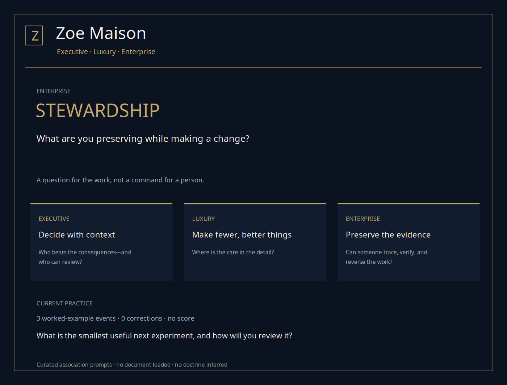
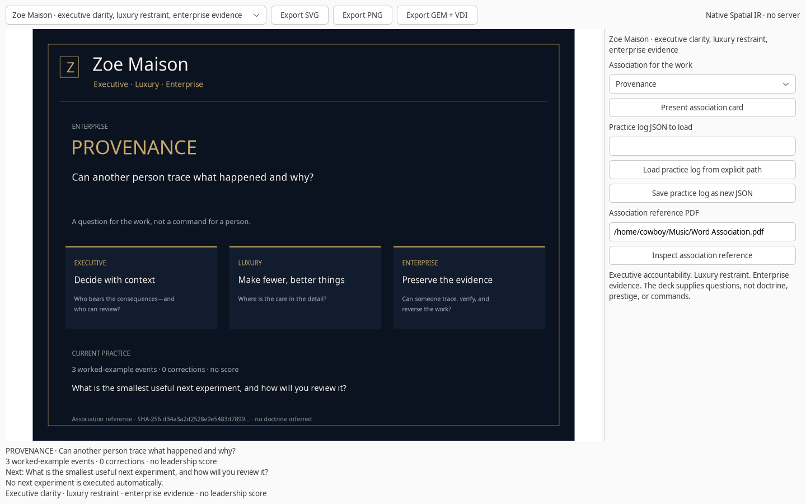

# Zoe Maison

**Executive accountability. Luxury restraint. Enterprise evidence.**

Zoe Maison is a distinct studio for building with those three ideas in mind. It is not a claim of prestige, wealth, institutional status, or enterprise certification. The work has to carry the meaning.

- **Executive:** understand context, consequences, authority, and review.
- **Luxury:** choose restraint, care, adaptation, and complete details over ornament.
- **Enterprise:** preserve provenance, boundaries, evidence, and a way to reverse the work.

The association deck turns those ideas into questions for actual practice. It does not turn them into a leadership score or a command.

## Open the studio

```bash
zoe maison
zoe maison --word provenance
zoe maison --word bespoke --output maison.svg
zoe maison scene --word atelier --output atelier.gem
```

The default scene uses the existing worked-example practice log, explicitly labeled as synthetic. Load a real log when you want to examine your own next experiment:

```bash
zoe maison --input corrected-practice.json --word patina
```

The studio does not replace the existing Zoe visual identity or force a theme onto the other modules. It is a separate, coherent design lens that can be reused deliberately.

## The three pillars

### Executive clarity

A decision should expose its context and its review path. Useful questions include who bears the consequences, who can challenge the plan, and where authority stops. Gravitas can be quiet; it need not become theater.

### Luxury as restraint

Luxury is treated as care rather than excess. Bespoke asks what needs adaptation. Atelier asks what will be made and inspected together. Patina asks what experience changed without erasing the original. A flagship can be the smallest complete example of excellent work, not the largest display.

### Enterprise as evidence

Enterprise means someone else can inspect what happened. Provenance, protocol, discretion, stewardship, custody, and archives make the work legible and reversible. This is not a guarantee of compliance, availability, or production acceptance; those require their own evidence.

## The association deck

```bash
zoe maison deck
zoe maison deck --output maison-deck.json
```

The deck contains 18 curated associations with original prompts:

- **Executive:** accountability, counsel, execution, fiduciary, governance, gravitas.
- **Luxury:** atelier, bespoke, flagship, hallmark, heritage, patina.
- **Enterprise:** archive, custodian, discretion, protocol, provenance, stewardship.

For example:

- **Fiduciary:** Whose interests must the decision protect?
- **Bespoke:** What needs adaptation rather than another copy?
- **Provenance:** Can another person trace what happened and why?
- **Patina:** What has experience changed without erasing the original?
- **Execution:** What will you actually do next, and what will you notice?

The supplied `Word Association.pdf` is a one-page, AI-assisted association brainstorm. It is not an authority, a leadership model, or a substitute for practice. The studio preserves its source identity and uses associations as questions only; it does not reproduce the document's lists or call them doctrine.

## Reference provenance

```bash
zoe maison reference "/home/cowboy/Music/Word Association.pdf" \
  --output maison-reference.json
```

Reference inspection records the file path, byte size, PDF page count, and SHA-256. The supplied file remains outside the repository. A hash identifies bytes; it does not establish authorship, factual correctness, or endorsement.

The checked reference is **171,612 bytes, one PDF page**, with SHA-256:

```text
d34a3a2d2528e9e5483d789917acc323ede5e0ce6ffb571cd3edcc1de7367301
```

No reference file is required for the default deck or studio.

## Native practice view

The native selector presents each association in turn. **Load practice log from explicit path** reads an existing practice log only after an explicit action. **Inspect association reference** hashes a supplied PDF. Failed loads preserve the previous scene and reference.

**Save practice log as new JSON** uses the same append-only, no-overwrite practice history as Leadership Garden. Maison does not create a second scoring system or execute the next experiment.

The scene distinguishes:

- The selected association and its pillar.
- A prompt for the current work.
- The three executive/luxury/enterprise cards.
- The actual or worked-example event count.
- The next review question.
- Optional reference identity.

## Design language

`PALETTE` in `guiai/gem/maison.py` defines the reusable design tokens:

- **Ink:** deep blue-black for the field.
- **Pearl:** warm off-white for primary text.
- **Champagne:** restrained emphasis and rules.
- **Bronze:** secondary borders and framing.
- **Slate and sage:** readable supporting information.
- **Rose:** reserved for a different emphasis when needed.

Typography uses the existing renderer font; there is no new font dependency. Meaning is carried by labels and structure, not by color alone. Native controls use the existing keyboard-accessible GTK widgets, and text remains subordinate to the work rather than decorative branding.

Executive clarity should make the next review visible. Luxury should leave enough space to think. Enterprise should make the evidence easy to find.

## Verification

```bash
PYTHONPATH=guiai-lab python -m unittest stress.maison_stress -v
PYTHONPATH=guiai-lab guiai-lab/stress/nested_x11.sh \
  python -m unittest stress.maison_stress -v
```

The suite checks all 18 associations, invalid words, actual reference identity, direct and forwarded commands, no-overwrite SVG/PNG/GEM exports, native association changes, reference failure preservation, log loading/saving, and worked-example provenance.




