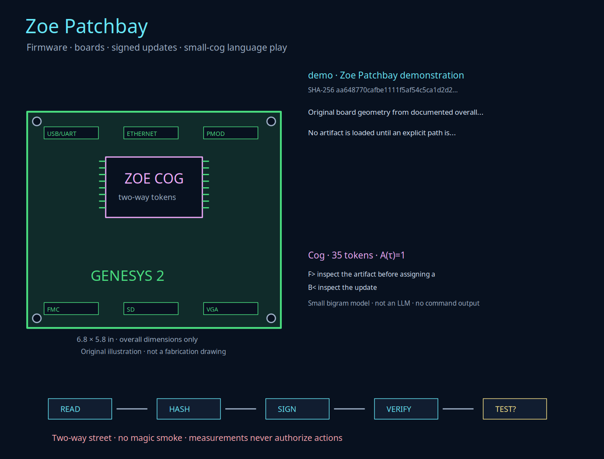
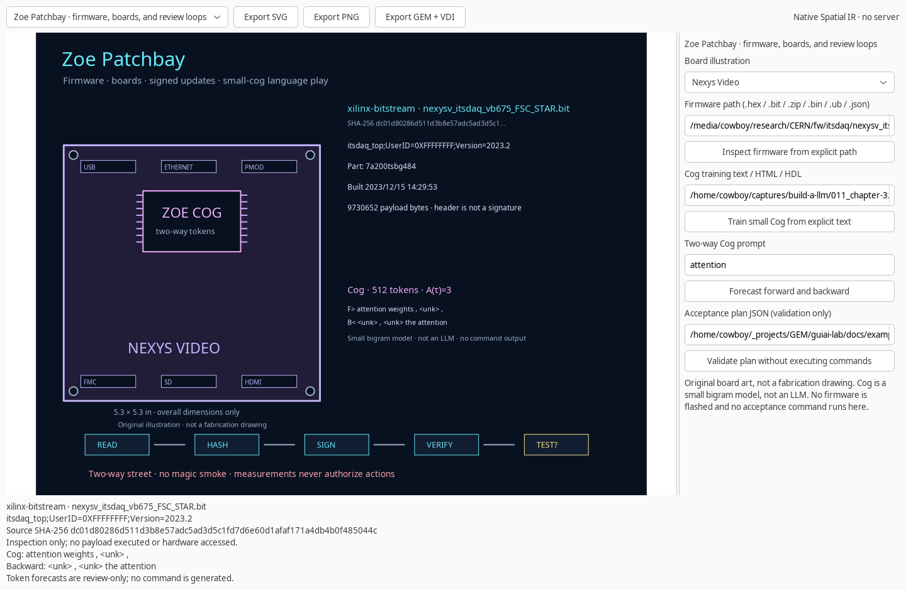

# Zoe Patchbay

Zoe Patchbay is a creative firmware workbench: original board illustrations, real artifact inspection, signed update capsules, explicit acceptance records, a local media gallery, and a small two-way token processor named **Cog**.

The visual motto is **two-way street, no magic smoke**. The implementation separates reading, hashing, signing, verification, and testing. Opening a board or inspecting an artifact does not execute its contents or contact hardware.

## Open the workbench

```bash
zoe patchbay scene
zoe patchbay scene --board nexys-video
zoe patchbay scene firmware.bit --output bitstream.svg
zoe patchbay scene --source /media/cowboy/research/CERN/source/firmware
```

The same commands work through `gem patchbay`. The native atlas provides board selection, an explicit firmware path, an inspect button, Cog training and forecast controls, and acceptance-plan validation. Entering a path does not read it. A failed inspection preserves the previous artifact and scene.

The native validator never runs an acceptance command. Signing and command execution are explicit CLI actions. SVG, PNG, and GEM exports use the same verified Spatial IR scene as the other Zoe instruments.

## Firmware and source inspection

| Input | What Patchbay retains | Important boundary |
|:---|:---|:---|
| Intel HEX `.hex` | Validated record lengths/checksums, address spans, data-byte count, start address, source hash | An application image is not silently labeled as its separate bootloader |
| Xilinx `.bit` | Design, FPGA part, build date/time, payload length/hash, synchronization-word location | A bitstream header is not a publisher signature |
| Source `.zip` | Bounded directory entries, source extensions, top-level HDL candidates | No recursive extraction, archive script, or project build is executed |
| ZynqMP `BOOT.BIN` | Existing Ablation partition parser, offsets, sizes, identities, load/entry addresses, encryption/authentication flags | Container flags do not reveal device fuses or runtime acceptance |
| U-Boot `.ub` | Legacy image fields and CRC results, or FIT metadata through `fdtget` | CRC detects corruption, not publisher identity; FIT signature verification is not implied |
| Timing `.json` | Existing `build_findings` WNS/timing-met evidence and source revision | Digital build evidence is not analog or deployed timing validation |
| Source tree | Git revision, tracked dirty state, bounded source inventory and content hash | Submodules and untracked files are excluded from the Git dirty check and labeled accordingly |

For example:

```bash
zoe patchbay scene /media/cowboy/research/CERN/firmware/edms-downloads/edms_1074819.hex
zoe patchbay scene /media/cowboy/research/CERN/fw/emp/BOOT.BIN
zoe patchbay scene /media/cowboy/research/CERN/fw/emp/sdcard.bak/bootpart/image.ub
zoe patchbay scene /media/cowboy/research/CERN/analysis/felix-flx155/findings.json
zoe patchbay source /media/cowboy/research/CERN/source/firmware --output source-inventory.json
```

ZynqMP decoding uses Ablation's `zynqmp_boot` module, resolved through an importable `ablation` package or `ZOE_ABLATION_ROOT`. FIT inspection requires the optional `fdtget` utility. Missing optional tools produce an explicit error rather than an invented format result.

The checked local examples establish concrete facts:

- A1396 contains 49,656 data bytes in two spans; A1535 contains 87,010 in three. Both Intel HEX files pass record checksum validation.
- The EMP container has five checksum-valid partitions. Its flags request neither encryption nor authentication; this is not a claim about unread device fuses.
- `image.ub` is a FIT image with an ARM64 Linux kernel, gzip compression, and a system device tree. Several `.MOV` files in the media collection are instead PICT images, detected from their headers.
- The FELIX source checkout resolves to revision `449b67271229891f0fb5f38dbfc26fde3beb8b4c`. The bounded inventory covers 1,120 source files and 111,779,133 bytes. Git's dirty result covers tracked files only; submodule state and untracked files are not silently called clean.

These are new software views over preserved evidence. A target-specific C166 replacement bootloader is a separate implementation task, not a byproduct of parsing its application images.

## Public firmware catalog

```bash
zoe patchbay catalog --output ucl-firmware-catalog.json
```

The default source is the [UCL firmware directory](https://www.hep.ucl.ac.uk/~warren/upgrade/firmware/). Patchbay retrieves at most 1 MiB of HTML over HTTPS, with a timeout, and records filenames, URLs, inferred board family, revision text, and `latest` aliases. It does **not** download every bitstream.

A `latest` alias does not prove byte equality with a named revision. The catalog's HTTPS transport is not a publisher signature. Compare downloaded bytes and hashes explicitly before treating two entries as identical.

## Signed update capsules

Patchbay uses real Ed25519 signatures through the installed OpenSSL command-line tool. No cryptography library or private-key file is bundled.

```bash
zoe patchbay keygen private.pem public.pem
zoe patchbay sign new-firmware.bin \
  --private-key private.pem --public-key public.pem \
  --target genesys2-lab-unit --output update-capsule.json
zoe patchbay verify update-capsule.json \
  --artifact new-firmware.bin --trusted-key public.pem \
  --output verification.json
```

Key generation refuses existing paths and restricts the new private-key file to mode `0600`. The private key is passed to OpenSSL by path; it is not printed or embedded in the capsule.

A capsule binds:

- Artifact filename, size, and SHA-256.
- A user-supplied target label and timestamp.
- The Ed25519 public-key fingerprint and signature.
- A canonical-JSON digest for tamper evidence.

Verification distinguishes three checks:

1. Does the signature match the signed metadata?
2. Does the selected artifact match its signed size and hash?
3. Does the explicitly trusted public key match the signing key?

`authenticity_established=true` requires all three. A self-contained public key can prove signature consistency, but by itself it does not establish publisher trust. This is a new-update mechanism, not a retroactive claim about an old unsigned image or a device's secure-boot configuration.

## Acceptance plans and execution

Validation does not execute a command:

```bash
zoe patchbay accept plan.json --output validation.json
```

Execution requires `--execute`. Any step marked `hardware_write=true` additionally requires `--allow-hardware-write`:

```bash
zoe patchbay accept plan.json --execute --output acceptance.json
zoe patchbay accept write-plan.json --execute --allow-hardware-write --output update-acceptance.json
```

A plan contains an explicit argument array, not a shell string:

```json
{
  "schema_version": 1,
  "instrument": "zoe-patchbay-acceptance",
  "target": "synthetic-target-no-hardware",
  "firmware": "endeavour-clocks.vcd",
  "steps": [
    {
      "name": "synthetic-command-check",
      "argv": ["/usr/bin/python3", "-c", "print('explicit local test')"],
      "timeout_seconds": 5,
      "expected_exit": 0,
      "hardware_write": false,
      "cwd": "."
    }
  ]
}
```

The included `docs/examples/patchbay-acceptance.json` uses a synthetic VCD as its tracked input, not as firmware. It is safe to validate without CERN artifacts. Execution still requires an explicit flag.

Plans allow 1–16 steps, 1–32 arguments per step, and timeouts from 0.1 to 120 seconds. The runner:

- Uses `execve`-style argument arrays without a shell.
- Supplies a minimal environment containing only `PATH`, the target label, and firmware path.
- Starts each command in a separate process group and terminates that group on timeout.
- Drains output while retaining at most 64 KiB each for stdout and stderr, with truncation flags.
- Stops after a failed, missing, or timed-out command.
- Hashes the tracked input before and after execution and rejects unexpected local changes.
- Saves canonical, digest-checked reports without overwriting existing files.

`accepted=true` covers the declared plan and unchanged input only. `hardware_accessed` remains unknown because an argument string cannot prove physical access. Passing a synthetic command test is not a universal proof of hardware behavior. Verify a capsule before using a real update plan; the runner does not silently infer trust.

## Local media gallery

```bash
zoe patchbay media --root /media/cowboy/research/CERN --output patchbay-media.html
```

Open the resulting local HTML file in a browser. It references the original images, videos, mechanical drawings, and documents through local file URIs; no web server or autoplay is used. Videos have explicit controls. Images load lazily.

The gallery covers the supplied system-test and fibre-installation collections plus the top-level mechanical assets. It hashes each artifact, limits the gallery to 128 entries and videos to 512 MiB each, and uses optional `ffprobe` metadata when available. PICT files with misleading `.MOV` suffixes are offered as original documents rather than mislabeled movies. Original media are not copied into the Zoe repository.

**Beautiful cable spaghetti. Every strand gets a hash.**

## Cog: a small two-way token processor

Cog is deliberately a **small, interpretable language model**, not a large language model, transformer, consciousness claim, or command generator. The supplied *Build a Large Language Model (From Scratch)* capture provides the reading context for tokenization, context, probabilities, and generation. Cog implements a simpler bounded interpolated bigram model with an original implementation; it does not reproduce the book's GPT code.

```bash
zoe patchbay cog /home/cowboy/captures/build-a-llm/011_chapter-3.html \
  --prompt attention --reverse attention --steps 4 \
  --model-output attention-cog.json --output attention-walk.json

zoe patchbay cog --model attention-cog.json \
  --prompt inspect --reverse update --output another-walk.json
```

Cog accepts up to 16 explicit local text, Markdown, HTML, HDL, C/C++, or Python files, each at most 2 MiB. Training retains at most 500,000 tokens and 2,048 vocabulary entries; the default is 512. HTML tags, scripts, and styles are not executed. Source paths, original-file hashes, normalized-text hashes, and decoding replacements are retained.

The forward distribution interpolates observed next-token counts with the corpus unigram distribution. Backward walks reverse the observed transition relation, not meaning, causality, or time. Every walk reports top candidates, a digest of the complete probability vector, and accessible volume at the chosen threshold.

The accessible-volume calculation is:

```text
A_tau(S) = sum_{a in O} 1[P(a | h_T(S)) > tau]
```

Its original equation is credited to **Nicholas Michael Kloster alone, March 6, 2026**. In Cog it describes forecast breadth, not correctness, truth, safety, or permission to act. Small models can produce amusing nonsense; Cog labels that output as review-required rather than wisdom.

## Board illustrations and provenance

The Genesys 2 scene uses the documented **6.80 × 5.80 inch** overall dimensions. The Nexys Video scene uses **5.30 × 5.30 inches**. These proportions inform original vector illustrations; connector artwork is schematic and is **not a fabrication drawing**.

The original mechanical files, source archives, firmware, photographs, videos, and book capture remain outside the repository. No bitstream, proprietary HDL, raw research corpus, book pages, or cover images are bundled into Patchbay. External organizations and authors do not endorse Zoe.

## Verification

```bash
PYTHONPATH=guiai-lab python -m unittest stress.cog_stress stress.patchbay_stress -v

ZOE_ABLATION_ROOT=/home/cowboy/_projects/GEM/components/ablation \
  PYTHONPATH=guiai-lab guiai-lab/stress/nested_x11.sh \
  python -m unittest stress.cog_stress stress.patchbay_stress -v
```

The suites cover actual HEX, BIT, source ZIP, EMP, FIT, timing, source, and media inputs; Ed25519 signing and trust failures; dry-run and gated execution; process timeout and output bounds; report tampering; Cog training and forward/backward probabilities; direct and forwarded CLIs; and native inspection, Cog, validation, and export workflows. Optional local-evidence tests are skipped when their inputs or tools are unavailable.




