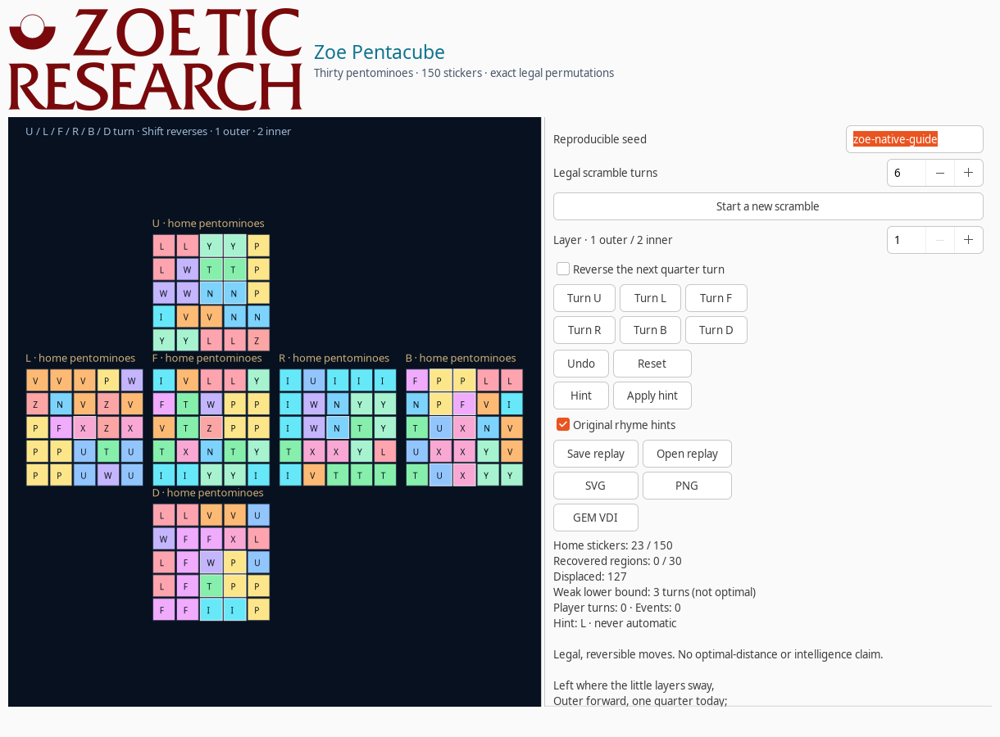
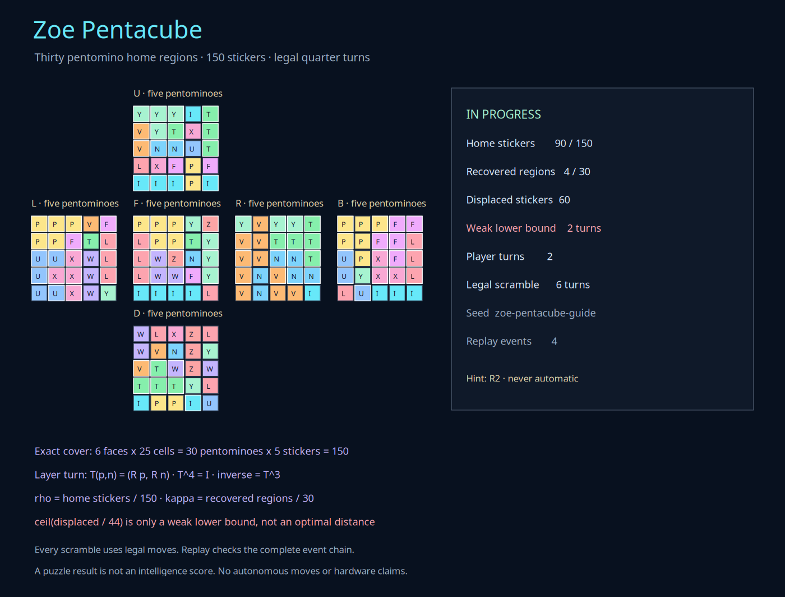

# Zoe Pentacube

**Zoe Pentacube combines the twelve free pentominoes with a legal 5×5 cube-permutation model.** Six solved faces contain thirty pentomino home regions. Outer and inner quarter turns then scramble 150 stickers through exact, reversible permutations.

This is a new turn-based puzzle and inspection tool, not a Tetris clone, an official Rubik product, an optimal cube solver, or an intelligence test.


The **Zoetic Research** co-brand is user-created artwork and an homage to Gary Kildall and Digital Research. It is independent from Digital Research and does not replace the Zoe orbital eye.

## Why a 5×5 cube fits

A 3×3 face has nine stickers, which cannot be partitioned into five-cell pentominoes. A 5×5 face has 25 cells, so five pentominoes can tile it exactly. Six faces provide:

\[
6\times 25 = 30\times 5 = 150\text{ stickers}.
\]

Each face uses five distinct pentomino shapes with no overlap and no uncovered cell. Across the six faces there are 30 home regions, with every one of the twelve free shapes represented; shapes may repeat on different faces.

The checked-in home tilings were produced with a bounded minimum-remaining-values exact-cover search. They are data, not a startup-time search problem. Every game starts by validating the resulting 150-sticker state.

## Play and export

```bash
zoe pentacube
zoe pentacube --seed my-challenge --scramble 12 --rhyme
zoe pentacube --seed my-challenge --scramble 12 --hint --output challenge.svg
zoe pentacube --moves "F,R2',U" --output session.json
zoe pentacube session.json --output verified-replay.svg
```

`F`, `R`, `U`, `L`, `B`, and `D` select a face. A following `2` selects the inner slice; without it, the outer face layer is used. A trailing apostrophe reverses the quarter turn. `R2'` therefore means the inner R-slice inverse, not a 180-degree turn.

The native window provides:

- Six face buttons, outer/inner depth selection, and an inverse checkbox.
- Keyboard face letters, with Shift for the reverse turn.
- Undo and reset to the recorded scramble.
- A hint that reverses one step of the recorded legal path without claiming to be optimal.
- An explicit Apply Hint action; no hint moves automatically.
- Original rhyme hints, replay save/open, and SVG/PNG/GEM VDI export.
- A scrollable control column and accessible face-net description.



## The equations

### Exact cover

For each face \(f\), let \(P_f\) be its five placements and \(C(p)\) the five cells occupied by placement \(p\). Then:

\[
\bigcup_{p\in P_f} C(p)=F_f,\qquad C(p)\cap C(q)=\varnothing\quad(p\neq q),\qquad |P_f|=5.
\]

Pentomino rotations and reflections reuse Zoe Pentomino's normalized dihedral orientations. The home-state SHA-256 is `672d23c2f8e997bb57f738c5f51ae4c496a3450ab290a03d258632748eee1166`.

### Layer permutations

Each sticker has a position \(p=(x,y,z)\), an outward normal \(n\), and a permanent home identity. Coordinates are integers from \(-2\) to \(2\). On the selected layer:

\[
T_{a,\ell,q}(p,n)=
\begin{cases}
(R_a^q p,R_a^q n), & p\cdot e_a=\ell,\\
(p,n), & \text{otherwise}.
\end{cases}
\]

Here \(a\in\{x,y,z\}\), \(\ell\in\{-2,-1,1,2\}\), and \(q\in\{1,3\}\) is a quarter turn. Positive rotations use the right-handed matrices:

\[
R_x(x,y,z)=(x,-z,y),\qquad
R_y(x,y,z)=(z,y,-x),\qquad
R_z(x,y,z)=(-y,x,z).
\]

Outward-face clockwise turns select the appropriate sign for positive and negative faces. Position **and** normal rotate, which carries stickers around edges and corners instead of painting a two-dimensional net.

The inverse is exact:

\[
T_{a,\ell,q}^{-1}=T_{a,\ell,4-q},\qquad T_{a,\ell,q}^4=I.
\]

Every one of the 24 face/depth/direction variants is tested for these identities and for preservation of all 150 unique position/normal pairs.

An outer turn displaces 44 position/normal pairs; its face-center position is unchanged. An inner-slice turn displaces 20. The model tracks sticker position and normal, not an orientation mark on a square center sticker.

### Recovery metrics

\[
\rho(S)=\frac{\text{stickers at their home position and normal}}{150},
\]

\[
\kappa(S)=\frac{\text{home pentomino regions whose five stickers are all home}}{30}.
\]

A weak lower bound is also shown:

\[
d(S)\geq \left\lceil\frac{150-\text{home matches}}{44}\right\rceil.
\]

The last expression uses only the maximum number of displaced pairs in one legal turn. **It is not an optimal solution distance, a God's-number result, or a shortest-path search.**

A solved state has \(\rho=\kappa=1\). A hint simply reverses the latest step in the known scramble-plus-player path. Since every scramble is made from legal moves, reversing that complete path always restores the home state.

## Replay and evidence

A session records its seed, explicit scramble, current sticker state, player history, ordered events, previous-event hashes, and state hashes. Saving performs a complete replay before creating a new canonical JSON file.

Loading verifies:

- The home-state identity and document digest.
- The initial scramble and event sequence.
- Every turn, undo, and reset.
- Previous-event hashes and final state.
- All reported measurements.

Undo applies an inverse permutation and appends an event; it does not delete history. Reset restores the recorded scramble and clears the player-move stack used for solving, while retaining earlier events. Digest checking provides tamper evidence, not authentication. Session and scene files never overwrite an existing destination.

`docs/examples/pentacube-session.json` is a worked replay with two player turns remaining after an undo.



## Original rhyme hints

The supplied `/home/cowboy/Music/songs-of-the-ibm.pdf` is the **1937 edition of *Songs of the IBM***, a corporate fellowship songbook, rather than a traditional nursery-rhyme collection. Its communal singing and playful rhythms inspired optional short hint rhymes.

Zoe's rhymes are newly written. No lyrics are copied, and the songbook's corporate-loyalty themes are not adopted. A hint remains a choice, never an automatic move. The PDF is not bundled; its identification report has SHA-256 `098377ba36341f7cd0de798b1ab160d907ec4fb109c631c739b0170f4923d620` and explicitly leaves its page tree unverified.

## Historical design references

### ARTetris

[Exyte's ARTetris](https://github.com/exyte/ARTetris) separates tetromino definitions, current state, the well, the engine, and SceneKit presentation. That separation informed Zoe's model-first structure. The inspected revision is [`c9d10828487b0fb5477a336a032c0fca62becb66`](https://github.com/exyte/ARTetris/tree/c9d10828487b0fb5477a336a032c0fca62becb66), with the MIT license and copyright **2017 Exyte**.

No Swift source, images, ARKit behavior, game physics, scoring table, or assets are copied. Pentacube uses five-cell pieces, cube permutations, Python, GTK, and Zoe Spatial IR rather than ARTetris's four-cell falling-block game.

### IBM PC Tetris

The supplied `/media/cowboy/research/tetris-ibm-pc/README.txt` identifies version 3.12 of the original IBM PC port by **Vadim Gerasimov**, based on **Alexey Pajitnov's** game. `Tetris.exe` and the member of `Tetris3.zip` are byte-identical with this SHA-256:

```text
d72cb451e63f32bfd3838b5e9ddc52954988b8fbb2b0c5087fef36b2f29085e6
```

The read-only MZ inspection confirms 25,744 declared and actual bytes, 459 relocations, and an 1,872-byte header. The executable was not run, emulated, disassembled for game code, or bundled. Its [author's historical account](https://vadim.oversigma.com/Tetris.htm) remains the appropriate narrative source.

### Atari archive

The inspected [Atari tools archive](https://ftpmirror.your.org/pub/misc/bitsavers/bits/Atari/arcade/atari_tools.zip) contains 137 entries and has this SHA-256:

```text
56b246c16e87e9d36efa5b4c81ad5104b91a6073e618b9853ef0f94d08ea3ac6
```

It contains 1978–79 assembly/Pascal source and object files, including display-direction and sound-processor code.

This is **not presented as a ready-to-run firmware image or as validated hardware behavior**. No member was executed or bundled. The adapter records paths, sizes, member SHA-256 values, and CRC32 as integrity metadata rather than signatures.

### Digital Research and GSX

The supplied Digital Research collection is unusually rich: desktop handbooks, GSX guides, 1985/1986 VDI references, AES material, resource tools, applications, and source archives. The 1986 VDI guide's device-independent output model and the GSX clipping routines reward careful study. Pentacube uses original geometry and text, while Zoe's existing Spatial IR/VDI path supplies device-independent exports.

The local and mirrored [GSX-80/86 source archive](https://ftpmirror.your.org/pub/misc/bitsavers/bits/DigitalResearch/gsx80_86_src.zip) have the same SHA-256:

```text
22303ae5a75188e9d45fe91b7261497033ead882da0df8172331c88e6e560158
```

It contains 823 entries. The source was inspected, not copied or compiled. Digital Research manuals and source remain external.

### Zoetic Research logo

The user-created `/home/cowboy/Downloads/Zoetic_Research_Logo.{png,svg}` is included with these identities:

```text
68637ee2488eb90ffbc6150458bb2806eebd2df08a5ce44835aec502139fae89  PNG
996dd01df42676df995e3adc75370e464d08236a132c8fb4eb3d4bc0096dba58  SVG
```

The user identifies `Digital_Research_Logo.svg` and `Digital_Research_logo_1990.svg` as inspiration. Their red serif typography and circular motifs are acknowledged as an homage to Gary Kildall and Digital Research. Those two source logos remain external. The Zoetic lettering and circular/bowl mark are self-contained vector artwork, not a Digital Research endorsement or an official mark.

## Read-only historical evidence commands

```bash
zoe pentacube --reference /media/cowboy/research/tetris-ibm-pc/Tetris.exe \
  --source-url https://vadim.oversigma.com/Tetris3.zip \
  --output tetris-reference.json

zoe pentacube --reference /path/to/atari_tools.zip \
  --source-url https://ftpmirror.your.org/pub/misc/bitsavers/bits/Atari/arcade/atari_tools.zip \
  --output atari-reference.json
```

MZ headers and ZIP member inventories are parsed without execution. Reports preserve source identity and explicit boundaries: no payloads run, no hardware is accessed, runtime is unverified, firmware is not identified from assertion, and no license determination is inferred. Source artifacts and substantial historical text are not bundled.

Worked evidence reports are under `docs/examples/`:

- `pentacube-tetris-reference.json`
- `pentacube-atari-tools.json`
- `pentacube-gsx-reference.json`
- `pentacube-ibm-songs-reference.json`

## Verification

```bash
PYTHONPATH=guiai-lab python -m unittest stress.pentacube_stress -v
PYTHONPATH=guiai-lab guiai-lab/stress/nested_x11.sh \
  python -m unittest stress.pentacube_stress -v
```

The suite checks exact covers, face/cell round trips, all 24 turn variants, 44/20 displacement counts, inverses and order four, deterministic scrambles, hints, undo/reset, complete replay and tamper detection, SVG/PNG/GEM exports, both CLI entry points, MZ/ZIP parsing, real Tetris and GSX evidence, optional Atari evidence when present, native controls, rhyme and logo presentation, and the dedicated Atlas window.
