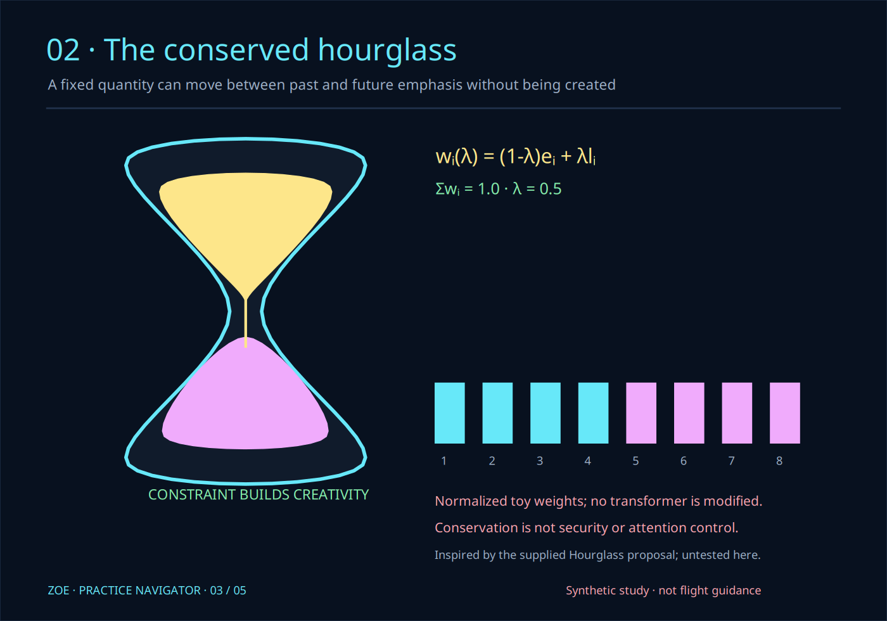

# Zoe Practice Navigator

**Zoe Practice Navigator** is an original five-page visual guide made with Zoe Artline. Its technical panels, instrument grid, typography, routes, and diagrams are new; historical pilot guides, plotters, tablets, covers, logos, and screenshots are not redistributed.

This is a creative practice guide, **not certified flight-training or navigation material**. It contains no wind, weather, terrain, aircraft-performance, or real-world route model.

## Open or export

```bash
zoe pilot
zoe pilot --output zoe-practice-navigator.pdf
zoe pilot --page hourglass --output hourglass.svg
zoe pilot --page practice --output practice.gem
```

`zoe pilot` opens the original cover as an editable Artline document. PDF output always includes all five pages. Individual pages also export to SVG, PNG, or verified GEM VDI. Output files are never overwritten.

## Pages

1. **Cover — Practice Navigator.** A new instrument-inspired grid and the observe / orient / decide / review loop.
2. **Plot before you move.** Toy coordinates, an explicit displacement, and `remaining = max(0, budget - elapsed)`. It does not predict a real route.
3. **The conserved hourglass.** A normalized redistribution of eight toy weights between early and late emphasis.
4. **Signals through the hourglass.** An original seven-layer network sketch and synthetic arrival-spacing measurements.
5. **Build Rome, then change the clock.** The verified twelve-piece tiling and controlled 1 / 5 / 20 / 300-second strategy comparison.

## Hourglass boundary



For normalized early and late weights `e` and `l`, the illustration computes:

```text
w_i(λ) = (1 - λ)e_i + λl_i,     0 ≤ λ ≤ 1
Σ w_i(λ) = 1
```

This demonstrates convex redistribution only. It does not modify a transformer, detect ambiguity or threats, implement positional attention, or validate the supplied Hourglass Defense proposal. Conservation alone does not establish security.

## Packet-timing boundary

The signals page uses synthetic arrival times `[0, 10, 23, 32, 49, 61, 79, 90]`. It reports interval means and mean absolute interval deviation. It does not contact a network, estimate clock offset, or implement the RTP interarrival-jitter estimator. Layering and variable delay are conceptual topics drawn from the supplied packet-communication chapter; its prose and figures are not copied.

## Attempt and review

The practice page uses the attempt-value model as a decision lens rather than a biological equation. No universal ideal deadline or measure of intelligence is inferred. Original accessible-volume work remains separately credited to **Nicholas Michael Kloster alone, March 6, 2026**.

## Checks

```bash
PYTHONPATH=guiai-lab python -m unittest stress.pilot_stress -v
```

The suite verifies hourglass normalization, synthetic spacing calculations, every Spatial IR scene, every GEM VDI round trip, real five-page Cairo PDF output, command-line exports, and opening the editable native cover.
