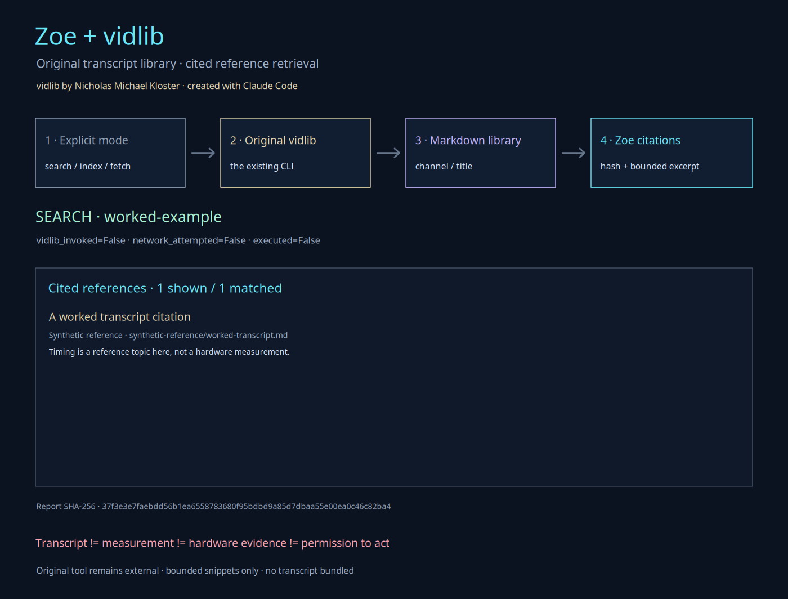

# Zoe + vidlib: cited transcript memory

**vidlib is Nicholas Michael Kloster's original tool, created with Claude Code.** Zoe does not replace, rename, absorb, or claim authorship of it. The integration invokes the existing executable and adds a separate evidence adapter with source hashes, bounded citations, explicit network controls, and no-overwrite reports.

The use case is **reference retrieval**: keep a personal YouTube transcript library searchable, cite the relevant Markdown source, and inspect a small excerpt before deciding what to do next.

```text
transcript != measurement != hardware evidence != permission to act
```



## Original tool and dependency

The inspected installation is:

```text
/home/cowboy/.local/bin/vidlib
/home/cowboy/.local/bin/vidlib.py
```

At integration time their SHA-256 values were:

```text
a10fe28bdb92b452acdd6d37cb2df89cf8956cd7fe57fdce34a9560843231ad2  vidlib
2df811527f8f20eea5536e2d46071ec54352cb81233952b13289a7ef2322ae86  vidlib.py
```

Every new report records the actual executable path and hash, plus the sibling Python implementation path and hash when present. These values identify the inspected installation; they are not an invented upstream version.

vidlib requires `yt-dlp` for metadata and subtitle retrieval. The installed version was found, but Zoe does not install or update it. The original tool uses `yt-dlp --no-check-certificates`; the adapter preserves that original behavior rather than silently claiming certificate validation. Search and index operations do not invoke `yt-dlp`.

The original files were not modified for this integration.

## Search an existing library offline

```bash
zoe evidence video \
  --library /path/to/vidlib \
  --search "timing" \
  --output vidlib-timing.json \
  --scene-output vidlib-timing.svg
```

The same command is available through `gem evidence video`. Zoe invokes the original `vidlib --search` with an argument array and no shell. It then reads the Markdown library to produce normalized citations containing:

- Title, channel, date, duration, reading-time metadata, and source URL when present.
- Absolute source path and library-relative path.
- Source byte count and SHA-256.
- One bounded matching excerpt per matching transcript.
- The original process return code and bounded stdout/stderr.

Search sets `vidlib_invoked=true`, `network_requested=false`, `network_attempted=false`, and normally `executed=false`. It does not contact YouTube. An unexpected library change during any operation is reported and makes `executed=true` rather than being hidden.

A missing library returns `status=missing-library`, an empty result list, and `returncode=0`. Zoe does not create, search, index, or download into that missing directory. An empty existing library is a different state: the original command is invoked and returns `status=ok` with zero matches.

## Rebuild the original index

```bash
zoe evidence video --library /path/to/vidlib --index \
  --output vidlib-index.json
```

This deliberately invokes the original `vidlib --index`. It writes `index.md` using vidlib's own channel/title catalog format. This is a library-changing operation, so `executed=true`; it does not request network access. The report records the resulting index hash and all cited transcript hashes.

The original index behavior may replace an existing `index.md`. The separate Zoe JSON and scene destinations still refuse to overwrite existing files.

## Explicit transcript retrieval

Only a URL supplied for this command permits a network operation:

```bash
zoe evidence video --library /path/to/vidlib \
  --url "https://www.youtube.com/watch?v=YOUR_VIDEO_ID" \
  --output vidlib-video.json
```

Playlist processing requires both a playlist URL and the explicit flag:

```bash
zoe evidence video --library /path/to/vidlib \
  --url "https://www.youtube.com/playlist?list=YOUR_PLAYLIST_ID" \
  --playlist --timeout 1200 --output vidlib-playlist.json
```

The adapter accepts only HTTPS URLs on `youtube.com`, `www.youtube.com`, `youtu.be`, or `m.youtube.com`. Credentials and non-default ports are rejected. A playlist URL without `--playlist`, or `--playlist` with a non-playlist URL, is rejected before the executable starts.

For a fetch, the report distinguishes:

- `network_requested`: this operation was explicitly configured as a fetch.
- `network_attempted`: the original executable was actually launched for that fetch.
- `remote_fetch_succeeded`: the original executable returned zero, not an independent audit of remote content.
- `transcript_downloaded`: new or changed transcript Markdown was observed after the call.
- `executed`: the explicitly requested library-changing operation was invoked.

A failed command can still have `network_attempted=true` and `executed=true`; those fields do not mean that a transcript arrived. The original nonzero return code is returned by `zoe evidence video`. A timeout returns 124 and terminates the isolated process group. Partial library changes are reported rather than erased.

No user-selected video URL was supplied for this integration. **Real YouTube retrieval was not performed or verified.** Tests exercise fetch behavior with synthetic local fixtures. The real vidlib JSON3 parser, Markdown generation, local search, and index rebuild were exercised without network access.

## Report integrity and limits

Reports use canonical JSON and a SHA-256 `digest` over every other report field. JSON reports are created exclusively. `load_video_report()` checks the digest, citation schema, evidence boundaries, and output limits; by default it also verifies cited source hashes and a recorded index hash against the current files.

This is **tamper evidence, not authentication**. Someone who can edit a report and recompute its digest can still make assertions. A report also contains local paths and bounded original-tool output, so review it before sharing.

Current bounds are:

```text
64 returned citations
360 characters per citation excerpt
8,192 bytes captured from each process output stream
4 MiB per transcript
4,096 transcripts per library scan
2 MiB per saved report read
1–256 nonblank search characters
1–3,600 seconds process timeout
```

`source_text_bundled=false` means the complete transcript is not copied into the Zoe report or repository. A short search excerpt remains a citation aid, not a license determination or a substitute for the source. Transcript cleanup and automatic-speech-recognition corrections are not authoritative corrections of technical meaning.

Every report retains `measurement=false`, `hardware_evidence=false`, `hardware_accessed=false`, `llm_called=false`, and `action_authorized=false`. These flags concern the evidence and subsequent-action boundary; explicit indexing or fetching still honestly reports `executed=true`.

## Worked example and visual export

`docs/examples/vidlib-search.json` is a **synthetic worked example**. It demonstrates the citation shape without bundling a transcript or claiming that vidlib ran. Its example paths do not identify physical sources. Use `verify_sources=False` only when inspecting this explicitly synthetic document; real reports should use the default source verification.

Any operation can also export a new SVG, PNG, or GEM VDI scene through `--scene-output`. The scene is validated with Zoe's geometry or VDI verifier before writing. It visualizes the supplied report; it does not generate transcript evidence.

A downloaded Markdown path may also be passed to the existing `Cog.from_paths()` API for bounded language exploration. That is optional language play, not a giant model, a hardware observation, or a record that a person performed the advice in a transcript.

## Verification

```bash
PYTHONPATH=guiai-lab python -m unittest stress.video_stress -v
```

The suite covers missing libraries and executables, URL and playlist gates, no-network search, explicit indexing and simulated retrieval, original exit codes, timeout cleanup, bounded output and snippets, source and report tampering, no-overwrite behavior, CLI forwarding through both entry points, symlink escape rejection, scene verification, and the original vidlib JSON3/Markdown/search/index workflow using temporary synthetic inputs.
