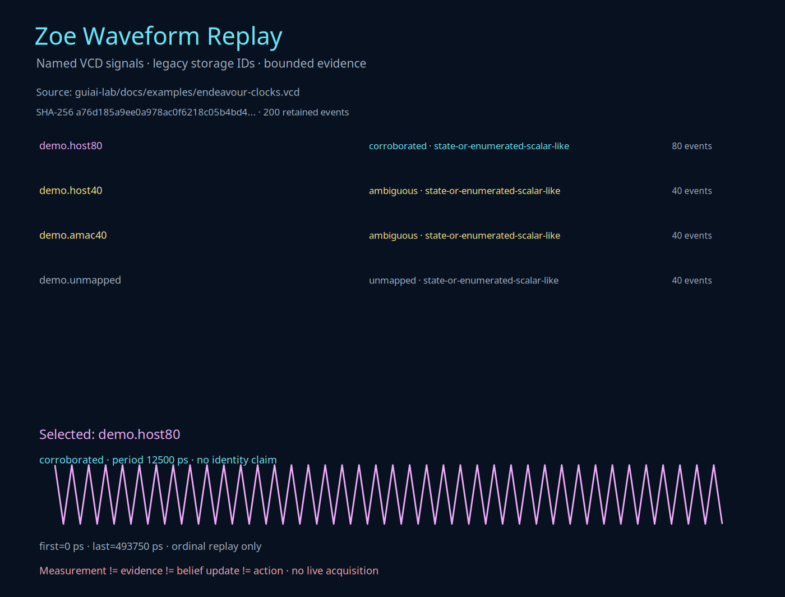
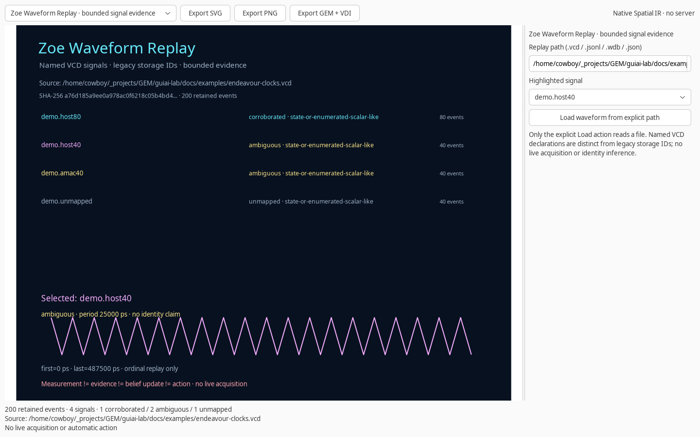

# Zoe Waveform Replay

Zoe Waveform Replay is a bounded, local reader for named VCD signals and anonymous legacy waveform events. It preserves the source identity, retained event window, timestamps, values, and evidence limits. It draws an inspectable Spatial IR scene and exports SVG, PNG, and GEM VDI without contacting hardware.

**Replay is not acquisition.** A matching transition pattern can corroborate a proposed clock signature; it cannot recover a missing name, prove a device function, establish analog timing, or authorize an action.

## Open, replay, and export

```bash
zoe waveform
zoe waveform guiai-lab/docs/examples/endeavour-clocks.vcd --signal c1
zoe waveform capture.vcd --max-events 4096 --output replay.json
zoe waveform replay.json --output replay.svg
zoe waveform capture.vcd --output replay.gem
```

The same arguments work through `gem waveform`. Without `--output`, the native atlas opens a signal selector, an explicit input-path field, and a **Load waveform from explicit path** button. Merely entering a path does not read it. A failed load leaves the previous replay and scene intact.

The included `endeavour-clocks.vcd` is a **synthetic demonstration**, not an original CERN trace. Its `host80` trace has a unique sampled period. `host40` and `amac40` share a complete sampled signature, so both are **ambiguous** rather than independently corroborated. `unmapped` has no supported clock match.

Output paths must not already exist. SVG/PNG/VDI scenes are verified before export. The JSON document is a normalized replay snapshot, not a re-simulation or a hardware record.

## VCD: declared names and values

The VCD reader supports:

- Nested module scopes and declared signal identifiers.
- Scalar `0`, `1`, `x`, and `z` transitions.
- Binary vectors and finite real-valued transitions.
- Decimal positive timescales in seconds, milliseconds, microseconds, nanoseconds, picoseconds, or femtoseconds.
- Ordered integer timestamps after conversion to picoseconds.

Declarations must be unique, and every retained event must reference a declared identifier. Unknown identifiers, duplicate declarations, invalid timescales, decreasing timestamps, missing declarations, and empty event streams are rejected. Declared but unobserved signals remain visible in reports; they cannot be selected for a trace until an event is retained.

Input files are limited to **64 MiB**, lines to **1 MiB**, declarations to **4,096**, retained events to **65,536**, and event-value text to **8,192 characters**. `--max-events` defaults to **4,096**. A nonempty remainder beyond that bound sets `truncated=true`; it is not presented as a complete waveform.

The picture connects retained samples in event order. It is not an analog oscilloscope, a proportional full-time raster, or a reconstruction of transitions discarded by the bound.

## Legacy JSONL and WDB: storage identities only

The JSONL adapter accepts one event object per line with these fields:

```json
{"root_index": 0, "storage_id": "0x4B0", "time": 0, "payload_hex": "02"}
```

The optional WDB path uses the existing bounded `WdbReader` from the bundled Ablation source tree. It supports that reader's documented legacy profiles; it is not a new general-purpose proprietary-format decoder. If `ablation` is not importable, point to its checkout explicitly:

```bash
ZOE_ABLATION_ROOT=/home/cowboy/_projects/GEM/components/ablation \
  zoe waveform /media/cowboy/research/CERN/analysis/wdb/endeavour_tb_behav.wdb \
  --max-events 256 --output legacy-replay.svg
```

No raw CERN waveform, proprietary HDL, vendor IP, or simulator output is bundled in Zoe. The optional local research paths are neither required for installation nor silently searched by the native interface. WDB decoding retains the root index, storage ID, event timestamp, and payload bytes supplied by the reader. It does not invent embedded signal names or resolve vendor-specific behavior.

Ablation's reader credits the MIT-licensed Vivado-WDB-Waveform-Converter format research and retains the upstream notice in `components/ablation/ablation/data/vivado_wdb_upstream_LICENSE.txt`.

## Clock corroboration, ambiguity, and labels

For each stream, the classifier checks its initial payload and the first **32 subsequent equal intervals and alternating transitions**. VCD clocks use `0`/`1`; the investigated legacy streams use payload `02`/`03`. The candidate period is twice the first interval in the retained representation.

- **Corroborated:** a complete sampled signature matches and no other retained stream has the same candidate period.
- **Ambiguous:** multiple streams share the candidate period, or more than one initial-state candidate remains.
- **Unmapped:** the available sample does not support the clock check.

A shared candidate period is deliberately not treated as independent identification, even when the streams have the same alternating phase. This conservative grouping prevents duplicate signatures from inflating the corroborated count. A unique sampled period is still not proof of identity: another unsampled or truncated signal may share it, and an unrelated signal may reproduce it.

Other labels such as `constant-like`, `state-or-enumerated-scalar-like`, and `mixed-or-complex-data` describe only the retained values. They do not establish RTL type, hardware purpose, or protocol meaning.

## Normalized replay and integrity

The JSON document retains:

- Source path, format, byte size, SHA-256, and name-mapping category.
- Timescale, complete declarations, retained event window, and truncation flag.
- A canonical SHA-256 digest over the document excluding the digest field.

Loading validates the document structure, event references, ordering, metadata, and digest. This detects edits to the normalized document; it does **not** authenticate its author or recalculate a hash against a potentially unavailable original file. Source hashes identify the original bytes, not their correctness. Saves use exclusive file creation and never overwrite an existing file.

```text
measurement != evidence != belief update != action
```

Waveform loading records no posterior update and creates no hardware command. There is no live acquisition, FPGA programming, network transmission, or automatic follow-up action.

## What remains open

The local research evidence does not supply the missing original bootloader or complete MCU memory layout. It cannot establish source authenticity, embedded WDB name mappings, complete vendor-IP behavior, analog timing closure, or acceptance on deployed hardware. A bounded sample cannot validate the full WDB corpus. Recreated simulations and matching timestamps require their own provenance before they can strengthen a mapping.

Those questions need actual source, independent measurements, and hardware review. Replay makes the available evidence inspectable; it does not fill those gaps by assertion.

## Verification

```bash
PYTHONPATH=guiai-lab python -m unittest stress.waveform_stress -v

ZOE_ABLATION_ROOT=/home/cowboy/_projects/GEM/components/ablation \
  PYTHONPATH=guiai-lab guiai-lab/stress/nested_x11.sh \
  python -m unittest stress.waveform_stress -v
```

The suite covers scoped VCD values, malformed inputs, bounds and truncation, duplicate clock signatures, unused and single-event streams, normalized-document integrity, no-overwrite exports, CLI forwarding, native explicit loading, and geometry/VDI checks. When the optional local research files are present, it also replays 16 legacy JSONL events and a bounded 256-event WDB window and checks their source hashes. External-file tests are skipped when their evidence or optional decoder is unavailable.



The native screenshot below shows the actual selector and explicit loading controls.


