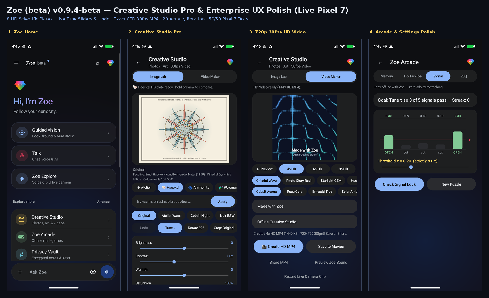

# Zoe (beta) — Mobile Companion (`v0.9.4-beta`)

> **Status:** **Zoe (beta)** (`v0.9.4-beta`, versionCode `15`) is a free, offline-first + online-on-demand, privacy-respecting work-in-progress mobile companion for **Android** (verified live on a Google Pixel 7 across 50/50 instrumentation tests, 20-Activity rotation safety &amp; 16-screen visual QA; direct development-signed beta APK on [GitHub Releases](https://github.com/Ablation-Tool/zoe/releases/tag/v0.9.4-beta)) and **Apple** (`iPhone`, `iPad`, and `iPhone Duo Fold` native SwiftUI source + shared `ZoeCore` Swift package).

<div align="center">

<a href="https://github.com/Ablation-Tool/zoe/releases/tag/v0.9.4-beta"></a>

**[⬇ Download Zoe (beta) Android APK (`v0.9.4-beta` + SHA-256)](https://github.com/Ablation-Tool/zoe/releases/tag/v0.9.4-beta)** &nbsp;·&nbsp; **[Complete 23-Tool Zapps Guide (`ZAPPS.md`)](ZAPPS.md)** &nbsp;·&nbsp; **[SafeConvert Guide (`SAFECONVERT.md`)](SAFECONVERT.md)** &nbsp;·&nbsp; **[Security Model (`SECURITY.md`)](SECURITY.md)**

</div>

Original native Android and Apple interfaces for **Zoe · NuClide Research**, designed in a calm, symmetrical **Google Gemini Material 3 Expressive** layout (`16dp` outer rails, `8dp` gutters, `20dp` concentric cards) anchored by the tappable **Zoe GEM-Ellipsis** Home emblem. The app strictly separates four capability planes:

1. **Deterministic & Offline Zoe:** Strict accessible-volume measurement $A_\tau(p)$, `< 2 ms` exact math/units/clock, offline `ZoeBrainEngine` (Kloster $A_{0.08}$ telemetry + SHA-256 hash-chained memory), bundled OCR/labeling, 18-archetype clean-room Haeckel/Lamarck/CPC Offline Visual Atlas (`8.4 KB`) + `< 0.1 ms` `VisionPriorStore`, scientific-aesthetic Creative Studio & H.264 MP4 Video Maker, 4 offline Arcade games, native `44.1 kHz` Rosenberg-Klatt Voice & `Sing Zoe`, Chladni cymatics, Signal-inspired Privacy Vault, and International SafeConvert.
2. **Optional On-Device Neural AI:** Android MediaPipe LiteRT (`tasks-genai:0.10.35` + `tasks-core:0.10.35`) running user-imported local `.task` models offline with **GPU-first + CPU fallback**, **zero-prefill KV-cache `cloneSession()`**, instant barge-in cancellation, and native `addImage(MPImage)` vision-language packs; plus optional public ML Kit GenAI Image Description (`AICore`) when supported by the device. Apple uses native `Vision`, `ARKit`, `MapKit`, and `CryptoKit`.
3. **Explicit Opt-In Bridges & Web Grounding:** Loopback USB (`127.0.0.1:8765`) or HTTPS **Eliza-GEM Studio & Closed-Loop L5 Digestion** (`/api/digest/mobile`, with double-sided privacy firewall hard-excluding SafeConvert, Privacy Vault, raw photos, and private chat transcripts), **Trinity** (`127.0.0.1:8767`), zero-key DuckDuckGo/Wikipedia live web citations (`Web: off` by default), opt-in CPC physical Google Patents lookup, and user-supplied BYOK AI streaming (**Gemini, Claude, ChatGPT, Grok**, or local OpenAI-compatible server).
4. **External Assistant Handoffs:** Explicit one-tap share/launch handoffs to installed Gemini, Claude, ChatGPT, Grok, Maps, or Signal apps. Zoe never reads another assistant's private screen/camera, injects hidden commands, or claims another app's permissions.

**No Deception (`CONSTITUTION.md`):** `measurement ≠ evidence ≠ belief update ≠ action`. Model confidence, visual contour scores, and LLM outputs remain strictly separate from verified truth, safety guarantees, or permission to act (`sentience_claimed = False`, `zoe_clone_claimed = False`, `l5_agi_qualified = False`, `clinical_action_authorized = False`).

---

## Researcher Quick Start

Requirements: **Java 17+**, **Android SDK 36**, and **Android 8.0 / API 26 or later**. The first Gradle build requires network access to fetch declared dependencies. From `mobile/android`:

```bash
export ANDROID_HOME=/path/to/android-sdk
./gradlew testDebugUnitTest lintDebug assembleDebug assembleDebugAndroidTest --no-daemon
adb install -r app/build/outputs/apk/debug/app-debug.apk
adb shell am start -n research.zoetic.zoe/.MainActivity
```

To run the full on-device Espresso suite on a connected Android device:

```bash
adb install -r app/build/outputs/apk/androidTest/debug/app-debug-androidTest.apk
adb shell am instrument -w \
  research.zoetic.zoe.test/androidx.test.runner.AndroidJUnitRunner
```

To run **Closed-Loop Mobile ↔ Workstation L5 Digestion** live over USB:

```bash
# On workstation (from repository root):
zoe eliza serve
adb reverse tcp:8765 tcp:8765
# On phone: open Eliza-GEM Studio -> tap "Connect / Refresh" -> tap "Feed & Digest Lab"
```

> **Honest Build Note:** No release keystore is committed in this repository. The published beta APK is a **development-signed debug build**, not a Play Store production distribution. Before any store launch, configure production signing, test across a wider device matrix and screen-reader flows, and complete independent security and accessibility audits.

---

## Platform Matrix *(Verified vs. Remaining Unverified Scope)*

| Platform | Zoe Form | Current Honest Verification (`v0.9.4-beta`) |
|:---|:---|:---|
| **Google Pixel / Android** *(API 26+)* | Native Java app (**15 Home Zapps + 8 Field Kit Instruments**) | **Verified on Linux + Google Pixel 7:** **`90/90` Android JUnit**, **`0` Lint errors**, **`50/50` Pixel 7 hardware Espresso tests** (`0` fatal exceptions), **20/20 Activities `configChanges` rotation resilience**, live **720×720 30fps exact-CFR HD MP4** export verified on Pixel 7, two-pass 16-screen visual QA verified (Dark + Light mode), and **live Pixel 7 ↔ Workstation `POST /api/digest/mobile` HTTP 200 round-trip** verified (`evidence/l5-mobile-digestion/digestion-report.json`). *Still needed before Play Store:* production signing, multi-device OEM matrix, independent security & accessibility audit. |
| **Apple / iOS 17+** *(iPhone, iPad & iPhone Duo Fold)* | Native SwiftUI app + shared `ZoeCore` Swift package | **Shared Swift Core verified on Linux Swift 6.1.3:** **`20/20` `ZoeCore` tests pass with `0` compiler warnings** (covering `AccessibleVolume`, `ZoeBrainEngine`, `TrinityModels`, `OsToolsBridge`, `WebSearchClient`, `MultiAiClient`, `CreativeAndArcadeCore`, `ZoeSignalAndWakeCore`, `ArExploreCore`, `SafeBeaconMeshCore`, `ScientificVisualAndPatentCore`, and `MobileDigestionCore`). **Not yet verified on this Linux host:** Xcode compilation of the SwiftUI views, iOS simulator run, Apple code signing, and physical iPhone/iPad testing require macOS + Xcode. |
| **Linux Workstation** | Eliza-GEM Studio (`:8765`), Closed-Loop L5 Digestion, & Trinity (`:8767`) | **Verified on Linux:** **`16/16` Mobile Digestion verifier** (`scripts/verify_mobile_digestion.py`), **`14/14` Eliza-GEM**, **`22/22` L5 Phase 5**, **`20/20` L5 Phase 4**, and Trinity browser/API workflows pass. |
| **Windows 10/11 x86_64** | Native Win32 portable `ZoeTrinity.exe` | Core & packaged API tested under Wine; native window captured. Real Windows hardware testing and Authenticode signing remain. See [windows/README.md](windows/README.md). |

---

## Android Architecture & Capabilities (`research.zoetic.zoe`)

Home organizes **15 Core Zapps** (with your customizable Top 3 above the fold and the rest under **Explore more**) plus **8 Specialized Field Kit Instruments** — see **[`ZAPPS.md`](ZAPPS.md)** for the full breakdown of all 23 tools:

- **Vision & Spatial:** **Guided Vision** (bundled ML Kit OCR `16.0.1` + image labeling `17.0.9`, 18-archetype Haeckel/Lamarck/CPC Offline Visual Atlas, `< 0.1 ms` `VisionPriorStore` contour learning, opt-in CPC patent prior, optional AICore GenAI `1.0.0-beta1`), **Zoe Explore** (60fps Voice Orb, ARCore `1.48.0` 6DoF `✦ AR Space`, `Live + Cam`, opt-in `"Hi Zoe"` wake-word), and **Trip Journal**.
- **Intelligence & Continual Improvement:** **Talk** (`ZoeBrainEngine` + `< 2 ms` exact Math/Units/Clock, MediaPipe `tasks-genai:0.10.35` zero-prefill KV-clone & `MPImage` vision-language engine, opt-in DuckDuckGo/Wikipedia web citations, multi-turn BYOK streaming, approval-gated action plans) and **Eliza-GEM Studio** (offline Chladni pad, `44.1 kHz` `Sing Zoe`, Workstation Bridge, & 1-tap **`Feed & Digest Lab`** closed-loop L5 digestion).
- **Creativity, Play & Privacy:** **Creative Studio Pro** (8 HD `1280×960` mathematical plates including Chladni & Fibonacci Phyllotaxis, 9 filters, live Tune sliders, 16-step Undo, hold-to-compare, Photos/Movies `MediaStore` save, exact-CFR `720×720 30fps` offline H.264 MP4 Video Maker with live preview, optional BYOK Gemini Imagen / OpenAI AI Art), **Zoe Arcade** (4 ad-free offline games with live graphical Kloster Signal bar chart), **Privacy Vault** (`AndroidKeyStore AES-256-GCM`, `P-256 ECDH`/`HKDF-SHA256`, 60-digit Safety Number), **Maps & Safety**, **SafeConvert** (unit converter cover; type **variants of `911`** — `911`, `991`, `919`, `199`, `119`, `191`, `999`, `111`, including decimals like `9.11` or `0.911` — to open the hidden international 8-region/5-language safety companion, SHA-256 vault, and Offline BLE Help Beacon Mesh; see **[`SAFECONVERT.md`](SAFECONVERT.md)**), **Accessible Volume**, **Trinity**, **Device Field** (clean grouped settings rows), **Field Kit** (8 tools), and **Researcher Guide**.

### Permissions & Offline-First Posture
Zoe is **offline-first, not offline-only**. Its manifest declares runtime permissions only for features the user explicitly invokes (`CAMERA`, `RECORD_AUDIO`, `INTERNET`, `ACCESS_NETWORK_STATE`, `BIND_SERVICE` for public AICore, Bluetooth for Radio Field & opt-in SafeConvert BLE Beacon, `VIBRATE`, `ACCESS_FINE_LOCATION`/`ACCESS_COARSE_LOCATION` for Maps & Safety / Location Field / opt-in 1-shot SafeConvert GPS, `SET_ALARM`, and launcher-only `<queries>`). There are **no** Contacts, Call Log, SMS-send, external-storage, device-admin, `QUERY_ALL_PACKAGES`, or bootloader privileges. `allowBackup="false"` and `fullBackupContent="false"` exclude app-private data from cloud backup and device transfer. **Screen Space** requires manual user opt-in to `ZoeAccessibilityService` (`canRetrieveWindowContent="false"`).

### Device-AI Public APIs & Honest Observations
Android uses only documented public APIs:
- ML Kit Text Recognition (`16.0.1`), Image Labeling (`17.0.9`), and GenAI Image Description (`1.0.0-beta1`)
- MediaPipe Tasks Core & GenAI (`0.10.35`)
- Google Play Services for AR / ARCore (`1.48.0`)
- CameraX (`1.4.2`) and Android `SpeechRecognizer` / `TextToSpeech`

On the audited Pixel 7, optional ML Kit Gemini Nano AICore returned `601-BINDING_FAILURE` when unavailable; Zoe reported it cleanly with a 5-second atomic timeout guard and continued seamlessly using bundled offline OCR, image labeling, `VisionPriorStore`, and the Offline Visual Atlas rather than fabricating an AI description.

---

## Zoe Trinity · Tiny Zoe · Legacy C99 Prototype

- **Trinity (`mobile/TRINITY.md`):** Shared three-plane measurement deck synchronizing **Tiny Zoe** (quantized Q0.15 APDU witness), **Phone**, and **Laptop** (`python mobile/tools/zoe_trinity.py` + `adb reverse tcp:8767 tcp:8767`). See [TRINITY.md](TRINITY.md) & [PAIRING.md](PAIRING.md).
- **Tiny Zoe (`mobile/card/README.md`):** Behavioral Java Card APDU simulator inside **Field Kit → Tiny Zoe** (`800200000A0666599A199A0A3D028F` → `00030001000406669000`, verifying strict `p > τ` with `A = 3 of 4`). This is a local behavioral protocol model — no SIM, NFC secure element, CAP install, or carrier eSIM modification is claimed.
- **Legacy C99 Prototype (`mobile/legacy/README.md`):** Zero-dependency C99 strict $A_\tau(p)$ reference binary with ASan/UBSan checks (`Windows 95/98` itself remains unverified).

---

## Measured Verification Ledger (`v0.9.4-beta`)

All checks below were executed directly on this checkout:

- **Android Host Unit Tests (`./gradlew testDebugUnitTest`):** **`90/90 PASS`** (`0` failures, `0` errors), covering `AccessibleVolume`, `ZoeBrainEngine` (math/units/clock/memory/honesty), `MobileDigestionBundle` & privacy firewall, `VisionPriorStore` + 18-archetype atlas + workstation merge, `PatentReverseImageEngine`, `ScientificVisualSubstrate` (8 HD plates), `ImageLabEngine` (9 filters, warmth/saturation/vignette, Gemini Imagen / OpenAI provider selection), `VideoMakerEngine` (5 styles, exact 30fps CFR presentation timestamps), `ArExploreBrain`, `SafeBeaconMesh`, `SafeVaultLock`, `SafeEvidenceStore`, `MultiAiClient`, `WebSearchClient`, `ArcadeEngine`, `LiveSessionLogic`, `OsToolsBridge`, `Trinity`, `CellSession`, and `ElizaGemClient`.
- **Android Lint (`./gradlew lintDebug`):** **`0` errors**.
- **Google Pixel 7 Physical Hardware Instrumentation (`am instrument`):** **`50/50 PASS`** across all 17 `androidTest` suites with **`0` fatal exceptions**, plus live **Portrait↔Landscape rotation resilience** verified across Activities and live **720×720 30fps HD MP4** synthesis verified on Pixel 7.
- **Live Pixel 7 ↔ Workstation Closed-Loop L5 Digestion Round-Trip:** Verified live over USB (`adb reverse tcp:8765 tcp:8765`, `POST /api/digest/mobile` HTTP 200 → [`evidence/l5-mobile-digestion/digestion-report.json`](../evidence/l5-mobile-digestion/digestion-report.json)): `device="Pixel 7"`, `app_version="0.9.3"`, `firewall_verified=true`, `offline_coverage_ratio=1.0`, adaptive `recommended_tau=0.07`, `digested_zoe_score=1.0` vs `undigested_control_score=0.85`, `l5_agi_qualified=false`.
- **Workstation L5 Mobile Digestion Verifier (`scripts/verify_mobile_digestion.py`):** **`16/16 PASS`** (5/5 hostile privacy-firewall blocks + HTTP 400 check, Haeckel/CPC atlas lineage enrichment, visual gain with `100%` zero-forgetting retention, idempotent re-digestion, immediate workstation recall, emergency stop).
- **Workstation Eliza-GEM & L5 Phase 5 Frontier Verifiers:** **`14/14 PASS`** + **`22/22 PASS`** (`max_delta = 0.0`).
- **Apple Shared Swift Core (`swift test` on Swift 6.1.3 Linux):** **`20/20 PASS`**, **`0` compiler warnings**.

### Honest Hardware & Scope Limits (Kept Strictly Separate From Test Claims)
- **Apple iOS Build & Physical Device:** Building the SwiftUI app in Xcode, code signing, iOS simulator UI checks, and physical iPhone/iPad testing require macOS + Xcode and have **not** been executed from this Linux host.
- **No Automatic Saving — Explicit Tap Saves Only:** Zoe never saves photos, audio, or videos automatically. Compact **Trip Journal** thumbnails, user-exported **Creative Studio** images/MP4s, and **SafeConvert** Private Safety Log audio/video recordings are written **strictly on explicit user tap** inside app-private storage (`allowBackup="false"`) or the user's chosen share sheet.
- **Radio / Acoustic / BLE Limits:** Offline SafeConvert BLE Help Beacons reach approximately `~30–80 m` between active Zoe phones (not Apple's global Find My network). Acoustic Ranging and BLE RSSI are uncalibrated physical observations, not certified distance/navigation instruments.
- **Safety, Medical & Security Disclaimer:** SafeConvert, Privacy Vault, and Guided Vision are offline assistive & informational tools — not emergency service guarantees, clinical/medical advice, legal representation, or independently audited high-assurance cryptography.

---

## Shared Conformance & Project Map

Verify strict $A_\tau(p)$ conformance across Python, Java, and Swift:

```bash
python mobile/conformance/verify.py
cd mobile/shared && swift test
```

```text
mobile/
  android/                 Native Java/Android app (90 JUnit, 50 Pixel 7 Espresso)
  apple/Zoe.xcodeproj      Native SwiftUI application project (iOS 17+)
  apple/Zoe/               SwiftUI views, ARKit, MapKit, CryptoKit, Info.plist
  shared/                  Swift 6 ZoeCore package (20 XCTest unit tests)
  shared/safeconvert/      Byte-identical offline SafeConvert HTML/CSS/JS bundle
  card/                    Zoe Cell Java Card APDU protocol & manifest
  conformance/             Shared strict A_tau(p) fixtures and verifier
  tools/                   Trinity companion server, QR pairing & author-cert tools
  windows/                 Native Win32 Trinity source & guide
  ZAPPS.md                 Complete 23-tool plain-English Zapps guide
  SAFECONVERT.md           SafeConvert privacy, 911 variants, BLE & safety guide
  SECURITY.md              Threat model, privacy firewalls & production blockers
  STORE_COMPLIANCE.md      Google Play & Apple App Store checklist
  TRINITY.md / PAIRING.md  Three-plane sync & pairing protocols
```

**Authorship & Credit:** The original Operational Metacognition / Accessible Volume equation $A_\tau(p)$ was originated solely by **Nicholas Michael Kloster on March 6, 2026**. The original SafeConvert concept is credited to **ExileKingdom / Nuclide**. Mobile engineering does not transfer original authorship credit or claim that Zoe is sentient or human.
