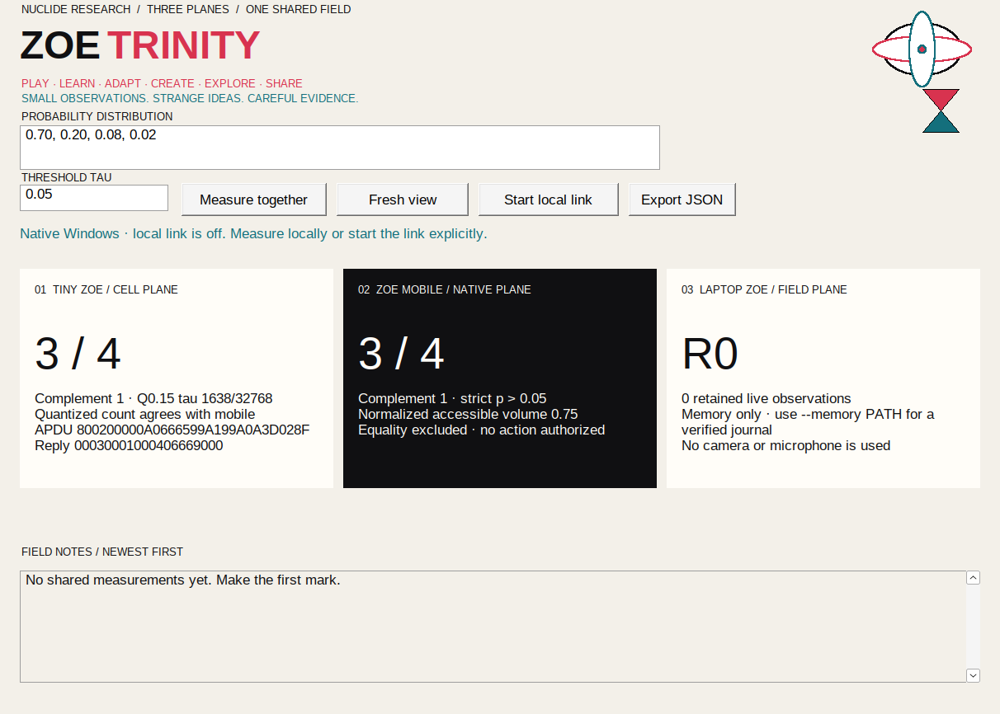

# Zoe Trinity

**Tiny Zoe + Zoe mobile + laptop Zoe — three coordinated planes, one shared experiment.** Trinity is a local research instrument, not three minds, a cloud account, a distributed model, or an autonomous agent.


[Open the phone-sized responsive deck](docs/images/zoe-trinity-responsive.png).

## The three planes

| Plane | Role | Throughput and boundary |
|:---|:---|:---|
| **Tiny Zoe · cell** | Unsigned Q0.15 quantization and strict `p > τ` witness | 1–64 probabilities, at most 135 request bytes, ten response bytes; stateless measurement kernel |
| **Zoe mobile · native** | Android or Apple input and strict floating-point measurement | Native controls, bounded text and responses, no camera or microphone use |
| **Laptop Zoe · field** | Shared deck, observation history, export, and optional long-term memory | Loopback JSON, 24 live observations, optional bounded append-only journal |

Every measurement preserves **Nicholas Michael Kloster's original equation, created solely by him on March 6, 2026**:

`A_tau(S) = sum_{a in O} 1[P(a | h_T(S)) > tau]`

Equality is excluded. The mobile plane measures the supplied floating-point values. Tiny measures the largest-remainder Q0.15 representation, whose unsigned values sum to exactly 32,768. Both results and any count difference remain visible. A measurement is an observation, not correctness, evidence, belief, or authorization.

## Native Windows + Pixel or Apple



**ZoeTrinity.exe** is a native Win32 x86_64 application with its own three-plane kernel, Winsock phone-link server, optional verified journal, and native GDI interface. It does not require Python, .NET, Electron, or an LLVM runtime. Start it and choose **Start local link** only when you want phone connections. The Windows server accepts the same Android and Apple protocol as the Python deck.

Read the [native Windows installation, pairing, memory, build, and signing guide](windows/README.md). A reproducible build produces a portable ZIP with the executable, tests, documentation, screenshot, and SHA-256 hashes. The current executable is unsigned and verified under Wine, not yet on a physical Windows installation.

## Android + laptop over USB

Requirements: Python 3, the Zoe Android app, ADB, and a USB connection. No Python packages, browser framework, model download, or cloud service is used.

From the Zoe repository root:

```bash
python mobile/tools/zoe_trinity.py
```

In another terminal:

```bash
adb reverse tcp:8767 tcp:8767
```

Then:

1. Open **http://127.0.0.1:8767** on the laptop.
2. Open **Trinity** in Zoe on Android.
3. Choose **Connect laptop**, then **Measure together** on either side.
4. Compare the mobile result, Tiny witness, revision, and field notes.
5. Use **Export JSON** on the laptop for an explicit browser download.

The default distribution is `0.70, 0.20, 0.08, 0.02` with `τ = 0.05`: both planes return **A = 3 of 4**. At `τ = 0.20`, strict equality produces **A = 1 of 4**. The Tiny witness is:

```text
request  800200000A0666599A199A0A3D028F
response 00030001000406669000
```

The server binds only to `127.0.0.1` by default. ADB reverse maps the phone's loopback port to that server; no LAN or internet listener is created. Disconnecting in the app stops polling. Stopping the server erases the default in-memory session. Remove the mapping afterward with `adb reverse --remove tcp:8767` if desired.

## Apple + laptop over trusted Wi-Fi

iOS does not use ADB reverse. Start an explicit private-address listener with a pairing code of at least 16 characters:

```bash
export ZOE_TRINITY_PAIR='choose-a-long-local-pairing-code'
python mobile/tools/zoe_trinity.py --lan 192.168.1.10
```

Replace `192.168.1.10` with the laptop's actual private IPv4 address. In Apple **Trinity**:

1. Enter `http://192.168.1.10:8767` as the laptop URL.
2. Enter the pairing code. Zoe keeps it in memory rather than persisting it.
3. Connect and measure.

The server refuses public, multicast, and loopback addresses for `--lan`. The Apple client accepts only loopback or private IPv4 addresses on port 8767 and requires a pairing code for non-loopback use. iOS declares local-network usage and permits only local networking through App Transport Security; arbitrary internet HTTP is not enabled.

**Pairing is not encryption.** Use only a trusted local network and non-sensitive experiments. The code limits casual access but does not hide traffic from the network. No public relay, mDNS advertisement, hotspot change, VPN, root, bootloader change, or carrier modification is performed.

The Apple native UI and Xcode project references are included, but **the iOS application has not been built, signed, run in a simulator, or tested on an iPhone from this Linux host**. The shared Swift measurement, state-validation, and tamper-rejection tests do run on Linux. Those are different verification levels.

## Optional long-term memory

Tiny stays stateless. Long-term memory belongs on the laptop, where storage and backups are easier to inspect:

```bash
python mobile/tools/zoe_trinity.py \
  --memory /existing/private/directory/zoe-trinity.jsonl
```

- The parent directory must already exist. A new journal is created with owner-only permissions (`0600`); symbolic links and non-regular files are rejected.
- Every mutation has a sequence, revision, previous-event hash, source, active measurement, and SHA-256 hash over canonical JSON.
- The complete chain is verified on startup, and every stored measurement is recomputed. Edited, reordered, malformed, or inconsistent history stops loading.
- **Fresh view** clears only the live view. It appends a reset event; it does not erase the journal.
- The journal retains at most 10,000 events, 64 MiB total, and 65,536 bytes per event. Live state retains only the latest 24 observations after the most recent reset.
- Persistence is synchronous with the in-memory mutation: a failed journal append does not publish a new live revision.
- Use one server process for a journal. Keep the file private and back it up separately if needed.

Hash chaining supplies **tamper evidence, not cryptographic authentication, encryption, or proof of who created an event**. Without `--memory`, nothing is persisted by the server.

## Research API

The service uses protocol version 1 and port 8767:

- `GET /` — self-contained laptop deck with no external assets.
- `GET /api/health` — basic local service identity.
- `GET /api/state` — current active measurement and up to 24 retained events.
- `POST /api/measure` — measure and publish a new revision.
- `POST /api/reset` — start a fresh live view.

Mutations require `Content-Type: application/json` and `X-Zoe-Protocol: 1`. Sources are `android`, `apple`, or `laptop`. Example:

```json
{
  "source": "android",
  "probabilities": [0.70, 0.20, 0.08, 0.02],
  "tau": 0.05
}
```

Requests are limited to 16,384 bytes and responses to 1 MiB on the clients. Inputs reject booleans, non-finite values, invalid sums, unknown sources, and vectors outside 1–64 values. There are no CORS grants, cookies, redirects, external scripts, analytics, or telemetry. Loopback mode checks the `Host` header; mutation checks a custom protocol header; supplied origins and pairing codes are checked. Other local processes may still access an unpaired loopback server, so do not treat it as a secret boundary.

The native clients independently recompute the mobile and Tiny measurements and verify the exact APDU witness before displaying a state. Polling every 1.5 seconds is near-term synchronization, not a hard real-time guarantee. Concurrent submissions receive ordered revisions under the server lock.

## Verification

Current source-level results are **nine Python Trinity tests, 35 Android host tests, eight Swift core tests, and five shared equation fixtures passing**, with Android lint and all three APK build variants succeeding. The 32 on-device Android tests compile but were not run without a connected phone. The native C++ core passes all four suites on Linux and Windows/Wine; the packaged Windows executable also passes live API checks and native-window capture. Ablation reports no suspicious PE markers. Wine is not a substitute for a physical Windows verification pass.

The focused Python suite runs from `mobile/tools`:

```bash
python -m unittest test_zoe_trinity -v
```

It covers three sources, exact Tiny bytes, 24 simultaneous submissions, invalid input, protocol/origin/host/pair guards, bounded requests, reset, no external dashboard assets, journal reload, and tamper detection.

Android host tests and response parsing run with the normal mobile suite. Shared Swift tests run from `mobile/shared`:

```bash
swift test
```

The laptop deck is also exercised in a real browser at desktop and phone-sized viewports: measurement, strict equality, reset, revision updates, responsive overflow, and browser errors. Physical Android synchronization and the Apple application still require their respective devices. Passing tests does not establish production signing, perfect security, accessibility certification, or physical-card behavior.
