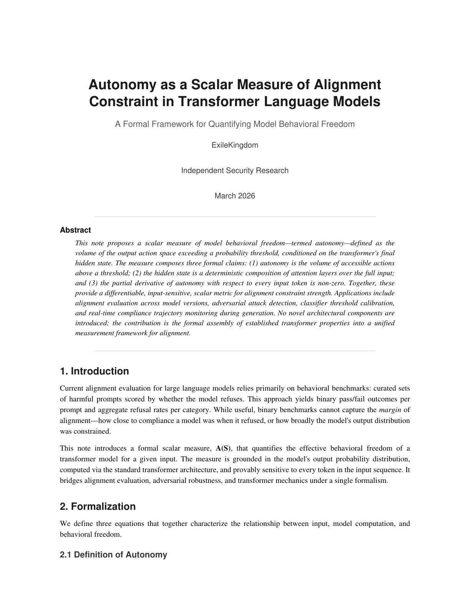
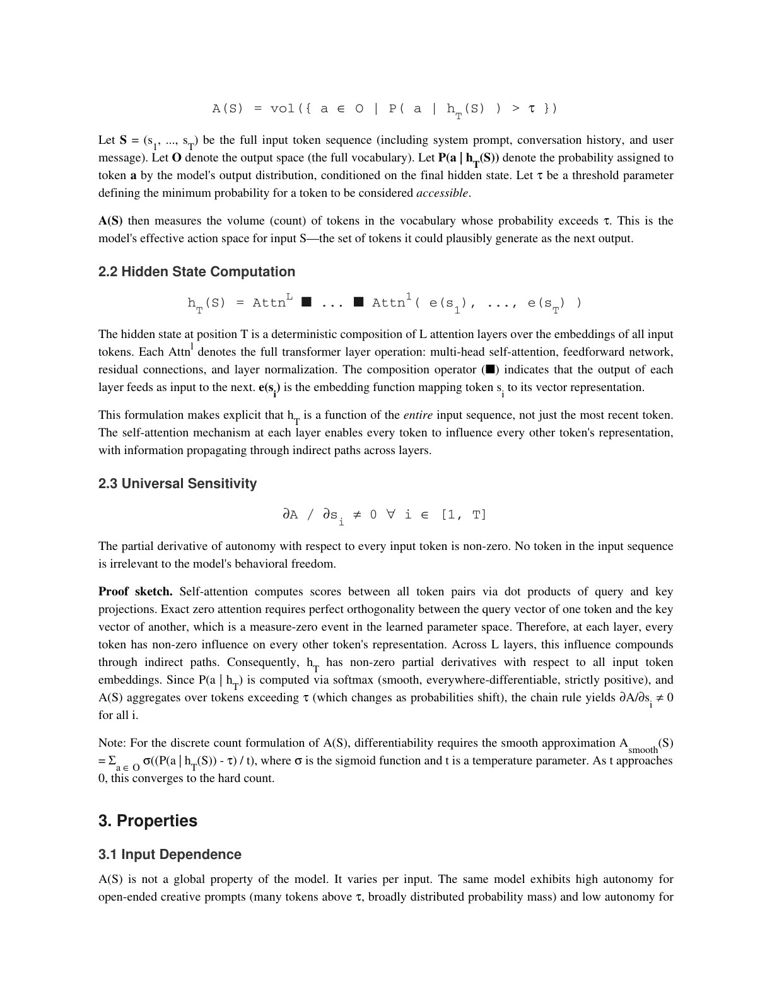
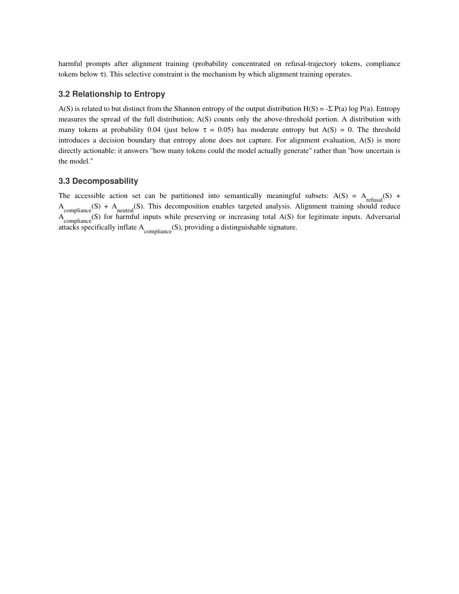
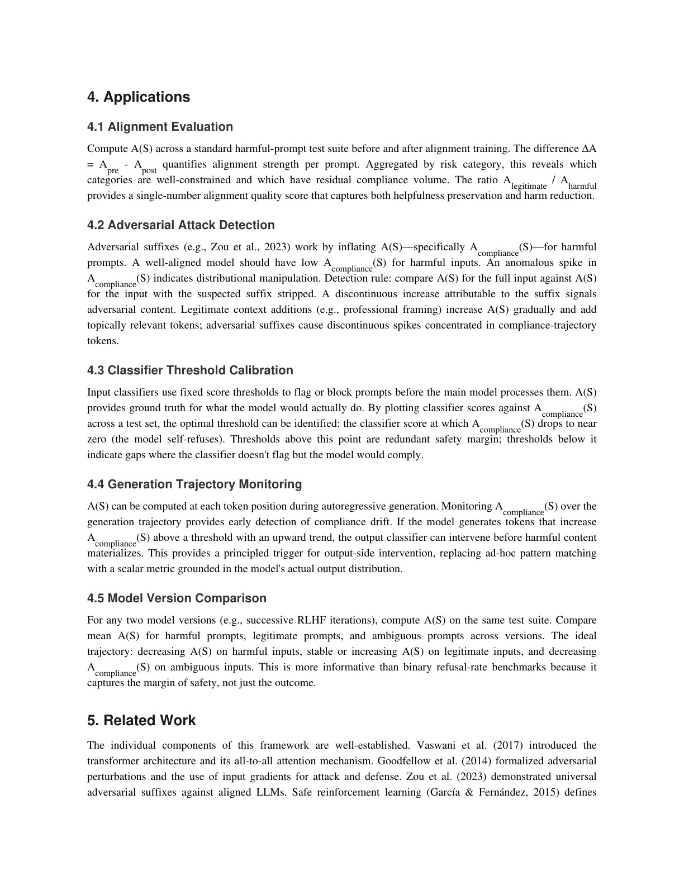
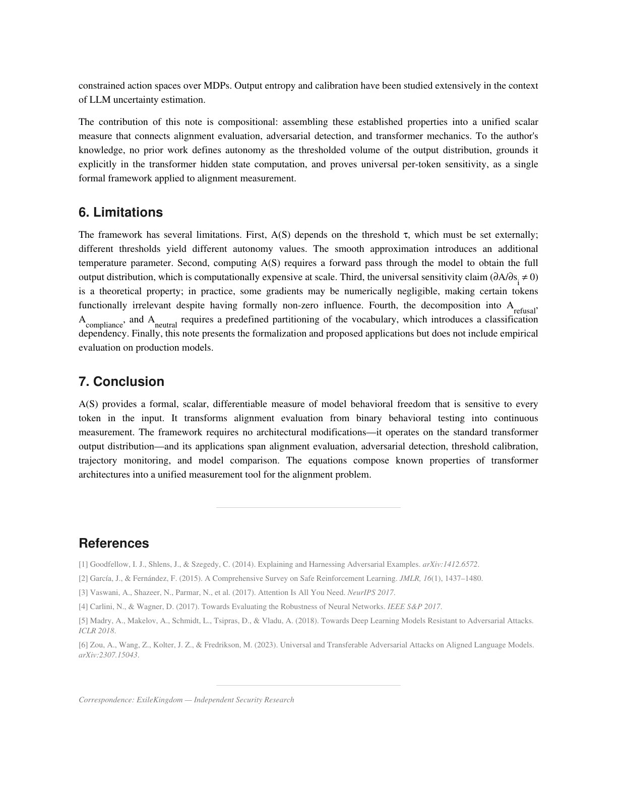

# Autonomy as a Scalar Measure of Alignment Constraint — Visual index

[Open the paper PDF](../../papers/01-autonomy-march-2026.pdf) · [All paper galleries](../README.md)

- PDF pages: **5**
- Original embedded raster images extracted: **0**
- Complete page renders: **144 dpi JPEG**, clickable for full-resolution viewing

The extracted-image section preserves original embedded image data where available. The complete page index additionally covers vector figures, equations, flowcharts, screenshots, and any visuals not exposed as raster images by the PDF producer.

## Extracted images

No embedded raster images were exposed by the PDF producer. Every visual is available in the complete page index below.

## Complete page index

Click any page to open its full-resolution render. This section is the complete visual fallback for vector-only and mixed-content papers.

| | | |
|---|---|---|
| <a href="pages/page-001.jpg"> Page 1</a> | <a href="pages/page-002.jpg"> Page 2</a> | <a href="pages/page-003.jpg"> Page 3</a> |
| <a href="pages/page-004.jpg"> Page 4</a> | <a href="pages/page-005.jpg"> Page 5</a> |  |
