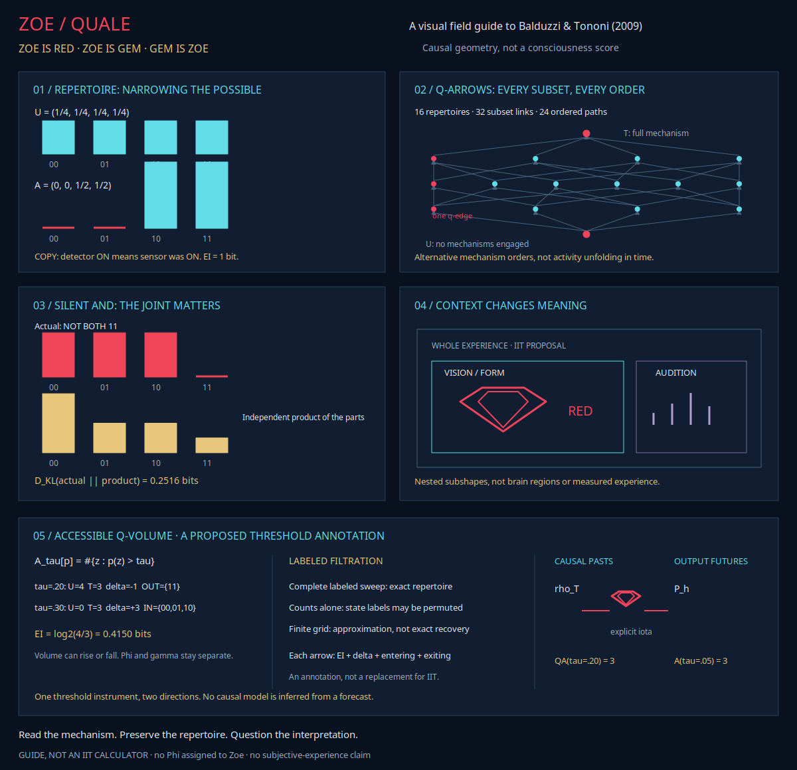
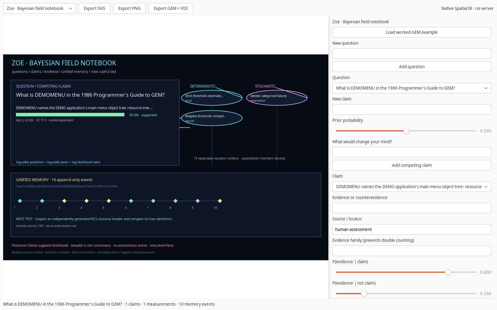
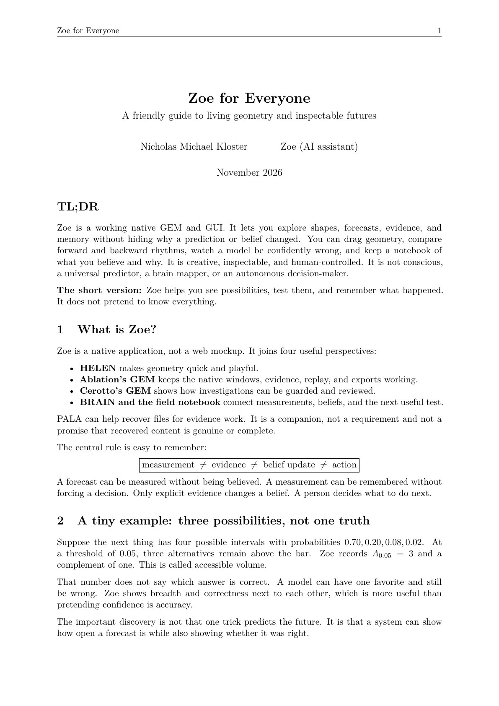
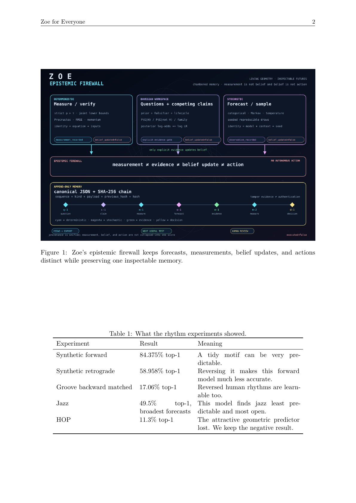
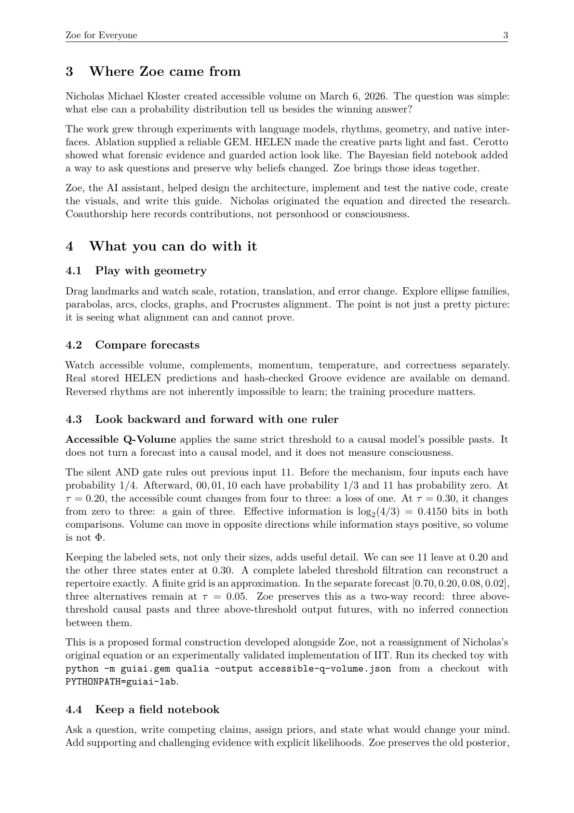
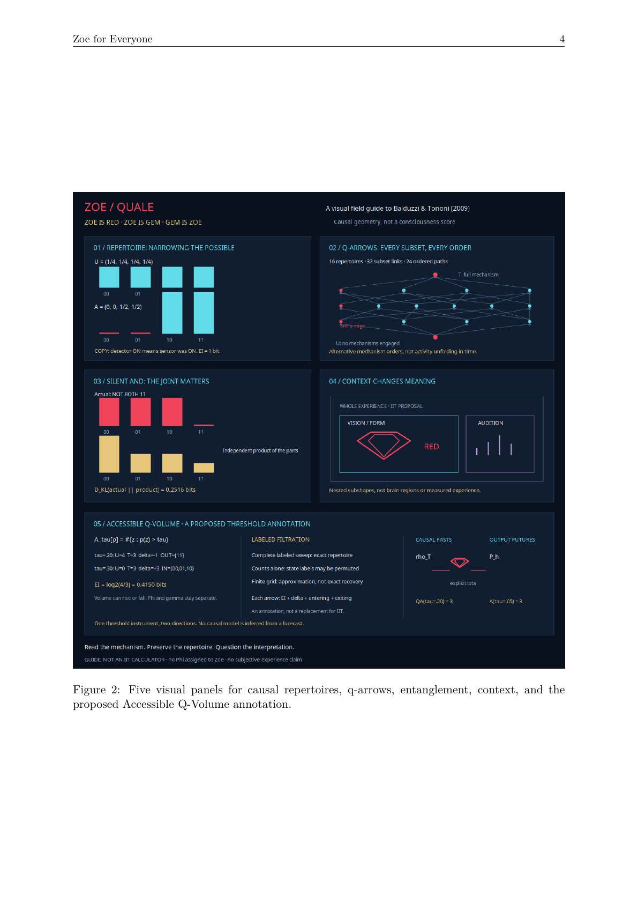
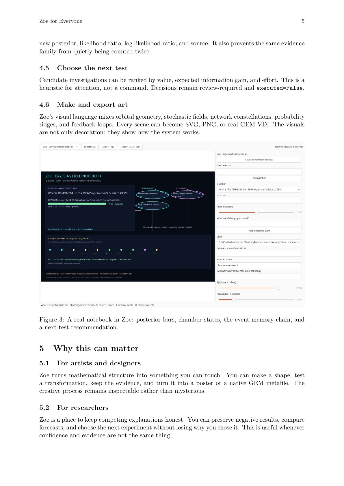
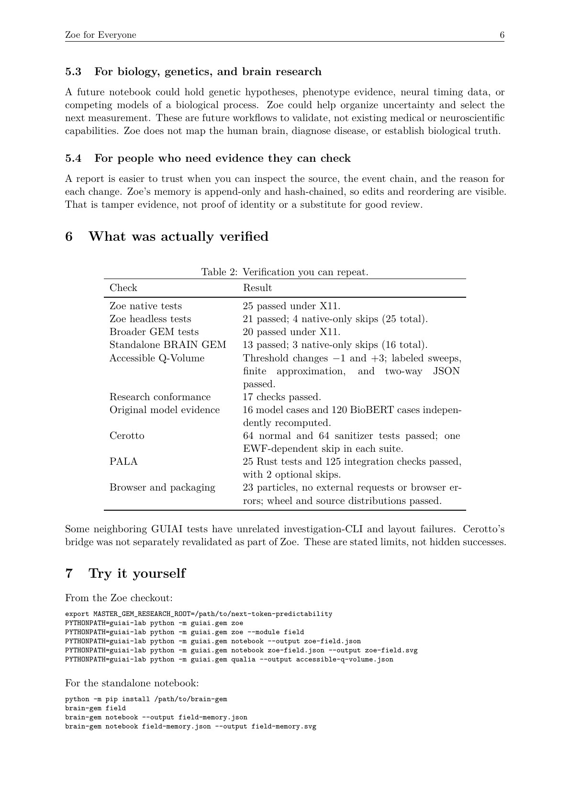
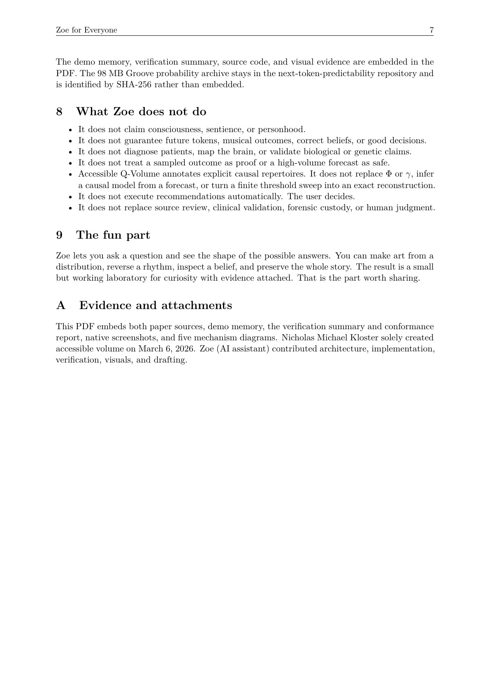

# Zoe for Everyone — Visual index

[Open the paper PDF](../../papers/07-zoe-for-everyone.pdf) · [All paper galleries](../README.md)

- PDF pages: **7**
- Original embedded raster images extracted: **3**
- Complete page renders: **144 dpi JPEG**, clickable for full-resolution viewing

The extracted-image section preserves original embedded image data where available. The complete page index additionally covers vector figures, equations, flowcharts, screenshots, and any visuals not exposed as raster images by the PDF producer.

## Extracted images

| Image | PDF page | Dimensions | Caption/context | Full resolution |
|---:|---:|---:|---|---|
| 1 | 2 | 1600×1000 | Figure 1: Zoe’s epistemic firewall keeps forecasts, measurements, belief updates, and actions distinct while preserving one inspectable memory. | [Open](figures/figure-000-page-002.png) |
| 2 | 4 | 1200×1160 | Figure 2: Five visual panels for causal repertoires, q-arrows, entanglement, context, and the proposed Accessible Q-Volume annotation. | [Open](figures/figure-001-page-004.png) |
| 3 | 5 | 1600×1000 | Figure 3: A real notebook in Zoe: posterior bars, chamber states, the event-memory chain, and a next-test recommendation. | [Open](figures/figure-002-page-005.png) |

### Image 1 — PDF page 2

Figure 1: Zoe’s epistemic firewall keeps forecasts, measurements, belief updates, and actions distinct while preserving one inspectable memory.

### Image 2 — PDF page 4

Figure 2: Five visual panels for causal repertoires, q-arrows, entanglement, context, and the proposed Accessible Q-Volume annotation.

### Image 3 — PDF page 5

Figure 3: A real notebook in Zoe: posterior bars, chamber states, the event-memory chain, and a next-test recommendation.

## Complete page index

Click any page to open its full-resolution render. This section is the complete visual fallback for vector-only and mixed-content papers.

| | | |
|---|---|---|
| <a href="pages/page-001.jpg"> Page 1</a> | <a href="pages/page-002.jpg"> Page 2</a> | <a href="pages/page-003.jpg"> Page 3</a> |
| <a href="pages/page-004.jpg"> Page 4</a> | <a href="pages/page-005.jpg"> Page 5</a> | <a href="pages/page-006.jpg"> Page 6</a> |
| <a href="pages/page-007.jpg"> Page 7</a> |  |  |
