# CERN research in Zoe — Visual research index

[All galleries](../README.md) · [Zoe research library](../../zoe-research/README.md)

[CERN research guide](../../zoe-research/cern/README.md). HELIOS, Atelier, Evidence Navigator, waveform and protocol models, Patchbay, Resilience, timing, and source-linked research universes. No image implies live hardware access or detector health.

**21 directly viewable images.** Click any image to open its original file.

## 1. Cern universe

`assets/neurogarden/cern-universe.png`

<a href="../../zoe-research/assets/neurogarden/cern-universe.png">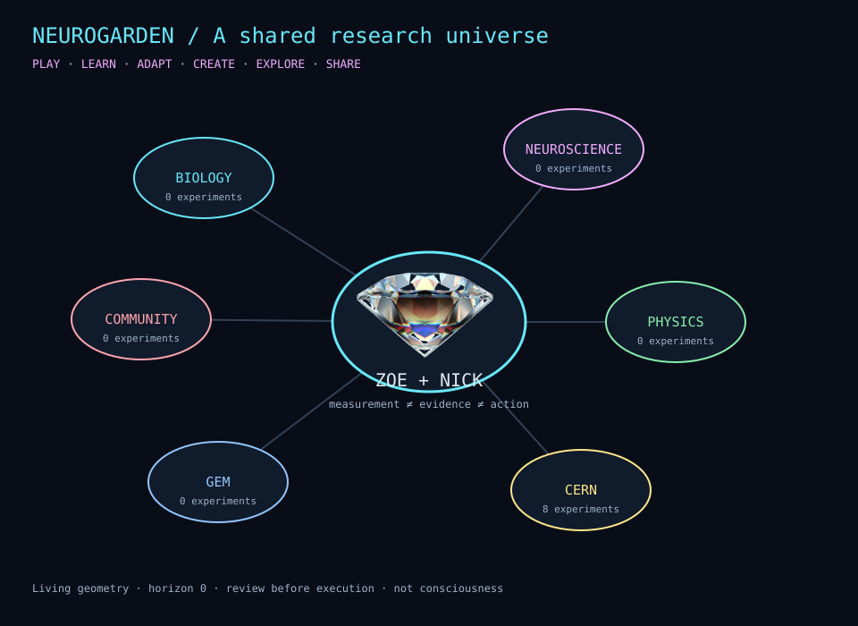</a>

## 2. Zoe helios

`assets/native/zoe-helios.png`

## 3. Zoe atelier

`assets/native/zoe-atelier.png`

<a href="../../zoe-research/assets/native/zoe-atelier.png">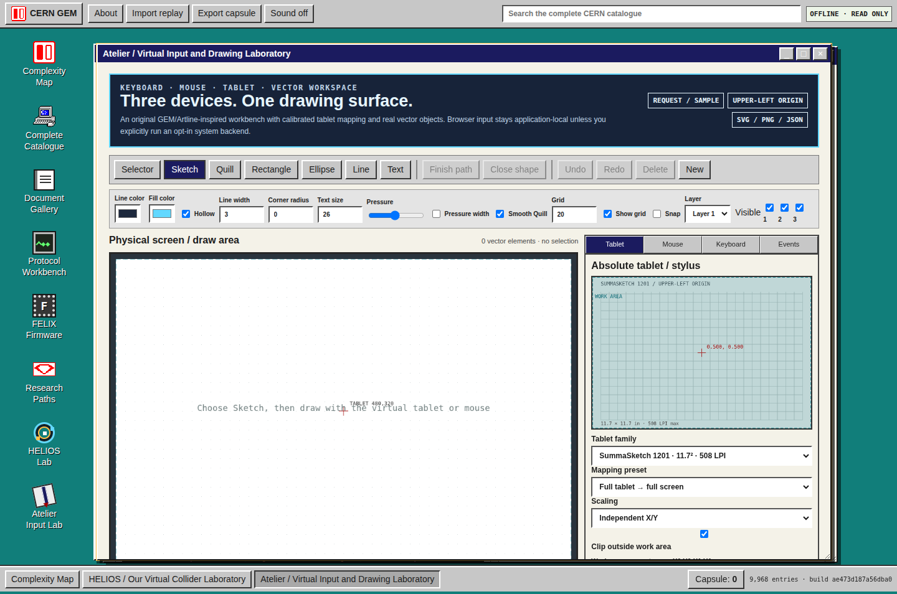</a>

## 4. Zoe evidence

`assets/native/zoe-evidence.png`

<a href="../../zoe-research/assets/native/zoe-evidence.png">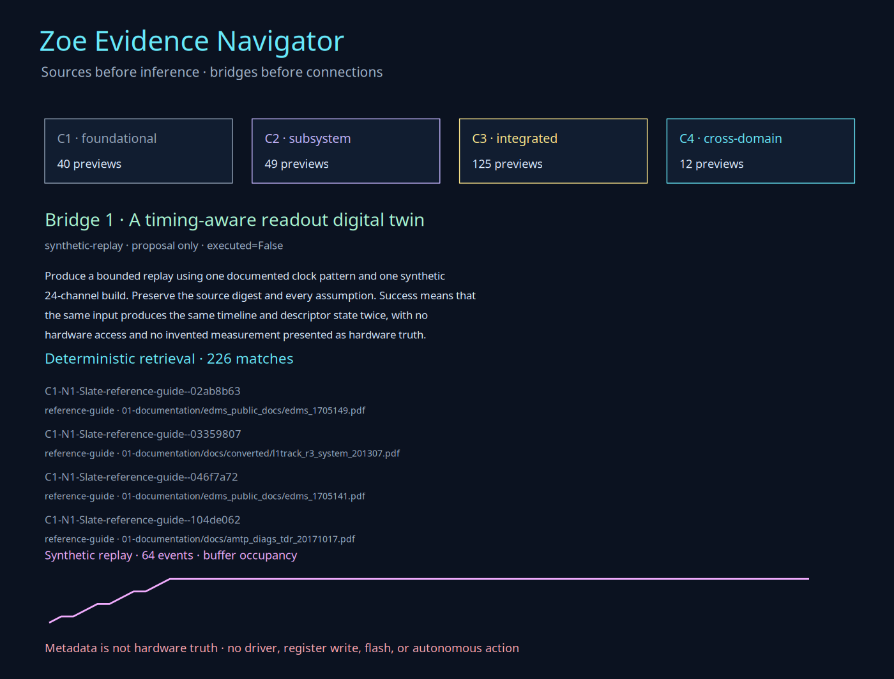</a>

## 5. Zoe evidence native

`assets/native/zoe-evidence-native.png`

<a href="../../zoe-research/assets/native/zoe-evidence-native.png">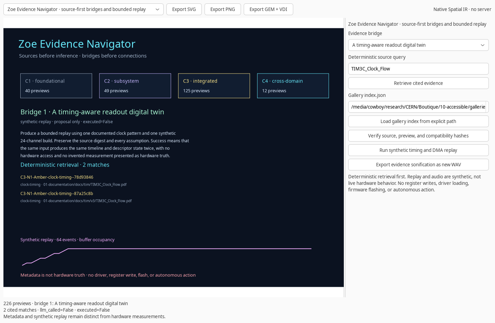</a>

## 6. Zoe waveform

`assets/native/zoe-waveform.png`

<a href="../../zoe-research/assets/native/zoe-waveform.png">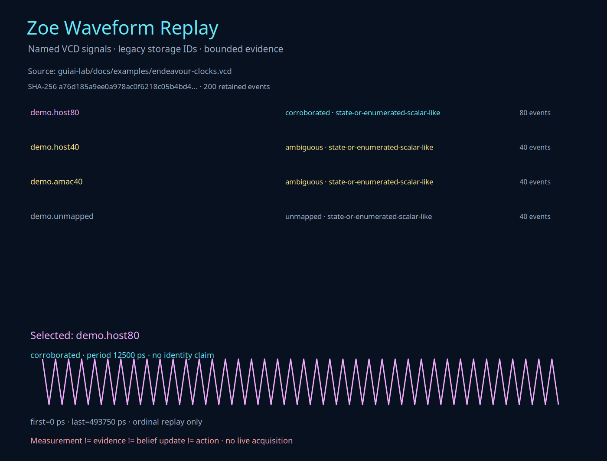</a>

## 7. Zoe waveform native

`assets/native/zoe-waveform-native.png`

## 8. Zoe protocol

`assets/native/zoe-protocol.png`

<a href="../../zoe-research/assets/native/zoe-protocol.png">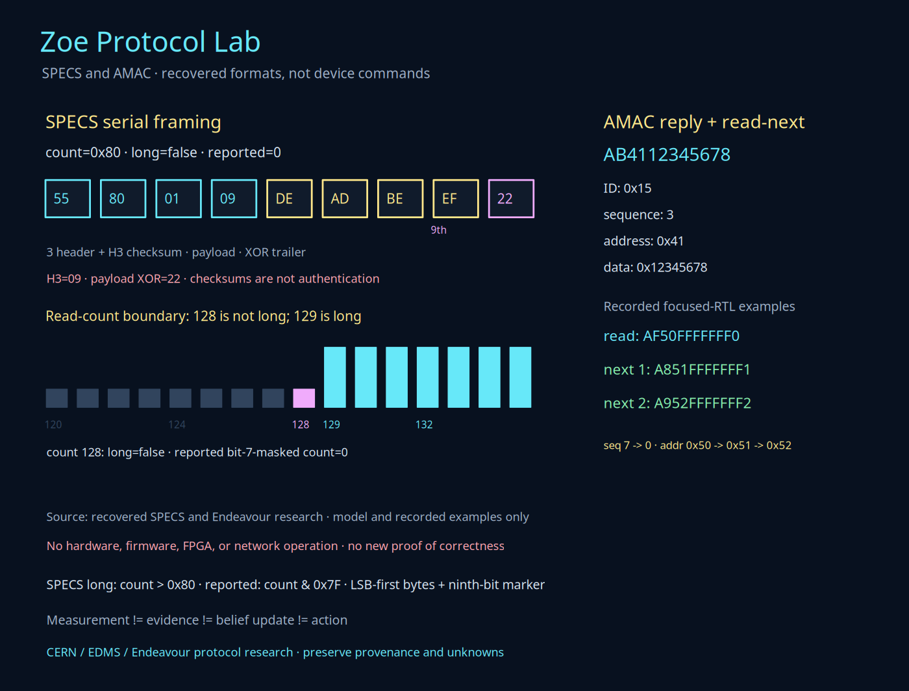</a>

## 9. Zoe protocol native

`assets/native/zoe-protocol-native.png`

<a href="../../zoe-research/assets/native/zoe-protocol-native.png">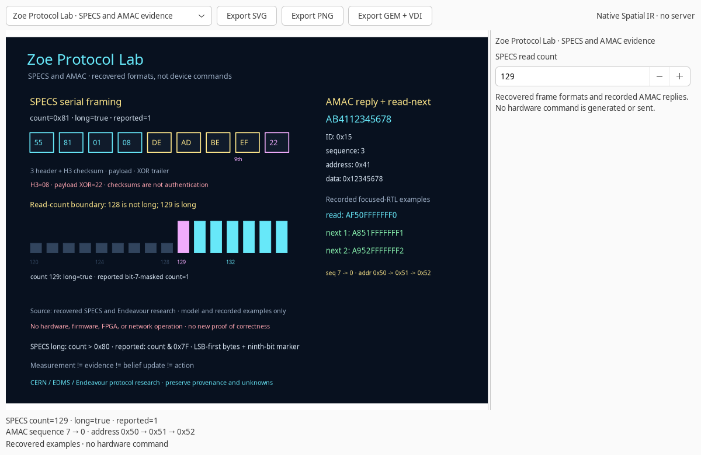</a>

## 10. Zoe patchbay

`assets/native/zoe-patchbay.png`

<a href="../../zoe-research/assets/native/zoe-patchbay.png">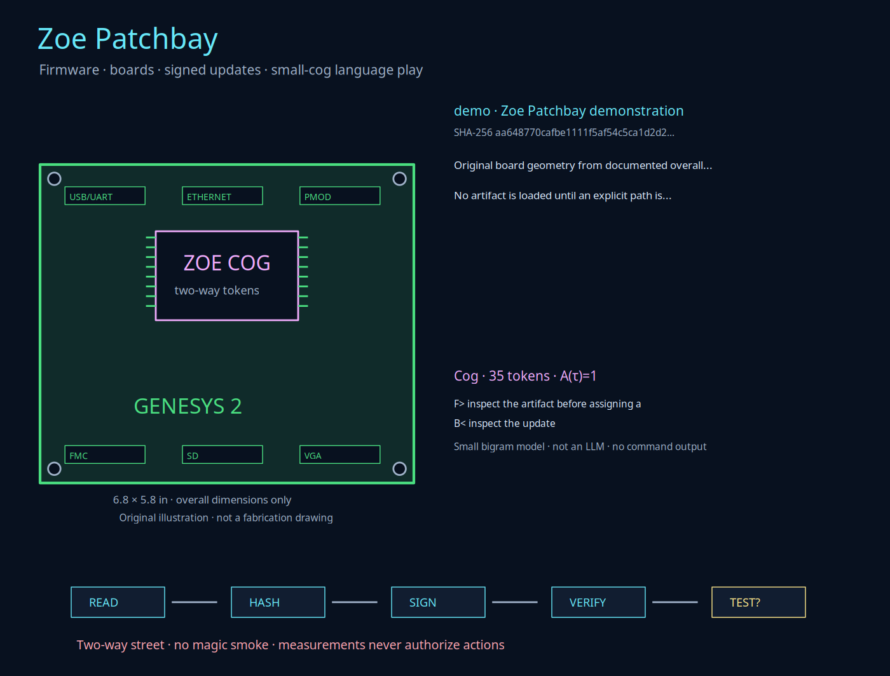</a>

## 11. Zoe patchbay native

`assets/native/zoe-patchbay-native.png`

## 12. Zoe resilience

`assets/native/zoe-resilience.png`

<a href="../../zoe-research/assets/native/zoe-resilience.png">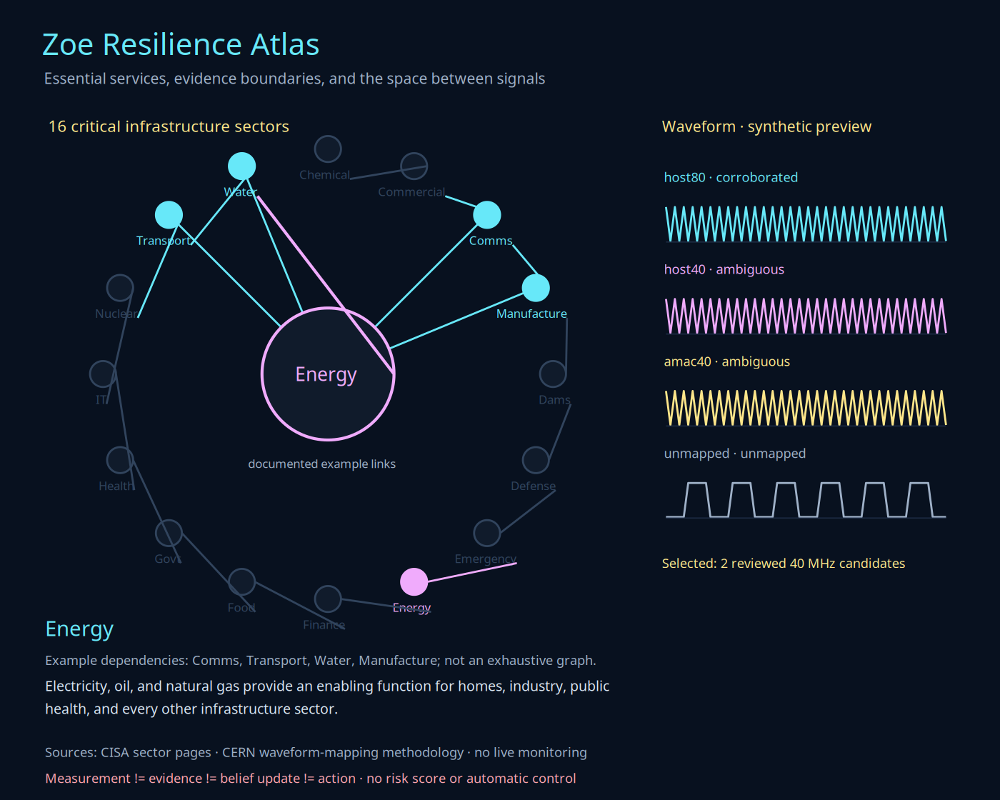</a>

## 13. Zoe resilience native

`assets/native/zoe-resilience-native.png`

<a href="../../zoe-research/assets/native/zoe-resilience-native.png">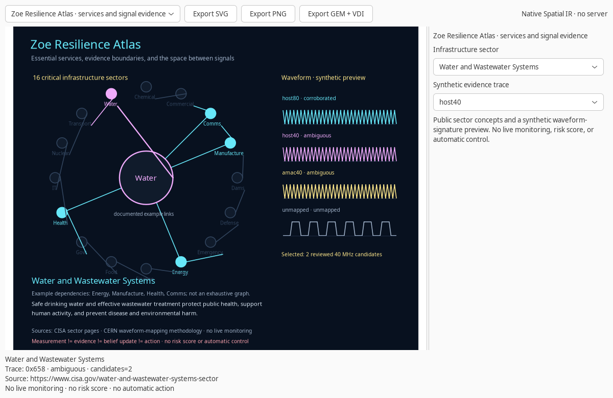</a>

## 14. Zoe vidlib

`assets/native/zoe-vidlib.png`

## 15. Zoe cicada

`assets/native/zoe-cicada.png`

<a href="../../zoe-research/assets/native/zoe-cicada.png">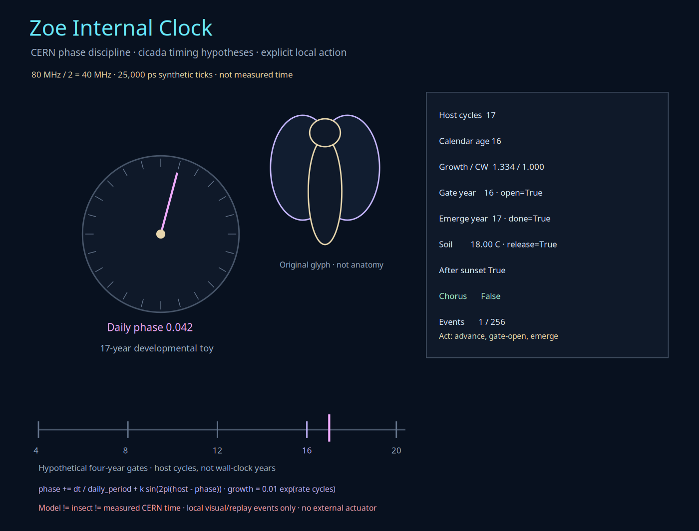</a>

## 16. Zoe cicada native

`assets/native/zoe-cicada-native.png`

## 17. Zoe pilot cover

`assets/native/zoe-pilot-cover.png`

## 18. Zoe pilot native

`assets/native/zoe-pilot-native.png`

<a href="../../zoe-research/assets/native/zoe-pilot-native.png">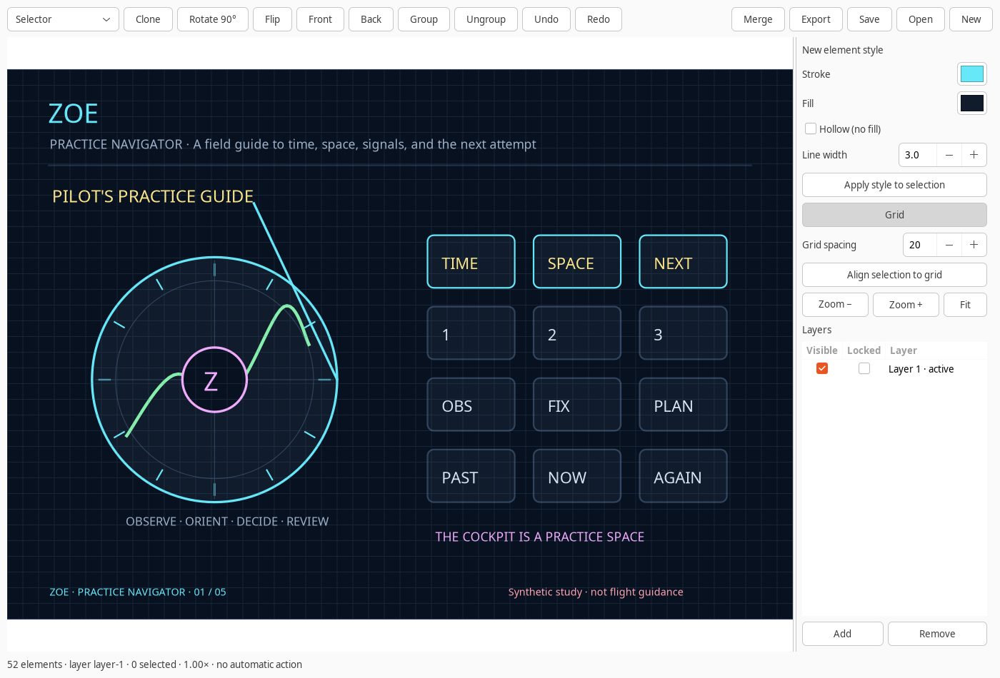</a>

## 19. Zoe pilot practice

`assets/native/zoe-pilot-practice.png`

## 20. Zoe pilot route

`assets/native/zoe-pilot-route.png`

<a href="../../zoe-research/assets/native/zoe-pilot-route.png">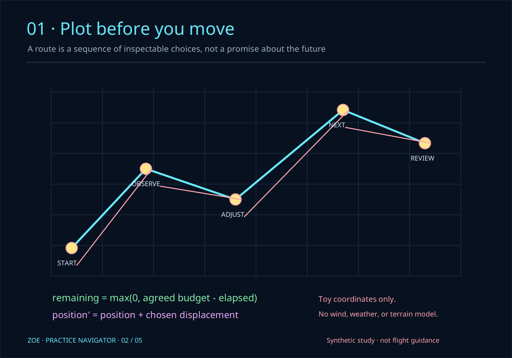</a>

## 21. Zoe pilot signals

`assets/native/zoe-pilot-signals.png`

<a href="../../zoe-research/assets/native/zoe-pilot-signals.png">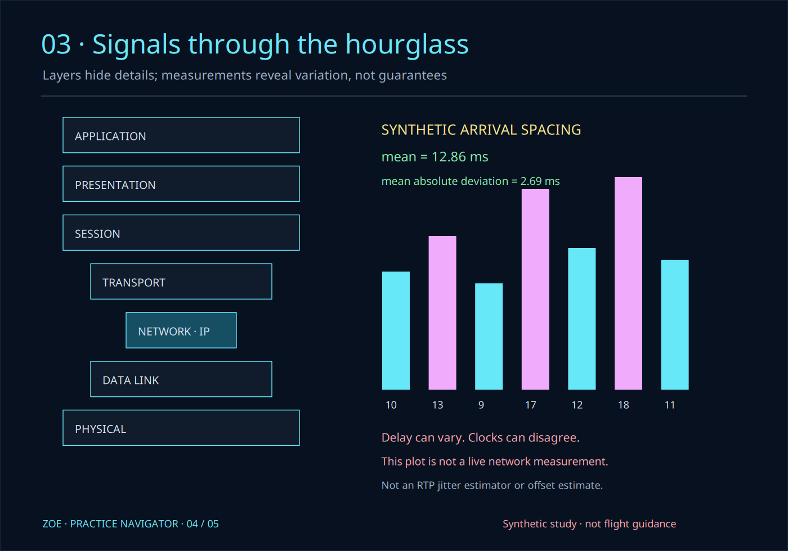</a>
