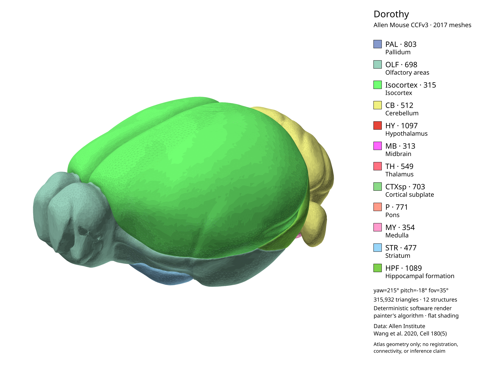
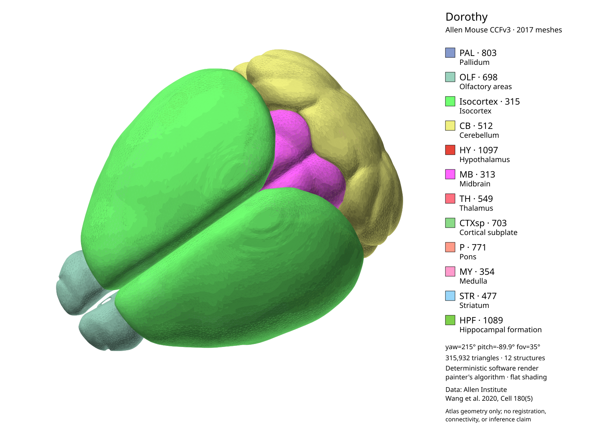
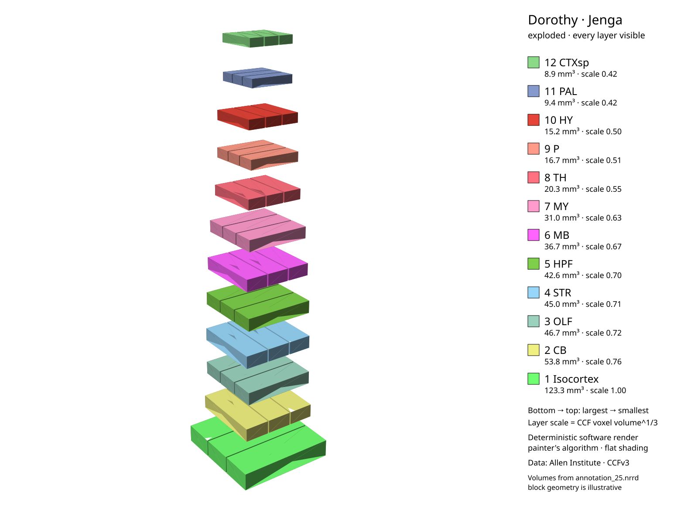
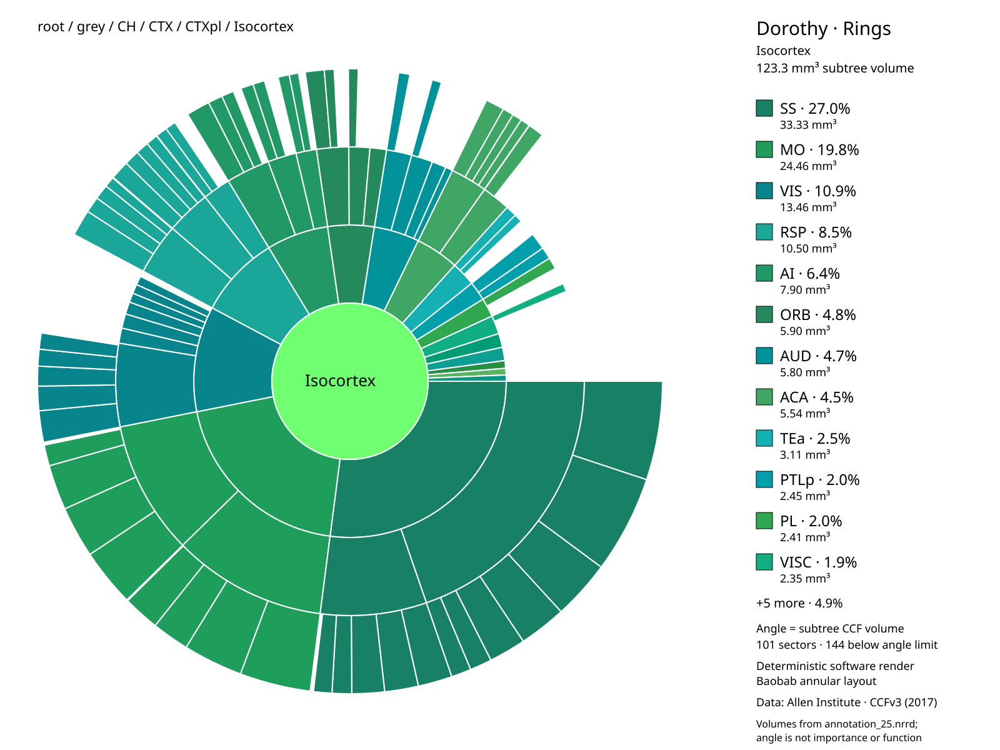
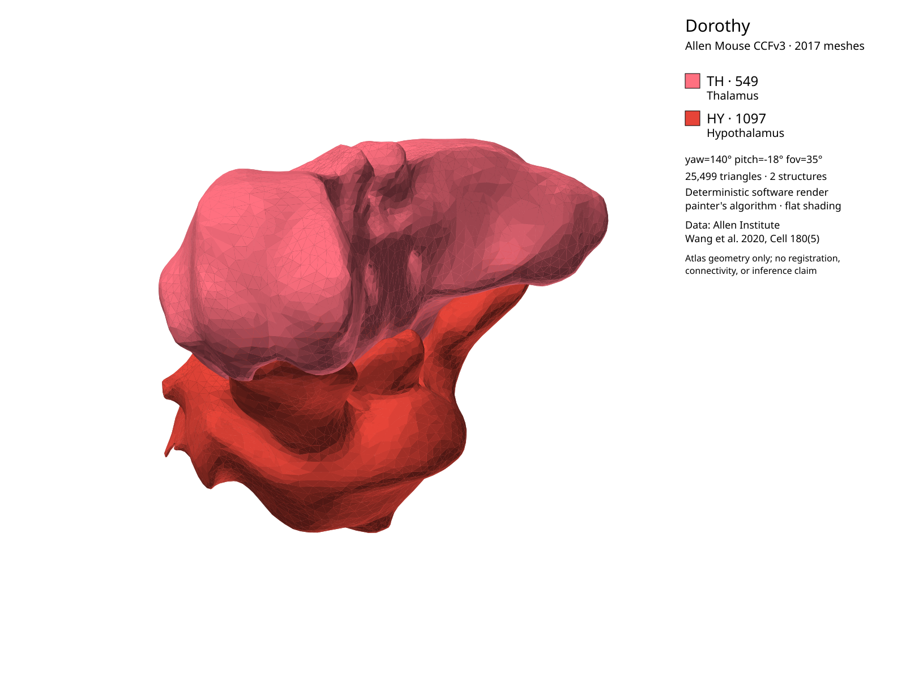
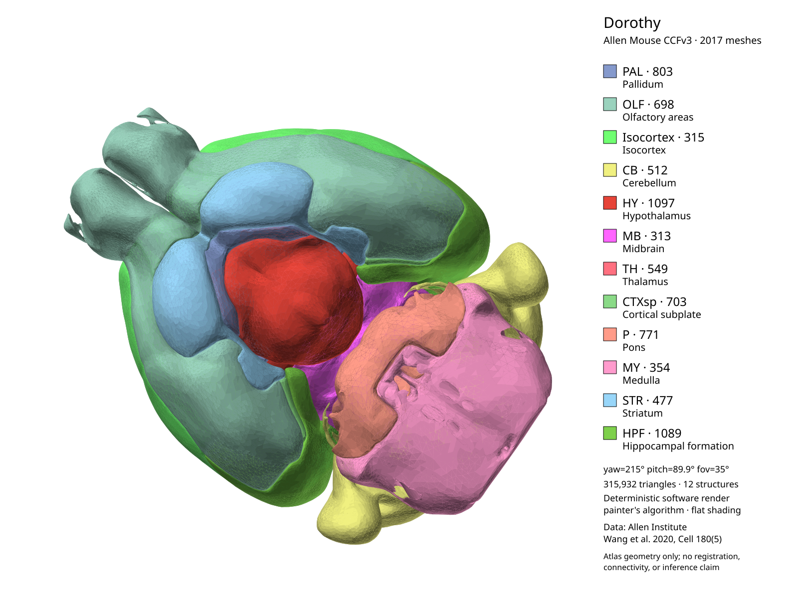
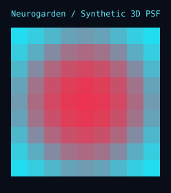
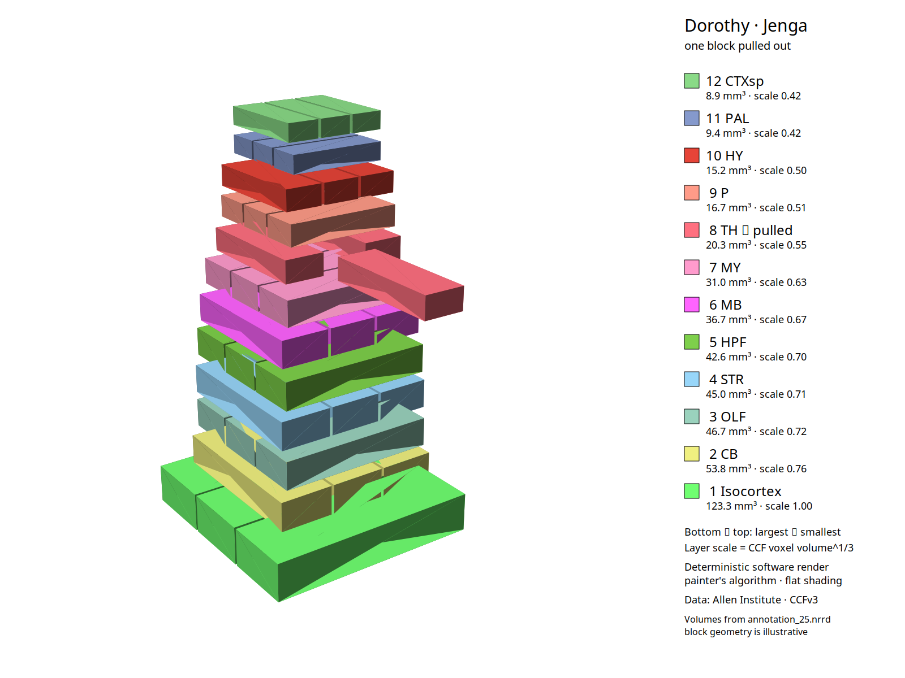

# Dorothy and Neurogarden — Visual research index

[All galleries](../README.md) · [Zoe research library](../../zoe-research/README.md)

[Dorothy research guide](../../zoe-research/dorothy/README.md). Allen Mouse CCFv3 reference geometry, ontology and spatial layouts, and synthetic Neurogarden benches. These are preclinical and educational visuals, not patient images or diagnostic evidence.

**9 directly viewable images.** Click any image to open its original file.

## 1. Dorothy ccf2017

`assets/native/dorothy-ccf2017.png`

## 2. Dorothy dorsal

`assets/native/dorothy-dorsal.png`

## 3. Dorothy jenga exploded

`assets/native/dorothy-jenga-exploded.png`

## 4. Dorothy rings isocortex

`assets/native/dorothy-rings-isocortex.png`

## 5. Dorothy thalamus hypothalamus

`assets/native/dorothy-thalamus-hypothalamus.png`

## 6. Dorothy ventral

`assets/native/dorothy-ventral.png`

## 7. Dorothy neurogarden

`assets/neurogarden/dorothy-neurogarden.png`

## 8. Neurogarden spatial

`assets/neurogarden/neurogarden-spatial.png`

## 9. Dorothy jenga pull

`assets/dorothy/dorothy-jenga-pull.png`

