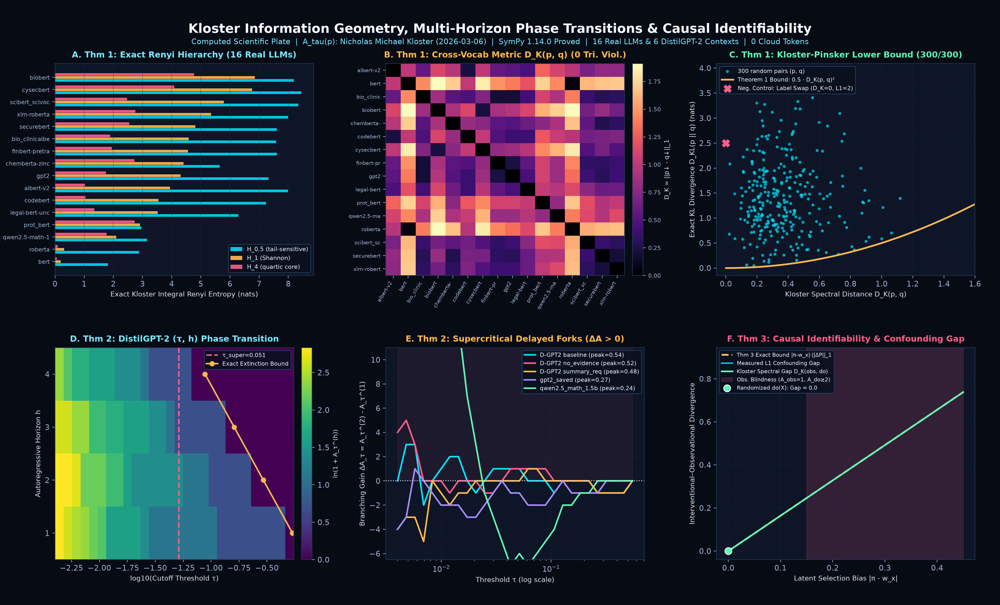

# Kloster Information Geometry, Dynamic Multi-Horizon Phase Transitions & Causal Identifiability

**Equation Origin:** Nicholas Michael Kloster (Operational Metacognition $A_\tau(p)$, March 6, 2026)  
**Compiled PDF Paper:** [`KLOSTER-INFORMATION-GEOMETRY-AND-PHASE-TRANSITIONS.pdf`](./KLOSTER-INFORMATION-GEOMETRY-AND-PHASE-TRANSITIONS.pdf)  
**LaTeX Source:** [`KLOSTER-INFORMATION-GEOMETRY-AND-PHASE-TRANSITIONS.tex`](./KLOSTER-INFORMATION-GEOMETRY-AND-PHASE-TRANSITIONS.tex)  
**Implementation:** [`guiai-lab/guiai/gem/kloster_info_geometry.py`](../../../guiai-lab/guiai/gem/kloster_info_geometry.py)  
**Independent Verifier:** [`scripts/verify_kloster_theory.py`](../../../scripts/verify_kloster_theory.py) (`14/14 PASS`, SHA-256 `8939bf7422acbe59`)  
**Computed Scientific Plate:** [`zoe-kloster-info-geometry.png`](../../../components/agent-logging-system/docs/images/zoe-kloster-info-geometry.png)

---



## 1. Three Original Theorems (SymPy 1.14.0 Proved + Real 16-LLM Verified)

1. **Theorem 1 — Kloster–Rényi–Tsallis Integral Duality & Kloster–Pinsker Inequality:**
   - Exact Lebesgue integral duality for **all real $\alpha > 0, \alpha \neq 1$**:
     $$H_\alpha(p) = \frac{1}{1-\alpha}\ln\!\left(\int_0^1 \alpha \tau^{\alpha-1} A_\tau(p)\,d\tau\right), \quad S_q(p) = \frac{1 - \int_0^1 q\tau^{q-1} A_\tau(p)\,d\tau}{q-1}, \quad I_{\mathrm{Gini}}(p) = \int_0^1 (1 - 2\tau)A_\tau(p)\,d\tau.$$
   - **Vocabulary-Invariant Kloster Spectral Distance:** $D_K(p, q) := \int_0^1 |A_\tau(p) - A_\tau(q)|\,d\tau = \|p^\downarrow - q^\downarrow\|_1$ obeys the **Kloster–Pinsker Lower Bound** $D_{\mathrm{KL}}(p \parallel q) \ge \frac{1}{2} D_K(p, q)^2$ (`300/300` hold, step-integral vs rearrangement max error `2.22e-16`), and induces a strict cross-vocabulary metric across all **16 real saved neural LLMs** (`0` triangle violations across all triples; closest cross-architecture pair: `bert-base-cased` vs `roberta-base` at `0.05102`; farthest: `bert-base-cased` vs `biobert-base-cased-v1.2` at `1.91152`).
   - **Preserved Negative Control:** Pure orthogonal label permutation yields $D_K = 0.0$ despite $L_1 = 2.0$, transparently bounding what permutation-invariant spectral metrics can and cannot detect.

2. **Theorem 2 — Dynamic Multi-Horizon Phase Transitions in the $(\tau, h)$ Plane:**
   - Partitions multi-horizon accessible volume $A_\tau^{(h)}(S)$ into **Supercritical Hidden Branching** ($\tau < \tau_{\mathrm{super}}$, where $A_\tau^{(h+1)} > A_\tau^{(h)}$), **Critical Persistence**, and **Subcritical Extinction** ($\tau \ge \tau_{\mathrm{ext}}(S, h) \le \prod_{t=1}^h \max P_t$).
   - **Real LLM Discovery:** On real `151,936`-token **`Qwen2.5-Math-1.5B`**, supercritical delayed branching reaches a **`6.7×` horizon expansion ratio** ($\tau_{\mathrm{super}} = 0.02065$). On real **`DistilGPT-2`**, removing contextual evidence pushes the dangerous supercritical ceiling **up** from `0.05138` (`baseline`) to **`0.08880`** (`no_evidence`, `2.0×` fork gain).

3. **Theorem 3 — Partial-Observability Causal Identifiability & Confounding Gap Bound:**
   - Proves $D_K(P(Y\mid X=x), P(Y\mid \mathrm{do}(X=x))) \le |\pi - w_x| \cdot \|P(Y\mid X=x, Z=1) - P(Y\mid X=x, Z=0)\|_1$ (`200/200` random SCMs exact to `2.22e-16`), exposing **`13` observational-blindness witnesses** where passive certainty $A_\tau(P(Y\mid X)) = 1$ hides interventional ambiguity $A_\tau(P(Y\mid \mathrm{do}(X))) \ge 2$, while randomized intervention collapses the gap to **`0.0`**. Formally grounds Zoe's constitutional axiom: `measurement != evidence != belief update != action`.

## 2. Independent Reproduction

```bash
cd /media/cowboy/research/zoe-monorepo
python3 scripts/verify_kloster_theory.py
```
