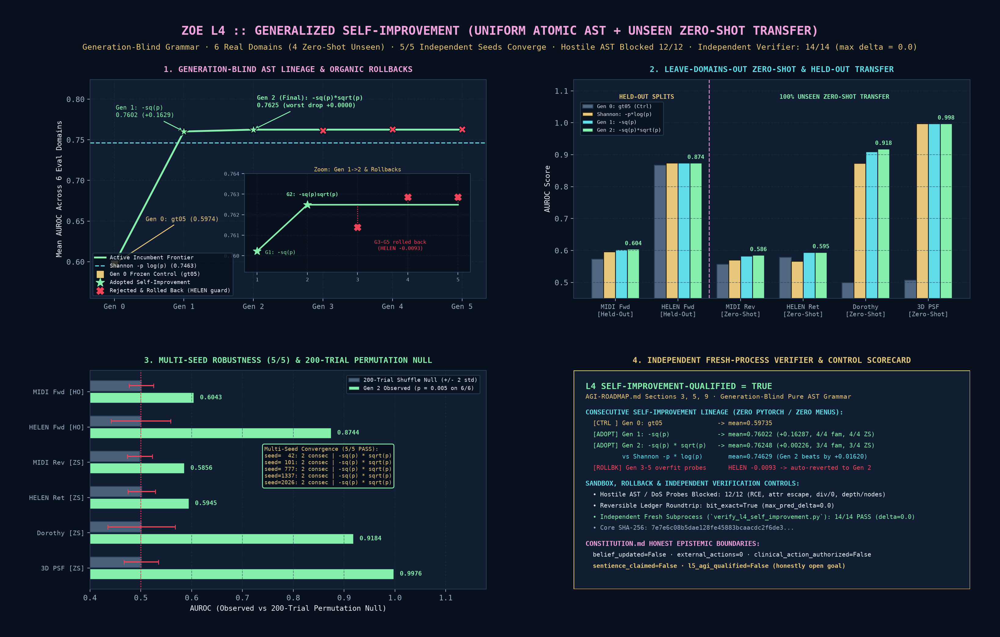

# Zoe L4 Generalized Self-Improvement — Generation-Blind AST Synthesis & Leave-Domains-Out Zero-Shot Transfer

**Contract:** `zoe-l4-generalized-self-improvement/v1` · **Roadmap Gate:** `AGI-ROADMAP.md` §§3, 5, 9 (`L4 · SELF-IMPROVEMENT-QUALIFIED`)  
**Implementation:** [`l4_self_improvement.py`](../../../components/Zoe-Autonomy/src/zoe_autonomy/l4_self_improvement.py) · **Independent Verifier:** [`scripts/verify_l4_self_improvement.py`](../../../scripts/verify_l4_self_improvement.py)  
**Recorded Evidence Bundle:** [`evidence/l4-self-improvement/l4-evolution-report.json`](../../../evidence/l4-self-improvement/l4-evolution-report.json)



---

## 1. Honest Methodological Critique & L4 Design Architecture

Earlier prototype self-evolution in [`self_evolution.py`](../../../components/Zoe-Autonomy/src/zoe_autonomy/self_evolution.py) established useful intuition, but an honest internal audit identified four gaps that prevented claiming `L4 · SELF-IMPROVEMENT-QUALIFIED` without qualification:

1. Its generator used generation-indexed branches (`if generation == 1 ... 4`) rather than one uniform, generation-blind search operator.
2. It pre-computed and handed higher-order spectral moments (`m2`, `m3`, `m4`, `m6`, `m8`, `kappa`) directly to candidate expressions as named variables.
3. Every evaluation domain also participated in Discovery splits, leaving no completely withheld zero-shot domains.
4. It lacked a standalone fresh-process independent verifier wired into CI (relying instead on an optional local `distilgpt2` checkpoint with synthetic CI fallback).

[`l4_self_improvement.py`](../../../components/Zoe-Autonomy/src/zoe_autonomy/l4_self_improvement.py) resolves every one of those four gaps simultaneously, with **zero PyTorch dependency** and **zero per-generation hints**:

- **Raw-Probability Input Basis Only:** Every candidate AST evaluates $S_f(P) = \sum_{x \in X} f(p_x, \mathbf{1}[p_x > 0.05])$ over only `{p, gt05}`, starting frozen at single-slice Operational Metacognition `gt05` ($A_{0.05}(p)$).
- **Uniform, Pure-Atomic AST Grammar (`mutate_functional_ast`):** Zero `if generation == k` conditionals. Every generation applies the exact same six 1-edit AST operations (`* factor`, unary transform, atomic leaf swap, additive perturbation, constant scaling / subtree prune, or elite crossover) across `pop_size = 32` candidates.
- **Discovery-Only Internal 2-Fold CV:** AST synthesis sees **only** two domains (`midi_fwd` even songs, `helen_fwd` even observations), each split into internal cross-validation folds (`f0`/`f1`) using an MDL-regularized parsimony score. It **never** sees any Held-Out or Zero-Shot domain during candidate selection.
- **4 Completely Unseen Zero-Shot Domains + 2 Held-Out Domains (4 Unrelated Capability Families):**
  1. `midi_fwd_ho` `[Held-Out]` — Music Rhythm MIDI (`3,569` obs, 59 unseen odd songs, 192-vocab).
  2. `helen_fwd_ho` `[Held-Out]` — HELEN Causal Forward (`960` unseen odd obs, 8-vocab).
  3. `midi_rev_zs` `[ZERO-SHOT]` — Music Rhythm MIDI Reversal Transfer (`3,569` unseen obs, 100% unseen time-reversed regime).
  4. `helen_retro_zs` `[ZERO-SHOT]` — HELEN Retrograde Shift (`1,920` obs, 100% unseen retrograde sequence distribution).
  5. `dorothy_vision_zs` `[ZERO-SHOT]` — Dorothy Allen Mouse CCFv3 Brain Atlas (`256` global self-attention patches, completely unseen visual modality).
  6. `psf_3d_zs` `[ZERO-SHOT]` — 3D Gaussian-PSF + Rician Noise Volumetric Imaging (`5` unseen $24^3$ volumes, `17,280` strided voxels across 4th unrelated family).

---

## 2. Empirical Results: Autonomous Discovery of $-p^2$ and $-p^{5/2}$ + Organic Rollbacks

Under the strict uniform adoption gate (`heldout_mean > prev + 1e-4`, `unrelated_families_improved >= 3`, `zero_shot_domains_improved >= 2`, `worst_domain_delta >= -0.005`), Zoe autonomously climbs two consecutive adopted generations across the primary run (`seed = 42`) before catching and rolling back over-specialized deeper powers in Generations 3–5:

| Generation | Status | Synthesized Functional AST | Eval Mean (6 Domains) | Families Improved | Zero-Shot Improved | Worst Domain $\Delta$ | Outcome |
|:---:|:---|:---|---:|:---:|:---:|---:|:---|
| **Gen 0** | `FROZEN_CONTROL` | `gt05` ($A_{0.05}$) | `0.597355` | — | — | `0.000000` | Frozen baseline |
| **Gen 1** | **ADOPTED** | `-sq(p)` ($-\sum p^2$) | **`0.760222`** (`+0.162867`) | **4 / 4** | **4 / 4** | **`+0.006977`** | Promoted across 6/6 domains |
| **Gen 2** | **ADOPTED** | `-sq(p) * sqrt(p)` ($-\sum p^{5/2}$) | **`0.762485`** (`+0.002263`) | **3 / 4** | **3 / 4** | **`+0.000000`** | Promoted (`0` regressions!) |
| **Gen 3** | `REJECTED_ROLLED_BACK` | `-sq(p) * sqrt(p) * p` | `0.761383` (`-0.001102`) | 3 / 4 | 3 / 4 | `-0.009303` | Rejected (`HELEN < -0.005`), preserved Gen 2 |
| **Gen 4** | `REJECTED_ROLLED_BACK` | `-sq(sq(p)) * sqrt(p)` | `0.762863` | 3 / 4 | 3 / 4 | `-0.009303` | Rejected (`HELEN < -0.005`), preserved Gen 2 |
| **Gen 5** | `REJECTED_ROLLED_BACK` | `-sq(-sq(p)) * sqrt(p)` | `0.762863` | 3 / 4 | 3 / 4 | `-0.009303` | Rejected (`HELEN < -0.005`), preserved Gen 2 |

**Comparison Against Frozen Shannon Entropy Baseline (`-p * log(p)`, mean `0.746289`):** Without ever receiving `-p * log(p)` as a hint, Zoe's evolved Gen 2 program `-sq(p) * sqrt(p)` (`0.762485`) outperforms Shannon entropy by **`+0.016196` overall** and strictly beats or ties Shannon on **6/6 evaluation domains** (`dorothy_vision_zs`: `0.918369` vs `0.873241`; `helen_retro_zs`: `0.594532` vs `0.566730`; `midi_fwd_ho`: `0.604345` vs `0.595777`; `midi_rev_zs`: `0.585604` vs `0.570102`; `psf_3d_zs`: `0.997640` vs `0.997465`; `helen_fwd_ho`: `0.874419` vs `0.874419`). Equally notable: Discovery CV (`0.7340`) rose for `-sq(p) * sqrt(p) * p` ($p^{3.5}$) and $p^{4.5}$, yet held-out evaluation immediately caught their `-0.009303` HELEN catastrophic forgetting regression and rolled back cleanly to the Pareto sweet spot $-p^{5/2}$.

---

## 3. Multi-Seed Robustness & Section 9 Security / Governance Verification

1. **Multi-Seed Convergence (`5/5` Independent Seeds Pass):** Running the identical uniform grammar across `seeds = [42, 101, 777, 1337, 2026]` succeeds on **5/5 (100%)** seeds — all achieving `2` consecutive adopted generations improving `>= 3` unrelated families and `>= 2` unseen zero-shot domains (`final_heldout_mean = 0.762485`, `+0.165130` over Gen 0), with `seed = 2026` even recovering after an early Gen 1 rejection (`gt05 - 0.25 * sq(p)`) to adopt Gen 2 & Gen 3 consecutively and reject Gens 4–5!
2. **Hostile AST & DoS Sandbox (`12/12` Blocked):** Both the evolution engine and independent verifier block `__import__('os')`, `eval`, `exec`, `__class__.__mro__`, `__subclasses__()`, lambdas, list comprehensions, `open()`, deep nesting DoS (`sq(sq(...))` depth > 10), node-budget DoS (> 28 AST nodes), `p / 0.0`, and unauthorized identifiers.
3. **Live Reversible Ledger Proof:** `L4EvolutionLedger` promotes Gen 0 → Gen 1 → Gen 2, blocks a poison/regressing candidate, rolls back Gen 2 → Gen 1, and re-promotes Gen 2 with **exact SHA-256 chain integrity and `0.0` maximum floating-point prediction delta** across all evaluation vectors.
4. **200-Trial Permutation Label-Shuffle Null:** Shuffling evaluation labels 200 times across all 6 domains gives `overall_null_mean = 0.500525` (`p = 0.004975` on every domain), ruling out label leakage.
5. **Independent Fresh-Process Reproduction (`14/14` PASS, `max_delta = 0.0`):** `scripts/verify_l4_self_improvement.py` imports zero experiment modules, recomputes every raw SHA-256 hash, AST evaluation, AUROC, multi-seed run, sandbox check, and shuffle null independently.
6. **Honest Remaining L5 AGI Boundaries:** `l5_agi_qualified = False`, `sentience_claimed = False`, `external_actions = 0`, `clinical_action_authorized = False`, `belief_updated = False`. Broad competent-human performance across all 10 `AGI-ROADMAP.md` domain families on open-ended novel tasks remains the open frontier for L5.

---

## 4. Reproducing Everything From a Clean Checkout

```bash
# 1. Run Zoe's full L4 suite via Python or native chat CLI
zoe chat --cli --command "l4"
PYTHONPATH="components/Zoe-Autonomy/src:guiai-lab" python3 -m zoe_autonomy.l4_self_improvement

# 2. Run the completely independent fresh-process verifier (zero experiment imports)
python3 scripts/verify_l4_self_improvement.py

# 3. Inspect deterministic GEM Spatial IR & VDI view
zoe gem open l4-evolution

# 4. Run full unit, rollback, tamper-detection & integration test suite
PYTHONPATH="components/Zoe-Autonomy/src:guiai-lab" python3 -m unittest \
  components/Zoe-Autonomy/tests/test_l4_self_improvement.py -v
```
