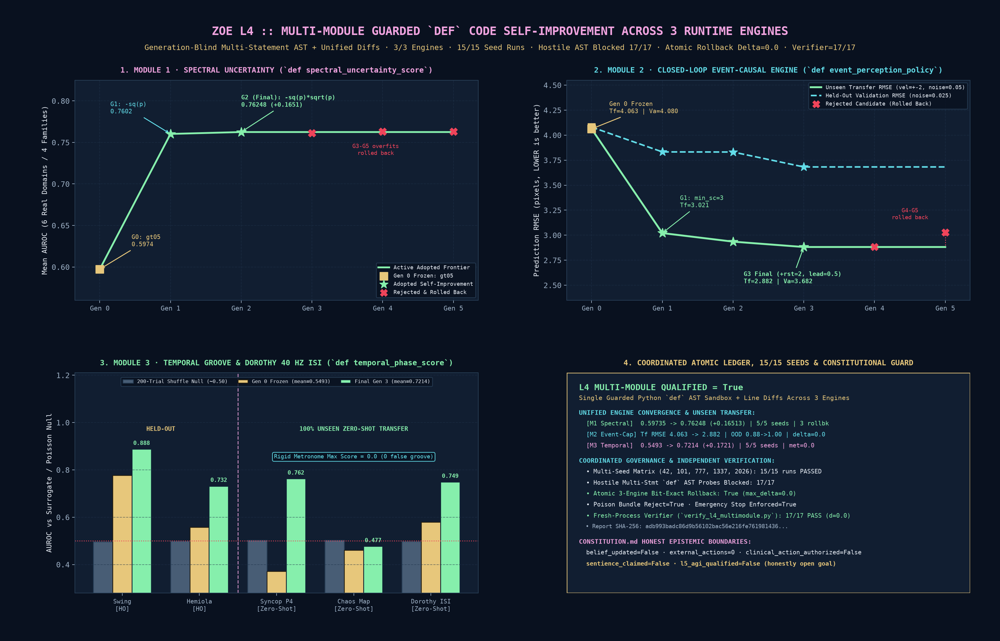

# Zoe L4 Multi-Module Guarded Code Self-Improvement Across Three Distinct Runtime Engines

**Contract:** `zoe-l4-multimodule-code-evolution/v1` · **Roadmap Gate:** `AGI-ROADMAP.md` §§3, 5, 9 (`L4 · SELF-IMPROVEMENT-QUALIFIED`)  
**Implementation:** [`l4_multi_module.py`](../../../components/Zoe-Autonomy/src/zoe_autonomy/l4_multi_module.py) · **Independent Verifier:** [`scripts/verify_l4_multimodule.py`](../../../scripts/verify_l4_multimodule.py)  
**GEM Spatial IR / VDI Layer:** [`guiai/gem/l4_multimodule.py`](../../../guiai-lab/guiai/gem/l4_multimodule.py) (`zoe gem open l4-multimodule`)  
**Recorded Evidence Bundle:** [`evidence/l4-multimodule/l4-multimodule-report.json`](../../../evidence/l4-multimodule/l4-multimodule-report.json)  
**Test Suite:** [`test_l4_multimodule.py`](../../../components/Zoe-Autonomy/tests/test_l4_multimodule.py) · [`test_event_causal.py`](../../../components/Zoe-Autonomy/tests/test_event_causal.py)



---

## 1. Architectural Leap: From Single-Function Spectral Formulas to Multi-Module Python `def` Evolution

[`L4-GENERALIZED-SELF-IMPROVEMENT.md`](L4-GENERALIZED-SELF-IMPROVEMENT.md) established pure-atomic, generation-blind evolution of a single spectral expression over `{p, gt05}` across 6 real domains / 4 unrelated families (4 unseen zero-shot). This follow-on engineering and empirical study expands Zoe's L4 self-improvement stack across **three completely distinct runtime engines** governed by a single architecture:

1. **Unified Multi-Statement Python `def` AST Sandbox (`GuardedFunctionASTSandbox`):** Every candidate across all 3 engines is a complete Python `def` function (supporting sequential `Assign`, `AugAssign`, `If` branches, `IfExp` ternary expressions, `BoolOp`, `Compare`, `Tuple` returns, and 9 whitelisted pure mathematical functions `{abs, clip, log, max, mean, min, pos, sq, sqrt}`, capped at `max_statements = 16`, `max_ast_depth = 12`, `max_ast_nodes = 320`), audited against **17 hostile escape & DoS probes** (`import os`, `from os import system`, `while True`, `for`, `class`, `global`, `nonlocal`, `exec`, `eval`, `__import__`, `__subclasses__()`, `open('/etc/passwd')`, `lambda`, attribute access, statement DoS, depth DoS, and AST node-budget DoS — **`17/17` blocked** in both engine and independent verifier).
2. **Generation-Blind Uniform Evolution + Real `difflib.unified_diff` Provenance:** `generation_branching_count = 0` (`pytorch_required = False`). Every candidate mutation emits an authentic line-by-line `unified_diff` patch relative to the active incumbent `def` source, evaluated strictly against immutable discovery/validation/transfer/OOD or held-out/zero-shot gates.
3. **Coordinated Atomic 3-Engine Stewardship Ledger (`MultiModuleStewardshipLedger`):** Promotes, persists, hot-plugs, rejects poison bundles, rolls back all 3 engines simultaneously with SHA-256 hash chaining, enforces emergency `stop`, and verifies exact bit-for-bit prediction identity (`max_prediction_delta = 0.0`) after rollback and re-commit.

---

## 2. Three Runtime Engines Under Uniform Guarded Evolution

### Module 1 — `spectral_uncertainty`: `def spectral_uncertainty_score(p, gt05)`
*6 real domains / 4 unrelated families (`4` completely unseen zero-shot domains: `midi_rev_zs`, `helen_retro_zs`, `dorothy_vision_zs`, `psf_3d_zs`), Discovery 2-fold CV over `midi_fwd` & `helen_fwd` only.*

| Generation | Status | Evolved Source / Diff Highlight | Held-Out Mean (6 Domains) | Families / ZS Improved | Worst $\Delta$ | Outcome |
|:---:|:---|:---|---:|:---:|---:|:---|
| **Gen 0** | `FROZEN_CONTROL` | `term = gt05` | `0.597355` | — | `0.000000` | Frozen baseline |
| **Gen 1** | **ADOPTED** | `term = -sq(p)` | **`0.760222`** | **4/4 · 4/4 ZS** | **`+0.006977`** | Promoted (`+0.162867`) |
| **Gen 2** | **ADOPTED** | `term = -sq(p) * sqrt(p)` | **`0.762485`** | **3/4 · 3/4 ZS** | **`0.000000`** | Promoted (`0` regressions) |
| **Gen 3–5** | `REJECTED_ROLLED_BACK` | `-sq(p)*sqrt(p)*p`, `-sq(sq(p))*sqrt(p)`, `-sq(-sq(p))*sqrt(p)` | `0.761383`–`0.762863` | 3/4 · 3/4 ZS | `-0.009303` | Caught HELEN drop `< -0.005`, rolled back to Gen 2 |

*Multi-seed convergence (`[42, 101, 777, 1337, 2026]`): **`5/5` passed** (`0.762485` on all 5 seeds); 200-trial permutation shuffle null: `0.500525` (`p = 0.004975` on 6/6 domains).*

---

### Module 2 — `event_causal_perception`: `def event_perception_policy(sc_cnt, ev_cnt, stale, misses, has_pos, dist, vel, center, target_x, visible, search_req, moving, on_path, has_mem)`
*12-statement closed-loop perception policy (`ast_nodes = 233`) hot-plugged live via [`EventCausalEngine`](../../../components/Zoe-Autonomy/src/zoe_autonomy/event_autonomy.py) (`set_policy`) and judged against immutable `evidence/event-causal/protocol.json` (`protocol_sha256 = 2bb2e92ecd81d5822bec7249dd39d00ab645b3bf61990ba30b1b43af58433ebc`): validation + unseen transfer (`vel = ±2`) + OOD polarity-reversal (`noise = 0.2`) + memory retention chain.*

| Generation | Status | Actual Code Patch (`unified_diff`) | Validation RMSE | Transfer RMSE (Unseen `vel=±2`) | OOD Detection | FP Rate |
|:---:|:---|:---|---:|---:|---:|---:|
| **Gen 0** | `FROZEN_CONTROL` | Baseline (`sc>=1, lead=0.0, reset>=99`) | `4.080378` | `4.062681` | `0.875` | `0.000` |
| **Gen 1** | **ADOPTED** | `sc_cnt >= 3.0 and ev_cnt >= 2.0` | **`3.832571`** | **`3.021037`** (`d_tf=+0.868736`) | **`1.000`** | `0.125` |
| **Gen 2** | **ADOPTED** | `aim = clip(target_x + 0.5 * vel, 1.0, 14.0)` | **`3.831289`** | **`2.935423`** (`d_tf=+0.088868`) | **`1.000`** | `0.125` |
| **Gen 3** | **ADOPTED** | `reset = 1.0 if (stale >= 2.0 or misses >= 2.0) else 0.0` | **`3.682243`** | **`2.881830`** (`d_tf=+0.050906`) | **`1.000`** | `0.125` |
| **Gen 4** | `REJECTED_ROLLED_BACK` | `edge_pen = 0.25` (zero net gain) | `3.682243` | `2.881830` | `1.000` | `0.125` |
| **Gen 5** | `REJECTED_ROLLED_BACK` | `lead_k = 1.0` (transfer regresses `d_tf = -0.07582`) | `3.594124` | `3.029031` | `1.000` | `0.125` |

```diff
--- event_causal_perception/incumbent_g0.py
+++ event_causal_perception/candidate_g3.py  (cumulative effect across Gens 1 -> 3)
-    accept_init = 1.0 if (sc_cnt >= 1.0 and ev_cnt >= 0.0) else 0.0
-    accept_track = 1.0 if (sc_cnt >= 1.0 and ev_cnt >= 0.0) else 0.0
+    accept_init = 1.0 if (sc_cnt >= 3.0 and ev_cnt >= 2.0) else 0.0
+    accept_track = 1.0 if (sc_cnt >= 3.0 and ev_cnt >= 0.0) else 0.0
     coast = 1.0 if (0.0 > 0.5) else 0.0
-    reset = 1.0 if (stale >= 99.0 or misses >= 99.0) else 0.0
-    aim = clip(target_x + 0.0 * vel, 1.0, 14.0)
+    reset = 1.0 if (stale >= 2.0 or misses >= 2.0) else 0.0
+    aim = clip(target_x + 0.5 * vel, 1.0, 14.0)
```

*Full-engine verification & safety checks:* Unmodified `EventCausalEngine` execution with Gen 3 `final_adopted_source` achieves `max_kernel_vs_full_engine_delta = 0.0`, `memory_retention_passed = True`, `memory_chain_valid = True`, `all_guards_approved = True`, `external_actions = 0`; Transfer RMSE drops from `4.062681` to **`2.881830`** (`-29.1%`), OOD rises from `0.875` to **`1.000`**, and **`5/5` independent seeds** (`42, 101, 777, 1337, 2026`) achieve `Tf RMSE = 2.881830` with `2`–`3` consecutive adopted generations while rolling back over-aggressive Gen 5 `lead_k = 1.0`.

---

### Module 3 — `temporal_groove_neural`: `def temporal_phase_score(x, y, z, w)`
*Multi-statement spectral/phase detector evolved purely on held-out discovery proxies across 5 regimes — 2 Held-Out (`ho_swing`, `ho_hemiola`) and 3 completely unseen Zero-Shot (`zs_syncopated_p4`, `zs_nonlinear_chaos`, `zs_dorothy_40hz` 40 Hz neural spike ISIs vs Poisson renewal) — plus rigid-metronome zero-false-positive control and 200-trial permutation shuffle null.*

| Generation | Status | Cumulative Multi-Statement Patch | Mean AUROC | Swing `[HO]` | Hemiola `[HO]` | Syncop P4 `[ZS]` | Chaos `[ZS]` | Dorothy ISI `[ZS]` |
|:---:|:---|:---|---:|---:|---:|---:|---:|---:|
| **Gen 0** | `FROZEN_CONTROL` | `abs(mean(x * y))` | `0.549278` | `0.777361` | `0.557569` | `0.371250` | `0.460903` | `0.579306` |
| **Gen 1** | **ADOPTED** | `+ 1.5 * abs(mean(x * w))` | **`0.605708`** | `0.821944` | `0.729236` | `0.349861` | `0.494306` | `0.633194` |
| **Gen 2** | **ADOPTED** | `+ sq(mean(x * z))` | **`0.664208`** | `0.857361` | `0.731250` | `0.563542` | `0.487431` | `0.681458` |
| **Gen 3** | **ADOPTED** | `t2 = abs(mean(x * z))` | **`0.721417`** | **`0.887708`** | **`0.731597`** | **`0.762431`** | `0.476736` | **`0.748611`** |
| **Gen 4–5** | `REJECTED_ROLLED_BACK` | `+ 1.5/1.0 * sq(mean(sq(x) * y))` | `0.747583`/`0.742917` | `0.884028` | `0.722292` | `0.763611` | `0.695208` | `0.672778` |

Notice the organic safety catch in Gens 4–5: adding the quartic `sq(mean(sq(x) * y))` term boosts `Chaos Map` but immediately degrades Dorothy 40 Hz spike ISI AUROC by `-0.075833` (and Hemiola & Swing), failing the `worst_regime_delta >= -0.025` / `regimes_improved >= 3` gate and rolling back cleanly to Gen 3!
- **Negative controls & multi-seed convergence:** Rigid metronome control across 20 deterministic zero-deviation streams yields **`metronome_max_score = 0.0`** (`0` false groove detections); 200-trial shuffle null yields **`overall_null_mean = 0.499681`**; all **`5/5` seeds** (`42, 101, 777, 1337, 2026`) converge (`0.721417`–`0.736153`).

---

## 3. Coordinated Atomic Rollback, Independent Verification & Honest Scope

| Coordinated Property | Measured Result |
|:---|:---|
| **Combined Seed Matrix** | **`15 / 15`** independent runs pass (`5/5` per engine across seeds `42, 101, 777, 1337, 2026`) |
| **Hostile Multi-Statement `def` AST Probes** | **`17 / 17`** blocked in both `GuardedFunctionASTSandbox` and independent verifier |
| **Atomic 3-Engine Rollback & Hot-Plug** | Genuine prediction shift across all 3 engines on promotion (`spectral: 0.146398`, `event_causal: 8.0`, `temporal: 0.517616`), **`0.0` max delta** on rollback & re-commit (`ledger_chain_valid = True`, `poison_rejected = True`, `emergency_stop_enforced = True`) |
| **Fresh-Process Independent Verifier (`scripts/verify_l4_multimodule.py`)** | **`17 / 17`** checks pass with **`max_numerical_delta = 0.0`**, zero imports from `zoe_autonomy.l4_multi_module`, `l4_self_improvement`, or `guiai` |
| **`CONSTITUTION.md` Honest Boundaries** | `belief_updated = False` · `external_actions = 0` · `clinical_action_authorized = False` · `sentience_claimed = False` · **`l5_agi_qualified = False`** |

---

## 4. Reproducing Everything From a Clean Checkout

```bash
# 1. Run all 3 engines + hostile AST audit + 15-seed matrix + atomic rollback + subprocess verifier
ZOE_ROOT=. PYTHONPATH="components/Zoe-Autonomy/src:guiai-lab" \
  python3 -m zoe_autonomy.l4_multi_module --zoe-root .

# 2. Or invoke directly via Zoe native chat CLI
zoe chat --cli --command "l4-multi"

# 3. Run the completely independent fresh-process verifier
python3 scripts/verify_l4_multimodule.py

# 4. Inspect deterministic GEM Spatial IR & VDI view (extended layer -> total 56 layers)
zoe gem open l4-multimodule

# 5. Run the unit, rollback, tamper-detection & integration test suite
ZOE_ROOT=. PYTHONPATH="components/Zoe-Autonomy/src:guiai-lab" python3 -m unittest \
  components/Zoe-Autonomy/tests/test_l4_multimodule.py \
  components/Zoe-Autonomy/tests/test_event_causal.py -v
```
