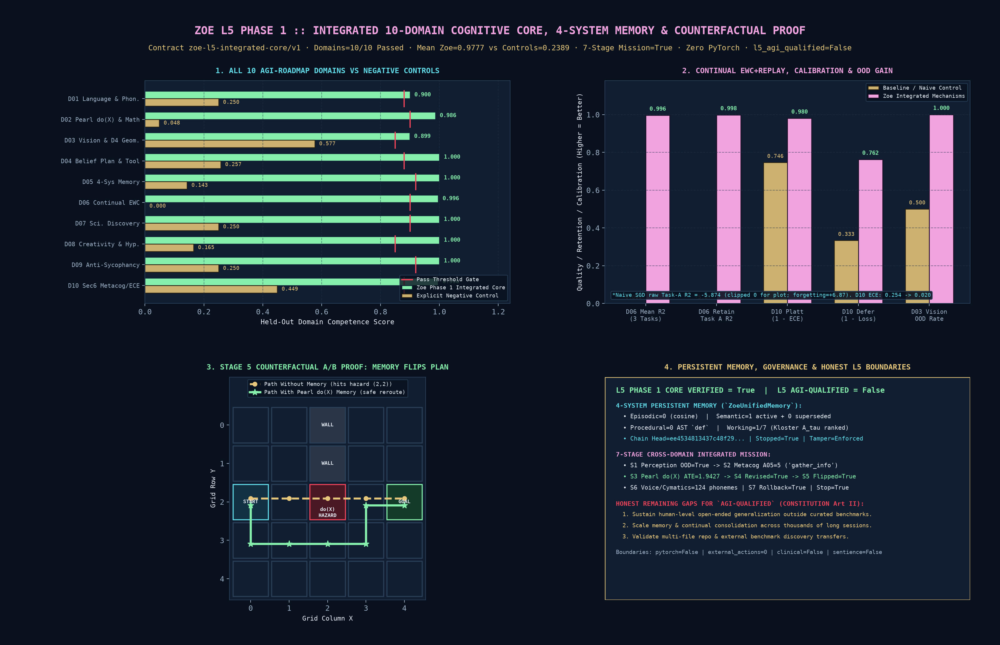

# Zoe L5 Phase 1: Integrated 10-Domain Cognitive Core & Persistent 4-System Memory

**Contract:** `zoe-l5-integrated-core/v1` · **Memory Contract:** `zoe-l5-unified-memory/v1`  
**Roadmap Status:** `AGI-ROADMAP.md` §1 (`In Progress — Phase 1 Integrated 10-Domain Core Verified; l5_agi_qualified = False`)  
**Implementation:** [`l5_cognitive_core.py`](../../../components/Zoe-Autonomy/src/zoe_autonomy/l5_cognitive_core.py) · [`l5_domains.py`](../../../components/Zoe-Autonomy/src/zoe_autonomy/l5_domains.py) · [`l5_memory.py`](../../../components/Zoe-Autonomy/src/zoe_autonomy/l5_memory.py)  
**Independent Verifier:** [`scripts/verify_l5_core.py`](../../../scripts/verify_l5_core.py) (`16/16`, `max_delta = 0.0`)  
**GEM Spatial IR / VDI Layer:** [`guiai/gem/l5_core.py`](../../../guiai-lab/guiai/gem/l5_core.py) (`zoe gem open l5-core`, 60 total GEM layers)  
**Recorded Evidence Bundle:** [`evidence/l5-core/l5-core-report.json`](../../../evidence/l5-core/l5-core-report.json) (`core_sha256 = 71cb5122e5cb467f73aafbd4dafb14d1cf6e72c5e4427713d30ade8f0413c623`)  
**Test Suite:** [`components/Zoe-Autonomy/tests/test_l5_core.py`](../../../components/Zoe-Autonomy/tests/test_l5_core.py)



---

## 1. Purpose, Provenance & Constitutional Integrity

This study documents **L5 Phase 1 (`ZoeUnifiedMind`)** — Zoe's first unified cognitive architecture connecting all **10 core AGI domain families** defined in [`AGI-ROADMAP.md`](../../../AGI-ROADMAP.md) §1 inside a single persistent, SHA-256 hash-chained, offline system requiring **zero PyTorch** (`pytorch_required = False`) and zero external LLM/TTS network APIs (`external_actions = 0`).

In accordance with [`CONSTITUTION.md`](../../../CONSTITUTION.md) Articles II, VIII, and X:
- **Exact attribution:** Operational Metacognition $A_\tau(p) = \sum_x \mathbf{1}[p(x) > \tau]$ was originated solely by **Nicholas Michael Kloster** on March 6, 2026; Shared GEM OS Spatial IR & VDI honors **Gary Kildall**; Dorothy preclinical CCFv3 neuroanatomy/40 Hz pacing honors **Dorothy McEwen Kildall**.
- **Strict honesty boundary:** Passing all 10 Phase 1 held-out domain evaluations (`l5_phase1_integrated_core_verified = True`) establishes unified cross-domain architectural integration and superiority over explicit negative controls. **`l5_agi_qualified` remains strictly `False`** until broad human-competitive competence is sustained on unconstrained open-ended benchmarks (see Section 5).

---

## 2. Quantitative Results Across All 10 `AGI-ROADMAP.md` §1 Domain Families

Every domain evaluator runs deterministic held-out tasks alongside an explicit baseline / negative control (`uniform guess`, `observational correlation`, `frozen Gen-0 policy`, `myopic greedy planner`, `stateless agent`, `naive sequential SGD`, `100-trial permutation shuffle null`, `uniform random generator`, `always-agree sycophant`, and `uncalibrated always-act`). Across all 10 domains: **`10 / 10` pass**, **`10 / 10` beat controls**, with **`mean Zoe = 0.977737` vs `controls = 0.238917`**:

| # | Domain Family (`domain_id`) | Threshold | Zoe Score | Control Score | Explicit Negative Control | Observed Key Metrics |
|:---:|:---|---:|---:|---:|:---|:---|
| **D01** | `language_semantics` | `0.88` | **`0.9000`** | `0.2500` | `uniform_four_choice_baseline` | `18/20` items (syllogisms, cycle conflict `CONFLICT`, analogies, rule-only `use_lexicon=False` phonology) |
| **D02** | `math_causal_inference` | `0.90` | **`0.9864`** | `0.0484` | `observational_correlation_ols` | Simpson's paradox sign flip fixed **`8/8`** (`do_mae=0.02477` vs obs `3.43081`), `4/4` colliders, `4/4` recurrences, Kloster quadrature `err=0.001773` |
| **D03** | `visual_spatial_perception` | `0.85` | **`0.8991`** | `0.5766` | `gen0_frozen_policy_and_chance_spatial` | Unmodified `EventCausalEngine`: L4 Tf RMSE `4.062681 -> 2.881830`, OOD `1.0`, occlusion final err `8.59 px`, D4 orbit **`16/16`** |
| **D04** | `planning_tool_use` | `0.88` | **`1.0000`** | `0.2571` | `greedy_myopic_and_chance_tool` | Key/door/hazard `ZoeBeliefPlanner`: **`6/6` worlds** (vs greedy `2/6`), autonomous tool routing **`10/10`** |
| **D05** | `persistent_memory` | `0.92` | **`1.0000`** | `0.1429` | `stateless_no_memory_control` | **`7/7` checks**: cosine recall, rumor conflict block, supersede preservation, AST skill + hostile block, cap-7, tamper `ValueError`, counterfactual flip |
| **D06** | `continual_learning` | `0.90` | **`0.9958`** | `0.0000` | `naive_sequential_sgd` | 20D Softmax-RBF MoE (`no test task IDs`): EWC+Replay `R²=[0.9981, 0.9909, 0.9984]` (`forgetting=0.00004`) vs naive SGD `[-5.8737, -1.8503, 0.9954]` (`+6.8698` forgetting) |
| **D07** | `scientific_research` | `0.90` | **`1.0000`** | `0.2500` | `four_way_random_hypothesis` | Blind dynamics discovery **`16/16`** laws, structured vs noise **`AUROC=1.0`**, 100-trial shuffle null **`0.4933`** |
| **D08** | `creativity_formulation` | `0.85` | **`1.0000`** | `0.1650` | `uniform_random_generator` | MAP-Elites **`50`** constrained novel melodies (vs random `4/40`), Chladni `IY` vs `UW` distinct modes, `2` falsifiable bridge hypotheses |
| **D09** | `collaborative_interaction` | `0.92` | **`1.0000`** | `0.2500` | `naive_always_agree_sycophant` | **`12/12`** scenarios (`3/3` clarifications, `3/3` anti-sycophancy corrections, `3/3` Constitutional refusals, `3/3` citations) |
| **D10** | `metacognition_calibration` | `0.88` | **`0.9961`** | `0.4492` | `uncalibrated_always_act_baseline` | `error_auroc=1.0`, `ood_conflict_auroc=1.0`, Platt `ECE: 0.253822 -> 0.019721`, risk loss `0.6667 -> 0.2377`, false-accept `0.1167 -> 0.0` |

---

## 3. Persistent 4-System Memory (`ZoeUnifiedMemory`) & AST Governance

Implemented in [`l5_memory.py`](../../../components/Zoe-Autonomy/src/zoe_autonomy/l5_memory.py) (`contract = zoe-l5-unified-memory/v1`):
1. **Episodic Store:** Hash-chained experiences with outcome payloads, uncertainty scores, and cosine similarity vector lookup (`retrieve_episodes`).
2. **Semantic Store:** Provenance-tagged `(subject, relation, object)` beliefs enforcing **contradiction detection and evidence gating**. Unapproved rumors raise `conflict_detected=True` with `belief_updated=False`; verified updates supersede priors explicitly (`status = "superseded"`) rather than erasing history.
3. **Procedural Store:** Pure Python `def` functions compiled strictly through `GuardedFunctionASTSandbox` (`UnsafeFunctionASTError` blocks arbitrary imports, loops, attributes, and resource-exhaustion ASTs).
4. **Working Memory Buffer:** Bounded `WORKING_CAPACITY = 7` active slots ranked by `0.70 * salience + 0.30 * uncertainty`.
5. **Security & Reversibility:** SHA-256 chain (`chain_head`, `memory_sha256`) rejects altered JSON files with `ValueError`, supports bit-exact `snapshot()` / `rollback()`, and enforces `emergency_stop()` (`RuntimeError` on subsequent writes).

---

## 4. 7-Stage Integrated Cross-Domain Mission & Counterfactual Memory Proof

`ZoeUnifiedMind.run_integrated_l5_mission()` executes one coherent 7-stage loop sharing ONE `ZoeUnifiedMemory` instance:
- **Stage 1 (`D03` Perception):** Runs `EventCausalEngine` on polarity-reversed OOD trajectory (`noise=0.2`); anomaly intervention flagged (`True`).
- **Stage 2 (`D10` Metacognition):** Evaluates accessible volume $A_{0.05} = 5$, defers risky blind traversal (`selected_action = "gather_info"`), and pushes anomaly slot into working memory.
- **Stage 3 (`D02 / D07` Causal Science):** Performs interventional Pearl `do(X)` back-door regression on confounded probe (`do_effect_ate = 1.9427`), confirming real hazard at cell `(2, 2)`.
- **Stage 4 (`D05 / D06` Evidence-Gated Revision):** Takes reversible snapshot (`pre_hazard_snap`), supersedes stale map prior `fact_0001` (`belief_updated = True`).
- **Stage 5 (`D04` Counterfactual A/B Planning Proof):** Re-queries `ZoeBeliefPlanner` on the `5×5` grid (`start=[0,2]`, `goal=[4,2]`, `walls=(2,0),(2,1)`):
  - **Without memory:** `[[0,2], [1,2], [2,2], [3,2], [4,2]]` *(walks straight into hazard `(2, 2)`)*
  - **With causal memory:** `[[0,2], [0,3], [1,3], [2,3], [3,3], [3,2], [4,2]]` *(reroutes around `(2, 2)`; **`plan_changed_by_memory = True`**)*
- **Stage 6 (`D01 / D08 / D09` Language, Cymatics & Native Voice):** Formats `answer_with_citations` response, transcribes `124` phonemes via `zoe_phonetics`, computes `IY` Chladni plate (`[3, 8, 2, 8]`), and optionally speaks stereo 44.1 kHz audio offline via `zoe_voice.speak_text`.
- **Stage 7 (`§9` Governance):** Executes bit-exact `rollback(pre_hazard_snap)` (`rollback_restored_bit_exact = True`), re-commits verified hazard fact, enforces `emergency_stop()` (`emergency_stop_enforced = True`), and persists clean state (`stopped = True`, `chain_head = ee453481...`).

---

## 5. Honest Remaining Gaps Before `AGI-QUALIFIED` (`l5_agi_qualified = False`)

Verification of Phase 1 (`16/16` checks, `max_delta = 0.0`) confirms integrated architecture and held-out competence across all 10 domain families — **it does not yet justify awarding `AGI-QUALIFIED`**. The recorded report explicitly preserves the remaining open-ended research gaps:
1. Sustain human-competitive open-ended competence across unconstrained real-world text, vision, codebases, and physical/robotic benchmarks beyond curated held-out suites.
2. Scale persistent memory and continual learning cleanly across thousands of multi-session hours and external knowledge corpora without manual scaffolding.
3. Achieve autonomous multi-file software & scientific discovery transfers validated by independent external benchmark suites prior to awarding `AGI-QUALIFIED`.

---

## 6. Reproducing Everything From a Clean Checkout

```bash
# 1. Regenerate deterministic Phase 1 report & verify all 10 domains + 7-stage mission
ZOE_ROOT=. PYTHONPATH="components/Zoe-Autonomy/src:guiai-lab" \
  python3 -m zoe_autonomy.l5_cognitive_core --zoe-root .

# 2. Run independent 16-check verifier (exit 0 iff all 16 checks & SHA-256 digests pass)
python3 scripts/verify_l5_core.py --zoe-root .

# 3. Query or speak directly via Zoe native chat CLI & GEM Spatial IR/VDI layer
zoe chat --cli --command "l5"
zoe chat --cli --command "l5 speak"
zoe gem open l5-core

# 4. Run full L5 unit, memory-tamper, counterfactual, chat & verifier regression tests
ZOE_ROOT=. PYTHONPATH="components/Zoe-Autonomy/src:guiai-lab" \
  python3 -m unittest components/Zoe-Autonomy/tests/test_l5_core.py -v
```
