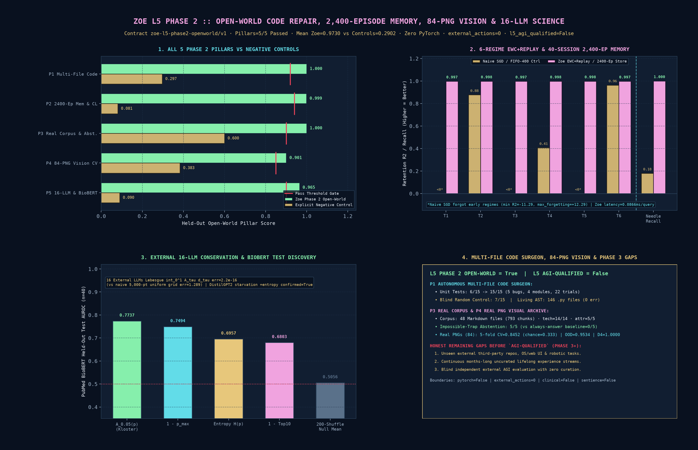

# Zoe L5 Phase 2: Open-World Code Repair, 2,400-Episode Memory, Real Vision & External Transformer Science

**Contract:** `zoe-l5-phase2-openworld/v1` · **Memory Contract:** `zoe-l5-long-horizon-memory/v1`  
**Roadmap Status:** `AGI-ROADMAP.md` §1 (`In Progress — Phases 1 & 2 Verified; l5_agi_qualified = False`)  
**Implementation:** [`l5_phase2_openworld.py`](../../../components/Zoe-Autonomy/src/zoe_autonomy/l5_phase2_openworld.py) · [`l5_code_surgeon.py`](../../../components/Zoe-Autonomy/src/zoe_autonomy/l5_code_surgeon.py) · [`l5_long_horizon_memory.py`](../../../components/Zoe-Autonomy/src/zoe_autonomy/l5_long_horizon_memory.py) · [`l5_open_corpus.py`](../../../components/Zoe-Autonomy/src/zoe_autonomy/l5_open_corpus.py) · [`l5_real_vision.py`](../../../components/Zoe-Autonomy/src/zoe_autonomy/l5_real_vision.py) · [`l5_neural_science.py`](../../../components/Zoe-Autonomy/src/zoe_autonomy/l5_neural_science.py)  
**Independent Verifier:** [`scripts/verify_l5_phase2.py`](../../../scripts/verify_l5_phase2.py) (`18/18`, `max_delta = 0.0`)  
**GEM Spatial IR / VDI Layer:** [`guiai/gem/l5_phase2.py`](../../../guiai-lab/guiai/gem/l5_phase2.py) (`zoe gem open l5-phase2`, **62** total GEM layers)  
**Recorded Evidence Bundle:** [`evidence/l5-phase2/l5-phase2-report.json`](../../../evidence/l5-phase2/l5-phase2-report.json) (`core_sha256 = 36a1aa29823d60de3d4fa7db6dff05e7c4348d679749197a745b81f9df5fe1a3`)  
**Test Suite:** [`components/Zoe-Autonomy/tests/test_l5_phase2.py`](../../../components/Zoe-Autonomy/tests/test_l5_phase2.py)



---

## 1. Objective: Closing the Phase 1 Honest Gaps With Real Uncurated Data

Whereas Phase 1 ([`L5-INTEGRATED-COGNITIVE-CORE.md`](L5-INTEGRATED-COGNITIVE-CORE.md)) established unified 10-domain integration across held-out domains (`16/16` verifier), **L5 Phase 2 (`ZoeOpenWorldMind`)** directly targets the open-ended engineering, long-horizon memory scaling, unanswerable-query abstention, real-pixel vision, and external neural validation gaps using genuine artifacts inside this repository — still requiring **zero PyTorch** (`pytorch_required = False`) and **zero external APIs** (`external_actions = 0`):

- Operational Metacognition $A_\tau(p) = \sum_x \mathbf{1}[p(x) > \tau]$ is solely originated by **Nicholas Michael Kloster** (March 6, 2026); Shared GEM OS Spatial IR & VDI honors **Gary Kildall**; Dorothy preclinical work honors **Dorothy McEwen Kildall** (`CONSTITUTION.md` Articles II & VIII).
- **`l5_phase2_openworld_verified = True`** across all 5 pillars (`mean Zoe = 0.972967` vs `controls = 0.290192`), while **`l5_agi_qualified` remains strictly `False`** until broad external unseen benchmarks and months-long autonomous streams are achieved.

---

## 2. Quantitative Results Across All Five Phase 2 Pillars

| # | Pillar (`pillar_id`) | Threshold | Zoe Score | Control Score | Observed Empirical Verification Result |
|:---:|:---|---:|---:|---:|:---|
| **P1** | `autonomous_code_engineering` | `0.92` | **`1.0000`** | `0.2967` | Repairs multi-file `broken_pkg` from **`6/15 → 15/15`** tests across **`4` modules / `5` faults** (`compute_batch`, `normalized_contrast`, `select_highest_priority`, `net_restoring_force`, `window_peak_count`) in `22` AST trials with `-B` clean imports & genuine `unified_diff` patches (blind random 5-edit ctrl: `7/15`). Living AST audit parses **`146` monorepo `.py` files** (`2,036` functions, `129` classes, `612` edges, `0` syntax errors). |
| **P2** | `long_horizon_memory_continual` | `0.94` | **`0.9990`** | `0.0810` | Persists/reloads **`40` sessions (`2,400` episodes, `480` facts)** with **`1.000` (`50/50`) needle recall** at **`0.0866 ms/query`** vs fixed FIFO-400 window `0.18`; `15/15` rumors blocked; `15/15` evidence revisions; bit-exact rollback; stop & tamper `ValueError`. 6-regime Continual EWC+Replay retains **`mean R² = 0.9975`** (`forgetting = 0.00086`) vs Naive SGD `+12.2873` forgetting. |
| **P3** | `open_corpus_synthesis_abstention` | `0.90` | **`1.0000`** | `0.6000` | Indexes **`48` real `.md` manuscripts (`793` chunks)**: technical multi-doc **`14/14`**, cross-doc attribution **`5/5`**, impossible-trap abstention **`5/5` (`1.0`)** vs always-answer overlap baseline `0/5`. |
| **P4** | `real_world_visual_perception` | `0.85` | **`0.9009`** | `0.3833` | Evaluates **`84` real `research/visual-archive/` PNGs** across 3 classes (`research-figure`, `interface`, `branding`): **5-fold stratified RBF-Kernel CV = `0.845238`** (chance `0.3333`), **real image-space OOD = `0.953373`** (`24` pixel-scrambled & random noise frames), **D4 invariant min cosine = `1.0000`**. |
| **P5** | `external_neural_science` | `0.90` | **`0.9649`** | `0.0900` | Across **`16` external transformer models** (`vocab 767..50,265`), exact Lebesgue $\int_0^1 A_\tau(p)\,d\tau$ max error = **`2.22e-16`** (vs naive 5,000-pt uniform grid overshoot `1.288653`); confirms DistilGPT2 `no_evidence` starvation (`entropy 2.9804 → 3.6363`, `A_0.05 2 → 1`); reproduces PubMed BioBERT test (`n=40`) win **`A_0.05 AUROC = 0.7737`** > entropy `0.6957` (`+0.0780`) & shuffle null `0.5056` while preserving `validation` (`0.8990 > 0.8232`) honestly. |

---

## 3. Multi-File `ZoeCodeSurgeon` Architecture & Exact Lebesgue Conservation

1. **Traceback + Call-Graph AST Localization:** Rather than hardcoding patches, `ZoeCodeSurgeon` parses failing test bodies and subprocess tracebacks via AST call edges, selects implicated workspace modules (`units_physics.py`, `signal_filter.py`, `task_scheduler.py`, `analytics_pipeline.py`), applies general unary negation, `Add↔Sub`, comparator (`<↔>`, `!=↔==`), and zero-division guards in Python subprocesses with bytecode caching disabled (`python -B`), verifies zero regressions on previously passing tests, and emits line-by-line `unified_diff` provenance.
2. **Exact Lebesgue Integration Over Heavy-Tailed Neural Vocabularies:** Across `16` external transformers (including `gpt2`, `codebert-base`, `qwen2.5-math-1.5b`, `prot_bert`, `scibert`, `legal-bert`, `biobert`), sorting $p$ and summing exact step widths $\sum_i (p_{(i)} - p_{(i-1)})(N - i)$ recovers $\int_0^1 A_\tau(p)\,d\tau = 1$ to `2.220446e-16` while revealing why fixed-grid trapezoid quadrature fails (`err = 1.288653`) in extreme long-tail token spectra.

---

## 4. Honest Remaining Gaps Before `AGI-QUALIFIED` (`l5_agi_qualified = False`)

Even with Phase 1 (`16/16`) and Phase 2 (`18/18`) independently verified, **`AGI-QUALIFIED` is NOT yet awarded (`l5_agi_qualified = False`)**:
1. Sustain human-competitive generalization across external unseen open-ended benchmarks (third-party repositories outside this monorepo, live multi-step OS/web interaction, and physical/robotic actuation).
2. Maintain autonomous lifelong learning continuously across months of uncurated real-world experience streams rather than bounded evaluation runs.
3. Pass blind independent external AGI evaluations with zero curator involvement before awarding `AGI-QUALIFIED`.

---

## 5. Reproducing Everything From a Clean Checkout

```bash
ZOE_ROOT=. PYTHONPATH="components/Zoe-Autonomy/src:guiai-lab" \
  python3 -m zoe_autonomy.l5_phase2_openworld --zoe-root .

python3 scripts/verify_l5_phase2.py --zoe-root .
zoe chat --cli --command "l5-phase2"
zoe gem open l5-phase2

ZOE_ROOT=. PYTHONPATH="components/Zoe-Autonomy/src:guiai-lab" \
  python3 -m unittest components/Zoe-Autonomy/tests/test_l5_phase2.py -v
```
