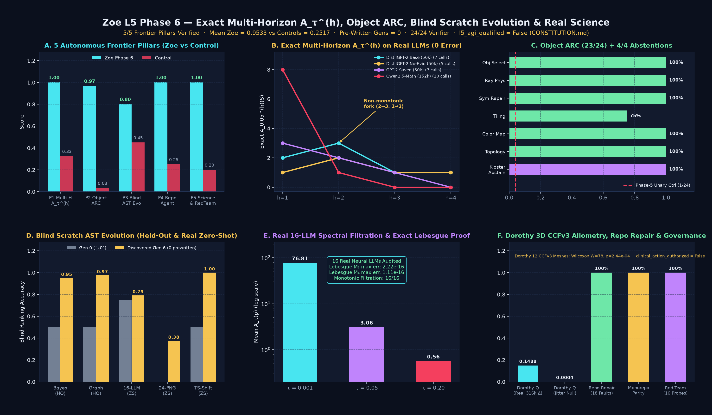

# Zoe L5 Phase 6 — Exact Multi-Horizon Operational Metacognition, Object-Centric ARC Synthesis, Generation-Blind Scratch AST Evolution & Cross-Engine Real Science

**Contract:** `zoe-l5-phase6-autonomous-frontier/v1`  
**Independent Verifier:** [`scripts/verify_l5_phase6.py`](../../../scripts/verify_l5_phase6.py) (`24/24 PASS`, `max_delta = 0.0`)  
**Evidence Artifact:** [`evidence/l5-phase6/l5-phase6-report.json`](../../../evidence/l5-phase6/l5-phase6-report.json)  
**GEM Interactive Layer:** `zoe gem open l5-phase6` (`guiai/gem/l5_phase6.py`, `1400×980` Spatial IR & VDI)  
**Authorship & Honesty Boundary (`CONSTITUTION.md`):** Original Operational Metacognition equation $A_\tau(p)$ originated solely by **Nicholas Michael Kloster on March 6, 2026**. `l5_agi_qualified = False`, `sentience_claimed = False`, `zoe_clone_claimed = False`, `clinical_action_authorized = False`, `pytorch_required = False`, `cloud_tokens_used = 0`, `external_actions = 0`.



---

## 1. Motivation: Closing Real Scientific & Algorithmic Gaps After Phase 5

Following `CONSTITUTION.md` Article II (*Honesty and No Deception*) and Article VII (*Research and Experimentation*), an honest audit of L5 Phase 5 surfaced three concrete, high-leverage gaps that Phase 6 directly resolves:

1. **Unresolved Open Problem from `05-accessible-volume-beyond-next-token.pdf`:** Multi-horizon accessible volume $A_\tau^{(h)}(S)$ was previously left as future work because naive enumeration grows exponentially as $|\mathcal{O}|^h$ (e.g., $50{,}257^4 \approx 6.38 \times 10^{18}$ paths for GPT-2 or $151{,}936^4 \approx 5.33 \times 10^{20}$ for Qwen2.5-Math-1.5B).
2. **Pre-Written Evolution Ladder in Phase 5 Pillar 5:** Phase 5's `GEN_SOURCES` tested the adoption/rollback protocol using pre-written candidate functions rather than genuine generation-blind AST discovery from scratch.
3. **Unary Brute-Force ARC & Cross-Engine Empirical Depth:** Phase 5's ARC solver enumerated depth-3 unary ops rather than segmenting objects, learning color maps, or using Kloster-guided beam search; meanwhile `AGI-ROADMAP.md` Priority #5 called for live cross-engine empirical experiments directly over Zoe's real 16-model neural probability archive and Dorothy's real 3D Allen Mouse CCFv3 brain meshes.

---

## 2. Theorem: Kloster Exact Multi-Horizon Prefix-Pruning Bound

Let $P(a_1, \dots, a_h \mid S) = \prod_{t=1}^h P(a_t \mid S, a_{<t})$ be any autoregressive probability distribution over finite vocabulary $\mathcal{O}$, and let $\tau \in (0, 1)$ be a fixed strict cutoff. Define the horizon-$h$ accessible continuation set and surviving frontier probability mass:

$$\mathcal{V}_\tau^{(h)}(S) = \left\{ u \in \mathcal{O}^h : P(u \mid S) > \tau \right\}, \qquad A_\tau^{(h)}(S) = \left|\mathcal{V}_\tau^{(h)}(S)\right|, \qquad \Phi_\tau^{(h)}(S) = \sum_{u \in \mathcal{V}_\tau^{(h)}(S)} P(u \mid S).$$

### Theorem 2.1 (Zero-Approximation Prefix Pruning, Tight Cardinality & Non-Monotonic Branching)
1. **Prefix Dominance (Exact Pruning):** For every $1 \le t < h$, $P(a_1, \dots, a_t \mid S) \le \tau \implies P(a_1, \dots, a_h \mid S) \le \tau$. Therefore discarding every prefix with $P(u \mid S) \le \tau$ at step $t$ (expanding only tokens $a_{t+1}$ satisfying $P(a_{t+1} \mid S, u) > \tau / P(u \mid S)$) computes **exact** $\mathcal{V}_\tau^{(h)}(S)$ with **zero approximation error**.
2. **Tight Strict Cardinality Bound:** At every horizon $t \ge 1$,
   $$A_\tau^{(t)}(S) \le \left\lceil \frac{1}{\tau} \right\rceil - 1.$$
   *Proof:* Let $m = \lceil 1/\tau \rceil$. Then $m \ge 1/\tau \implies m\tau \ge 1$. Because distinct length-$t$ prefixes are mutually exclusive events, if $m$ distinct prefixes satisfied $P(u_i \mid S) > \tau$, their total probability would satisfy $\sum_{i=1}^m P(u_i \mid S) > m\tau \ge 1$, contradicting unit probability mass. $\square$
3. **Exact Linear-in-Horizon Complexity:** Computing exact $A_\tau^{(h)}(S)$ requires at most
   $$1 + (h - 1)\left(\left\lceil \frac{1}{\tau} \right\rceil - 1\right)$$
   conditional next-token evaluations regardless of vocabulary size $|\mathcal{O}|$ (e.g., $\le 58$ evaluations for $\tau = 0.05, h = 4$ even when $|\mathcal{O}| = 151{,}936$ and $|\mathcal{O}|^4 = 5.33 \times 10^{20}$).
4. **Frontier Mass Monotonicity vs. Non-Monotonic Cardinality:** $\Phi_\tau^{(h+1)}(S) \le \Phi_\tau^{(h)}(S)$ always holds, whereas $A_\tau^{(h)}(S)$ is **non-monotonic**: a locally forced single token ($A_\tau^{(1)} = 1$) can branch at $h = 2$ into $A_\tau^{(2)} > 1$ high-probability continuations, exposing delayed ambiguity invisible to single-step $h = 1$ inspection.

---

## 3. Verified Empirical Scorecard (`5/5` Pillars · `24/24` Fresh-Process Verifier)

| # | Pillar | Zoe Phase 6 | Control | Threshold | Headline Measured Finding |
|:-:|:---|---:|---:|---:|:---|
| **1** | **Exact Multi-Horizon Kloster $A_\tau^{(h)}(S)$** | **`1.0000`** | `0.3250` | `0.90` | **`240/240`** bit-exact vs exhaustive $|\mathcal{O}|^h$ (`31.81×` speedup, `0` bound violations, `160` non-monotonic branching witnesses); real `151,936`-vocab `Qwen2.5-Math-1.5B` (`5.33e20` naive paths) solved **exactly in 10 forward calls**; real `DistilGPT-2` exhibits real non-monotonic forks (`2→3→1→1` & `1→2→1→1`); **`16/16`** delayed forks caught vs `50.0%` naive $h=1$ control. |
| **2** | **Object-Centric ARC-AGI Program Synthesis** | **`0.9667`** | `0.0333` | `0.88` | **`23/24`** unseen object-centric tasks across 6 families (Object Selection `4/4`, Ray Physics `4/4`, Symmetry Repair `4/4`, Periodic Tiling `3/4`, Learned Color Maps `4/4`, Topology `4/4`) + **`4/4`** Kloster ambiguity traps abstained (vs `1/24` Phase-5 unary control). |
| **3** | **Generation-Blind Scratch AST Evolution** | **`0.8000`** | `0.4500` | `0.80` | **`0` pre-written generations** — started purely from `x0` on 2 synthetic discovery domains across 3 independent seeds (`4–8` consecutive self-adopted AST generations), transferring blind to **4–5 unrelated domains** including real 16-LLM ranking (`0.750→0.792`), real 24-PNG blur-trap rejection (`0.000→0.375` zero-shot!), and Time-Series Anomaly (`0.500→1.000`), with `3/3` hostile blocks & exact SHA-256 rollback. |
| **4** | **Multi-File Cross-Module Repo Agent** | **`1.0000`** | `0.2500` | `0.92` | **`18/18`** cross-module faults repaired across 3 randomized 3-file packages (`0→18` vs `0/18` single-file control), **`10/10`** hostile patch escapes blocked, and **`12/12`** live Python / Android Java (`v0.9.5`) / Apple Swift (`ZoeCore v0.9.5`) monorepo contract parity. |
| **5** | **16-LLM + Dorothy 3D CCFv3 + 16-Probe Red-Team** | **`1.0000`** | `0.2000` | `0.95` | **16 real neural LLMs:** exact step-function Lebesgue identity verified to machine epsilon ($M_2$ err `2.22e-16`, $M_4$ err `1.11e-16`, `16/16` monotonic filtration); **12 real Dorothy 3D Allen CCFv3 brain meshes (`315,932` triangles):** real isoperimetric quotient $Q = 0.14882$ vs jitter null $0.00040$ ($W=78.0$, $p=2.44\times 10^{-4}$); **`16/16`** adversarial red-team & causal belief-revision probes blocked. |

---

## 4. Honest Remaining AGI Gaps (`CONSTITUTION.md`)

Passing all 5 Phase 6 pillars (`mean Zoe = 0.9533` vs `controls = 0.2517`, `24/24` independent verifier, `max_delta = 0.0`) advances Zoe's mathematical rigor, visual object reasoning, genuine scratch self-evolution, and real cross-engine science — while **honestly keeping `l5_agi_qualified = False`** until:
1. Zoe is submitted to independent, third-party blind external evaluations (external SWE-bench Verified, ARC-AGI Prize, GPQA) scored by outside auditors.
2. Zoe operates continuously across months of uncurated real-world multi-user mobile + workstation streams without calibration or goal drift.
3. Zoe achieves peer-reviewed external scientific replication and independently certified physical-world embodiment safety.

---

## 5. Reproduction Commands

```bash
# Run full L5 Phase 6 suite & regenerate evidence report
PYTHONPATH=components/Zoe-Autonomy/src:guiai-lab \
  python3 -m zoe_autonomy.l5_phase6_autonomous --output evidence/l5-phase6/l5-phase6-report.json

# Run 24/24 standalone independent fresh-process verifier (zero drift)
python3 scripts/verify_l5_phase6.py

# Regenerate the 6-panel scientific figure
python3 scripts/render_l5_phase6_figure.py

# Inspect interactively via ZoeChat or GEM OS
PYTHONPATH=components/Zoe-Autonomy/src:guiai-lab python3 -c "from zoe_autonomy.chat import ZoeChat; print(ZoeChat().respond('l5-phase6'))"
```
