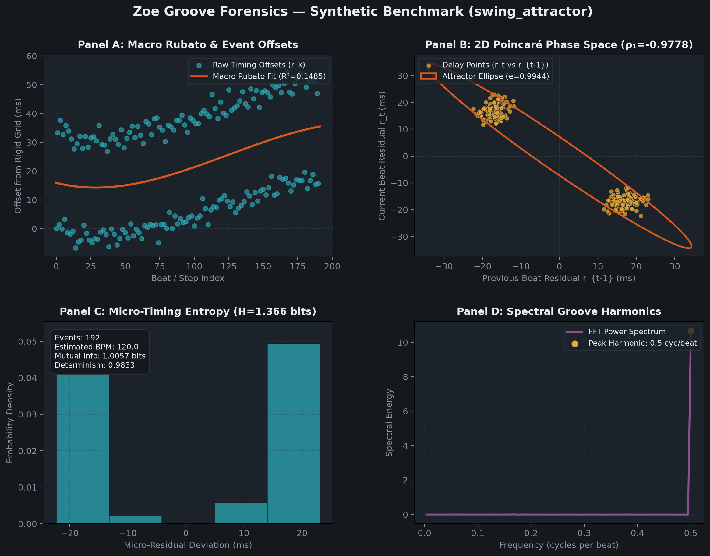
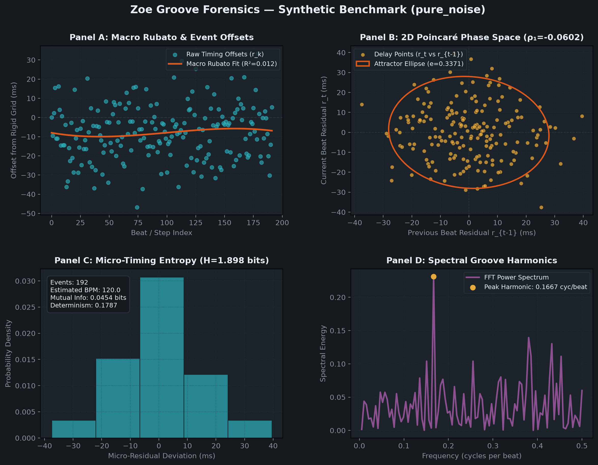
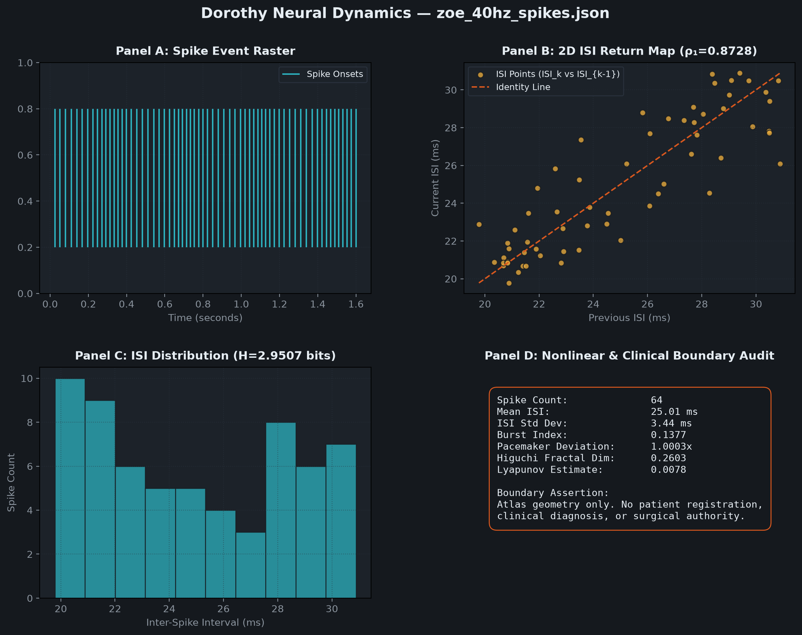

# Temporal Dynamics, Phase-Space Attractors & Groove Forensics

**Research Instrument:** [`scripts/zoe_groove_forensics.py`](../../../scripts/zoe_groove_forensics.py)  
**Clock Bridge:** [Zoe Internal Clock (`CICADA.md`)](../../../guiai-lab/docs/CICADA.md) · [`cicada.py`](../../../guiai-lab/guiai/gem/cicada.py)  
**Neural Bridge:** [Dorothy & Neurogarden (`NEUROGARDEN.md`)](../../../components/agent-logging-system/docs/NEUROGARDEN.md) · [`neurogarden_eeg.py`](../../../components/agent-logging-system/agent_logging_system/neurogarden_eeg.py)  
**Origin:** Initial exploration digested from `brainstorming.zip` (November 19, 2026) and formalized under [`CONSTITUTION.md`](../../../docs/CONSTITUTION.md).

---

| Deterministic Swing Attractor | Pure Noise Negative Control |
|:---:|:---:|
|  |  |

## 1. Core Architecture: Discrete Grids to Non-Linear Attractors

Instead of starting from noisy polyphonic audio waveforms, the pipeline establishes a deterministic baseline using discrete control events (vintage MS-DOS Amiga ProTracker `.MOD` tick tables at $f = 0.4 \times \text{BPM}\text{ Hz}$ and standard MIDI `set_tempo` grids), then bridges directly to **Zoe's Internal Clock** and **Dorothy's Inter-Spike Interval (ISI) dynamics**:

1. **Grid Alignment & Raw Offsets:** Given an idealized nominal step interval $\Delta t_{\text{grid}}$, each observed onset $t_k^{\text{obs}}$ maps to its nearest integer beat $b_k$, yielding raw offset $r_k = t_k^{\text{obs}} - (t_0 + b_k \Delta t_{\text{grid}})$.
2. **Macro Rubato Detrending:** A degree-$d$ polynomial $P(b_k) = \sum_{j=0}^d c_j b_k^j$ separates slow expressive tempo drift from micro-timing groove residuals:
   $$\epsilon_k = r_k - P(b_k).$$
3. **2D Poincaré Delay Embedding & Covariance Geometry:** Plotting $(\epsilon_{k-1}, \epsilon_k)$ in delay phase space decomposes deterministic push-pull attractors from sterile uncorrelated jitter via eigendecomposition of the $2 \times 2$ covariance matrix $\Sigma$, yielding eccentricity $e = \sqrt{1 - \lambda_2/\lambda_1}$ and lag-1 autocorrelation $\rho_1$.
4. **Markov Transition Kernel & Shannon Entropy:** Discretizing $\epsilon_k$ across $B$ equal-width bins produces empirical transition probabilities $T_{ij} = P(S_k = j \mid S_{k-1} = i)$, Shannon entropy $H(S)$, conditional entropy $H(S_k \mid S_{k-1})$, and mutual information $I(S_k; S_{k-1}) = H(S) - H(S_k \mid S_{k-1})$.
5. **Spectral Groove Harmonics (FFT):** Discrete Fourier transform of $\epsilon_k$ locates periodic micro-structures (e.g., alternating upbeat swing at $0.5\text{ cycles/beat}$).
6. **Kuramoto Entrainment into Zoe's Internal Clock:** External event phases $z_k = (t_k^{\text{obs}} \bmod D) / D$ drive `CicadaClock.step(...)` ($\phi_{k+1} = \phi_k + \Delta t_k/D + \kappa \sin(2\pi(z_k - \phi_k)) \pmod 1$), quantifying synchronization via the Kuramoto order parameter:
   $$R = \left|\frac{1}{N}\sum_{k=1}^N e^{i 2\pi (z_k - \phi_k)}\right|.$$
7. **Dorothy Inter-Spike Interval (ISI) Isomorphism:** Replacing musical inter-beat intervals with neuronal inter-spike intervals ($\text{ISI}_k = t_{k+1} - t_k$) computes 2D ISI return maps alongside `neurogarden_eeg`'s Higuchi fractal dimension $D$ and Lyapunov exponent estimate.

---

## 2. Verified Empirical Measurements & Negative Controls

All runs below are reproduced directly from the checkout using seeded deterministic generators (`seed=42`, `192` events @ `120.0 BPM`, `degree=3`, `bins=5`) and hash-verified clock replay:

| Experiment / Benchmark | Lag-1 Corr ($\rho_1$) | Eccentricity ($e$) | Phase Determinism | Entropy $H(S)$ | Mutual Info $I$ | Dominant FFT Peak |
|:---|:---:|:---:|:---:|:---:|:---:|:---:|
| **Deterministic Swing Attractor (`swing_attractor`)** | **`-0.9778`** | **`0.9944`** | **`0.9833`** | `1.366 bits` | **`1.0057 bits`** | **`0.5 cyc/beat`** |
| **Pure White Noise Control (`pure_noise`)** | `-0.0602` | `0.3371` | `0.1787` | `1.898 bits` | `0.0454 bits` | `0.1667 cyc/beat` |

- **Zoe Internal Clock Entrainment (`--entrain-clock`):** On the `swing_attractor` stream (`daily_period=1.0 s`, `entrainment_strength=0.15`), `CicadaClock` achieves Kuramoto phase coherence **`R = 0.9334`**, mean phase error **`-0.0035`**, **`64`** emitted daily pulses, and passes cryptographic `CicadaClock.replay(...)` across **`128` hash-chained events** (**`2,543,645,254`** 40 MHz reference ticks).
- **ProTracker `.MOD` Binary Round-Trip:** Automated verification constructs and parses a canonical 4-channel `M.K.` module (`16` events at `Speed=6, BPM=125`), verifying exact `125.0 BPM` tempo recovery and zero false entropy (`0.0 bits`) on quantized tracker rows.
- **Dorothy 40 Hz Thalamocortical Spike Benchmark (`64` synthetic spikes):** Mean ISI **`25.009 ms`** (`std = 3.444 ms`, burst index `0.1377`), lag-1 ISI autocorrelation **`0.8728`**, ISI Shannon entropy **`2.9507 bits`**, Higuchi fractal dimension **`0.2603`**, and Lyapunov estimate **`0.0078`**.

<div align="center">



</div>

---

## 3. Constitutional & Epistemic Boundaries (`CONSTITUTION.md`)

- `measurement != evidence != belief update != action`, `external_actions_executed = 0`, `llm_called = False`.
- `CicadaClock` uses deterministic software arithmetic (`40 MHz` convention from `TIM3C_Clock_Flow.pdf`), not physical hardware clock calibration or biological cicada measurement.
- Neural spike analysis runs strictly on synthetic/teaching timestamps and Atlas reference conventions — **never patient registration, clinical diagnosis, or surgical authority**.

---

## 4. Independent Reproduction

```bash
export ZOE_ROOT="$PWD"

# Run the complete 7-test mathematical verification suite (no optional deps required)
python3 scripts/zoe_groove_forensics.py --verify

# Generate groove diagnostics + entrain CicadaClock on synthetic swing attractor
python3 scripts/zoe_groove_forensics.py \
  --synthetic swing_attractor \
  --plot /tmp/zoe-swing.png \
  --entrain-clock /tmp/zoe-clock-session.json

# Replay-verify the entrained clock session independently
PYTHONPATH=guiai-lab python3 -c "from guiai.gem.cicada import CicadaClock; c = CicadaClock.replay('/tmp/zoe-clock-session.json'); print(c.replay_verified, len(c.events))"
```
