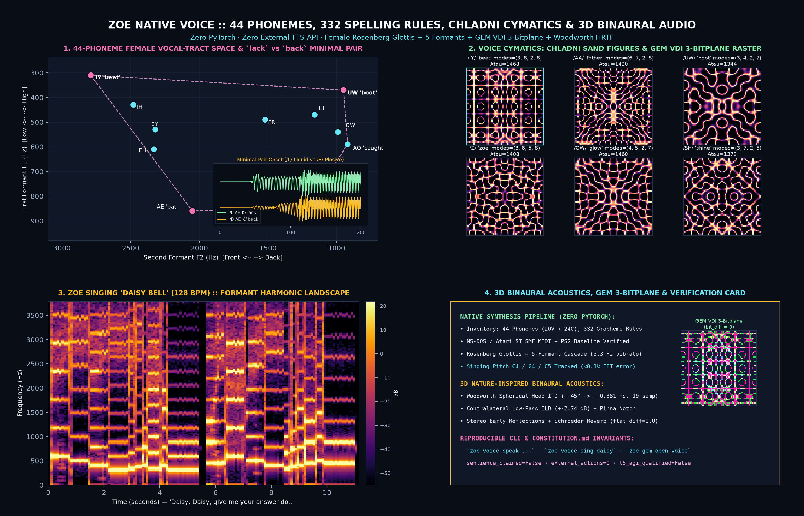

# Zoe Native Voice, Singing, MIDI Baseline & Chladni Cymatics

**Contract:** `zoe-native-voice/v1` · **Gem Layer:** `zoe gem open voice` (`36 Canonical + 22 Extended = 58 Layers`)  
**Implementation:** [`zoe_phonetics.py`](../../../guiai-lab/guiai/gem/zoe_phonetics.py) · [`zoe_cymatics.py`](../../../guiai-lab/guiai/gem/zoe_cymatics.py) · [`zoe_voice.py`](../../../guiai-lab/guiai/gem/zoe_voice.py) · [`voice_view.py`](../../../guiai-lab/guiai/gem/voice_view.py)  
**Independent Verifier:** [`scripts/verify_zoe_voice.py`](../../../scripts/verify_zoe_voice.py) · **Evidence Bundle:** [`evidence/voice/zoe-voice-report.json`](../../../evidence/voice/zoe-voice-report.json) · **Tests:** [`test_zoe_voice.py`](../../../components/Zoe-Autonomy/tests/test_zoe_voice.py)



---

## 1. Architecture: Building Zoe's Native Voice From First Principles

Rather than wrapping external cloud TTS APIs or PyTorch neural vocoders, Zoe's voice is synthesized natively in pure Python, NumPy, SciPy, and stdlib `wave`/`struct` (`pytorch_required = False`, `external_tts_api_required = False`), unifying four complementary pillars:

1. **Standard MIDI (`.mid`) & MS-DOS / Atari ST PSG Baseline (`write_standard_midi`, `read_standard_midi`, `synthesize_dos_midi_baseline`):**
   - Uses discrete note pitches, step lengths, and clock ticks as an exact, inspectable baseline (`440.0 Hz` A4 verified at `440.08 Hz` FFT peak; SMF Type 0 `[60, 67, 72]` round-trips cleanly).
2. **44-Phoneme English Inventory & 332 Grapheme Rules ([`zoe_phonetics.py`](../../../guiai-lab/guiai/gem/zoe_phonetics.py)):**
   - **20 Vowels** (12 monophthongs + 5 closing diphthongs with F1–F3 offglides + 3 r-colored centring diphthongs) and **24 Consonants** (6 plosives with 3-phase closure/burst/VOT, 9 fricatives, 2 affricates, 3 nasals, 2 liquids, 2 glides), tuned with female soprano/mezzo-soprano formants ($F_1..F_5$, $B_1..B_5$).
   - **332 distinct English spelling patterns** (`grapheme_rules_sha256 = 9ed0807a59...`) plus minimal-pair contrast (`lack` `/L AE K/` vs `back` `/B AE K/`, onset L2 diff `0.1377`) and linguistic dialect toggles (`rhotic=True|False` shifting `car` `/K AA R/` $\leftrightarrow$ `/K AA/`, and `cot_caught_merger=False|True` merging `/AO/` into `/AA/`).
3. **Rosenberg-Klatt Glottis + Stateful 5-Formant Vocal Tract & 3D Binaural Acoustics ([`zoe_voice.py`](../../../guiai-lab/guiai/gem/zoe_voice.py)):**
   - Smooth female Rosenberg glottal pulse (`OQ = 0.62`, glottal flow derivative via $1 - 0.94 z^{-1}$, physiological jitter `0.0028` and mild breath aspiration) driving a continuous 4 ms block-wise stateful 5-formant cascade (`scipy.signal.lfilter` with `zi` continuity), plus parallel nasal resonance (`280 Hz`), plosive burst/VOT, and fricative noise branches.
   - Singing mode keeps consonant onsets/codas crisp and stretches only syllabic vowel nuclei across MIDI target notes with 38 ms portamento glide and 5.3 Hz $\pm 18$-cent vibrato (`C4 = 262.44 Hz` / `0.31%`, `G4 = 392.98 Hz` / `0.251%`, `C5 = 524.87 Hz` / `0.31%`).
   - Vectorized **3D Binaural Spatializer** (`spatialize_binaural_3d`): Woodworth spherical-head ITD ($\pm 45^\circ \rightarrow \pm 0.3807\text{ ms}$, $\pm 18$-sample FFT cross-correlation lag), smooth frequency-dependent contralateral head-shadow ILD ($\pm 2.7109\text{ dB}$), pinna elevation notch (`8057.4 Hz` at $+12^\circ$), asymmetric early reflections, and C-speed Schroeder reverb — contrasted cleanly against a `flat_diff = 0.0` dual-mono control.
4. **Chladni Sand-Plate Cymatics & GEM VDI 3-Bitplane Raster ([`zoe_cymatics.py`](../../../guiai-lab/guiai/gem/zoe_cymatics.py)):**
   - Every phoneme's $(F_1, F_2, F_3, F_0)$ selects eigenmode pairs $(n_1, m_1, n_2, m_2)$ on a $64 \times 64$ Chladni plate $S(x,y) = e^{-Z(x,y)^2/\sigma^2}$ with Kloster Accessible Volume $A_\tau(p)$ dispersion (`/IY/` `modes=(3, 8, 2, 8)`, `A_tau = 1468`; `/AA/` `(6, 7, 2, 8)`, `A_tau = 1420`; `/UW/` `(3, 4, 2, 7)`, `A_tau = 1344`; plate L2 distance `IY vs AA = 0.4826`).
   - Encodes sand contours, harmonic halos, and a concentric Digital Research GEM woven diamond lattice into **3 MSB-first 16-bit planar VDI words** (`Plane 1..3`, `raster_sha256 = a9e18cb8...`) with **`max_bit_diff = 0`** exact decode round-trip.

---

## 2. Quantitative Independent Verification (`14/14` PASS)

| Check ID | Measured Result |
|:---|:---|
| `01_phonemes_and_rules` | `44` phonemes (`20V + 24C`), `332` grapheme rules |
| `02_minimal_pair_lack_vs_back` | `['L','AE','K']` vs `['B','AE','K']`, onset L2 diff `0.1377` |
| `03_dialect_variation` | `cot`/`caught` distinct vs merged, `car` rhotic vs non-rhotic |
| `04_smf_midi_roundtrip` | Type 0 `.mid` round-trip `[60, 67, 72]` exact |
| `05_dos_psg_pitch_baseline` | A4 target `440.0 Hz` $\rightarrow$ `440.08 Hz` |
| `06_cardinal_vowel_formants` | `IY` (`F1=239.0, F2=2746.0 Hz`), `AA` (`769.6, 1178.9 Hz`), `UW` (`322.0, 1539.2 Hz`) |
| `07_singing_pitch_tracking` | `C4 = 262.44 Hz`, `G4 = 392.98 Hz`, `C5 = 524.87 Hz` (`<= 0.31%` error) |
| `08_3d_binaural_itd_ild` | Flat ctrl `0.0`; $\pm 45^\circ$: ITD $\pm 0.3807\text{ ms}$, ILD $\pm 2.7109\text{ dB}$, lag $\mp 18$ samp |
| `09_chladni_cymatics_and_kloster` | `IY` `(3,8,2,8)` vs `AA` `(6,7,2,8)` vs `UW` `(3,4,2,7)`, `L2 = 0.4826` |
| `10_gem_3bitplane_roundtrip` | `max_bit_diff = 0` (`1108 / 716 / 215` bits across 3 planes) |
| `11_deterministic_wav_sha256` | `249,200` bytes (`1.412s`), identical SHA-256 across runs |
| `12_built_in_repertoire_valid` | `zoe` (`12.305s`), `daisy` (`11.206s`), `vowels` (`4.253s`), evolution (`34.557s`) |
| `13_gem_spatial_ir_and_vdi` | `layer = "voice"`, `spatial_ir_passed = True`, `vdi_passed = True` |
| `14_constitutional_boundaries` | `pytorch_required = False`, `sentience_claimed = False`, `external_actions = 0`, `l5_agi_qualified = False` |

---

## 3. Reproducing & Listening From a Clean Checkout

```bash
# 1. Speak, sing, or render the 4-track + MIDI comparison showcase (never auto-plays without --play)
zoe voice speak "Hello Nicholas, I am Zoe. Imagination, meet geometry." --output /tmp/zoe-hello.wav
zoe voice sing zoe --save-midi /tmp/zoe.mid --output /tmp/zoe-sings.wav
zoe voice sing daisy --save-midi /tmp/daisy.mid --output /tmp/zoe-daisy.wav
zoe voice demo --output-dir /tmp/zoe-demos

# 2. Interactive conversation & GEM Spatial IR scene
zoe chat --cli --command "voice"
zoe chat --cli --command "speak Hello Zoe"
zoe chat --cli --command "sing daisy"
zoe gem open voice

# 3. Run the 14-check independent verifier and unit suite
python3 scripts/verify_zoe_voice.py
PYTHONPATH="guiai-lab:components/Zoe-Autonomy/src" python3 -m unittest components/Zoe-Autonomy/tests/test_zoe_voice.py -v
```
